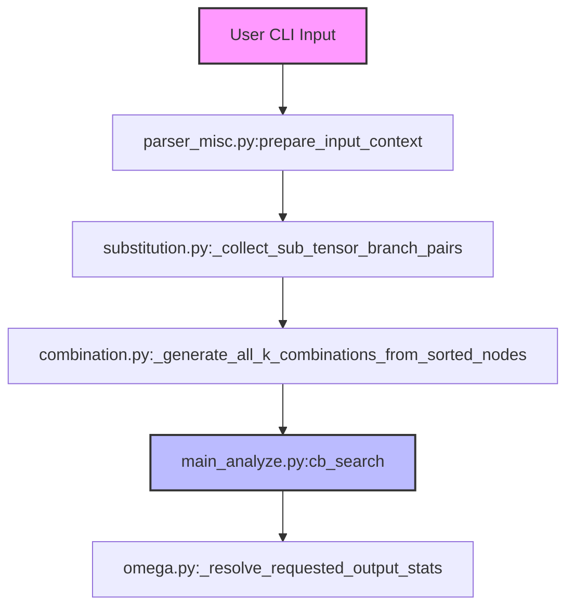
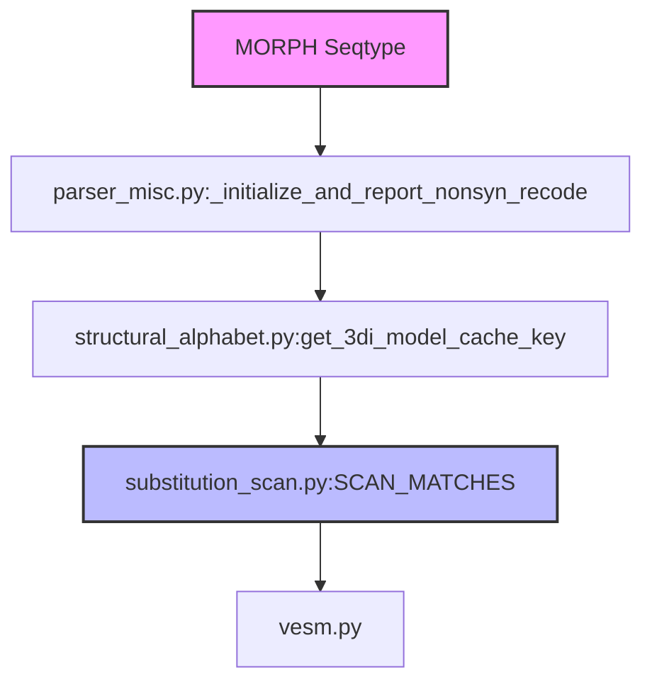

# Glossary

Relevant source files

The following files were used as context for generating this wiki page:

- [Makefile](Makefile)
- [csubst/cli.py](csubst/cli.py)
- [csubst/cli_io.py](csubst/cli_io.py)
- [csubst/combination.py](csubst/combination.py)
- [csubst/config_types.py](csubst/config_types.py)
- [csubst/foreground.py](csubst/foreground.py)
- [csubst/main_analyze.py](csubst/main_analyze.py)
- [csubst/main_benchmark.py](csubst/main_benchmark.py)
- [csubst/main_benchmark_plot.py](csubst/main_benchmark_plot.py)
- [csubst/main_download.py](csubst/main_download.py)
- [csubst/main_scan.py](csubst/main_scan.py)
- [csubst/main_sites.py](csubst/main_sites.py)
- [csubst/omega.py](csubst/omega.py)
- [csubst/output_run.py](csubst/output_run.py)
- [csubst/output_safety.py](csubst/output_safety.py)
- [csubst/param.py](csubst/param.py)
- [csubst/parser_iqtree.py](csubst/parser_iqtree.py)
- [csubst/parser_misc.py](csubst/parser_misc.py)
- [csubst/plotting.py](csubst/plotting.py)
- [csubst/recoding.py](csubst/recoding.py)
- [csubst/resource_cache.py](csubst/resource_cache.py)
- [csubst/structural_alphabet.py](csubst/structural_alphabet.py)
- [csubst/substitution.py](csubst/substitution.py)
- [csubst/substitution_scan.py](csubst/substitution_scan.py)
- [csubst/substitution_sparse.py](csubst/substitution_sparse.py)
- [csubst/substitution_sparse_cy.pyx](csubst/substitution_sparse_cy.pyx)
- [csubst/tree.py](csubst/tree.py)
- [csubst/vesm.py](csubst/vesm.py)
- [docs/ARCHITECTURE.md](docs/ARCHITECTURE.md)
- [docs/CLI_SAFETY.md](docs/CLI_SAFETY.md)
- [docs/ENDPOINT_POSTERIORS.md](docs/ENDPOINT_POSTERIORS.md)
- [docs/SCAN_INFERENCE.md](docs/SCAN_INFERENCE.md)
- [pyproject.toml](pyproject.toml)
- [tests/cli/test_cli_validation.py](tests/cli/test_cli_validation.py)
- [tests/cli/test_output_lifecycle.py](tests/cli/test_output_lifecycle.py)
- [tests/integration/test_main_benchmark.py](tests/integration/test_main_benchmark.py)
- [tests/integration/test_resource_cache.py](tests/integration/test_resource_cache.py)
- [tests/integration/test_scan_candidates_and_rates.py](tests/integration/test_scan_candidates_and_rates.py)
- [tests/integration/test_scan_ctmc.py](tests/integration/test_scan_ctmc.py)
- [tests/integration/test_scan_execution.py](tests/integration/test_scan_execution.py)
- [tests/unit/test_3di_state_cache.py](tests/unit/test_3di_state_cache.py)
- [tests/unit/test_main_download.py](tests/unit/test_main_download.py)
- [tests/unit/test_plotting.py](tests/unit/test_plotting.py)
- [tests/unit/test_structural_prediction.py](tests/unit/test_structural_prediction.py)
- [tests/unit/test_tree_core.py](tests/unit/test_tree_core.py)
- [tests/unit/test_vesm.py](tests/unit/test_vesm.py)

This page provides technical definitions and code pointers for key `csubst`-specific terms, mathematical concepts, architectural constructs, and subsystem options.

---

## 1. Combinatorial Analysis Terms

### Arity ($K$)
The number of branches evaluated simultaneously in a branch combination (`cb`). By default, `csubst analyze` iterates from $K = 2$ up to `--max_arity`.
* **Implementation:** Controlled by `--max_arity` in `[csubst/main_analyze.py:141-148]()` and generated via `[csubst/combination.py:59-84]()`.

### OCN / OCS (Observed Combinatorial Substitutions)
* **OCN:** Observed count of nonsynonymous combinatorial substitutions across a set of branches for a given site.
* **OCS:** Observed count of synonymous combinatorial substitutions across a set of branches for a given site.
* **Implementation:** Calculated dynamically via chunked streams in `[csubst/main_analyze.py:73-74]()` using substitution tensors in `[csubst/substitution.py]()`.

### omegaC ($\omega_C$)
The ratio of observed combinatorial substitutions to expected combinatorial substitutions, analogous to the conventional dN/dS ($\omega$) ratio but extended to combinations of $K$ branches.
* **Implementation:** Computed across statistics and null models in `[csubst/omega.py]()` and `[csubst/omega_statistics.py]()`.

### Foreground
A user-designated subset of lineages or clades marked by binary or multi-state phenotypic traits (`--foreground`). Used to constrain or prioritize branch combinations during search.
* **Implementation:** Parsed and managed in `[csubst/foreground.py]()` and filtered in `[csubst/main_analyze.py:129-130]()`.

### Event ID
A unique integer or bit-packed identifier used within sparse substitution tensors to represent specific state transitions from ancestral to descendant nodes at a given site.
* **Implementation:** Encoded and decoded in `[csubst/substitution_sparse.py]()`.

---

Diagram: Natural Language Space to Code Entity Space (Combinatorial Pipeline)

Sources: `[csubst/parser_misc.py:105-128]`, `[csubst/substitution.py:132-151]`, `[csubst/combination.py:59-84]`, `[csubst/main_analyze.py:140-163]`, `[csubst/omega.py:104-110]()`

---

## 2. Expectations, Calibration, and Storage

### ASRV (Amino Acid Substitution Rate Variation)
Site-specific rate variation modeling across codons or amino acids (`--asrv`). Modes include `each` (independent per site) or `sn` (structure-aware).
* **Implementation:** Validated and applied in `[csubst/asrv.py]()` and `[csubst/omega.py:162-166]()`.

### Urn Model
A non-parametric expectation method (`--expectation_method urn`) that models substitution sampling without relying on explicit codon rate matrices, using hypergeometric or Wallenius noncentral hypergeometric distributions.
* **Implementation:** Defined in `[csubst/urn_expectation.py]` and normalized in `[csubst/param.py:145-162]()`.

### dSC Calibration
Downstream calibration applied to $\omega$ or substitution rate matrices to correct for long-tail artifacts, rate heterogeneity, and finite-sample biases.
* **Implementation:** Implemented via `_calibrate_dsc_matrix` and `_calibrate_dsc_vector` in `[csubst/omega_statistics.py]` and imported in `[csubst/omega.py:30-31]()`.

### Packed CSR
A memory-efficient compressed sparse row (CSR) data structure optimized for sparse substitution tensors, minimizing memory overhead when projecting high-dimensional branch-site tensors.
* **Implementation:** Designed and implemented in `[csubst/substitution_sparse.py]` and accelerated by `[csubst/substitution_sparse_cy.pyx]()`.

---
Sources: `[csubst/asrv.py]()`, `[csubst/urn_expectation.py]()`, `[csubst/param.py:145-162]`, `[csubst/omega_statistics.py]()`, `[csubst/omega.py:30-31]`, `[csubst/substitution_sparse.py]()`

---

## 3. Structural Alphabets and Scoring

### 3Di
A 20-letter structural alphabet representing local protein backbone conformations, used for predicting structural states from amino acid sequences or structural models.
* **Implementation:** Processed via `[csubst/structural_alphabet.py]` and integrated in `[csubst/parser_misc.py:36-78]()`.

### MORPH
A specialized sequence type (`--seqtype MORPH`) indicating that input alignments consist of 3Di structural state sequences rather than standard nucleotide or amino acid codons.
* **Implementation:** Handled during IQ-TREE output parsing in `[csubst/parser_iqtree.py]` and initialization in `[csubst/parser_misc.py:70]()`.

### VESM (Variant Effect Scoring Model)
Deep-learning-based log-likelihood ratio (LLR) scoring models (such as VESM-35M) used to evaluate the functional or structural impact of amino acid variants on protein sequences.
* **Implementation:** Implemented in `[csubst/vesm.py]` and managed via `[csubst/variant_effect.py]()`.

---

Diagram: Natural Language Space to Code Entity Space (Structural & Scan Subsystem)

Sources: `[csubst/parser_misc.py:33-78]`, `[csubst/structural_alphabet.py]()`, `[csubst/substitution_scan.py:72-90]`, `[csubst/vesm.py]()`

---

## 4. Substitution Scan Subsystem

### Scan Match
The specific category of state transition tracked during a substitution scan (`--scan_match`), such as `any2any`, `spe2spe`, or `dif2dif`.
* **Implementation:** Defined as tuples in `[csubst/substitution_scan.py:72-82]()`.

### Rate Exposure
The denominator or normalization factor used when calculating substitution rates in scans (`--scan_rate_exposure`), accounting for branch lengths, expected mutations, or state availability.
* **Implementation:** Enumerated in `[csubst/substitution_scan.py:85]` and computed across lineages in `[csubst/substitution_scan.py]` and `[csubst/scan_endpoint.py]()`.

### Parity Lane
A strict validation and testing taxonomy (`tests/parity/`) designed to guarantee numerical and behavioral consistency across pure-Python, Cython-accelerated, and alternative execution backends.
* **Implementation:** Verified via continuous integration test suites in `[tests/parity/]()`.

---
Sources: `[csubst/substitution_scan.py:72-90]`, `[csubst/scan_endpoint.py]()`