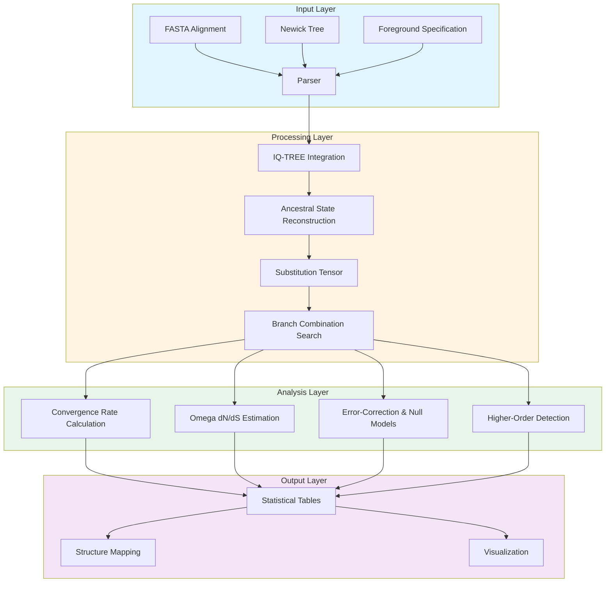

CSUBST (/si:sʌbst/) is a sophisticated computational toolkit designed for analyzing **C**ombinatorial **SUBST**itutions in codon sequences across phylogenetic trees. At its core, csubst addresses a fundamental question in molecular evolution: how do protein-coding sequences evolve independently across different lineages to arrive at similar amino acid states? This tool enables researchers to detect, quantify, and visualize molecular convergence—the phenomenon where unrelated species evolve similar traits or genetic changes in response to similar selective pressures.


A combinatorial substitution is defined as recurrent substitutions that occur at the same protein site across multiple independent branches of a phylogenetic tree. When multiple substitutions result in the same amino acid, csubst identifies them as convergent amino acid substitutions—a powerful signal of adaptive evolution or functional constraint operating across distantly related species.

Sources: [README.md](README.md#L1-L13), [setup.py](setup.py#L1-L47)

## Key Features

CSUBST provides a comprehensive suite of analytical capabilities that distinguish it from other molecular evolution tools. The toolkit's architecture is built around four foundational pillars:

**Error-Corrected Convergence Detection**: csubst computes error-corrected rates of protein convergence using null expectations derived from empirical or mechanistic codon substitution models. An experimental approach employs urn sampling from site-wise substitution frequencies to establish robust baseline expectations, helping distinguish true convergent signals from stochastic processes.

**Flexible Foreground Lineage Specification**: Users can define "foreground" lineages—branches of particular interest for convergence analysis—through flexible pattern matching. The toolkit enables comparison between foreground lineages and their neighboring branches, facilitating tests of whether convergent evolution is enriched in specific evolutionary contexts.

**Higher-Order Convergence Detection**: Beyond pairwise comparisons, csubst implements heuristic algorithms to detect higher-order convergence involving more than two branches simultaneously. This capability is crucial for understanding complex evolutionary scenarios where similar amino acid changes occur across multiple independent lineages.

**Integrated Structural Mapping**: Convergent substitutions can be mapped onto three-dimensional protein structures, enabling researchers to explore the spatial distribution of convergent changes and investigate whether they cluster in functional domains or active sites.

Sources: [README.md](README.md#L6-L16), [csubst](csubst#L1-L349), [main_site.py](csubst/main_site.py#L1-L720)

## Architecture Overview

The csubst toolkit follows a modular design pattern that separates input processing, statistical computation, and visualization into distinct functional components. This architecture enables efficient parallel processing and flexible workflow customization for different analytical scenarios.



The processing pipeline begins with parsing input files, followed by ancestral state reconstruction using IQ-TREE. CSUBST then constructs multi-dimensional substitution tensors that encode all observed and inferred changes across the tree. These tensors serve as the foundation for branch combination searches, statistical hypothesis testing, and ultimately the identification of significant convergent evolution patterns.

Sources: [main_analyze.py](csubst/main_analyze.py#L20-L288), [substitution.py](csubst/substitution.py#L12-L369), [combination.py](csubst/combination.py#L13-L331)

## Command-Line Interface

CSUBST operates through four primary subcommands, each designed for specific analytical tasks. The toolkit's CLI is built using Python's argparse framework, providing consistent argument handling and comprehensive help documentation.


| Subcommand | Purpose | Key Inputs | Primary Outputs |
|------------|---------|------------|-----------------|
| `csubst dataset` | Generates test datasets for learning and validation | Dataset name (PGK/PEPC) | Sample alignment, tree, foreground file |
| `csubst analyze` | Core convergence analysis and statistical testing | Alignment, tree, foreground file | Branch combinations, convergence rates, ω<sub>C</sub> |
| `csubst simulate` | Generates synthetic datasets under convergent scenarios | Alignment, tree, evolutionary parameters | Simulated alignments for validation |
| `csubst site` | Site-wise analysis and structural mapping | Alignment, tree, branch IDs | Per-site substitution patterns, structure files |

The `analyze` subcommand is the heart of csubst, performing the full analytical workflow from ancestral state reconstruction through statistical testing. Users can customize the analysis through numerous parameters controlling codon models, branch selection criteria, and statistical thresholds. The `site` command extends this analysis by providing detailed per-site information and generating files for visualization in molecular graphics programs like PyMOL or Chimera.

Sources: [csubst](csubst#L1-L349), [main_dataset.py](csubst/main_dataset.py#L1-L13), [README.md](README.md#L38-L68)

## Core Components

The csubst implementation leverages several key Python modules that work together to deliver comprehensive convergence analysis capabilities.

**Combination Analysis** ([combination.py](csubst/combination.py#L1-L331)): This module implements the core algorithms for identifying and evaluating branch combinations. It includes functions for enumerating node combinations, calculating substitution patterns across branches, and managing dependency relationships between foreground lineages. The module supports both exhaustive searches of all possible combinations and efficient sampling strategies for large trees.

**Substitution Processing** ([substitution.py](csubst/substitution.py#L1-L369)): Handles the construction and manipulation of substitution tensors—multi-dimensional arrays that encode substitution events across branches, sites, and codon states. The module includes optimized Cython implementations ([substitution_cy.pyx](csubst/substitution_cy.pyx)) for performance-critical operations, enabling analysis of large phylogenomic datasets.

**Omega Calculation** ([omega.py](csubst/omega.py#L1-L362)): Implements the computation of ω (dN/dS) values for branch combinations, distinguishing between convergent (ω<sub>C</sub>) and non-convergent evolution. The module provides error-corrected estimates and supports various statistical transformations for hypothesis testing.

**Foreground Management** ([foreground.py](csubst/foreground.py#L1-L582)): Manages the specification and analysis of foreground lineages, including flexible pattern matching, randomization procedures for statistical testing, and clade permutation methods. This module enables researchers to test whether convergence is enriched in specific evolutionary contexts.

**Tree Operations** ([tree.py](csubst/tree.py#L1-L379)): Provides utilities for tree manipulation, including branch length rescaling, node distance calculations, and visualization support. The module integrates with the ETE3 toolkit for advanced tree visualization capabilities.

Sources: [combination.py](csubst/combination.py#L1-L331), [substitution.py](csubst/substitution.py#L1-L369), [omega.py](csubst/omega.py#L1-L362), [foreground.py](csubst/foreground.py#L1-L582), [tree.py](csubst/tree.py#L1-L379)

## Project Structure

The csubst codebase is organized into logical modules that separate concerns and enable efficient development and maintenance. The project includes both Python source files and Cython extensions for performance optimization.

```
csubst/
├── Core Analysis Modules
│   ├── main_analyze.py      # Primary analysis workflow
│   ├── main_simulate.py     # Simulation framework
│   ├── main_site.py         # Site-wise analysis and mapping
│   ├── main_dataset.py      # Dataset generation utilities
│
├── Statistical Engines
│   ├── combination.py       # Branch combination algorithms
│   ├── substitution.py       # Substitution tensor operations
│   ├── omega.py             # dN/dS calculations
│   └── foreground.py        # Foreground lineage management
│
├── Performance Optimization
│   ├── combination_cy.pyx   # Cython acceleration for combinations
│   ├── substitution_cy.pyx  # Cython acceleration for substitutions
│   ├── omega_cy.pyx         # Cython acceleration for omega
│   └── parallel.py          # Parallel processing utilities
│
├── Input/Output Handling
│   ├── parser_iqtree.py     # IQ-TREE output parsing
│   ├── parser_pymol.py      # PyMOL integration
│   ├── parser_biodb.py      # Bio-database parsing
│   ├── tree.py              # Tree operations
│   ├── sequence.py          # Sequence utilities
│   └── genetic_code.py      # Genetic code tables
│
├── Data Resources
│   ├── dataset/             # Example datasets (PGK, PEPC)
│   └── substitution_matrix/ # ECM codon substitution matrices
│
└── Supporting Utilities
    ├── param.py             # Parameter management
    ├── table.py             # Table operations
    ├── utility.py           # General utilities
    └── __init__.py          # Package initialization
```

The modular structure enables users to extend csubst functionality by adding new analysis modules or modifying existing components. Performance-critical operations are implemented in Cython to provide near-C speed while maintaining Python's ease of use.

Sources: [setup.py](setup.py#L1-L47), [get_repo_structure](csubst/)

## Getting Started

For developers and researchers new to csubst, the recommended learning path begins with understanding the core concepts and progressively building expertise through hands-on experimentation.

1. **Installation**: Begin with the [Installation](3-installation) guide to set up csubst on your system. The toolkit is available through both conda and pip, with conda recommended for ease of dependency management.

2. **Quick Start**: Follow the [Quick Start](2-quick-start) tutorial to run your first analysis using the included PGK dataset. This provides immediate hands-on experience with the complete workflow.

3. **Basic Usage**: Explore the [Basic Usage](4-basic-usage) guide to understand the essential parameters and workflow for typical convergence analyses.

4. **Core Concepts**: Dive deeper into the theoretical foundations through [Combinatorial Substitutions](5-combinatorial-substitutions), [Foreground Lineages](6-foreground-lineages), and [Codon Substitution Models](7-codon-substitution-models) to understand the statistical and evolutionary principles underlying the analysis.

> [!TIP]
> Start with the `csubst dataset --name PGK` command to generate a small test dataset, then run `csubst analyze` to see the complete workflow in action. This provides immediate feedback and helps validate your installation before moving to your own data.

CSUBST has been applied in published research to detect macroevolutionary genotype-phenotype associations, demonstrating its utility for understanding convergent evolution at the molecular level. The toolkit's error-corrected approach helps distinguish true adaptive convergence from random similarity, providing researchers with confidence in their evolutionary interpretations.

Sources: [README.md](README.md#L71-L83), [main_dataset.py](csubst/main_dataset.py#L1-L13), [setup.py](setup.py#L1-L47)

## Next Steps

Now that you understand the scope and capabilities of csubst, continue your journey through the documentation to build practical expertise:

- **[Quick Start](2-quick-start)**: Run your first analysis in under 5 minutes using built-in test datasets
- **[Installation](3-installation)**: Detailed installation instructions for various computing environments
- **[Basic Usage](4-basic-usage)**: Learn the essential parameters and workflow for convergence analysis
- **[Combinatorial Substitutions](5-combinatorial-substitutions)**: Understand the theoretical foundation of the method

Each subsequent page builds upon this overview, providing detailed explanations, practical examples, and advanced techniques for molecular convergence analysis.