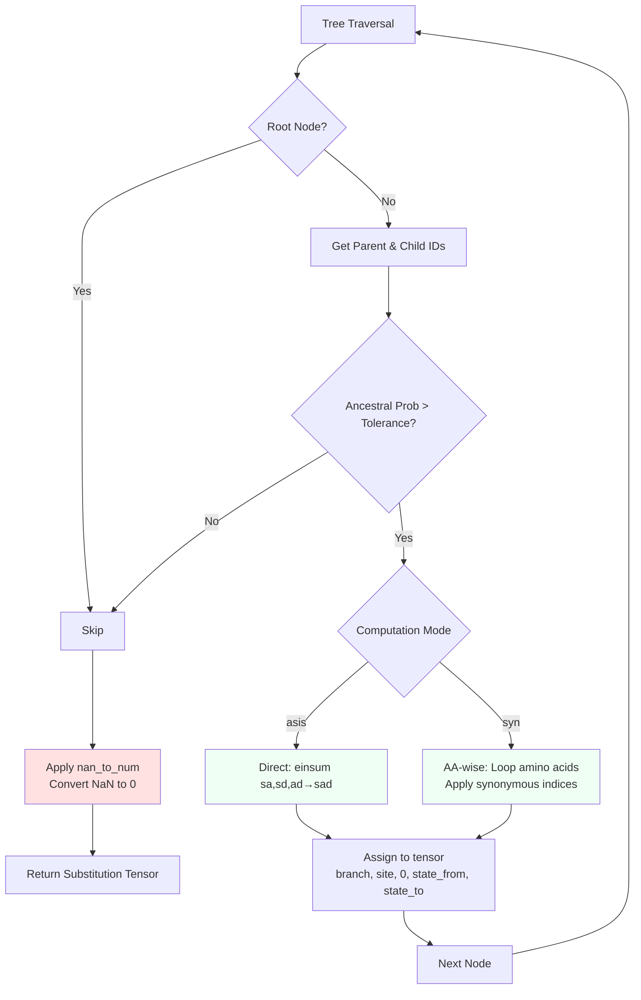
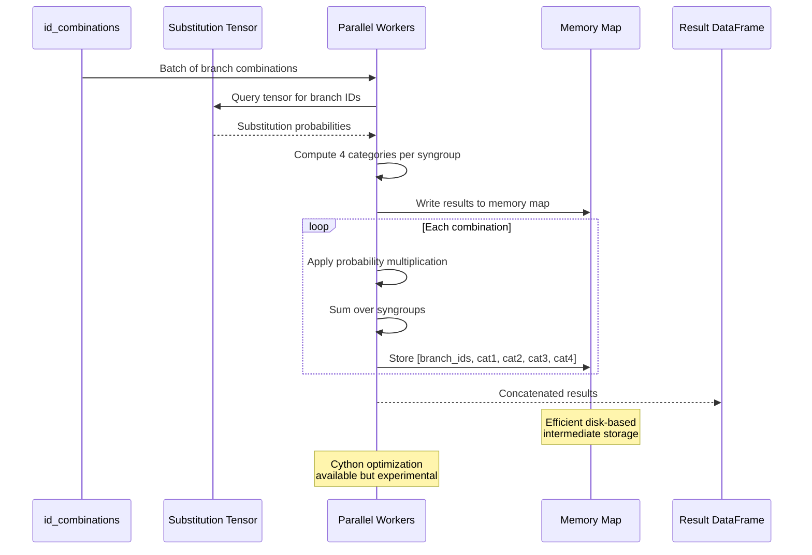
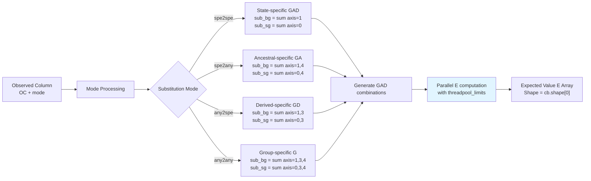
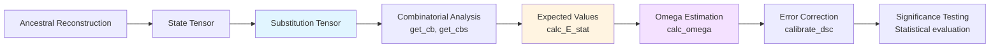

The substitution tensor represents the foundational data structure for analyzing convergent molecular evolution across phylogenetic branches. This 5-dimensional tensor encodes probabilistic substitution information that enables detection of statistically significant branch combinations and convergent evolutionary patterns. The tensor computation pipeline transforms ancestral state reconstructions into a mathematically rigorous framework for quantifying convergence likelihood.

Sources: [substitution.py](csubst/substitution.py#L12-L63)

## Tensor Architecture and Structure

The substitution tensor follows a precise dimensional architecture designed to capture substitution probabilities across multiple analytical dimensions:

```mermaid
graph TB
    A[State Tensor Input<br/>branch × site × state] --> B{Computation Mode}
    B -->|asis| C[Direct Mode<br/>num_syngroup = 1]
    B -->|syn| D[Synonymous Mode<br/>num_syngroup = |AA orders|]
    C --> E[Substitution Tensor<br/>branch × site × 1 × state × state]
    D --> F[Substitution Tensor<br/>branch × site × num_syngroup × max_syn × max_syn]
    E --> G[Memory-Mapped Storage<br/>tmp.csubst.sub_tensor.*.mmap]
    F --> G
    
    style G fill:#e1f5ff
    style E fill:#fff4e1
    style F fill:#fff4e1
```

The tensor axes are organized as `[branch, site, syngroup, state_from, state_to]`, where each dimension serves a specific analytical purpose. The initialization process creates memory-mapped tensor files that support both 'asis' mode (direct state-to-state transitions) and 'syn' mode (synonymous codon grouping), with the latter grouping codons by amino acid identity for more biologically relevant analyses. The memory-mapped approach enables efficient handling of large-scale phylogenomic datasets by leveraging disk-based storage with numpy-like access patterns.

Sources: [substitution.py](csubst/substitution.py#L12-L27)

## Tensor Construction and State Propagation

The core tensor construction algorithm propagates probabilistic state information through the phylogenetic tree using Einstein summation operations. For each non-root node, the algorithm computes substitution matrices by combining ancestral state probabilities from the parent node with descendant state probabilities from the child node:



In 'asis' mode, the computation uses `numpy.einsum("sa,sd,ad→sad", parent_states, child_states, diag_zero)` where `s=site`, `a=ancestral`, and `d=derived`. The diagonal zero matrix prevents self-transitions from contributing to substitution counts. In 'syn' mode, the algorithm iterates through amino acid groups, applying the same operation to synonymous codon subsets, effectively partitioning the substitution space by amino acid identity. The final step applies `numpy.nan_to_num()` to convert any remaining NaN values to zero, ensuring numerical stability for subsequent combinatorial calculations.

Sources: [substitution.py](csubst/substitution.py#L31-L63)

## Four-Category Substitution Classification

The tensor computation framework classifies substitutions into four distinct categories based on ancestral and derived state specificity. This categorization enables nuanced detection of convergence patterns ranging from exact state matches to broader functional changes:

| Category | Substitution Pattern | Mathematical Operation | Interpretation |
|----------|---------------------|-------------------------|----------------|
| **any2any** | Any ancestral → Any derived | `tensor.sum(axis=(2,3)).prod(axis=0).sum(axis=0)` | Total convergence regardless of specific states |
| **spe2any** | Specific ancestral → Any derived | `tensor.sum(axis=3).prod(axis=0).sum(axis=1).sum(axis=0)` | Convergence from specific ancestral states |
| **any2spe** | Any ancestral → Specific derived | `tensor.sum(axis=2).prod(axis=0).sum(axis=1).sum(axis=0)` | Convergence to specific derived states |
| **spe2spe** | Specific ancestral → Specific derived | `tensor.prod(axis=0).sum(axis=(1,2)).sum(axis=0)` | Exact state matches between branches |

These categories are computed through systematic reduction operations across the tensor dimensions. The `.prod(axis=0)` operation multiplies probabilities across branches in a combination, representing the likelihood of independent substitutions occurring on multiple branches simultaneously. The subsequent `.sum()` operations aggregate over sites or state dimensions depending on the category requirements. This mathematical framework enables detection of convergence at varying levels of stringency, from broad functional convergence (any2any) to precise molecular convergence (spe2spe).

Sources: [substitution.py](csubst/substitution.py#L118-L147)

## Combinatorial Branch Analysis

The detection of convergent evolution requires analyzing all possible branch combinations across the phylogenetic tree. The combinatorial computation engine processes branch pairs (or higher arity combinations) through parallelized tensor operations:



The combinatorial computation function `sub_tensor2cb()` accepts arrays of branch combinations and returns a DataFrame containing branch identifiers and the four substitution category counts. For large datasets, the system employs memory-mapped temporary files (`tmp.csubst.cb.out.mmap`) to enable efficient parallel processing without RAM exhaustion. The parallel implementation uses `joblib.Parallel` with the 'multiprocessing' backend, splitting the branch combination space into chunks processed by independent workers. Each worker computes the product of substitution probabilities across branches, effectively modeling the likelihood of independent substitutions occurring on multiple lineages.

> [!TIP]
> The `.prod(axis=0)` operation mathematically represents the assumption of independence between substitutions on different branches, which is critical for calculating expected convergence probabilities under null evolutionary models.

Sources: [substitution.py](csubst/substitution.py#L147-L207), [substitution_cy.pyx](csubst/substitution_cy.pyx#L1-L35)

## Site-Wise Combinatorial Analysis

Beyond aggregate branch combinations, the framework supports site-wise combinatorial analysis through `sub_tensor2cbs()`, which expands the analysis to include site dimensionality:

```mermaid
block-beta
    columns 5
    
    block: "Input"
        columns 1
        id_comb
        sub_tensor
    end
    
    space 1
    
    block: "Computation"
        columns 2
        iterate["Iterate combinations"]
        site_loop["Loop sites"]
        cat_calc["Calculate 4 categories"]
        prob_mult["Multiply probabilities"]
    end
    
    space 1
    
    block: "Output"
        columns 2
        df["DataFrame: <br/>branch_id_1, branch_id_2, site,<br/>OCany2any, OCspe2any, OCany2spe, OCspe2spe"]
        shape["Shape: <br/>(combinations × sites, arity + 5)"]
    end
    
    id_comb --> iterate
    sub_tensor --> cat_calc
    iterate --> site_loop
    site_loop --> cat_calc
    cat_calc --> prob_mult
    prob_mult --> df
```

The site-wise function generates output arrays with shape `(combinations × sites, arity + 5)`, where `arity` represents the number of branches in each combination. The additional columns include the site index and the four substitution category observations (OC) for that site-branch combination. This granular analysis enables detection of site-specific convergence patterns, allowing researchers to identify specific amino acid positions exhibiting convergent evolution across foreground lineages. The parallel implementation for site-wise analysis follows the same memory-mapped pattern, creating `tmp.csubst.cbs.out.mmap` for intermediate storage and enabling efficient processing of large phylogenomic datasets.

Sources: [substitution.py](csubst/substitution.py#L209-L270)

## Statistical Expected Value Computation

The framework computes statistical expectations for convergence under null evolutionary models, enabling significance testing of observed convergence patterns. The `calc_E_stat()` function in the omega module generates expected values (E) for each branch combination:



The expected value computation aggregates substitution tensors across appropriate dimensions based on the substitution mode. For 'spe2spe' mode, the system maintains state-specific information (G = syngroup, A = ancestral, D = derived), resulting in the most granular expectations. For broader modes like 'any2any', the aggregation reduces dimensionality, generating expectations based purely on syngroup information. The computation leverages site-wise substitution counts (`sub_sites`) and branch-wise substitution counts (`sub_branches`) derived from pre-aggregated tensors, enabling efficient parallel calculation of expected convergence probabilities across all branch combinations.

> [!TIP]
> The `threadpool_limits(limits=1, user_api='blas')` constraint prevents thread oversubscription when using joblib multiprocessing with numpy BLAS operations, ensuring optimal performance and numerical consistency across parallel workers.

Sources: [omega.py](csubst/omega.py#L104-L166)

## Branch and Site Substitution Summary

The framework provides summarization functions to extract branch-wise and site-wise substitution counts from the tensor structure:

- **Branch Substitutions (`get_b()`)**: Aggregates total substitutions per branch across all sites, states, and syngroups. Optionally provides sitewise details with minimum probability thresholds to filter low-confidence ancestral reconstructions. The function returns branch identifiers, names, and total substitution counts for both synonymous (S) and nonsynonymous (N) categories.

- **Site Substitutions (`get_s()`)**: Computes total substitutions per site across all branches and state dimensions. This function sums over the branch axis, producing per-site substitution totals that identify sites with elevated substitution activity across the tree.

These summary functions support downstream analyses including hotspot identification, rate variation estimation, and structural mapping of substitution patterns. The branch-wise summaries integrate with omega calculations, while site-wise summaries facilitate targeted investigation of functionally important positions.

Sources: [substitution.py](csubst/substitution.py#L73-L116)

## Integration with Convergence Analysis Pipeline

The substitution tensor serves as the computational foundation for the broader convergence detection framework. After tensor construction and combinatorial analysis, the results flow into statistical testing modules:



The tensor outputs feed directly into omega (dN/dS) estimation through the `calc_omega()` function, which integrates expected value computations with observed convergence counts. The pipeline applies error correction transformations (quantile-based calibration) to account for multiple testing and improve statistical power. The final output enables ranking of branch combinations by convergence significance, identifying foreground lineages exhibiting molecular convergence beyond null expectations.

This computational architecture supports both hypothesis-driven analysis (testing specific branch combinations) and exploratory analysis (genome-wide search for convergence), making it adaptable to diverse evolutionary biology research questions.
