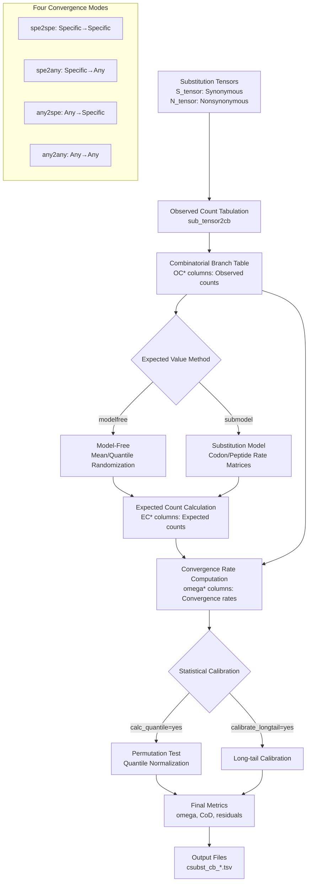

Convergence rate calculation in csubst quantifies the statistical significance of combinatorial substitution patterns across multiple phylogenetic branches. The system contrasts observed combinatorial substitution counts against expected null model distributions to detect evolutionary convergence beyond random expectation, producing omega (dN/dS) values and the Coefficient of Divergence (CoD) metrics for each branch combination.

## Architectural Overview

The convergence rate calculation pipeline transforms substitution tensors into statistical metrics through a four-stage process: (1) **Observed Count Tabulation** extracts combinatorial substitution patterns from substitution tensors, (2) **Expected Value Calculation** computes null expectations using either model-free randomization or codon substitution model expectations, (3) **Convergence Rate Computation** calculates omega ratios between observed and expected values, and (4) **Statistical Calibration** applies permutation-based quantile normalization when requested.



The architecture operates on **five-dimensional substitution tensors** with dimensions [branch, site, matrix_group, ancestral_state, derived_state] containing either boolean substitution indicators or posterior probabilities from ancestral state reconstruction. These tensors are reduced into combinatorial branch tables containing substitution counts for each branch combination, with separate processing for synonymous (S) and nonsynonymous (N) substitutions across four convergence modes.

## Observed Count Computation

The observed count tabulation converts raw substitution tensors into structured combinatorial branch tables through `sub_tensor2cb()` in [csubst/substitution.py](csubst/substitution.py#L147-L180). For each branch combination (K branches), this function computes four fundamental substitution categories by aggregating across matrix groups and sites with tensor operations that respect phylogenetic independence.

The four substitution categories follow a systematic naming convention reflecting ancestral and derived state specificity: **any2any** (all substitutions), **spe2any** (specific-to-any, foreground substitutions on any branch), **any2spe** (any-to-specific, background substitutions on specific branches), and **spe2spe** (specific-to-specific, foreground substitutions on specific branches). These categories are computed through tensor summation operations that multiply probabilities across branches (`.prod(axis=0)`) before summing over state dimensions.

For example, the spe2spe calculation computes the product of substitution probabilities across all K branches, then sums over all ancestral and derived state pairs: `sub_tensor[id_combinations[j,:], :, sg, :, :].prod(axis=0).sum(axis=(1, 2)).sum(axis=0)`. This operation ensures that only sites where all branches in the combination exhibit the same specific substitution pattern contribute to the count.

The resulting table contains columns prefixed with **OCS** (Observed Count Synonymous) and **OCN** (Observed Count Nonsynonymous), followed by the substitution pattern (e.g., `OCSspe2spe`, `OCNany2spe`). The table also includes `branch_id_*` columns identifying which branches comprise each combination, enabling downstream filtering by foreground membership.

Sources: [csubst/substitution.py](csubst/substitution.py#L147-L180), [csubst/substitution.py](csubst/substitution.py#L178-L210), [csubst/main_analyze.py](csubst/main_analyze.py#L99-L106)

## Expected Value Calculation Methods

csubst implements two fundamentally different approaches for calculating expected substitution counts under the null hypothesis of independent evolution. The method selection occurs through the `--omegaC_method` parameter with options **modelfree** (default) and **submodel**, each producing expected count columns prefixed with **ECS** (Expected Count Synonymous) and **ECN** (Expected Count Nonsynonymous).

### Model-Free Method (modelfree)

The model-free approach calculates expected values directly from observed substitution patterns without assuming an explicit codon substitution model. This method operates by aggregating substitution tensors across specific dimensions to create branch-wise and site-wise substitution distributions, then combining these distributions combinatorially.

The `calc_E_stat()` function in [csubst/omega.py](csubst/omega.py#L104-L165) implements this approach with two statistical modes: **mean** (default) and **quantile** (when `--calc_quantile yes`). For each of the four convergence modes (spe2spe, spe2any, any2spe, any2any), the function aggregates the substitution tensor differently:

- **spe2spe**: `sub_bg = sub_tensor.sum(axis=1)` collapses across sites to get branch-wise state-to-state substitution counts; `sub_sg = sub_tensor.sum(axis=0)` collapses across branches to get site-wise state-to-state substitution counts
- **spe2any**: Summation over derived states to get ancestral-to-any substitution distributions
- **any2spe**: Summation over ancestral states to get any-to-derived substitution distributions  
- **any2any**: Summation over both ancestral and derived states to get total substitution counts

The expected value calculation iterates through all non-empty combinations of matrix_group, ancestral_state, and derived_state (identified via `g[SN+'_ind_nomissing_gad']` where SN is 'S' or 'N'). For each combination, the function combines branch-wise and site-wise substitution probabilities:

```python
E_b = numpy.zeros_like(cb.index, dtype=g['float_type'])
for i, sg, a, d in list_igad:
    sub_sites = g['sub_sites'][g['asrv']]  # Site substitution probabilities
    sub_branches = substitution.get_sub_branches(sub_bg, mode, sg, a, d)  # Branch substitution counts
    for bid in branch_ids:
        E_b[is_branch] += sub_sites[bid,:] * sub_branches[bid]
```

> [!TIP]
> The model-free method's flexibility comes from the `--asrv` parameter (Among-Site Rate Variation), which controls how site substitution probabilities are calculated: 'no' uses uniform rates, 'pool' uses total substitution counts per site, 'file' uses external rate files (IQ-TREE), 'sn' uses separate rates for synonymous/nonsynonymous, and 'each' uses site-specific rates for each matrix group.

Parallel processing via joblib distributes computation across thread workers when `--threads > 1`, with memory-mapped arrays used for efficient data sharing between processes.

Sources: [csubst/omega.py](csubst/omega.py#L104-L165), [csubst/omega.py](csubst/omega.py#L22-L46), [csubst/substitution.py](csubst/substitution.py#L274-L310)

### Permutation-Based Quantile Calculation

When `--calc_quantile yes` is specified, the model-free method supplements mean expectations with **quantile-based expectations** computed through Monte Carlo permutation tests. This approach generates a null distribution for each branch combination by randomly permuting substitution sites according to the site-specific substitution probability distribution.

The `joblib_calc_quantile()` function in [csubst/omega.py](csubst/omega.py#L76-L103) calls `omega_cy.get_permutations()` implemented in [csubst/omega_cy.pyx](csubst/omega_cy.pyx#L1-L44), which performs Cython-optimized random sampling:

```python
# For each branch with k substitutions:
for j in range(niter):
    site_indices = numpy.random.choice(a=sites, size=k, replace=False, p=p)
    ps[i,j,site_indices] = True  # Mark randomly selected sites
# Calculate intersection across branches for each permutation:
num_shared_sub = sub_bool_array.sum(axis=1)
```

This creates a 3D boolean array `ps[branch, permutation, site]` where each permutation randomly selects sites for substitution based on the probability distribution `p`. The intersection across all branches in the combination is computed via logical AND operations (`sub_bool_array *= ps[branch]`), yielding the number of shared substitutions per permutation.

After generating `quantile_niter` permutations (default 1000), the expected value is calculated as the rank position of the observed value within this null distribution:

```python
obs_value = cb.loc[i, obs_col]
gt_rank = (dfq[i,:] < obs_value).sum()
ge_rank = (dfq[i,:] <= obs_value).sum()
corrected_rank = (gt_rank + ge_rank) / 2
E_b[i] = corrected_rank / quantile_niter
```

This quantile approach is robust to distributional assumptions and provides a direct measure of statistical significance: a quantile value of 0.95 indicates that the observed convergence rate exceeds 95% of random expectations.

Sources: [csubst/omega.py](csubst/omega.py#L76-L103), [csubst/omega_cy.pyx](csubst/omega_cy.pyx#L1-L44)

### Substitution Model Method (submodel)

The substitution model method calculates expected values by simulating substitutions under explicit codon and amino acid substitution models, providing theoretically grounded expectations based on branch lengths and rate heterogeneity. This approach requires pre-computed instantaneous rate matrices from the codon substitution model.

The `get_exp_state()` function in [csubst/omega.py](csubst/omega.py#L224-L260) calculates expected states at each node by applying the substitution process along each branch using matrix exponentiation:

```python
for node in g['tree'].traverse():
    if node.is_root():
        continue
    branch_length = max(node.SNdist, 0)  # Synonymous branch length
    inst_bl = inst * branch_length  # Rate matrix scaled by branch length
    for site_rate in site_rates:
        transition_prob = expm(inst_bl * site_rate)  # Matrix exponential
        expected_derived_state = numpy.einsum('a,ad->ad', 
                                             state[parent,s,:], 
                                             transition_prob)
        stateE[node,s,:] = expected_derived_state.sum(axis=0)
```

The function computes separate expected state tensors for codons (`g['state_cdnE']`) and peptides (`g['state_pepE']`), accounting for site-specific rate variation from IQ-TREE (`g['iqtree_rate_values']`). The matrix exponential `expm()` provides exact transition probabilities for continuous-time Markov models, validated against the Huelsenbeck (2012) teaching example.

These expected state tensors are then converted to expected substitution tensors via `substitution.get_substitution_tensor()` using mode='syn' for synonymous and mode='asis' (as-is) for nonsynonymous substitutions. Finally, `substitution.get_cb()` converts these tensors into expected count tables with EC* prefix columns.

Sources: [csubst/omega.py](csubst/omega.py#L224-L260), [csubst/omega.py](csubst/omega.py#L185-L220)

## Differential Statistics

Both observed and expected counts undergo further decomposition to distinguish foreground-specific from background-independent substitutions. The `add_dif_stats()` function in [csubst/substitution.py](csubst/substitution.py#L357-L369) calculates **differential** (dif) categories representing substitutions not specific to foreground branches:

```python
for SN in ['S', 'N']:
    for anc in ['any', 'spe']:
        col_dif = prefix + SN + anc + '2dif'
        col_any = prefix + SN + anc + '2any'
        col_spe = prefix + SN + anc + '2spe'
        cb.loc[:, col_dif] = cb[col_any] - cb[col_spe]
```

This creates columns like `OCSany2dif = OCSany2any - OCSany2spe` and `OCSspe2dif = OCSspe2any - OCSspe2spe`, representing substitutions that occur on at least one branch in the combination but not specifically on foreground branches. Similarly, `dif2any` and `dif2spe` categories capture substitutions from differential backgrounds.

Negative values (within floating-point tolerance `g['float_tol']`) are set to NaN to indicate impossibility, while values within tolerance of zero are set to exactly zero to avoid numerical artifacts.

Sources: [csubst/substitution.py](csubst/substitution.py#L348-L369)

## Convergence Rate (Omega) Computation

The convergence rate calculation transforms observed and expected counts into omega (ω) ratios representing the excess or deficit of combinatorial substitutions relative to null expectations. The `get_omega()` function in [csubst/omega.py](csubst/omega.py#L263-L287) implements this transformation for all combinations of observed (OC) and expected (EC) count columns:

```python
for obs_col, exp_col in itertools.product(oc_cols, ec_cols):
    omega_col = 'omegaC' + obs_col[2:]  # e.g., 'omegaCspe2spe'
    cb.loc[:, omega_col] = cb[obs_col] / cb[exp_col]
```

This generates columns like `omegaCspe2spe = OCSspe2spe / ECSspe2spe` and `omegaCany2spe = OCNany2spe / ECNany2spe`, representing the convergence rate for each substitution category. The omega metric is directly analogous to dN/dS in molecular evolution but computed on combinatorial substitution patterns rather than per-site rates.

Values greater than 1.0 indicate **positive convergence** (more substitutions than expected), values equal to 1.0 indicate **neutral evolution** (substitutions matching expectations), and values less than 1.0 indicate **negative selection or divergence** (fewer substitutions than expected). Extremely high values (>10) may indicate strong positive selection for convergent evolution.

> [!TIP]
> When quantile-based expectations are used, omega values represent statistical significance directly: an omega of 0.95 with quantile expectations means the observed convergence rate exceeds 95% of random expectations, regardless of the absolute magnitude of substitution counts.

Sources: [csubst/omega.py](csubst/omega.py#L263-L287)

## Coefficient of Divergence (CoD)

The Coefficient of Divergence provides an alternative measure of convergence by comparing specific-to-specific substitution patterns against any-to-differential patterns, distinguishing convergence from background divergence. The `get_CoD()` function in [csubst/omega.py](csubst/omega.py#L288-L297) calculates CoD for both synonymous and nonsynonymous substitutions:

```python
cb.loc[:, 'OCSany2spe'] = cb['OCSany2spe']
cb.loc[:, 'OCSany2dif'] = cb['OCSany2dif']
cb.loc[:, 'OCNCoD'] = cb['OCNany2spe'] / cb['OCNany2dif']
```

The CoD formula `CoD = any2spe / any2dif` represents the ratio of substitutions that are specific to foreground branches versus substitutions that are independent of foreground branches. Values greater than 1 indicate that foreground-specific substitutions dominate (convergence), while values less than 1 indicate that background-independent substitutions dominate (divergence).

Special handling prevents division by zero and infinite values when numerator is below floating-point tolerance (`g['float_tol']`), setting such CoD values to NaN.

Sources: [csubst/omega.py](csubst/omega.py#L288-L297)

## Integration with Analysis Pipeline

The convergence rate calculation integrates into the main analysis pipeline through the `cb_search()` function in [csubst/main_analyze.py](csubst/main_analyze.py#L20-L127), which iterates through branch combinations of increasing arity (K = 2, 3, ..., max_arity). For each arity level:

```python
cbS = substitution.get_cb(id_combinations, S_tensor, g, 'OCS')
cbN = substitution.get_cb(id_combinations, N_tensor, g, 'OCN')
cb = table.merge_tables(cbS, cbN)
cb = substitution.add_dif_stats(cb, g['float_tol'], prefix='OC')
cb, g = omega.calc_omega(cb, S_tensor, N_tensor, g)
```

The pipeline generates separate output files for each arity level: `csubst_cb_2.tsv`, `csubst_cb_3.tsv`, etc., each containing the full set of observed counts, expected counts, omega values, and CoD metrics for all branch combinations at that complexity level. Statistical calibration via `--calibrate_longtail` applies quantile normalization to the observed counts to correct for long-tail distributions when exhaustive search is performed.

Sources: [csubst/main_analyze.py](csubst/main_analyze.py#L20-L127), [csubst/omega.py](csubst/omega.py#L312-L320)

## Output Structure and Interpretation

The final combinatorial branch (cb) tables contain a rich set of metrics for evaluating convergence. Columns are organized hierarchically in [csubst/table.py](csubst/table.py#L20-L45):

1. **Identification columns**: `branch_id_1`, `branch_id_2`, ..., `branch_id_K` identifying which branches comprise the combination
2. **Observed counts (OC\*)**: `OCSany2any`, `OCNspe2spe`, etc. for observed substitution patterns
3. **Expected counts (EC\*)**: `ECSany2any`, `ECNspe2spe`, etc. for null model expectations
4. **Convergence rates (omegaC\*)**: `omegaCspe2spe`, `omegaCany2dif`, etc. for significance measures
5. **Coefficient of Divergence (OC\*CoD)**: `OCSany2spe / OCSany2dif` ratios for convergence assessment
6. **Linear regression residuals**: `OCS_linreg_residual`, `OCN_linreg_residual` for calibration quality assessment

Interpretation guidelines depend on the analysis context:

- **Strong convergence**: `omegaCspe2spe >> 1` and `CoD >> 1` indicates foreground-specific substitutions significantly exceeding expectations
- **Background convergence**: `omegaCany2any >> 1` but `omegaCspe2spe ≈ 1` indicates convergence independent of foreground branches
- **Divergence**: `omegaCspe2spe < 1` and `CoD < 1` indicates fewer substitutions than expected, possibly due to negative selection

The median omega values for each substitution category are printed to the console via `print_cb_stats()` in [csubst/omega.py](csubst/omega.py#L297-L310), providing a quick summary of convergence patterns across all branch combinations.
