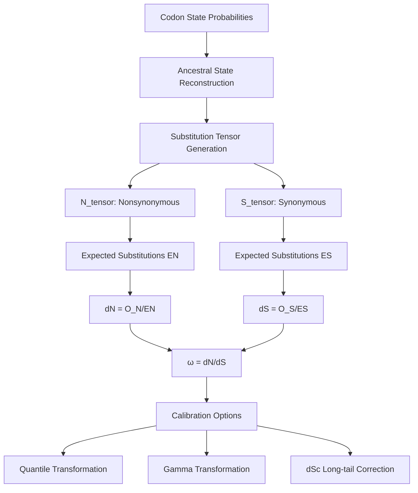
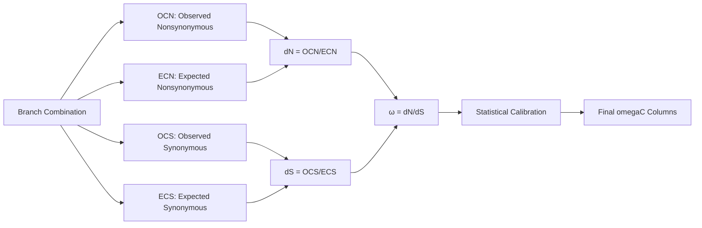

The omega (dN/dS) ratio estimation in csubst provides a sophisticated framework for quantifying selective pressure across branch combinations, leveraging tensor-based substitution tracking and site-specific rate variation models. This implementation diverges from traditional maximum likelihood approaches by integrating empirical substitution data from ancestral state reconstruction with combinatorial branch analysis, enabling precise detection of convergent molecular evolution patterns.

## Architectural Foundation

The omega estimation system operates on a 5-dimensional tensor architecture that tracks substitution events across branches, sites, and substitution categories simultaneously. The core data structure comprises two primary tensors: N_tensor for nonsynonymous substitutions and S_tensor for synonymous substitutions, each maintaining probability-weighted substitution counts across the phylogenetic tree [csubst/substitution.py](csubst/substitution.py#L12-L32). These tensors are constructed from codon state probability matrices derived from IQ-TREE ancestral state reconstruction, with dimensions representing [branch, site, matrix_group, ancestral_state, derived_state].

Sources: [csubst/omega.py](csubst/omega.py#L22-L77), [csubst/substitution.py](csubst/substitution.py#L12-L32)



## Computation Modes

### Substitution Category Classifications

csubst implements four distinct mode specifications for categorizing substitutions based on state specificity:

| Mode | Ancestral State | Derived State | Use Case |
|------|-----------------|---------------|----------|
| `spe2spe` | Specific codon | Specific codon | High-precision substitution tracking |
| `spe2any` | Specific codon | Any derived state | Convergence to multiple outcomes |
| `any2spe` | Any ancestral state | Specific codon | Convergent origins to specific outcomes |
| `any2any` | Any ancestral | Any derived | Broad substitution patterns |

These modes enable nuanced analysis of convergence patterns, particularly distinguishing between cases where different ancestral states converge to identical derived states versus specific ancestral states diversifying into multiple outcomes [csubst/omega.py](csubst/omega.py#L104-L166).

Sources: [csubst/omega.py](csubst/omega.py#L104-L166)

### Among-Site Rate Variation (ASRV) Models

The system supports five ASRV strategies to accommodate heterogeneous substitution rates across sites:

| ASRV Option | Rate Assignment | Memory Efficiency | Statistical Power |
|-------------|-----------------|-------------------|-------------------|
| `no` | Uniform rates | Maximum | Minimal |
| `pool` | Pooled S+N rates | High | Moderate |
| `file` | IQ-TREE rate categories | Moderate | High |
| `sn` | Separate S and N rates | Low | Very High |
| `each` | Per-group calculation | Very Low | Maximum |

The `sn` mode provides particularly sophisticated modeling by maintaining separate site-specific rates for synonymous and nonsynonymous substitutions, reflecting their typically differing evolutionary constraints [csubst/substitution.py](csubst/substitution.py#L274-L310).

Sources: [csubst/substitution.py](csubst/substitution.py#L274-L310)

## Expected Substitution Calculation

### Model-Free Method

The modelfree approach calculates expected substitutions through direct tensor aggregation and site probability weighting. For each branch combination, the algorithm computes:

**E_b** = Σ(sites) Σ(substitution_categories) [P_site × P_branch × substitution_count]

where P_site represents the normalized site probability across non-missing sites, and P_branch captures the branch-specific probability within the combination [csubst/omega.py](csubst/omega.py#L22-L46). The calculation iterates through matrix_group, ancestral_state, and derived_state dimensions, summing contributions across all valid (non-NaN) substitution categories.

The implementation employs efficient memory-mapped arrays for parallel computation, with `joblib_calc_E_mean` distributing tensor aggregation across multiple cores while maintaining thread safety through `threadpool_limits` [csubst/omega.py](csubst/omega.py#L47-L75).

Sources: [csubst/omega.py](csubst/omega.py#L22-L75)

### Submodel Method

The submodel approach leverages instantaneous rate matrices to compute expected substitutions through Markov process transition probabilities:

1. **Rate Matrix Construction**: Separate instantaneous matrices for amino acids and codons, scaled by site-specific rate categories from IQ-TREE
2. **Matrix Exponentiation**: For each branch, compute P(t) = exp(Q × branch_length) using scipy.linalg.expm
3. **Expected State Calculation**: E_derived = Σ(ancestral_state) [P(ancestral) × P(t)[ancestral→derived]]
4. **Tensor Integration**: Expected state probabilities feed into substitution tensor construction via `substitution.get_substitution_tensor` [csubst/omega.py](csubst/omega.py#L224-L262)

This method more explicitly models the continuous-time Markov process underlying codon evolution but requires significantly more computational resources than the modelfree approach.

Sources: [csubst/omega.py](csubst/omega.py#L224-L262)

> [!TIP]
> The matrix exponentiation in the submodel method correctly implements the transition probability matrix P(t) = exp(Qt), following Huelsenbeck's formulation for phylogenetic branch length scaling (2012). The implementation validates this against the Woods Hole workshop examples through probability sum constraints to maintain numerical stability.

## Omega Computation Pipeline

### Core Calculation Formula

The fundamental omega estimation follows the ratio of observed to expected substitution rates, computed separately for nonsynonymous (N) and synonymous (S) changes:

1. **dN calculation**: dN = OCN / ECN
   - OCN: Observed count of nonsynonymous substitutions
   - ECN: Expected count of nonsynonymous substitutions

2. **dS calculation**: dS = OCS / ECS
   - OCS: Observed count of synonymous substitutions
   - ECS: Expected count of synonymous substitutions

3. **omega ratio**: ω = dN / dS

The algorithm applies boundary conditions to handle zero-division cases, setting ω = 0 when either dN or observed substitution counts fall below the floating-point tolerance threshold (10^-3 for float32, 10^-9 for float64) [csubst/omega.py](csubst/omega.py#L263-L287).

Sources: [csubst/omega.py](csubst/omega.py#L263-L287)

### Combinatorial Substitution Integration

For each of the nine combinatorial substitution categories (any2any, any2spe, any2dif, dif2any, dif2spe, dif2dif, spe2any, spe2spe, spe2dif), csubst computes corresponding omega values, enabling multi-faceted analysis:

- **Convergence on Specificity (spe2spe)**: Identical derived states from specific ancestral states
- **Divergence (any2any)**: Broad substitution patterns without constraints
- **Differential Convergence (dif2dif)**: Distinct ancestral states converging to distinct derived states

The differential statistics (`any2dif`, `dif2any`, `dif2dif`) are computed automatically through `substitution.add_dif_stats` which derives these from the primary any/spe categories [csubst/substitution.py](csubst/substitution.py#L348-L356).

Sources: [csubst/omega.py](csubst/omega.py#L263-L287), [csubst/substitution.py](csubst/substitution.py#L348-L356)



## Statistical Calibration Methods

### Quantile-Based Significance

When `calc_quantile` is enabled, csubst performs permutation-based quantile estimation to assess statistical significance. For each branch combination, the algorithm executes `quantile_niter` (default 1000) permutations using Cython-optimized random sampling through `omega_cy.get_permutations` [csubst/omega.py](csubst/omega.py#L76-L102).

The process generates a null distribution of expected substitution counts by randomly redistributing substitution probabilities across branches and sites, then computing the empirical p-value as:

p-value = (count(null_values < observed) + count(null_values ≤ observed)) / (2 × quantile_niter)

This midpoint correction ensures proper handling of discrete permutation distributions while maintaining the desired false positive rate.

Sources: [csubst/omega.py](csubst/omega.py#L76-L102)

### dSc Long-Tail Distribution Correction

The dSc calibration addresses a systematic bias in omega estimation where synonymous substitution rates exhibit heavy-tailed distributions, potentially inflating omega estimates for branch combinations with low dS values. The calibration proceeds through:

1. **Rank Transformation**: Compute ranks of dSc values across all branch combinations
2. **Quantile Mapping**: Map dSc ranks to corresponding dNc distribution quantiles
3. **Distribution Matching**: Option for gamma distribution fitting or empirical quantile transformation
4. **Monotonicity Enforcement**: Ensure calibrated dSc ≥ uncalibrated dSc to maintain biological interpretability [csubst/omega.py](csubst/omega.py#L319-L362)

The calibration is particularly crucial for high-arity branch combinations where dS estimates become less precise due to reduced degrees of freedom.

Sources: [csubst/omega.py](csubst/omega.py#L319-L362)

### Gamma Distribution Fitting

For the gamma transformation option, csubst fits a gamma distribution to dNc values using maximum likelihood estimation (`stats.gamma.fit`), then transforms dSc quantiles using the fitted parameters (α, location, β) [csubst/omega.py](csubst/omega.py#L347-L349). This approach provides smooth, parametric calibration when sufficient data is available but may be sensitive to outliers in sparse branch combination scenarios.

## Integration with Branch Combination Search

The omega calculation integrates seamlessly with the branch combination search pipeline, computing omega values at each arity level during the search process [csubst/main_analyze.py](csubst/main_analyze.py#L76-L84). For K-arity branch combinations:

```python
# Compute observed substitutions for each combination
cbS = substitution.get_cb(id_combinations, S_tensor, g, 'OCS')
cbN = substitution.get_cb(id_combinations, N_tensor, g, 'OCN')

# Merge tables and compute omega
cb = table.merge_tables(cbS, cbN)
cb, g = omega.calc_omega(cb, S_tensor, N_tensor, g)

# Apply calibration if configured
if (g['calibrate_longtail']):
    cb = omega.calibrate_dsc(cb)
```

The resulting omega columns (omegaCany2any, omegaCspe2spe, etc.) serve as key statistics for evaluating branch combination significance, often used in conjunction with enrichment factors for foreground lineages [csubst/main_analyze.py](csubst/main_analyze.py#L76-L90).

Sources: [csubst/main_analyze.py](csubst/main_analyze.py#L76-L90)

## Coefficient of Dispersion (CoD) Calculation

As an auxiliary metric, csubst computes the Coefficient of Dispersion to quantify variability in substitution patterns:

**CoD = (any2spe) / (any2dif)**

This ratio distinguishes between convergent substitutions that produce specific outcomes versus those that diversify into different derived states, providing insight into the degree of convergence specificity. High CoD values indicate preferential convergence toward specific amino acids, while low values suggest more divergent evolutionary outcomes [csubst/omega.py](csubst/omega.py#L288-L296).

Sources: [csubst/omega.py](csubst/omega.py#L288-L296)

## Performance Optimization Strategies

### Memory-Mapped Tensor Operations

For large phylogenetic analyses with many branches and sites, csubst employs memory-mapped numpy arrays (`numpy.memmap`) to handle tensors exceeding RAM capacity. The temporary memory-mapped files are automatically cleaned up after computation, ensuring efficient memory management without manual intervention [csubst/omega.py](csubst/omega.py#L126-L132).

### Parallel Computation Architecture

The expected substitution calculations leverage joblib's multiprocessing backend with thread pool limiting to prevent BLAS library contention. The parallelization strategy splits the substitution category iteration space across available cores, enabling near-linear speedup for large tensor operations [csubst/omega.py](csubst/omega.py#L133-L142).

> [!TIP]
> When using `--calc_quantile yes`, ensure sufficient memory for the permutation matrix (shape: [num_branch_combinations × quantile_niter]). The algorithm requires approximately 4 bytes per permutation value (int32), so a typical analysis with 10,000 combinations and 1,000 iterations needs ~40 MB temporary storage.

## Output Column Specification

The omega estimation generates a comprehensive set of columns in the branch combination (cb) table:

| Column Pattern | Description | Example Usage |
|----------------|-------------|---------------|
| `OCN{mode}` | Observed nonsynonymous count | `OCNspe2spe` |
| `OCS{mode}` | Observed synonymous count | `OCSspe2spe` |
| `ECN{mode}` | Expected nonsynonymous count | `ECNspe2spe` |
| `ECS{mode}` | Expected synonymous count | `ECSspe2spe` |
| `dNC{mode}` | Nonsynonymous rate (dN) | `dNCspe2spe` |
| `dSC{mode}` | Synonymous rate (dS) | `dSCspe2spe` |
| `omegaC{mode}` | Omega ratio (dN/dS) | `omegaCspe2spe` |
| `QCN{mode}` | Quantile-corrected N | `QCNspe2spe` (if calc_quantile) |
| `QCS{mode}` | Quantile-corrected S | `QCSspe2spe` (if calc_quantile) |

The mode suffix includes all nine combinatorial categories: any2any, any2spe, any2dif, dif2any, dif2spe, dif2dif, spe2any, spe2spe, spe2dif.

Sources: [csubst/omega.py](csubst/omega.py#L263-L287)

## Biological Interpretation Guidelines

| Omega Range | Interpretation | Evolutionary Implication |
|-------------|----------------|--------------------------|
| ω < 0.5 | Strong purifying selection | Highly constrained residues |
| 0.5 ≤ ω < 1 | Moderate purifying selection | Functionally important sites |
| ω ≈ 1 | Neutral evolution | Drift-dominated changes |
| 1 < ω < 3 | Positive selection | Adaptive convergence |
| ω ≥ 3 | Strong positive selection | Rapid adaptive evolution |

When interpreting omega values in csubst context, consider the branch combination arity and the specific substitution mode. Higher omega values in `spe2spe` mode indicate particularly interesting cases of specific convergent evolution, where identical derived states emerge from specific ancestral states on multiple branches.
