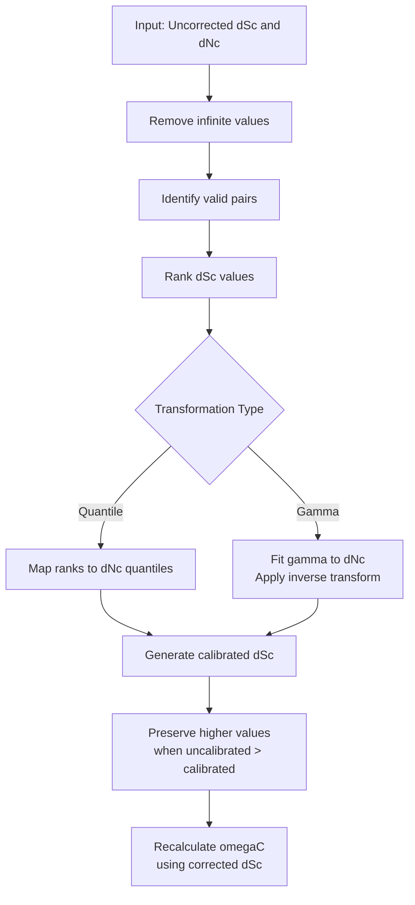
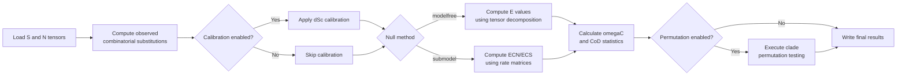

This section documents the statistical error-correction mechanisms and null expectation computation methods that ensure robust convergence signal detection. These methods address systematic biases, correct for distributional disparities, and establish statistical baselines through rigorous null model frameworks.

## The Statistical Challenge in Convergence Analysis

Convergence analysis in phylogenetics encounters several statistical challenges that require specialized correction mechanisms. When analyzing higher-order combinatorial substitutions across multiple lineages, the observed signals must be distinguished from patterns expected under neutral evolution. The csubst framework implements a multi-layered statistical correction system that addresses distributional biases, establishes proper null models, and provides empirical quantification of statistical significance through controlled randomization experiments.

The fundamental problem emerges from the different statistical properties of synonymous (S) and nonsynonymous (N) substitution patterns. Nonsynonymous substitutions typically exhibit heavier-tailed distributions and greater variance, which can lead to spurious convergence signals if not properly normalized. Additionally, the complex combinatorial search space for higher-order branch interactions necessitates sophisticated null model generation to assess significance.

Sources: [omega.py](/csubst/omega.py#L312-L362), [foreground.py](/csubst/foreground.py#L521-L582)

## dSc Calibration for Distribution Range Correction

The dSc calibration mechanism corrects for systematic differences in the statistical distributions between observed normalized nonsynonymous substitutions (dNc) and observed normalized synonymous substitutions (dSc). This correction is essential because dNc and dSc values often occupy different numerical ranges and exhibit different variance structures, which can distort omegaC calculations when dNc/dSc ratios are computed.

The calibration process implements a rank-based transformation that maps dSc values onto the empirical distribution of dNc values. Two transformation methods are available:

1. **Quantile Transformation**: Maps dSc values to dNc quantiles of equivalent rank
2. **Gamma Transformation**: Fits a gamma distribution to dNc and transforms dSc using the fitted parameters



The implementation ensures that the calibrated dSc values never exceed the original uncalibrated values when the original values were higher, preserving conservative estimates. The calibration is applied across all nine combinatorial substitution patterns (any2any, any2spe, any2spe, etc.) and provides detailed reporting of how many branch combinations required correction.

Sources: [omega.py](/csubst/omega.py#L319-L361)

## Null Expectation Computation Framework

The null expectation framework computes expected substitution counts under the assumption of phylogenetic independence, providing the denominator for corrected ratio calculations (ECN and ECS). These expected values represent the number of substitutions that would be observed if branches evolved independently, without any coordination or convergence signals.

The framework supports four substitution modes capturing different biological scenarios:

| Mode | Description | Biological Interpretation |
|------|-------------|--------------------------|
| `any2any` | Any state to any state | Total substitution rate without state specificity |
| `any2spe` | Any state to specific state | Convergence toward particular amino acids |
| `spe2any` | Specific state to any state | Divergence from particular amino acids |
| `spe2spe` | Specific state to specific state | Precise substitution pathways |

The calculation operates through a sophisticated tensor decomposition approach. The substitution tensors (S_tensor for synonymous, N_tensor for nonsynonymous) are summed along different axes to isolate branch-level and site-level substitution patterns. For each branch combination, the expected value is computed by combining site-specific substitution probabilities with branch-specific substitution frequencies.

> [!TIP]
> The null expectation calculation is computationally intensive because it requires iterating through all matrix_group/ancestral_state/derived_state combinations in the tensor. The framework uses memory-mapped arrays and parallel processing via joblib to handle large datasets efficiently, with special handling to prevent memory exhaustion during parallel execution.

Sources: [omega.py](/csubst/omega.py#L104-L165), [omega.py](/csubst/omega.py#L185-L222)

## Quantile-Based Permutation Testing

For applications requiring more conservative statistical assessment, the framework implements quantile-based permutation testing through the `--calc_quantile` parameter. This method computes empirical null distributions by permuting substitution patterns across branches and sites, generating QCN and QCS values (quantile-based expected counts) that represent the probability of observing a given substitution count under complete randomness.

The permutation testing mechanism uses a Cython-accelerated function (`omega_cy.get_permutations`) to efficiently compute permutation statistics. For each matrix_group/ancestral_state/derived_state combination, the algorithm generates `quantile_niter` (default 1000) random permutations and counts how often the permuted values are less than or equal to the observed value.

The final quantile value is computed using a corrected rank averaging approach:
```
corrected_rank = (gt_rank + ge_rank) / 2
E_b = corrected_rank / quantile_niter
```

Where `gt_rank` is the count of permuted values strictly less than the observed value, and `ge_rank` is the count less than or equal to the observed value. This midpoint correction provides an unbiased estimate of the true quantile when dealing with discrete permutation distributions.

Sources: [omega.py](/csubst/omega.py#L76-L102), [omega.py](/csubst/omega.py#L216-L219)

## Subroot Edge Case Handling

Phylogenetic trees present special edge cases for null expectation calculations, particularly around the root and root's immediate children. The framework includes a mechanism to handle these subroot branches by converting their expected values (E-columns) to NaN values in the results table.

The `subroot_E2nan` function identifies root nodes and their direct children, then sets all expectation values (columns starting with 'E') to NaN for these branches. This prevents statistical calculations from being influenced by these special branches that lack proper ancestral states or have other phylogenetic artifacts.

Sources: [omega.py](/csubst/omega.py#L167-L183)

## Foreground Clade Permutation Testing

For foreground-specific convergence analysis, the framework implements a clade permutation testing framework that generates empirical null distributions by randomly reassigning foreground trait annotations across the tree. This method tests whether the observed convergence signal in the specified foreground lineages exceeds what would be expected by chance given random foreground assignments.

The permutation process operates through the following stages:

1. **Randomized Foreground Generation**: Uses `set_random_foreground_branch` to generate new random foreground branch sets while preserving clade structure constraints
2. **Subset Extraction**: Extracts statistics from the existing cb table for branches that match the permuted foreground configuration
3. **Statistic Aggregation**: Computes median omegaC values and total OCN counts for each permuted foreground
4. **P-value Calculation**: Compares the observed foreground statistics to the permuted null distribution

The implementation includes sophisticated handling of missing data and edge cases. If a permuted foreground configuration yields no valid branch combinations (e.g., due to phylogenetic independence constraints), the permutation is discarded and a new trial is attempted. The framework allows up to 10 times the requested number of permutation attempts to find valid foreground configurations.

The final statistical output includes:
- Observed median omegaCany2spe in foreground lineages
- Median and mean ± SD of permuted omegaC values
- Observed and permuted total OCN counts
- Empirical p-value (observation ≤ permutation count / total permutations)

Sources: [foreground.py](/csubst/foreground.py#L521-L582), [foreground.py](/csubst/foreground.py#L442-L457)

## Integration with Analysis Pipeline

Error-correction and null expectation computation are seamlessly integrated into the main analysis pipeline through the `main_analyze` function. The workflow follows these stages:



The pipeline records calibration status in the `df_cb_stats` table, which tracks whether dSc calibration was applied for each arity level. This metadata is essential for reproducibility and for downstream interpretation of the results. The calibration is only applied for arity levels up to the value specified by `--exhaustive_until`, as higher-order analyses typically rely on the branch-and-bound heuristic that uses lower-order statistics as filtering criteria.

Sources: [main_analyze.py](/csubst/main_analyze.py#L89-L100), [main_analyze.py](/csubst/main_analyze.py#L272-L283)

## Configuration and Parameter Control

The error-correction and null expectation features are controlled through several key command-line parameters:

| Parameter | Default | Function |
|-----------|---------|----------|
| `--calibrate_longtail` | yes | Enable dSc calibration for distribution range correction |
| `--omegaC_method` | modelfree | Select null expectation method ('modelfree' or 'submodel') |
| `--calc_quantile` | no | Enable quantile-based permutation testing |
| `--fg_clade_permutation` | 0 | Number of foreground clade permutations to perform |
| `--exhaustive_until` | 1 | Maximum arity level for exhaustive search and calibration |
| `--float_type` | 64 | Numerical precision (16/32/64), affects tolerance calculations |

The numerical precision setting (`--float_type`) is particularly important for error-correction calculations, as it determines the floating-point tolerance used throughout the analysis:
- float16: tolerance = 10⁻¹
- float32: tolerance = 10⁻³  
- float64: tolerance = 10⁻⁹

These tolerance values are used to identify zero values, handle edge cases, and ensure numerical stability in division operations and ratio calculations.

Sources: [param.py](/csubst/param.py#L42-L51), [main_analyze.py](/csubst/main_analyze.py#L88-L98)

## Next Steps

Understanding error-correction and null expectations provides the foundation for detecting valid convergence signals. For comprehensive understanding of the detection framework:

- Learn about **[Higher-Order Convergence Detection](15-higher-order-convergence-detection)** to see how corrected statistics identify complex multi-branch patterns
- Review **[Omega (dN/dS) Estimation](13-omega-dn-ds-estimation)** for details on how the corrected dNc/dSc ratios are computed
- Explore **[Simulation Framework](16-sequence-evolution-under-convergence)** to understand how simulated data validates these correction methods