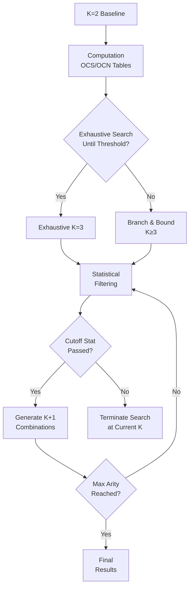

Higher-order convergence detection in csubst extends the identification of convergent molecular evolution beyond pairwise branch combinations (K=2) to encompass complex multi-branch scenarios (K≥3). This sophisticated analytical approach systematically searches for patterns where identical amino acid substitutions occur across three or more independent evolutionary lineages, leveraging a progressive search strategy that balances computational efficiency with comprehensive coverage of the combinatorial space.

## Progressive Arity Search Architecture

The detection algorithm employs an iterative progression through increasing arity levels (K), where K represents the number of branches in a combination. The search begins at K=2 and advances to a user-specified maximum arity ([`max_arity`](csubst/param.py#L10-L63)), generating a separate combinatorial substitution table (`cb`) at each iteration that captures substitution patterns specific to that branch cardinality. This progressive architecture enables the identification of convergence patterns across multiple levels of complexity—from simple pairwise convergent events to higher-order scenarios where three, four, or more lineages simultaneously evolve toward identical amino acid states.

Sources: [main_analyze.py](csubst/main_analyze.py#L21-L125), [param.py](csubst/param.py#L10-L63)

## Search Mode Selection Strategy

The algorithm dynamically selects between three distinct search modes based on the current arity level and user-specified parameters:

- **Foreground Mode**: At K=2, when a foreground specification is provided and [`exhaustive_until`](csubst/param.py#L23-L25) < 2, the system performs targeted searches limited to branch combinations involving foreground lineages defined in the input file. This prioritized approach efficiently focuses computational resources on biologically relevant regions of the phylogeny.

- **Exhaustive Mode**: At K=2 when exhaustive_until ≥ 2, or at higher arities when [`exhaustive_until`](csubst/main_analyze.py#L69-L74) ≥ current_arity, the algorithm evaluates all independent branch combinations across the entire tree. This comprehensive approach ensures no potential convergent patterns are missed but scales combinatorially with tree size.

- **Branch-and-Bound Mode**: For K≥3 when exhaustive_until < current_arity, the system implements a heuristic search that restricts higher-order combinations to those built from K-1 combinations that passed the cutoff statistical threshold. This intelligent pruning dramatically reduces the search space while maintaining sensitivity to biologically significant patterns.

Sources: [main_analyze.py](csubst/main_analyze.py#L26-L76)

### Cutoff Statistics and Heuristic Filtering

The branch-and-bound algorithm relies on statistical cutoffs ([`cutoff_stat`](csubst/main_analyze.py#L44-L60)) to identify high-confidence K-1 combinations that serve as building blocks for higher-order searches. Users specify statistics (e.g., `omegaCany2any > 1.0`) that branch combinations must satisfy to be retained. When the number of qualifying combinations exceeds [`max_combination`](csubst/main_analyze.py#L53-L58), the system selects the top-ranking combinations based on the specified statistical metrics, preventing uncontrolled computational expansion while prioritizing the most promising candidates.

Sources: [main_analyze.py](csubst/main_analyze.py#L44-L60)

## Combinatorial Substitution Computation

For each branch combination at every arity level, the algorithm computes four types of combinatorial substitutions across all codon sites:

- **any2any**: Total convergent substitutions from any ancestral state to any derived state
- **spe2any**: Convergent substitutions from specific ancestral states to any derived state
- **any2spe**: Convergent substitutions from any ancestral state to specific derived states
- **spe2spe**: Convergent substitutions from specific ancestral to specific derived states

These computations leverage tensor operations that efficiently aggregate substitution counts across branches, sites, and codon states. For K-branch combinations, the algorithm performs element-wise multiplication along the branch dimension followed by summation across codon state dimensions, yielding per-site combinatorial substitution counts that reflect the joint probability of parallel substitutions across all K branches.

Sources: [substitution.py](csubst/substitution.py#L147-L177), [substitution.py](csubst/substitution.py#L210-L241)

> [!TIP]
> The tensor-based combinatorial substitution computation uses NumPy broadcasting and aggregation operations to achieve vectorized calculations. For K-branch combinations, the expression `sub_tensor[id_combinations[i,:], :, sg, :, :].sum(axis=(2, 3)).prod(axis=0)` computes the product of summed substitutions across all K branches for each codon state group (sg), efficiently capturing the joint substitution pattern across the combination.

## Statistical Significance Assessment

Higher-order convergence detection requires robust statistical evaluation to distinguish genuine convergent patterns from chance occurrences. The framework employs a model-free approach that calculates expected substitution values (E) under the null hypothesis of independent evolution across branches:

- **Null Model Construction**: The system partitions substitution tensors into branch-level ([sub_bg](csubst/omega.py#L106-L120)) and site-level ([sub_sg](csubst/omega.py#L106-L120)) marginal distributions, capturing evolutionary variation across each dimension separately.

- **Expected Value Calculation**: For each branch combination, the algorithm computes expected combinatorial substitutions by multiplying the appropriate marginal distributions, aggregating across all substitution categories (defined by matrix group, ancestral state, and derived state combinations). This yields E-values that represent the expected number of convergent substitutions under independence.

- **Omega Estimation**: The convergence ratio (ωC) is calculated as `dNc/dSc`, where `dNc = OCN/E[OCN]` and `dSc = OCS/E[OCS]`. This ratio quantifies whether observed convergent substitutions exceed neutral expectations, with values >1 indicating potential adaptive convergence.

Sources: [omega.py](csubst/omega.py#L104-L190), [omega.py](csubst/main_analyze.py#L89)

## Long-Tail Distribution Calibration

Convergent substitution counts often exhibit long-tailed distributions where a small number of sites accumulate many convergent events, potentially biasing statistical inferences. The optional [`calibrate_longtail`](csubst/main_analyze.py#L90-L98) procedure corrects for this bias by:

1. Computing empirical quantiles of dNc values across all branch combinations
2. Applying rank-based transformation to dSc values, mapping them to the dNc distribution shape
3. Re-calculating ωC values using the calibrated dSc values

This quantile calibration ([calibrate_dsc](csubst/omega.py#L319-L361)) ensures that ωC estimates are not artificially inflated due to distributional mismatches between dNc and dSc, improving the reliability of statistical inference particularly for high-arity combinations where sampling variance is greater.

Sources: [omega.py](csubst/omega.py#L319-L361)

## Output Structure and Interpretation

The analysis generates separate TSV files (`csubst_cb_2.tsv`, `csubst_cb_3.tsv`, etc.) containing comprehensive statistics for each branch combination at each arity level. Column names follow the pattern `branch_id_1`, `branch_id_2`, ..., `branch_id_K` for branch identifiers, with substitution and statistical metrics prefixed by OCS/OCS (observed combinatorial substitutions) and ECS/ECN (expected combinatorial substitutions).

The most informative columns for interpreting higher-order convergence include:

| Column Pattern | Description | Interpretation |
|---------------|-------------|----------------|
| `omegaC{sub}` | Convergence ratio (dNc/dSc) | Values >1 indicate excess convergence |
| `dNC{sub}` | Normalized N substitutions | Ratio of observed to expected N convergent substitutions |
| `dSC{sub}` | Normalized S substitutions | Ratio of observed to expected S convergent substitutions |
| `OCSCoD` | Codon bias ratio | spe2any/dif comparisons for convergence type assessment |

Where `{sub}` represents one of the nine combinatorial substitution categories (any2any, any2spe, any2dif, spe2any, spe2spe, spe2dif, dif2any, dif2spe, dif2dif), enabling nuanced interpretation of convergence patterns across different amino acid change types.

Sources: [table.py](csubst/table.py#L20-L44), [omega.py](csubst/omega.py#L263-L296)

## Performance Considerations

The computational complexity of higher-order convergence detection grows exponentially with arity (scaling as n choose K for n branches). Several strategies mitigate this complexity:

- **Parallel Processing**: Tensor operations and combinatorial substitutions are distributed across multiple CPU cores using joblib, with threadpool limits preventing BLAS library thread contention ([parallel.py](csubst/parallel.py) integration through [substitution.py](csubst/substitution.py#L252-L268)).

- **Memory Mapping**: For large analyses, temporary memory-mapped arrays ([numpy.memmap](csubst/substitution.py#L254-L260)) reduce RAM requirements by spilling intermediate results to disk.

- **Search Space Pruning**: The branch-and-bound heuristic dramatically reduces the search space at higher arities by only considering combinations built from high-confidence K-1 candidates.

- **Float Precision Control**: Users can configure floating-point precision ([`float_type`](csubst/param.py#L42-L51)) to balance numerical accuracy and memory usage, with options for 16-bit, 32-bit, or 64-bit floating point representations.

Sources: [param.py](csubst/param.py#L42-L51), [substitution.py](csubst/substitution.py#L249-L268)

> [!TIP]
> When analyzing large phylogenies (>500 branches) or targeting high arities (K≥4), start with a conservative [`max_combination`](csubst/main_analyze.py#L53-L58) value (e.g., 10,000) and progressively increase it if needed. This strategy prevents runaway memory consumption while allowing controlled exploration of the higher-order combinatorial space.

## Integration with Statistical Validation

The higher-order convergence detection pipeline seamlessly integrates with the broader csubst analysis framework, feeding into downstream analyses including:

- **Site-wise mapping** ([Site-Wise Substitution Mapping](20-site-wise-substitution-mapping)): Identification of specific codon positions driving higher-order convergence signals
- **Structural annotation** ([Protein Structure Database Integration](19-protein-structure-database-integration)): Mapping high-order convergent sites onto 3D protein structures
- **Permutation testing** ([Error-Correction and Null Expectations](14-error-correction-and-null-expectations)): Empirical validation of statistical significance through foreground clade randomization

This integrated approach ensures that higher-order convergence patterns are evaluated within a comprehensive evolutionary context, enabling robust biological inference about adaptive evolution across multiple lineages.
