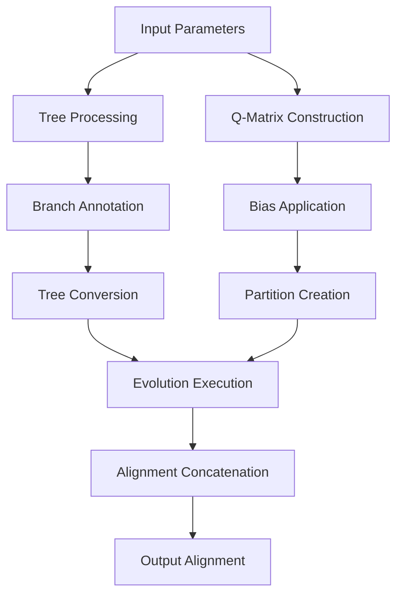

This documentation explains the simulation framework that generates synthetic codon alignments under controlled convergent evolutionary scenarios. The framework enables researchers to validate detection methods and understand the statistical properties of combinatorial substitutions by evolving sequences along phylogenetic trees with specified substitution biases toward target amino acids in foreground lineages.

The simulation system implements a partition-based evolution strategy where sites can evolve under different substitution regimes: convergent sites (foreground branches with biased substitution patterns) and non-convergent sites (background evolution without biases). This architecture allows precise control over the intensity and distribution of convergent signals for methodological validation.

## Simulation Architecture Overview

The simulation pipeline follows a modular design that separates tree processing, Q-matrix construction, and sequence evolution into distinct components. The core workflow orchestrates these components to produce synthetic alignments with known convergent patterns, enabling ground-truth validation of combinatorial substitution detection methods.

The architecture leverages **pyvolve** as the underlying evolution engine while providing csubst-specific enhancements for convergent evolution scenarios. The framework accepts codon alignments, phylogenetic trees, and foreground lineage specifications as inputs, then generates simulated sequences with programmable convergence intensity through Q-matrix manipulation.

## Tree Processing and Branch Annotation

Tree preparation involves multiple transformations to enable lineage-specific evolution models. The system scales branch lengths according to user-specified factors and annotates foreground branches with model identifiers that map to different Q-matrices during evolution.

**Tree scaling** applies uniform multiplication of branch distances, enabling control over evolutionary rates across the entire phylogeny [main_simulate.py#L44-L47](csubst/main_simulate.py#L44-L47). For convergent evolution, foreground branches receive separate scaling factors that accelerate or decelerate evolution relative to background branches, creating differential rates that mimic selective scenarios.

The tree conversion to pyvolve format adds special markers to foreground branch lengths using a numerical label substitution scheme [main_simulate.py#L49-L65](csubst/main_simulate.py#L49-L65). Each foreground branch receives a `#mN` suffix where N identifies the specific foreground lineage, enabling pyvolve to assign distinct substitution models to different branch categories.

## Q-Matrix Construction and Manipulation

The instantaneous rate matrix (Q-matrix) forms the mathematical foundation of codon substitution models, encoding the relative rates of transitions between all 61 sense codons. The simulation framework constructs Q-matrices using two complementary approaches: the csubst method and the pyvolve method.

### Background Q-Matrix Generation

**csubst method**: Loads empirical exchangeability matrices from the ECM (Empirical Codon Model) files [main_simulate.py#L311-L317](csubst/main_simulate.py#L311-L317). The system reads `substitution_matrix/ECMunrest.dat` containing empirically-derived exchangeability parameters that capture observed substitution patterns across diverse taxa. These exchangeabilities combine with codon equilibrium frequencies to generate the unscaled Q-matrix, then rescale to achieve the target background ω (dN/dS) ratio.

**pyvolve method**: Constructs Q-matrices using parametric codon models like MG (Muse-Gaut) or GY (Goldman-Yang) [main_simulate.py#L178-L185](csubst/main_simulate.py#L178-L185). This approach generates matrices from first principles using transition/transversion ratios and nucleotide frequency parameters, offering theoretical flexibility when empirical patterns are unavailable.

Both methods ensure the resulting Q-matrix diagonal entries satisfy the Markov process constraint: each row sums to zero, with negative diagonal values representing the total exit rate from each codon state.

### Q-Matrix Rescaling and ω Control

The system precisely controls the nonsynonymous-to-synonymous rate ratio through iterative rescaling [main_simulate.py#L166-L175](csubst/main_simulate.py#L166-L175). The rescaling procedure:
1. Zeroes diagonal elements (temporary removal of exit rates)
2. Calculates total matrix sum
3. Multiplies target substitution rates by the scaling factor
4. Renormalizes matrix to preserve total rate
5. Restores diagonal entries as negative row sums

This algorithm preserves relative rate relationships while achieving exact ω values, critical for simulating selective regimes ranging from purifying (ω < 1) to adaptive (ω > 1) evolution.

## Biased Substitution Implementation

The core innovation for convergent simulation lies in the Q-matrix biasing mechanism that increases substitution rates toward specified target amino acids in foreground lineages. This bias creates directional selection pressure that promotes recurrent nonsynonymous substitutions to the same amino acid across independent branches.

### Target Codon Identification

The system first identifies codons encoding the convergent amino acids using the specified genetic code table [main_simulate.py#L74-L80](csubst/main_simulate.py#L74-L80). For each target amino acid, all associated codons are extracted, creating a mapping from amino acid to its synonymous codon set.

**Biased nonsynonymous substitution indices** enumerate all codon transitions that result in convergent amino acids [main_siminate.py#L82-L97](csubst/main_simulate.py#L82-L97). The algorithm generates ordered pairs (source_codon, target_codon) where target_codons encode biased amino acids. Crucially, it excludes transitions between codons encoding the same biased amino acid (synonymous within-biased substitutions), focusing exclusively on convergent changes.

### Bias Application Algorithm

The bias application increases substitution rates toward convergent codons by a specified percentage while maintaining overall matrix properties [main_simulate.py#L200-L212](csubst/main_simulate.py#L200-L212). The procedure:

1. Measures current total biased Q (sum of rates toward convergent codons)
2. Measures current total nonsynonymous Q
3. Calculates scaling factor to achieve target biased percentage
4. Rescales biased substitution entries
5. Re-normalizes matrix and restores diagonal entries
6. Adjusts ω to foreground target if specified

> [!TIP]
> The bias application maintains the mathematical integrity of the Q-matrix by always renormalizing after rate modifications. This preserves the Markov process properties while introducing directional selection pressure toward convergent states.

The resulting matrix exhibits elevated substitution rates specifically toward convergent amino acids in foreground lineages, creating realistic scenarios where natural selection drives parallel molecular adaptations.

## Codon Substitution Classification

The system classifies all possible codon transitions into categories essential for convergence simulation: synonymous (no amino acid change) and nonsynonymous (amino acid change). This classification enables precise rate control and bias application.

**Synonymous codon index** enumerates all transitions between codons encoding the same amino acid [main_simulate.py#L119-L137](csubst/main_simulate.py#L119-L137). For each amino acid with multiple codons, the system generates all ordered pairs of synonymous codons, creating the complete set of synonymous transitions. Stop codons are excluded from analysis.

**Nonsynonymous codon index** complements this by identifying all remaining transitions [main_simulate.py#L139-L156](csubst/main_simulate.py#L139-L156). The algorithm subtracts synonymous transitions from the complete set of 61×60 possible codon transitions, isolating exclusively nonsynonymous changes. This enables independent control over dN and dS rates through ω specification.

## Partition-Based Evolution Strategy

The simulation implements a two-partition strategy separating convergent and non-convergent sites, enabling controlled mixtures of evolutionary pressures within the same alignment.

### Convergent Partition Evolution

Convergent sites evolve under lineage-specific Q-matrices where foreground branches use biased matrices while background branches use unbiased matrices [main_simulate.py#L214-L278](csubst/main_simulate.py#L214-L278). The architecture creates a separate pyvolve model for each foreground lineage plus a root model:

- **Root model**: Uses background Q-matrix (no bias)
- **Foreground models**: Use biased Q-matrix with elevated rates toward convergent amino acids

Each convergent site evolves as a separate partition of size 1, enabling site-specific control over convergence intensity. The system reports the fraction of biased substitutions achieved and the expected proportion of convergent sites in the final alignment.

**Branch assignment** uses the tree annotation process where foreground branches receive model identifiers (m1, m2, etc.) mapping to biased Q-matrices. During evolution, pyvolve applies the appropriate model based on branch annotation, creating lineage-specific substitution pressures.

### Non-Convergent Partition Evolution

Non-convergent sites evolve uniformly across all branches using only the background Q-matrix [main_simulate.py#L280-L298](csubst/main_simulate.py#L280-L298). This represents neutral evolution without directional selection, providing the statistical baseline against which convergent signals are detected.

The non-convergent partition contains all remaining sites (simulated sites minus convergent sites) and uses a single pyvolve model applied to the entire background tree. This simplification is computationally efficient while maintaining biological realism for the majority of sites.

## Tree Branch Category Visualization

The system generates visual representations of branch categories during simulation to aid parameter specification and result interpretation [main_simulate.py#L364](csubst/main_simulate.py#L364). Tree plots color-code foreground and background branches, providing immediate feedback on lineage assignment and enabling verification that foreground definitions match evolutionary hypotheses.

This visualization is particularly valuable when specifying foreground lineages through regex patterns or complex clade definitions, ensuring that intended branches receive the convergent evolutionary regime.

## Complete Simulation Workflow

The `main_simulate` function orchestrates all components into a cohesive pipeline [main_simulate.py#L345-L394](csubst/main_simulate.py#L345-L394). The workflow:

```mermaid
flowchart LR
    A[Load Parameters] --> B[Initialize Codon Table]
    B --> C[Read & Annotate Tree]
    C --> D[Identify Foreground Branches]
    D --> E[Calculate Substitution Indices]
    E --> F[Scale Tree]
    F --> G[Convert Tree Formats]
    G --> H[Load Equilibrium Frequencies]
    H --> I[Generate Background Q-Matrix]
    I --> J{Foreground Specified?}
    J -->|Yes| K[Calculate Convergent Site Count]
    J -->|No| L[Set Convergent Sites = 0]
    K --> M{Convergent Sites > 0?}
    L --> M
    M -->|Yes| N[Evolve Convergent Partitions]
    M -->|No| O[Skip Convergent Evolution]
    N --> P{Convergent Sites < Total?}
    P -->|Yes| Q[Evolve Non-Convergent Partition]
    P -->|No| R[Skip Non-Convergent Evolution]
    Q --> S[Concatenate Alignments]
    R --> S
    O --> R
    S --> T[Clean Temporary Files]
    T --> U[Output simulate.fa]
```

The pipeline calculates the number of convergent sites based on the user-specified percentage (default 0-100% of sites), then executes the appropriate evolution functions. Results from convergent and non-convergent partitions concatenate into a single FASTA file (`simulate.fa`), with temporary intermediate files cleaned up automatically.

## Parameter Configuration Table

| Parameter | Purpose | Default | Range |
|-----------|---------|---------|-------|
| `--percent_convergent_site` | Percentage of sites evolving convergently | 0 | 0-100 |
| `--convergent_amino_acids` | Target amino acids for convergence | - | Specific AA or 'randomN' |
| `--percent_biased_sub` | Target biased substitution percentage | - | 0-100 (exclusive) |
| `--foreground_omega` | ω for foreground branches | Background ω | Any positive value |
| `--background_omega` | ω for background branches | 1.0 | Any positive value |
| `--foreground_scaling_factor` | Branch length multiplier for foreground | 1.0 | Any positive value |
| `--tree_scaling_factor` | Global branch length multiplier | 1.0 | Any positive value |
| `--num_simulated_site` | Total sites in output alignment | Input alignment length | Any positive integer |

## Convergence Intensity Control

The framework provides multiple levers for controlling convergence strength, each affecting different aspects of the evolutionary process:

**Percentage of convergent sites** (`--percent_convergent_site`) controls the proportion of alignment sites subject to convergent selection. Higher values increase the density of convergent signals but may reduce realism for most protein datasets where convergent sites are typically rare.

**Biased substitution percentage** (`--percent_biased_sub`) determines the fraction of nonsynonymous substitutions directed toward convergent amino acids within convergent sites. This parameter directly influences the probability that substitutions on foreground branches result in convergent amino acids, with higher values creating stronger convergent signals.

**Convergent amino acid specification** allows targeting specific amino acids (e.g., "ST" for Serine and Threonine) or random selection using the "randomN" syntax where N specifies the number of amino acids. The number of target codons affects bias intensity—more target amino acids create broader but potentially weaker convergence signals.

> [!TIP]
> The interaction between convergent site percentage and biased substitution percentage creates a two-dimensional parameter space. Validation studies should sample this space systematically to understand how detection methods respond to varying convergence architectures.

## Simulation Output and Usage

The simulation produces a FASTA alignment file (`simulate.fa`) containing synthetic codon sequences with known convergent patterns. Users can analyze this alignment using standard csubst pipelines to validate detection methods, estimate false positive/negative rates, or calibrate statistical thresholds.

The console output provides detailed statistics on the achieved convergence properties, including the actual biased substitution fractions and expected proportions of convergent substitutions. This information enables researchers to verify that simulations matched intended parameters and to document experimental conditions.

## Integration with Analysis Pipeline

Simulated outputs integrate seamlessly with the standard csubst analysis workflow. After generating `simulate.fa`, researchers can:

1. Run `csubst analyze` using the simulated alignment and original tree
2. Compare detected convergence rates against known simulation parameters
3. Evaluate detection sensitivity and specificity across parameter ranges
4. Generate null distributions by simulating with `--percent_convergent_site 0`

This integration enables comprehensive validation of the combinatorial substitution detection framework described in [Convergence Rate Calculation](12-convergence-rate-calculation) and statistical methods outlined in [Error-Correction and Null Expectations](14-error-correction-and-null-expectations).

## Next Steps

For deeper understanding of related components:

- [Biased Substitution Models](17-biased-substitution-models) - Explores the theoretical foundations of Q-matrix biasing
- [Foreground and Background Evolution Parameters](18-foreground-and-background-evolution-parameters) - Details parameter specification for different evolutionary regimes
- [Combinatorial Substitutions](5-combinatorial-substitutions) - Explains the combinatorial framework for detecting convergent patterns
- [Foreground Lineages](6-foreground-lineages) - Describes lineage specification and annotation methods

The simulation framework provides a controlled environment for testing methodological assumptions and understanding the statistical behavior of convergent evolution detection under known ground truth conditions.