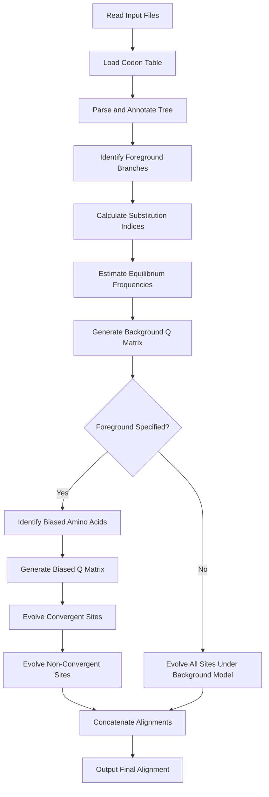

The biased substitution model framework in csubst enables realistic simulation of convergent evolution by selectively accelerating specific codon substitutions toward target amino acids on designated foreground branches. This mechanistic approach preserves the fundamental properties of codon substitution models while introducing controlled bias toward convergent phenotypes, creating test datasets that mirror empirical patterns of molecular convergence.

## Model Architecture and Core Components

The biased substitution model operates by modifying the instantaneous rate matrix (Q matrix) used in codon-based phylogenetic simulation. The architecture centers on three fundamental components: identification of target substitutions, rate matrix modification, and partition-based simulation with branch heterogeneity.

The system implements biased substitutions through targeted manipulation of non-synonymous substitution rates while preserving overall matrix properties. The bias is applied specifically to transitions toward codons encoding convergent amino acids, leaving other substitution categories intact. This selective acceleration enables controlled generation of convergence patterns that can be used to validate detection methods.

The implementation leverages the pyvolve simulation engine, which provides flexible model specification for codon evolution. By defining separate rate matrices for root and foreground branches, the framework creates branch-specific substitution dynamics where convergence emerges preferentially in foreground lineages.

Sources: [main_simulate.py](csubst/main_simulate.py#L178-L186), [main_simulate.py](csubst/main_simulate.py#L310-L310)

## Target Substitution Identification

The first step in implementing biased substitution models involves identifying which codon substitutions should receive bias. This process operates at both the amino acid level and the codon level.

The framework supports two approaches for specifying convergent amino acids: direct specification of target residues using single-letter codes (e.g., "ALS" for Alanine, Leucine, Serine) or random selection from the set of 20 amino acids. The random selection mode uses the format "randomN" where N specifies the number of amino acids to select (e.g., "random3" selects 3 amino acids uniformly at random). This flexibility enables simulation of various convergence scenarios, from single-amino acid convergence to multi-residue adaptation.

Once target amino acids are specified, the system identifies all codons encoding those residues using the genetic code table. For mammalian systems, this typically uses the standard genetic code (NCBI table ID 1), though alternative genetic codes can be specified through the `--genetic_code` parameter.

The critical computational task involves generating indices for biased non-synonymous substitutions. The algorithm iterates through each target amino acid, retrieves its codon repertoire, and creates all possible non-synonymous transitions toward those codons. It excludes synonymous transitions and transitions between codons for the same biased amino acid, ensuring that bias is applied only to non-synonymous changes that could generate convergence.

Sources: [main_simulate.py](csubst/main_simulate.py#L82-L97), [main_simulate.py](csubst/main_simulate.py#L99-L107), [main_simulate.py](csubst/main_simulate.py#L109-L117)

## Rate Matrix Modification Strategy

The core bias application occurs through controlled modification of the Q matrix elements. The framework implements a percentage-based approach where the user specifies the desired proportion of biased substitutions (`--percent_biased_sub`), and the system calculates the appropriate scaling factor to achieve this target.

The bias application follows a precise mathematical formulation: the scaling factor is calculated as the ratio of total non-synonymous Q to total biased Q, divided by one minus the target percentage (expressed as a fraction). This formulation ensures that after rescaling, the biased substitutions constitute exactly the specified proportion of all non-synonymous substitutions.

The rescaling process preserves the mathematical properties required of rate matrices. It temporarily zeroes the diagonal elements, applies the scaling factor to all targeted substitution rates, then renormalizes the matrix to maintain the total substitution rate. Finally, the diagonal elements are recomputed as negative row sums, ensuring that each row sums to zero—a fundamental requirement for rate matrices.

A critical constraint enforced at the parameter validation stage is that `percent_biased_sub` must be less than 100%. This mathematical necessity prevents division by zero in the scaling factor calculation and ensures that a meaningful proportion of substitutions remain unbiased, preserving realistic evolutionary dynamics.

Sources: [main_simulate.py](csubst/main_simulate.py#L166-L176), [main_simulate.py](csubst/main_simulate.py#L200-L209), [param.py](csubst/param.py#L57-L58)

## Branch Heterogeneity and Partition Design

The simulation framework implements sophisticated branch heterogeneity through partition-based evolution. Rather than applying a single rate matrix across the entire tree, the system creates separate matrices for root and foreground branches, enabling convergent evolution to emerge preferentially in the designated lineages.

The partition design process begins by determining the number of foreground lineages from the trait annotation. For each convergent site, the system generates a unique set of pyvolve models: one root model using the unbiased background Q matrix, and one foreground model per lineage using the biased Q matrix. This architecture enables realistic scenarios where convergence occurs independently on multiple foreground branches.

The number of convergent sites is calculated as a percentage of total sites specified by `--percent_convergent_site`. For example, with 1000 total sites and `--percent_convergent_site 10`, 100 sites will evolve under the biased substitution model on foreground branches. This proportional approach enables simulation of various convergence intensities, from rare focal convergence to pervasive adaptation.

Non-convergent sites evolve under the background substitution model across all branches, ensuring that the simulated alignment contains a realistic mixture of convergent and neutral evolution. The partition-based approach allows these two evolutionary regimes to be simulated independently, then concatenated into the final alignment file.

Sources: [main_simulate.py](csubst/main_simulate.py#L214-L279), [main_simulate.py](csubst/main_simulate.py#L280-L298), [main_simulate.py](csubst/main_simulate.py#L375-L378)

## Integration with Substitution Model Families

The biased substitution model framework integrates seamlessly with multiple codon substitution model families, providing flexibility in modeling different evolutionary scenarios. The system supports empirical codon models (ECMrest and ECMunrest) as well as mechanistic models (MG and GY), allowing users to match the model characteristics to their empirical data.

The background Q matrix generation uses the specified model type along with equilibrium codon frequencies estimated from the input alignment. The pyvolve library's model interface automatically handles the parameterization of these models, computing the instantaneous rate matrix from the specified parameters. For ECM models, this involves loading pre-computed substitution matrices from the substitution_matrix directory, while mechanistic models generate matrices analytically from transition/transversion ratios and codon frequencies.

After generating the background matrix, the system applies the bias modification described earlier. Importantly, this modification preserves the underlying model's assumptions about relative rates between different types of substitutions (e.g., transition vs. transversion biases), only scaling the overall rate toward target codons.

The integration with omega (dN/dS) parameters is particularly noteworthy. Users can specify distinct omega values for foreground (`--foreground_omega`) and background branches through tree scaling factors. This enables simulation of scenarios where convergent evolution occurs under different selective regimes, such as foreground lineages experiencing adaptive evolution (ω > 1) while background branches evolve under purifying selection (ω < 1).

Sources: [main_simulate.py](csubst/main_simulate.py#L310-L310), [main_simulate.py](csubst/main_simulate.py#L178-L185)

## Simulation Workflow Execution

The complete simulation workflow executed by `csubst simulate` orchestrates multiple computational stages, transforming input data into a realistic simulated alignment with controlled convergence patterns.



The workflow begins with standard preprocessing: loading the appropriate genetic code table, reading and annotating the phylogenetic tree, and identifying foreground branches from the trait annotation. The system then computes the complete set of synonymous and non-synonymous substitution indices, which serve as the reference for bias application.

Equilibrium codon frequencies are estimated directly from the input alignment using pyvolve's frequency computation module. These empirically-derived frequencies ensure that the simulated data reflects realistic nucleotide composition, improving the relevance of convergence detection validation.

The background Q matrix generation creates a reference matrix using the specified codon model and empirical frequencies. This matrix serves as the baseline for non-convergent evolution and as the starting point for bias modification in convergent partitions.

If foreground branches are specified, the system proceeds to simulate convergent evolution. For each convergent site, it creates the biased Q matrix, instantiates separate pyvolve models for root and foreground branches, and evolves sequences under this branch-heterogeneous model. The simulation outputs intermediate files tracking evolutionary information (rate and info files) for diagnostic purposes.

Finally, convergent and non-convergent alignments are concatenated, and temporary files are cleaned up, producing the final simulated alignment ready for convergence analysis.

Sources: [main_simulate.py](csubst/main_simulate.py#L345-L394)

## Configuration Parameters and Usage

The biased substitution model framework exposes several key parameters that control simulation characteristics, enabling researchers to match simulated data to their empirical scenarios.

| Parameter | Description | Constraints |
|-----------|-------------|-------------|
| `--alignment_file` | Input in-frame codon alignment (FASTA) | Must match tree tip labels |
| `--rooted_tree_file` | Rooted phylogenetic tree (Newick) | Required |
| `--foreground` | Foreground lineage specification file | Tab-delimited: lineage ID, regex pattern |
| `--convergent_amino_acids` | Target amino acids for convergence | Either direct (e.g., "ALS") or "randomN" |
| `--percent_convergent_site` | Percentage of sites evolving convergently | 0-100 |
| `--percent_biased_sub` | Target percentage of biased substitutions | Must be < 100 |
| `--foreground_omega` | dN/dS ratio for foreground branches | Positive value |
| `--foreground_scaling_factor` | Branch length scaling for foreground | Positive value, typically 0.5-2.0 |
| `--genetic_code` | NCBI genetic code table ID | Default 1 (standard) |
| `--num_simulated_site` | Number of sites to simulate | Default: uses input alignment length |

The `--convergent_amino_acids` parameter offers particular flexibility. Using "randomN" format (e.g., "random3") randomly selects N amino acids, useful for simulating various convergence scenarios without biasing results. Direct specification (e.g., "ALS") enables simulation of specific convergent phenotypes observed in empirical data.

The `--percent_biased_sub` parameter controls the intensity of convergence bias. Higher values generate stronger convergence signals (more substitutions toward target amino acids) but may produce less realistic evolutionary dynamics. Lower values produce subtler convergence that may be more challenging to detect but better approximates weak selective pressures.

Sources: [param.py](csubst/param.py#L57-L58), [main_simulate.py](csubst/main_simulate.py#L345-L394)

## Diagnostic Output and Validation

The simulation framework provides detailed diagnostic output enabling validation that the bias is being applied as intended. For each convergent site, the system reports the fraction of substitutions expected to result from the bias introduction.

The diagnostic output follows this format:
```
Codon site X; Biased amino acids = YYY; 
Total in Q toward the codons before and after the bias introduction = A% (A_total/A_nsy) and B% (B_total/B_nsy)
```

This output allows users to verify that the bias is being applied at the intended intensity. The comparison of biased fraction before and after bias introduction demonstrates the acceleration effect of the bias application.

After all sites are simulated, the framework provides a summary statistic:
```
C% of substitutions in T sites in the foreground branches are expected to result from the introduced bias in Q matrix.
```

This global summary quantifies the overall convergence signal strength in the simulated alignment, enabling users to tune parameters based on desired signal characteristics.

Sources: [main_simulate.py](csubst/main_simulate.py#L244-L248), [main_simulate.py](csubst/main_simulate.py#L265-L271)

## Validation and Applications

Biased substitution models serve as the foundation for multiple analytical validation approaches in csubst. By generating simulated alignments with known convergence patterns, researchers can validate the statistical properties of convergence detection methods and assess false positive rates under controlled conditions.

The primary application involves generating null datasets for error-correction validation. By simulating evolution without convergence bias (setting `--percent_biased_sub 0`), researchers can estimate baseline convergence rates under the specified tree and alignment characteristics. These null expectations provide a reference for assessing whether observed convergence exceeds expectations from shared evolutionary history alone.

For method benchmarking, researchers can simulate convergence at varying intensities (different `--percent_biased_sub` values) and evaluate detection power. By plotting true positive rate against bias intensity, they can characterize the sensitivity of convergence detection methods and identify appropriate significance thresholds for empirical analysis.

The framework also enables investigation of higher-order convergence detection. By specifying multiple foreground branches and moderate bias intensities, researchers can create scenarios where convergence occurs in more than two lineages, validating the heuristics used in csubst for higher-order branch combination detection.

Sources: [README.md](README.md#L9-L11), [README.md](README.md#L71-L77)

> [!TIP]
> When designing simulation experiments, always match the background substitution model and equilibrium frequency estimation method to your empirical analysis pipeline. Using mismatched models (e.g., ECMrest for simulation but MG94 for analysis) can introduce systematic bias in validation results.

## Integration with csubst Analysis Pipeline

The simulated alignments generated using biased substitution models are directly compatible with the csubst analysis pipeline. The output FASTA alignment can be analyzed using `csubst analyze` with the same tree and foreground specifications used during simulation.

This integration enables closed-loop validation where the same methodological framework used to analyze empirical data can be validated against simulated data with known convergence patterns. Researchers can directly compare convergence rates, ωC estimates, and branch combination statistics between simulations and empirical observations, providing rigorous validation of method performance.

When analyzing simulated data, the error-correction and null expectation calculations in csubst will compare observed convergence against expectations from random site selection (urn sampling) or mechanistic substitution models, depending on configuration. For simulated data with known convergence, the observed rates should significantly exceed these null expectations, validating that the detection methods are functioning correctly.

Sources: [README.md](README.md#L59-L60), [main_simulate.py](csubst/main_simulate.py#L383-L391)

## Next Steps

Having understood biased substitution models, explore their complementary concepts in the csubst framework:

- **[Foreground and Background Evolution Parameters](18-foreground-and-background-evolution-parameters)**: Learn how foreground and background branches are parameterized and how ω (dN/dS) differences create branch-specific evolutionary dynamics
- **[Sequence Evolution Under Convergence](16-sequence-evolution-under-convergence)**: Examine the broader simulation framework and understand how biased substitution models fit into the complete evolutionary simulation workflow
- **[Codon Substitution Models](7-codon-substitution-models)**: Review the theoretical foundations of codon substitution models that underpin both simulation and analysis in csubst

For practical implementation guidance, see the basic usage documentation to understand how to integrate biased substitution model parameters into your `csubst simulate` command.