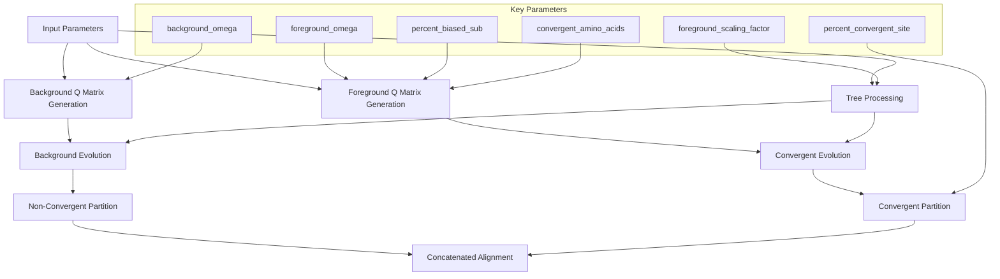

The simulation framework in csubst enables the controlled generation of sequence alignments under convergent evolutionary scenarios by implementing differential substitution models across foreground (convergent) and background (non-convergent) lineages. This dual-model architecture allows you to test hypotheses about adaptive convergence by comparing simulated data against empirical observations.

## Architecture Overview

The simulation system operates on a hierarchical parameter structure that separates evolutionary constraints between lineages of interest and the broader phylogenetic context. At its core, the framework constructs two distinct substitution rate matrices (Q matrices): one representing background evolutionary dynamics governed by neutral expectations, and another introducing directional bias toward specific amino acid states in foreground lineages.



Sources: [main_simulate.py](/csubst/main_simulate.py#L345-L394), [param.py](/csubst/param.py#L10-L65)

## Background Evolution Parameters

Background evolution represents the neutral substitution process occurring across all lineages in the phylogeny, governed by standard codon substitution models without directional bias. The background model serves as the evolutionary baseline against which convergent signals are measured.

### Omega (dN/dS) Parameter

The `background_omega` parameter controls the nonsynonymous-to-synonymous substitution rate ratio for background evolution. This parameter determines the overall strength of purifying selection acting on non-convergent sites. Values typically range from 0 (strong purifying selection) to approximately 0.3-0.5 for moderately constrained protein-coding regions.

The background Q matrix is constructed using the ECMunrest (Empirical Codon Model unrestricted) exchangeability matrix, which captures empirically observed patterns of codon substitutions derived from large-scale comparative analyses. The matrix is scaled to achieve the specified `background_omega` value:

```python
background_Q = rescale_substitution_matrix(unscaled_mat, all_nsy_cdn_index, scaling_factor)
```

Where `scaling_factor = background_omega/dnds` ensures the resulting dN/dS matches the target value.
Sources: [main_simulate.py](/csubst/main_simulate.py#L310-L319), [parser_misc.py](/csubst/parser_misc.py#L174-L180)

### Tree Scaling

The `tree_scaling_factor` applies uniform scaling to all branch lengths in the phylogeny, controlling the overall evolutionary rate. This parameter enables adjustment of total tree length without altering relative branch proportions. A factor of 1.0 maintains original branch lengths, while values >1.0 accelerate evolution and <1.0 decelerate it.

### Equilibrium Frequencies

Codon equilibrium frequencies are estimated from the input alignment unless explicitly specified via the `equilibrium_frequency` parameter. These frequencies represent the stationary distribution of the substitution process and critically influence both synonymous and nonsynonymous substitution rates.
Sources: [parser_misc.py](/csubst/parser_misc.py#L180-L199)

## Foreground Evolution Parameters

Foreground evolution introduces directional bias toward specified amino acid states in designated foreground lineages, simulating the action of positive selection driving convergent adaptation. These parameters control the intensity, specificity, and phylogenetic distribution of convergent signals.

### Foreground Omega and Scaling

The `foreground_omega` parameter establishes the baseline dN/dS ratio for foreground lineages before introducing convergent bias, representing the general selective regime experienced by these lineages. This value can differ from `background_omega` to accommodate lineage-specific differences in overall evolutionary constraints.

Branch-specific scaling is applied through `foreground_scaling_factor`, which multiplies branch lengths exclusively in foreground lineages:

```python
for node in tree.traverse():
    if getattr(node, 'is_fg_' + trait_name):
        node.dist *= foreground_scaling_factor
```

This scaling enables simulation of accelerated or decelerated evolution specifically in convergent lineages, independent of background rates.
Sources: [main_simulate.py](/csubst/main_simulate.py#L300-L310), [foreground.py](/csubst/foreground.py#L269-L290)

### Convergence Intensity Parameters

The `percent_convergent_site` parameter determines what proportion of sites in the alignment should evolve under convergent selection in foreground lineages. For example, with `--percent_convergent_site 20` and a 1000-site alignment, 200 sites will be assigned biased substitution matrices while 800 sites evolve under the background model.

The `percent_biased_sub` parameter controls the fraction of nonsynonymous substitutions that should be directed toward convergent amino acid states within convergent sites. This parameter ranges from 0-100 and determines the strength of directional selection. The implementation calculates a scaling factor that adjusts specific substitution rates to achieve the target proportion:

```python
scaling_factor = total_nsy_Q_before / total_biased_Q_before / (1 - (percent_biased_sub/100))
```

This ensures that exactly the specified percentage of nonsynonymous flux is redirected toward convergent targets while maintaining overall substitution rate constraints.
Sources: [main_simulate.py](/csubst/main_simulate.py#L200-L214), [main_simulate.py](/csubst/main_simulate.py#L214-L279)

### Convergent Target Specification

The `convergent_amino_acids` parameter specifies the amino acid(s) toward which substitutions are biased in convergent lineages. This can be provided as a specific amino acid string (e.g., "A") or generated randomly using the format "randomN" where N specifies the number of randomly selected target amino acids.

For each target amino acid, the system identifies all codons encoding that amino acid and constructs a biased substitution matrix that increases rates toward those codons while maintaining proper matrix normalization and overall dN/dS constraints.
Sources: [main_simulate.py](/csubst/main_simulate.py#L99-L109), [main_simulate.py](/csubst/main_simulate.py#L82-L98)

## Parameter Interaction and Validation

The simulation framework enforces logical constraints across parameters to ensure biologically plausible scenarios. Key validation rules include:

- `percent_biased_sub` must be less than 100 to prevent matrix singularity
- `foreground_scaling_factor` modifies only foreground branch lengths, preserving background topology
- Convergent sites evolve under biased matrices only in foreground lineages; background branches and non-convergent sites always use the unbiased background Q matrix
- The total number of convergent sites is calculated as: `num_convergent_site = floor(num_simulated_site * percent_convergent_site / 100)`

### Partition-Based Evolution

The simulation implements a two-partition strategy where convergent and non-convergent sites evolve independently:

1. **Convergent Partition**: Sites with biased substitution matrices applied to foreground lineages
2. **Non-Convergent Partition**: Sites evolving under the background model across all lineages

Each partition uses separate `pyvolve.Partition` objects with distinct model assignments. The foreground tree assigns lineage-specific models (m1, m2, etc.) to foreground branches while the root model applies to background branches:

```python
models = list()
for model_name in model_names:
    is_nonroot_model = (model_name != 'root')
    if (is_nonroot_model):
        q_matrix = copy.copy(biased_Q)
    else:
        q_matrix = copy.copy(g['background_Q'])
    model = pyvolve.Model(model_type='custom', name=model_name, parameters={'matrix':q_matrix})
```

After evolution, partitions are concatenated to produce the final alignment.
Sources: [main_simulate.py](/csubst/main_simulate.py#L214-L279), [main_simulate.py](/csubst/main_simulate.py#L280-L299)

## Parameter Configuration Summary

| Parameter | Type | Default | Description | Impact |
|-----------|------|---------|-------------|--------|
| `background_omega` | float | 0.2 | dN/dS ratio for background evolution | Controls overall purifying selection strength |
| `foreground_omega` | float | 0.5 | dN/dS ratio for foreground evolution (before bias) | Establishes baseline selective regime for convergent lineages |
| `foreground_scaling_factor` | float | 1.0 | Branch length multiplier for foreground lineages | Accelerates/decelerates foreground evolution rate |
| `percent_convergent_site` | int | 0 | Percentage of sites evolving convergently | Determines number of sites under convergent selection |
| `percent_biased_sub` | float | 50 | Percentage of biased substitutions in convergent sites | Controls strength of directional selection |
| `convergent_amino_acids` | string | None | Target amino acid(s) for convergence | Specifies adaptive target of convergent evolution |
| `tree_scaling_factor` | float | 1.0 | Overall tree scaling multiplier | Adjusts total evolutionary time |

Sources: [param.py](/csubst/param.py#L10-L65), [main_simulate.py](/csubst/main_simulate.py#L345-L394)

## Integration with Analysis Pipeline

Simulated alignments generated using these parameters can be directly analyzed using the standard csubst analysis pipeline, enabling direct comparison between simulated and empirical convergence patterns. The `csubst simulate` command accepts all foreground evolution parameters, while the `csubst analyze` command processes both simulated and real data using identical combinatorial substitution detection methods.

This integration supports hypothesis testing by simulating data under known evolutionary scenarios and applying the same analytical framework to assess detection power, false positive rates, and statistical significance thresholds. For simulation examples and advanced configuration options, refer to the [Simulation Framework](16-sequence-evolution-under-convergence) and [Biased Substitution Models](17-biased-substitution-models) documentation.
