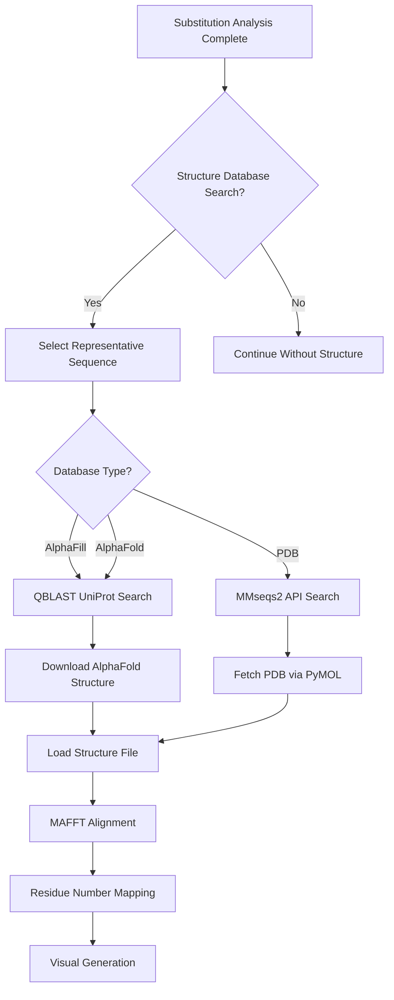

CSUBST provides automated integration with multiple protein structure databases, enabling direct visualization of combinatorial substitution patterns on three-dimensional structures. This system bridges statistical convergence analysis with structural biology, allowing researchers to investigate how convergent substitutions distribute across protein architectures.

## Database Integration Architecture

CSUBST supports three complementary structure databases through its unified search interface. The database selection follows a priority-based strategy controlled by the `--database` parameter, which accepts comma-separated values specifying the search order.

The integration pipeline begins after ancestral state reconstruction and substitution tensor computation, using a representative sequence from the foreground branch combination to query structure databases through `pdb_sequence_search()` [main_site.py](/csubst/main_site.py#L679-L680).



## Supported Databases

CSUBST integrates with three major structure repositories, each serving different analytical needs:

| Database | API Method | E-value Cutoff | Best Use Case |
|----------|------------|----------------|---------------|
| **RCSB PDB** | MMseqs2 REST API | Configurable (`--database_evalue_cutoff`) | Experimental structures with high-resolution data |
| **AlphaFill** | QBLAST + HTTPS download | Configurable | AlphaFold structures with cofactor/ligand annotations |
| **AlphaFold DB** | QBLAST + HTTPS download | Configurable | Pure AlphaFold predictions for proteins lacking experimental structures |

The system automatically validates structure accessibility before download attempts [parser_biodb.py](/csubst/parser_biodb.py#L55-L62). When searching the RCSB PDB database, CSUBST submits a JSON-formatted query to the RCSB search endpoint, specifying sequence similarity thresholds via `database_evalue_cutoff` and `database_minimum_identity` parameters [parser_biodb.py](/csubst/parser_biodb.py#L85-L96).

For AlphaFold databases, the workflow involves an intermediate NCBI QBLAST search against the UniProtKB/SwissProt database to obtain the correct UniProt accession ID [parser_biodb.py](/csubst/parser_biodb.py#L128-L130). This identifier is then used to construct the appropriate AlphaFold download URL.

## Sequence-Based Structure Retrieval

The structure search process identifies a representative sequence from the foreground branch combination using the median length criteria [parser_biodb.py](/csubst/parser_biodb.py#L47-L53). This sequence is translated to amino acid residues and submitted as a query against the specified databases.

For RCSB PDB searches, the system constructs a terminal query request with configurable parameters:

```python
param_dict = {
    'evalue_cutoff': g['database_evalue_cutoff'],
    'identity_cutoff': g['database_minimum_identity'],
    'sequence_type': 'protein',
    'value': aa_query,
}
```

The response includes search scores and identifiers, allowing CSUBST to select the best hit while respecting the maximum chain limit (`--pymol_max_num_chain`) [parser_biodb.py](/csubst/parser_biodb.py#L108-L122). Structures exceeding this limit are rejected with informative messages.

> [!TIP]
> The `--pymol_max_num_chain` parameter defaults to 20, but this may need adjustment for large protein complexes. Multi-chain structures can significantly increase visualization complexity and memory requirements.

## Sequence Alignment and Coordinate Mapping

Once a structure is identified, CSUBST must map codon positions from the input alignment to PDB residue numbers. This process involves two main steps:

### MAFFT-Based Alignment

CSUBST automatically generates an alignment between the PDB sequence and the input alignment using MAFFT [parser_pymol.py](/csubst/parser_pymol.py#L32-L87). The process extracts the protein sequence from the PDB structure using `get_fastastr()`, then uses MAFFT's `--add` mode to align it with the input sequences while preserving the original alignment structure:

```bash
mafft --keeplength --mapout --quiet --thread 1 \
      [--op value] [--ep value] \
      --add tmp.csubst.pdb_seq.fa tmp.csubst.leaf.aa.fa
```

The `--mapout` option generates a `.map` file containing the coordinate mapping between alignment positions and PDB residues, which CSUBST parses to create codon site mappings [parser_pymol.py](/csubst/parser_pymol.py#L124-L144).

### User-Provided Alignments

For cases requiring manual refinement, users can provide a pre-generated alignment file via the `--user_alignment` parameter [main_site.py](/csubst/main_site.py#L691-L695). This bypasses automatic MAFFT alignment and directly loads user-specified coordinate mappings. The system validates that the alignment length matches the original input alignment to prevent site misassignment.

> [!TIP]
> When manually editing alignments, preserve the amino acid site positions in the database-derived sequences. CSUBST cannot account for numbering shifts introduced by manual removal of excess sites, which can cause mapping errors.

## Residue Number Mapping

CSUBST maintains two parallel numbering systems for precise coordinate tracking:

1. **codon_site_[ID]**: Positions of codons in the input alignment (1-indexed after site analysis)
2. **codon_site_pdb_[ID]**: Positions of residues in the PDB file structure

The `add_pdb_residue_numbering()` function extracts residue numbers from each chain and object in the loaded structure [parser_pymol.py](/csubst/parser_pymol.py#L89-L107), filtering out non-alphabetic residue identifiers (often used for insertion codes) and removing duplicates. This mapping is merged with the site-wise analysis DataFrame, filling missing sites with zeros.

## PyMOL Integration and Visualization

CSUBST uses PyMOL to generate colored representations of convergence patterns on protein structures. The visualization system applies a hierarchical coloring scheme based on convergence probabilities and substitution types.

### Structure Loading and Preparation

The `initialize_pymol()` function handles both traditional 4-character PDB codes and newer 8-character PDB IDs [parser_pymol.py](/csubst/parser_pymol.py#L19-L30). Traditional codes trigger remote fetching via PyMOL's `fetch` command, while local files are loaded directly. Optional preprocessing removes solvent molecules (`--remove_solvent`) and specified ligands (`--remove_ligand`) to clean the visualization.

### Convergence Coloring Scheme

The `set_substitution_colors()` function applies three color categories based on statistical thresholds:

| Color Type | Hex Value | Condition | Probability Threshold |
|------------|-----------|-----------|----------------------|
| **OCNany2spe** | #FF0000 (red) | Convergent to same amino acid | `>= --pymol_min_combinat_prob` |
| **OCNany2dif** | #0000FF (blue) | Convergent to different amino acids | `>= --pymol_min_combinat_prob` |
| **single_sub** | #666666 (gray) | Single branch substitutions | `>= --pymol_min_single_prob` |

Transparency is applied to convergent sites (30%) to enhance visual depth perception [parser_pymol.py](/csubst/parser_pymol.py#L309-L311). The background protein structure is colored with a configurable gray level (`--pymol_gray`, default 50) [parser_pymol.py](/csubst/parser_pymol.py#L331).

### Multi-View Export

The `save_six_views()` function generates six orthogonal views of the structure from +X, -X, +Y, -Y, +Z, and -Z directions [parser_pymol.py](/csubst/parser_pymol.py#L344-L440). Each view uses a rotation matrix and camera position specified as 18 floating-point values, with automatic ray-tracing enabled by default for high-quality output.

The `save_6view_pdf()` function combines these six images into a single PDF document with a 3×2 grid layout [parser_pymol.py](/csubst/parser_pymol.py#L442-L492), facilitating publication-ready figure generation without external image manipulation software.

## Chimera Attribute Export

For users preferring UCSF Chimera over PyMOL, CSUBST generates Chimera-compatible attribute files via `export2chimera()` [main_site.py](/csubst/main_site.py#L321-L354). These files contain normalized convergence probability values (positive for same-amino-acid convergence, negative for different-amino-acid convergence) that can be loaded via "Tools → Structure Analysis → Define Attribute" in Chimera.

Additionally, CSUBST exports FASTA files of translated amino acid sequences suitable for homology modeling with tools like SWISS-MODEL, enabling structure prediction for proteins lacking experimental templates.

## Integration Workflow

The complete integration workflow is orchestrated through `main_site()` [main_site.py](/csubst/main_site.py#L635-L720):

1. **Database Search**: If `--run_pdb_sequence_search` is enabled, execute `pdb_sequence_search()`
2. **Structure Loading**: Initialize PyMOL and load the selected structure
3. **Chain Validation**: Verify chain count against `--pymol_max_num_chain` limit
4. **Alignment Generation**: Execute MAFFT alignment or load user-provided alignment
5. **Coordinate Mapping**: Parse mapping files and add residue numbering to analysis DataFrame
6. **Session Generation**: Create colored PyMOL session with substitution visualization
7. **Image Export**: Generate six-view PNG images and composite PDF if `--pymol_img` is enabled

The system gracefully handles failure conditions at each step, continuing analysis without structure visualization if database searches fail or chain limits are exceeded.

## Configuration Parameters

Key parameters controlling structure database integration:

| Parameter | Default | Description |
|-----------|---------|-------------|
| `--database` | pdb | Comma-separated database list (pdb, alphafill, alphafold) |
| `--database_evalue_cutoff` | 10 | E-value threshold for sequence similarity searches |
| `--database_minimum_identity` | 0.3 | Minimum sequence identity for structure selection |
| `--pymol_max_num_chain` | 20 | Maximum allowed chains in loaded structures |
| `--pymol_min_combinat_prob` | 0.95 | Minimum probability for convergence coloring |
| `--pymol_min_single_prob` | 0.95 | Minimum probability for single substitution coloring |
| `--pymol_gray` | 50 | Gray value for background structure (0-100) |
| `--pymol_transparency` | 0.3 | Surface transparency for protein structure |
| `--remove_solvent` | False | Remove solvent molecules from structure |
| `--remove_ligand` | None | Comma-separated list of ligands to remove |

The integration system requires MAFFT to be installed and accessible via the `--mafft_exe` parameter for automatic alignment generation.

## Output Files

Structure database integration generates several output files in the site-specific output directory:

- `csubst_site.[pdb_id].pymol.pse`: PyMOL session file with colored convergence patterns
- `csubst_site.[pdb_id].pymol.pdf`: Composite PDF with six orthogonal views (if `--pymol_img` enabled)
- `csubst_site.[pdb_id].tsv`: Extended site analysis table including PDB residue mappings
- `csubst_site_[seq_name].chimera.txt`: Chimera attribute files for each sequence
- `csubst_site_[seq_name].fasta`: Translated amino acid sequences for homology modeling

The output TSV file contains additional columns for each mapped sequence structure, including `codon_site_[ID]` (alignment positions), `codon_site_pdb_[ID]` (PDB residue numbers), and `aa_[ID]` (amino acid identities) for coordinate tracking.
