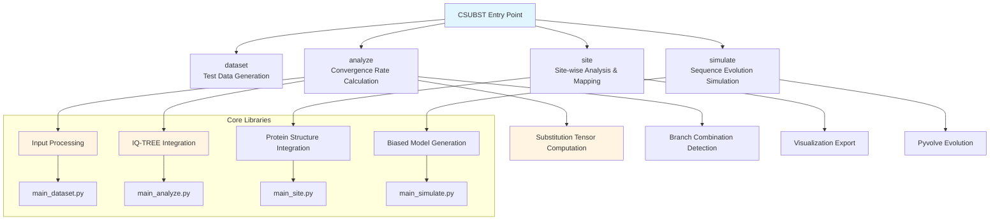
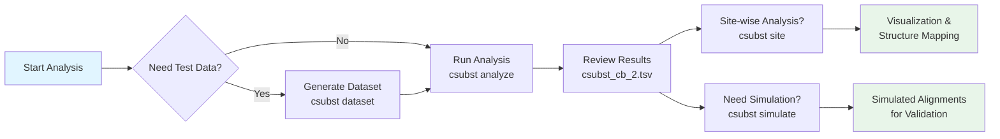

Quick Start provides the fastest path to getting hands-on experience with CSUBST. This guide will walk you through installation, testing the toolkit with provided datasets, and understanding the core workflow for analyzing molecular convergence in coding sequences.


CSUBST (pronounced `/si:sʌbst/`) is a specialized toolkit designed for detecting and analyzing combinatorial substitutions—recurrent amino acid changes occurring at the same protein site across independent evolutionary lineages. The toolkit implements error-corrected statistical methods to distinguish true convergent evolution from random mutations, integrates codon substitution models for ancestral state reconstruction, and supports protein structure mapping for visualizing convergence patterns.

Sources: [README.md](/README.md#L1-L29)

## Installation

CSUBST runs on Python 3.6 or higher and offers two installation methods depending on your preferred package management workflow.

### Option 1: Conda Installation (Recommended)

The Bioconda channel provides the most streamlined installation experience, automatically handling all dependencies including IQ-TREE:

```bash
conda install bioconda::csubst
```

### Option 2: Pip Installation

For users preferring pip, you'll need to install IQ-TREE separately before proceeding with CSUBST:

```bash
# Install dependencies
pip install numpy cython

# Install CSUBST from GitHub
pip install git+https://github.com/kfuku52/csubst
```

> [!TIP]
> **Installation Note**: When using pip installation, ensure IQ-TREE is in your system PATH before running CSUBST, as the toolkit relies on it for ancestral state reconstruction and codon model calculations.

Sources: [README.md](/README.md#L31-L42), [setup.py](/setup.py#L1-L47)

## System Architecture

Understanding CSUBST's architecture helps you navigate its capabilities. The toolkit is organized around four main subcommands that form the complete analysis pipeline:



The architecture reflects a modular design where each subcommand serves a distinct analytical purpose while sharing common computational infrastructure through Cython-optimized modules for tensor operations and phylogenetic parsing.

Sources: [csubst](/csubst/csubst#L1-L200), [main_analyze.py](/csubst/main_analyze.py#L20-L288), [main_site.py](/csubst/main_site.py#L1-L720)

## Quick Test Run

The fastest way to verify your installation and experience CSUBST's workflow is using the provided test datasets. CSUBST includes two pre-configured datasets:

| Dataset | Gene | Size | Description |
|---------|------|------|-------------|
| **PGK** | Phosphoglycerate kinase | Small | Vertebrate PGK genes, ideal for initial testing |
| **PEPC** | Phosphoenolpyruvate carboxylase | Large | Plant PEPC genes, suitable for stress-testing |

### Step 1: Generate Test Dataset

Generate the PGK dataset, which includes alignment files, a rooted phylogenetic tree, and a foreground lineage specification file:

```bash
csubst dataset --name PGK
```

This command creates several files in your working directory:
- `PGK.alignment.fa` - In-frame codon alignment in FASTA format
- `PGK.tree.nwk` - Rooted phylogenetic tree in Newick format  
- `PGK.foreground.txt` - Foreground lineage specification (tab-separated)

Sources: [README.md](/README.md#L44-L45), [main_dataset.py](/csubst/main_dataset.py#L4-L13)

### Step 2: Run Convergence Analysis

Execute the core analysis pipeline on the generated dataset:

```bash
csubst analyze \
  --alignment_file PGK.alignment.fa \
  --rooted_tree_file PGK.tree.nwk \
  --foreground PGK.foreground.txt
```

**What this command does:**
- Reads the codon alignment and rooted tree
- Parses the foreground lineage specification (in this case, labeling specific mammalian species)
- Runs IQ-TREE for ancestral state reconstruction using the default ECMK07+F+R4 codon model
- Computes substitution tensors across all branch combinations
- Identifies branch combinations with significant convergent patterns
- Outputs convergence metrics including ω_C (convergence dN/dS), dN_C, and dS_C

**Expected outputs:**
- `csubst_cb_2.tsv` - Branch combination results with convergence statistics
- `csubst_summary.txt` - Analysis summary with key findings
- `PGK.treefile.iqtree` - IQ-TREE tree output
- `PGK.state.iqtree` - Ancestral state reconstructions
- `PGK.rate.iqtree` - Site-specific evolutionary rates

Sources: [README.md](/README.md#L47-L51), [main_analyze.py](/csubst/main_analyze.py#L127-L288), [csubst/csubst](/csubst/csubst#L100-L200)

### Understanding the Foreground Specification

The `PGK.foreground.txt` file demonstrates how to specify lineages of interest:

| Lineage ID | Regex Pattern | Interpretation |
|------------|---------------|----------------|
| 1 | Monodelphis_domestica_ENSMODG00000023385 | Opossum (outgroup reference) |
| 2 | Homo_sapiens_ENSG00000170950 | Human |
| 2 | Macaca_mulatta_ENSMMUG00000011998 | Rhesus macaque |
| 2 | Mus_musculus_ENSMUSG00000031233 | Mouse |
| 2 | Rattus_norvegicus_ENSRNOG00000013600 | Rat |

This two-column format uses tab separation where the first column identifies lineages and the second column uses regex-compatible patterns to match tip labels in the tree.

Sources: [PGK.foreground.txt](/csubst/dataset/PGK.foreground.txt#L1-L10)

## Core Subcommands Overview

CSUBST provides four primary subcommands covering the complete convergence analysis workflow:



### Dataset Generation Command

The `dataset` subcommand creates ready-to-use test datasets:

```bash
csubst dataset --name <dataset_name>
```

**Parameters:**
- `--name`: Dataset name (choices: `PGK`, `PEPC`)

Sources: [README.md](/README.md#L54-L56)

### Analyze Command

The `analyze` subcommand performs the core convergence analysis:

```bash
csubst analyze \
  --alignment_file <path> \
  --rooted_tree_file <path> \
  --genetic_code <table_id> \
  --iqtree_model <model> \
  --threads <num_cpus> \
  --foreground <path> \
```

**Essential Parameters:**

| Parameter | Type | Default | Description |
|-----------|------|---------|-------------|
| `--alignment_file` | PATH | Required | In-frame codon alignment (FASTA) |
| `--rooted_tree_file` | PATH | Required | Rooted phylogenetic tree (Newick) |
| `--genetic_code` | INTEGER | 1 | NCBI codon table ID (1 = Standard) |
| `--iqtree_model` | STRING | ECMK07+F+R4 | Codon substitution model for IQ-TREE |
| `--threads` | INTEGER | 1 | Number of CPUs for parallel processing |
| `--foreground` | PATH | None | Foreground lineage specification file |

Sources: [README.md](/README.md#L58-L68), [csubst/csubst](/csubst/csubst#L60-L75)

### Site Command

The `site` subcommand performs detailed site-wise analysis with protein structure integration:

```bash
csubst site \
  --alignment_file <path> \
  --rooted_tree_file <path> \
  --branch_id <branch_list> \
  --cb_file <csubst_cb_tsv> \
  --untrimmed_cds <cds_fasta> \
  --pdb <pdb_file> \
```

This command requires first running `csubst analyze` to generate the branch combination file (`csubst_cb_2.tsv`). You then specify which branch combinations to analyze in detail, optionally mapping results onto protein 3D structures using PDB files.

Sources: [README.md](/README.md#L70-L76), [main_site.py](/csubst/main_site.py#L635-L720)

### Simulate Command

The `simulate` subcommand generates synthetic sequences under controlled convergent evolution scenarios:

```bash
csubst simulate \
  --alignment_file <path> \
  --rooted_tree_file <path> \
  --background_omega <value> \
  --foreground_omega <value> \
  --convergent_amino_acids <list> \
  --percent_biased_sub <percentage>
```

**Key Simulation Parameters:**

| Parameter | Type | Default | Description |
|-----------|------|---------|-------------|
| `--background_omega` | FLOAT | 0.2 | dN/dS for background evolution |
| `--foreground_omega` | FLOAT | 0.2 | dN/dS for foreground lineages |
| `--convergent_amino_acids` | STRING | random1 | Target amino acids (e.g., AQTS, or randomN) |
| `--percent_biased_sub` | FLOAT | 90 | Percentage of biased substitutions in foreground |
| `--percent_convergent_site` | FLOAT | 100 | Percentage of sites evolving convergently |

Sources: [README.md](/README.md#L78-L86), [main_simulate.py](/csubst/main_simulate.py#L345-L394)

## Verification Checklist

After completing the test run, verify your installation by checking for these outputs:

```
✓ PGK.alignment.fa                (Input alignment file)
✓ PGK.tree.nwk                   (Input tree file)
✓ PGK.foreground.txt             (Foreground specification)
✓ csubst_cb_2.tsv                (Branch combination results)
✓ csubst_summary.txt             (Analysis summary)
✓ PGK.treefile.iqtree            (IQ-TREE tree output)
✓ PGK.state.iqtree               (Ancestral states)
✓ PGK.rate.iqtree                (Rate categories)
```

> [!TIP]
> **Tip**: The `csubst_cb_2.tsv` file contains the primary analytical results. Open it in a spreadsheet or text editor to inspect branch combinations, convergence statistics, and significance values for your test dataset.

## Next Steps

After successfully running the quick test, you're ready to:

1. **Install CSUBST** - Review detailed installation options and system requirements for production deployments on the [Installation](3-installation) page.

2. **Learn Basic Usage** - Dive deeper into command syntax, parameter configurations, and workflow customization on the [Basic Usage](4-basic-usage) page.

3. **Understand Core Concepts** - Explore the theoretical foundations of combinatorial substitutions and the statistical methods CSUBST employs on the [Overview](1-overview) page.

4. **Explore Advanced Features** - Learn about foreground lineage specification, higher-order convergence detection, and protein structure mapping in the Deep Dive sections.


