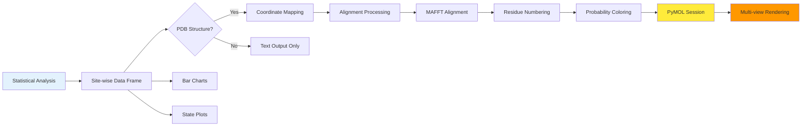

Site-wise substitution mapping enables the spatial visualization of convergent evolution events across protein structures, allowing researchers to identify structural hotspots where combinatorial substitutions occur with significant probability. This feature integrates statistical convergence analysis with 3D structural data to reveal patterns of molecular adaptation.

## Architecture Overview

The site-wise mapping system operates as an integrated pipeline that transforms statistical substitution tensors into visual representations on protein structures. The architecture connects three primary components: statistical computation in `main_site.py`, coordinate mapping in `parser_pymol.py`, and visualization rendering through PyMOL.

Sources: [main_site.py](csubst/main_site.py#L635-L720), [parser_pymol.py](csubst/parser_pymol.py#L1-L100)

## Site-wise Data Frame Initialization

The process begins with `initialize_site_df()`, which creates a foundational data structure for each alignment site. This function establishes the coordinate system that links codon positions to nucleotide positions and serves as the scaffold for all subsequent site-level annotations. Each row represents a single codon site, tracked through both codon and nucleotide coordinate systems.

The data frame integrates multiple layers of information: combinatorial substitution probabilities for both nonsynonymous (N) and synonymous (S) sites, branch-specific substitution probabilities, ancestral and derived codon states, and optionally, structural coordinates from PDB files. The integration occurs through sequential function calls in `main_site()` that progressively enrich the base data frame with statistical and structural information.

Sources: [main_site.py](csubst/main_site.py#L588-L608)

## Statistical Integration

The `add_cs_info()` function computes combinatorial substitution statistics for specified branch combinations. It extracts convergence metrics from substitution tensors and merges them into the site data frame using alignment site identifiers as keys. The function calculates three key probability metrics: any-to-any, any-to-specific, and any-to-different substitution probabilities, which are stored as OCS (synonymous) and OCN (nonsynonymous) values.

For each branch combination analyzed, the system computes both S (synonymous) and N (nonsynonymous) combinatorial substitution probabilities, along with gap rates for all branches and target foreground branches. The gap rate calculations quantify alignment completeness by measuring the proportion of sequences with missing data at each site, which is essential for interpreting substitution probability reliability.

Sources: [main_site.py](csubst/main_site.py#L594-L608), [main_site.py](csubst/main_site.py#L209-L213)

## Structural Coordinate Mapping

When a PDB structure is provided, the system performs coordinate mapping to link statistical sites to 3D structural positions. This process begins with PyMOL initialization in `initialize_pymol()`, which fetches structures from the Protein Data Bank by ID code or loads local PDB files. The system supports both legacy 4-character PDB codes and modern `pdb_XXXXXXX` format identifiers.

The coordinate mapping uses MAFFT alignment to bridge sequence and structural coordinate systems. The `write_mafft_alignment()` function extracts the PDB sequence and aligns it with the input codon alignment using MAFFT's `--add` mode with the `--keeplength` and `--mapout` options to preserve alignment structure and generate position mapping files. This alignment process is critical because structural databases may contain sequences that differ from the input alignment, requiring careful positional mapping.

Sources: [parser_pymol.py](csubst/parser_pymol.py#L19-L33), [parser_pymol.py](csubst/parser_pymol.py#L32-L88)

> [!TIP]
> The MAFFT alignment mapping process is the most error-prone step in site-wise visualization. CSUBST does not automatically exclude poorly aligned regions, so manual verification of the alignment file is essential before interpreting substitution patterns. Always examine the generated alignment file to ensure proper positional correspondence between sequence data and structural coordinates.

## Residue Numbering Systems

The mapping system maintains multiple residue numbering schemes to ensure accurate site identification across different coordinate systems:

- **Alignment Sites**: Position in the input codon alignment (1-based indexing)
- **Gene Sites**: Position in the original untrimmed coding sequence
- **PDB Sites**: Position in the Protein Data Bank structure

The `get_residue_numberings()` function extracts residue information from loaded PDB structures, handling both alpha carbon positions and chain-specific numbering. For each protein chain, the system collects all residue numbers, removes duplicates, and creates mapping tables that link internal site indices to PDB residue numbers. This enables precise positioning of substitution data on 3D structures.

Sources: [parser_pymol.py](csubst/parser_pymol.py#L89-L108), [main_site.py](csubst/main_site.py#L226-L304)

When user-provided alignments are supplied via `--user_alignment`, the system bypasses the MAFFT alignment step and directly maps coordinates using `add_coordinate_from_user_alignment()`. This function performs position-by-position comparison between the user alignment and the PDB sequence, handling gaps and mismatches while maintaining accurate site-to-residue correspondence.

## Gene Index Integration

For analyses requiring original gene coordinate mapping, the `add_gene_index()` function establishes correspondence between alignment sites and gene coding sites. This function uses a sliding-window approach with multiple window sizes (100, 50, 10, 5, 4, 3, 2, 1 codons) to progressively match alignment sites to gene coordinates. The algorithm identifies matching sequence windows between the alignment and untrimmed coding sequences, accounting for gaps and maintaining positional integrity.

The window-based matching strategy enables robust mapping even when sequences contain gaps or structural variations. By progressively reducing window sizes, the system achieves high-precision mapping while avoiding false matches in repetitive regions.

Sources: [main_site.py](csubst/main_site.py#L226-L304)

## Probability-Based Color Mapping

The visualization system uses color coding to represent substitution probability distributions on protein structures. The `set_substitution_colors()` function implements a hierarchical coloring scheme based on probability thresholds:

- **Red (OCNany2spe)**: High-probability combinatorial substitutions converging to the same amino acid (≥ `pymol_min_combinat_prob`)
- **Blue (OCNany2dif)**: High-probability combinatorial substitutions converging to different amino acids (≥ `pymol_min_combinat_prob`)
- **Gray (single_sub)**: Single-branch substitutions (≥ `pymol_min_single_prob`)
- **Gray background**: Sites below probability thresholds

Each colored site is rendered with 30% transparency in PyMOL to preserve visibility of underlying structural features. The color selection logic prioritizes combinatorial convergence events over single substitutions, ensuring that the most biologically interesting patterns remain visually prominent.

Sources: [parser_pymol.py](csubst/parser_pymol.py#L263-L312)

## PyMOL Session Generation

The `write_pymol_session()` function creates complete PyMOL visualization sessions with optimized rendering settings. The system applies several standard visualization presets:

- Cartoon representation for protein backbone
- Surface rendering with configurable transparency
- Solvent and ligand removal (optionally)
- Organic molecule coloring for small molecules
- Automatic zoom to fit the entire structure

The session saves to `.pse` files containing all coloring, viewing, and rendering settings, enabling reproducible visualization across analysis sessions. For multi-chain structures, the system applies coordinate mapping to each chain independently, ensuring accurate site coloring across complex protein assemblies.

Sources: [parser_pymol.py](csubst/parser_pymol.py#L313-L341)

## Multi-View Rendering

The `save_six_views()` function generates standardized structural images from six orthogonal viewing directions (+X, -X, +Y, -Y, +Z, -Z). Each view uses precisely calculated camera positions and rotation matrices to ensure consistent orientation across analyses. The rendering supports both perspective and orthographic projections, with configurable resolution (default: 900×900 pixels at 300 DPI).

The `save_6view_pdf()` function combines the six rendered views into a single PDF document with a 2×3 grid layout, providing a comprehensive overview of substitution distribution across the entire protein structure. This multi-view format enables efficient communication of complex spatial patterns in publications and presentations.

Sources: [parser_pymol.py](csubst/parser_pymol.py#L344-L442)

## Chimera Attribute Export

For users preferring UCSF Chimera visualization, the `export2chimera()` function generates attribute files that can be loaded via "Tools → Structure Analysis → Define Attribute". These files assign numerical values to each residue based on convergence probabilities:

- Positive values: OCNany2spe probability (convergent to same amino acid)
- Negative values: -OCNany2dif probability (convergent to different amino acids)
- None: Sites below probability thresholds

The function also exports corresponding FASTA files with translated protein sequences, enabling direct loading of structural data into Chimera. This dual-output format supports flexible visualization workflows across different molecular graphics platforms.

Sources: [main_site.py](csubst/main_site.py#L321-L356)

## Bar Chart Visualization

The `plot_barchart()` function generates static bar chart visualizations displaying site-wise substitution patterns. These charts show both nonsynonymous (colored) and synonymous (gray) substitutions across alignment sites, with gray-scale bars indicating alignment gap rates (white = 0% gaps, black = 100% gaps). The visualization uses stacked bars to combine S and N substitutions when either exceeds a threshold of 0.01, providing a compact representation of site-wise substitution activity.

The bar charts serve as essential diagnostic tools for identifying problematic alignment regions and validating statistical patterns before proceeding to 3D structural visualization. They provide immediate feedback on data quality and convergence signal distribution.

Sources: [main_site.py](csubst/main_site.py#L140-L208)

## Configuration Parameters

Several key parameters control site-wise mapping behavior:

| Parameter | Function | Default | Impact |
|-----------|----------|---------|--------|
| `--pdb` | PDB ID or file path | None | Enables structural visualization |
| `--pymol_min_combinat_prob` | Minimum probability for combinatorial coloring | Configurable | Controls red/blue site threshold |
| `--pymol_min_single_prob` | Minimum probability for single substitution | Configurable | Controls gray site threshold |
| `--pymol_transparency` | Surface transparency (0-1) | Configurable | Affects structure visibility |
| `--pymol_gray` | Background gray value (0-100) | Configurable | Base structure color |
| `--pymol_max_num_chain` | Maximum chain limit for PDB | Configurable | Prevents session overflow |
| `--user_alignment` | Custom alignment file | None | Bypasses MAFFT mapping |
| `--untrimmed_cds` | Original CDS sequence | None | Enables gene index mapping |

Sources: [param.py](csubst/param.py#L1-L81)

> [!TIP]
> When analyzing large multi-chain structures (>10 chains), consider increasing `--pymol_max_num_chain` or limiting analysis to specific chains. PyMOL session generation can fail silently with excessive chains, and session file corruption may occur. Test with a single chain before processing complete complexes.

## Output Files

The site-wise mapping pipeline generates several output files:

- **`csubst_site.tsv`**: Comprehensive tabular data with site statistics, probabilities, and coordinates
- **`csubst_site.[pdb_id].pymol.pse`**: Complete PyMOL session with color-coded substitutions
- **`csubst_site.[pdb_id].pymol.[direction].png`**: Six orthogonal view images
- **`csubst_site.[pdb_id].pymol.pdf`**: Combined multi-view PDF document
- **`csubst_site_[seqname].chimera.txt`**: Chimera attribute files
- **`csubst_site.pdf`**: Bar chart visualization of substitution patterns

All files are saved to branch-specific output directories (`./csubst_site.branch_idX,Y,Z/`), enabling organized storage of results from multiple branch combination analyses.

Sources: [main_site.py](csubst/main_site.py#L635-L720)

## Single Branch Mode

When analyzing single branches, the system automatically activates single branch mode, which converts combinatorial metrics to single-branch equivalents. The `combinatorial2single_columns()` function simplifies the data structure by removing combinatorial-specific columns and displaying single-branch substitution probabilities using purple coloration. This mode is useful for identifying lineage-specific patterns without combinatorial context.

In single branch mode, the color coding changes: single-branch N substitutions appear in purple (RGB: 0.5, 0, 0.5), clearly distinguishing them from multi-branch convergence patterns. This visual distinction helps analysts quickly differentiate between lineage-specific adaptations and convergent evolution events.

Sources: [main_site.py](csubst/main_site.py#L626-L634), [parser_pymol.py](csubst/parser_pymol.py#L263-L312)

## Next Steps

To gain deeper understanding of the statistical foundations underlying site-wise mapping, explore [Combinatorial Substitutions](5-combinatorial-substitutions) for detailed explanations of convergence probability calculations. For practical implementation guidance, see [Basic Usage](4-basic-usage) for command-line examples and parameter configuration.

For advanced visualization workflows, proceed to [PyMOL and Chimera Visualization](21-pymol-and-chimera-visualization) to learn about customizing rendering settings, creating publication-quality figures, and integrating additional structural data layers into your analyses.