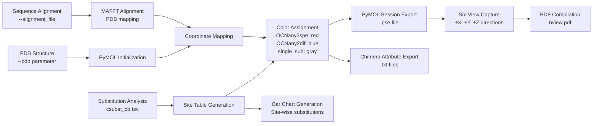
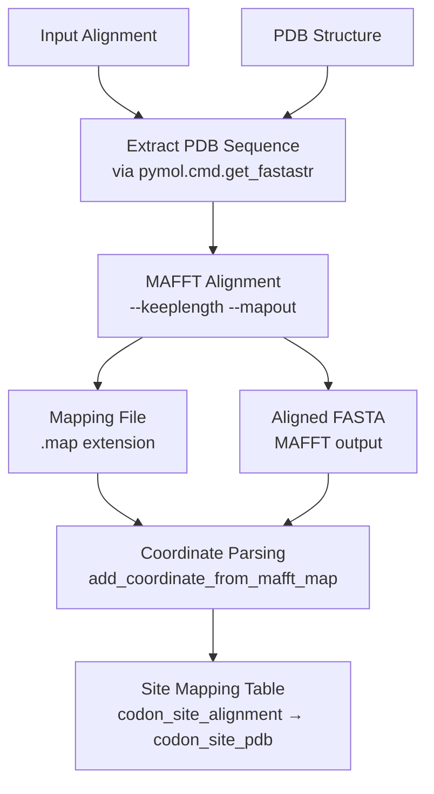

The csubst visualization system integrates molecular structure analysis with evolutionary substitution mapping, enabling comprehensive visual exploration of convergence patterns on protein structures. This system supports both PyMOL and UCSF Chimera platforms through automated workflows that transform substitution detection results into publication-ready visualizations.

## Visualization Architecture

The visualization pipeline operates through a multi-stage process that bridges evolutionary analysis with structural biology. The core architecture coordinates between sequence alignment, structure mapping, and visual rendering systems.



This modular design enables flexible visualization approaches while maintaining consistency between structural and evolutionary data representations. The system automatically handles coordinate transformations between alignment sites and PDB residues through sophisticated mapping algorithms.

## PDB Structure Loading and Initialization

The visualization workflow begins with PyMOL initialization, which accommodates multiple PDB input formats including legacy PDB codes (4-character alphanumeric) and modern RCSB identifiers (8-character format). The `initialize_pymol()` function manages structure fetching from online databases when PDB codes are provided, or loads local PDB files directly.

Sources: [parser_pymol.py](csubst/parser_pymol.py#L19-L31)

Structure loading supports both automated retrieval and local file access, with error handling for internet connectivity and invalid PDB identifiers. The initialization process clears any existing PyMOL objects to ensure a clean working environment.

> [!TIP]
> When working with large protein complexes or multi-chain structures, ensure sufficient memory allocation as the visualization process maintains full coordinate data in memory during rendering operations.

## Sequence-Structure Alignment Mapping

Accurate visualization requires precise mapping between codon sites in the evolutionary alignment and amino acid residues in the protein structure. This mapping is achieved through MAFFT-based sequence alignment with the `--keeplength` and `--mapout` options, preserving the original alignment structure while generating coordinate mapping files.

Sources: [parser_pymol.py](csubst/parser_pymol.py#L32-L88)

The alignment process follows this workflow:



The mapping generates two critical coordinate systems: `codon_site_alignment` (positions in the input alignment) and `codon_site_pdb` (positions in the structure file). Sites with `0` values indicate missing or unmapped positions, which are automatically handled during visualization.

Sources: [parser_pymol.py](csubst/parser_pymol.py#L124-L144)

### Custom Alignment Support

For users requiring manual alignment adjustments, the system supports user-provided alignments through the `--user_alignment` parameter. The `add_coordinate_from_user_alignment()` function processes custom alignments while maintaining coordinate consistency, enabling manual refinement of alignment quality without disrupting the mapping infrastructure.

Sources: [parser_pymol.py](csubst/parser_pymol.py#L146-L177)

## PyMOL Session Generation

The core visualization output is a complete PyMOL session file that encapsulates all styling, coloring, and viewing configurations. The `write_pymol_session()` function orchestrates this process through a series of PyMOL command operations:

Sources: [parser_pymol.py](csubst/parser_pymol.py#L313-L340)

### Rendering Pipeline Steps

| Step | PyMOL Command | Purpose | Parameters |
|------|---------------|---------|------------|
| 1 | `set seq_view, 1` | Enable sequence viewer visualization | - |
| 2 | `remove solvent` | Remove water molecules for cleaner views | `--remove_solvent` |
| 3 | `remove resn` | Remove specified ligand molecules | `--remove_ligand` |
| 4 | `preset.ligand_sites_trans_hq` | Apply high-quality ligand site preset | - |
| 5 | `hide wire/ribbon` | Hide default representations | - |
| 6 | `show cartoon` | Display cartoon secondary structure | - |
| 7 | `show surface` | Display molecular surface | - |
| 8 | `set transparency` | Apply transparency to protein surface | `--pymol_transparency` |
| 9 | `color gray` | Apply base gray color to structure | `--pymol_gray` |
| 10 | `util.cbag organic` | Color organic ligands by element | - |

### Substitution Color Mapping

The system automatically colors residues based on substitution patterns detected in the combinatorial analysis. Color assignments are determined by posterior probabilities from the OCN (Observed Codon Non-synonymous) metrics:

Sources: [parser_pymol.py](csubst/parser_pymol.py#L263-L312)

| Substitution Type | Color (Hex) | Probability Threshold | Transparency |
|-------------------|-------------|----------------------|--------------|
| OCNany2spe (specific convergent) | `#FF0000` (red) | `--pymol_min_combinat_prob` | 30% |
| OCNany2dif (divergent) | `#0000FF` (blue) | `--pymol_min_combinat_prob` | 30% |
| single_sub (single branch) | `#666666` (gray) | `--pymol_min_single_prob` | None |
| single_branch_N (foreground) | `#800080` (purple) | N/A | None |

The coloring logic in `set_substitution_colors()` evaluates each codon site against probability thresholds, applying conditional transparency to highlight convergent sites while maintaining overall structure visibility:

Sources: [parser_pymol.py](csubst/parser_pymol.py#L282-L311)

```python
if (prob_Nany2spe >= g['pymol_min_combinat_prob']) and (prob_Nany2dif <= prob_Nany2spe):
    color_sites['OCNany2spe'].append(codon_site)  # Red convergent
elif (prob_Nany2dif >= g['pymol_min_combinat_prob']) and (prob_Nany2dif > prob_Nany2spe):
    color_sites['OCNany2dif'].append(codon_site)  # Blue divergent
elif (prob_single_sub >= g['pymol_min_single_prob']):
    color_sites['single_sub'].append(codon_site)  # Gray single
```

### Chain Masking for Multi-Subunit Complexes

For protein complexes with multiple chains, the `mask_subunit()` function automatically applies distinct colors to non-identical subunits and nucleic acid chains, improving structural discrimination in visualizations. The system calculates amino acid identity between chains using `calc_aa_identity()` and identifies overlapping sequence ranges to determine which chains require differential coloring.

Sources: [parser_pymol.py](csubst/parser_pymol.py#L210-L249)

The masking algorithm:
1. Calculates pairwise amino acid identity across all chains
2. Identifies the chain with highest identity as the reference
3. Applies distinct colors to non-overlapping chains from 13 predefined colors
4. Masks nucleic acid chains separately (DNA nucleotides colored pink)

> [!TIP]
> For extremely large complexes (>13 chains), the color palette automatically cycles through available colors. Consider customizing the `colors` array in `mask_subunit()` for complex-specific visualization schemes.

## Multi-View Image Capture

The `save_six_views()` function captures publication-quality structural views from six orthogonal directions (+X, -X, +Y, -Y, +Z, -Z), ensuring comprehensive documentation of spatial relationships among convergent sites.

Sources: [parser_pymol.py](csubst/parser_pymol.py#L344-L440)

### View Configuration

Each view direction requires precise camera positioning through 18-parameter view matrices:

- **Rotation matrix** (9 floats): 3×3 matrix specifying camera orientation
- **Camera position** (3 floats): (X, Y, Z) coordinates
- **Clipping planes** (2 floats): Front and back plane distances
- **Perspective** (1 float): 1.0 for perspective, -1 for orthographic
- **Origin translation** (3 floats): Scene origin offset

For example, the +X view configuration:
```python
'pos_x': [
    0.0,  0.0, -1.0,   # Rotation row 1
    0.0,  1.0,  0.0,   # Rotation row 2
    1.0,  0.0,  0.0,   # Rotation row 3
    100.0, 0.0, 0.0,   # Camera position
    0.0, 200.0,        # Front/back planes
    1.0,               # Perspective on
    0.0, 0.0, 0.0      # Origin translation
]
```

Sources: [parser_pymol.py](csubst/parser_pymol.py#L361-L378)

### PDF Compilation

The `save_6view_pdf()` function automatically compiles the six captured PNG images into a single PDF with a 3×2 grid layout, suitable for manuscript figures. The function uses matplotlib for image arrangement and generates publication-ready output with proper spacing and labeling.

Sources: [parser_pymol.py](csubst/parser_pymol.py#L442-L492)

Default output specifications:
- **Figure size**: 7.2 × 9.7 inches
- **Grid layout**: 3 rows × 2 columns
- **Direction order**: +X, -X, +Y, -Y, +Z, -Z
- **Filename**: `6view.pdf` (customizable via `--pdf_filename`)

## Chimera Attribute File Export

For researchers preferring UCSF Chimera visualization, the system generates attribute definition files through the `export2chimera()` function. These files map substitution probabilities to structural residues using Chimera's attribute system.

Sources: [main_site.py](csubst/main_site.py#L321-L355)

### Attribute File Format

Chimera attribute files use the following structure:

```
attribute: condivPP
match mode: 1-to-1
recipient: residues
none handling: None
	:1	0.8423
	:2	-0.6152
	:3	None
	:4	0.9201
```

Key specifications:
- **Attribute name**: `condivPP` (combinatorial divergence)
- **Match mode**: `1-to-1` (one residue per data point)
- **Recipient**: `residues` (residue-level attribute)
- **Value encoding**: Positive = any2spe, Negative = any2dif, `None` = missing

Sources: [main_site.py](csubst/main_site.py#L322-L348)

### Value Assignment Logic

The system assigns values based on the maximum posterior probability:
```python
Nany2spe = df.loc[is_site, 'OCNany2spe'].values[0]
Nany2dif = df.loc[is_site, 'OCNany2dif'].values[0]
Nvalue = Nany2spe if (Nany2spe >= Nany2dif) else -Nany2dif
```

This encoding enables gradient coloring schemes in Chimera where:
- Positive values (red spectrum) indicate convergent substitutions
- Negative values (blue spectrum) indicate divergent substitutions
- Magnitude reflects probability strength

### Homology Modeling Support

The system exports translated amino acid sequences in FASTA format for each analyzed sequence, enabling homology modeling to obtain PDB structures when experimental structures are unavailable. Files are named `csubst_site_[sequence_name].fasta` and include translated sequences suitable for SWISS-MODEL or other modeling servers.

Sources: [main_site.py](csubst/main_site.py#L349-L355)

## Site-Wise Substitution Bar Charts

In addition to structural visualization, the system generates comprehensive bar charts showing substitution patterns across alignment sites. The `plot_barchart()` function creates multi-panel visualizations with the following components:

Sources: [main_site.py](csubst/main_site.py#L140-L200)

### Chart Architecture

| Panel | Content | Y-axis Range | Color Scheme |
|-------|---------|--------------|--------------|
| Top | Branch-wise substitutions (entire tree) | Dynamic | N: black, S: gainsboro |
| Middle | Branch-wise substitutions (target branches) | Fixed | N: black, S: gainsboro |
| Bottom | Posterior probabilities (any2spe/any2dif) | 0-1 | any2spe: red, any2dif: blue |

### Gap Indication System

Alignment gaps are visualized through grayscale bars positioned at the top of each panel:
- **White**: 0% missing (complete data)
- **Gray**: Partial missing
- **Black**: 100% missing (complete gap)

The `add_gapline()` function constructs continuous gap segments by iterating through alignment positions and detecting changes in gap rate, creating visual representations of data completeness across sites.

Sources: [main_site.py](csubst/main_site.py#L43-L79)

### Substitution Labeling

For sites meeting probability thresholds (`--pymol_min_combinat_prob`), the system adds vertical text labels showing the amino acid substitution pattern. Labels include ancestral and derived states with PDB residue numbering (e.g., "A45V" for alanine to valine at position 45).

Sources: [main_site.py](csubst/main_site.py#L117-L139)

> [!TIP]
> Labels use intelligent collision avoidance by checking horizontal spacing between adjacent substitutions. When labels would overlap, the system alternates justification (left/right) and adds small offsets to maintain readability.

## Configuration Parameters

Visualization behavior is controlled through multiple command-line parameters:

| Parameter | Default | Description | Impact |
|-----------|---------|-------------|--------|
| `--pdb` | None | PDB structure identifier or file path | Required for visualization |
| `--pymol_min_combinat_prob` | 0.5 | Minimum probability for convergent coloring | Determines color assignment sensitivity |
| `--pymol_min_single_prob` | 0.01 | Minimum probability for single-substitution coloring | Controls gray site highlighting |
| `--pymol_transparency` | 0.3 | Surface transparency (0-1) | Affects structure visibility |
| `--pymol_gray` | 50 | Base gray value for structure (0-100) | Controls background brightness |
| `--remove_solvent` | False | Remove water molecules | Affects visual clarity |
| `--remove_ligand` | None | Comma-separated ligand codes to remove | Controls cofactor visibility |
| `--mask_subunit` | False | Enable chain coloring in complexes | Affects multi-chain rendering |
| `--mafft_op` | -1 | MAFFT gap opening penalty | Influences alignment quality |
| `--mafft_ep` | -1 | MAFFT gap extension penalty | Influences alignment quality |

## Integration with Analysis Pipeline

Visualization generation occurs as a post-processing step after combinatorial branch combination detection. The workflow requires output files from the main analysis:

Sources: [main_analyze.py](csubst/main_analyze.py#L272-L284)

### Required Input Files

- **`csubst_cb.tsv`**: Branch combination statistics with OCN probabilities
- **Alignment files**: Original input alignment and untrimmed CDS
- **Tree file**: Phylogenetic tree with numerical labels
- **PDB structure**: Optional structure file for mapping

### Output File Structure

```
output_directory/
├── csubst_site.pdf              # Site-wise bar charts
├── csubst_session.pse           # PyMOL session file
├── csubst_site_[seq].chimera.txt # Chimera attribute files
├── csubst_site_[seq].fasta      # Translated sequences
├── tmp.csubst.pymol_pos_x.png   # +X view
├── tmp.csubst.pymol_neg_x.png   # -X view
├── tmp.csubst.pymol_pos_y.png   # +Y view
├── tmp.csubst.pymol_neg_y.png   # -Y view
├── tmp.csubst.pymol_pos_z.png   # +Z view
├── tmp.csubst.pymol_neg_z.png   # -Z view
└── 6view.pdf                    # Compiled multi-view PDF
```

## R Notebook Integration

The repository includes an R notebook (`csubst_visualization.ipynb`) for phylogenetic tree visualization using the ggtree package. This notebook provides complementary visualization capabilities focusing on evolutionary relationships rather than structural mapping.

Sources: [csubst_visualization.ipynb](csubst/csubst_visualization.ipynb#L144-L161)

### Key Features

- **Tree visualization** with convergence annotations
- **Numerical label assignment** for branch identification
- **Line coordinate extraction** for mapping substitution data onto tree branches
- **Integration with Bioconductor packages** (ape, ggtree, Biostrings)

The notebook supports both debug mode (interactive exploration) and batch mode (automated processing) for flexible workflow integration.

## Best Practices and Considerations

### Alignment Quality Control

The system does not automatically exclude poorly aligned regions. Users must carefully review the MAFFT alignment file before interpreting substitution events. Manual adjustments can be incorporated using the `--user_alignment` parameter while maintaining coordinate consistency.

Sources: [parser_pymol.py](csubst/parser_pymol.py#L61-L83)

### Site Numbering Consistency

When manually editing alignments:
- Preserve amino acid positions for database-derived sequences
- Remove excess sites from database sequences rather than input sequences
- Maintain awareness of site numbering shifts as csubst cannot account for manual removals
- Use the same `--alignment_file` for reruns with `--user_alignment`

Sources: [parser_pymol.py](csubst/parser_pymol.py#L66-L82)

### Performance Optimization

For large structures or complexes:
- Use `--remove_solvent` to reduce rendering complexity
- Apply `--remove_ligand` for non-essential cofactors
- Increase transparency values (`--pymol_transparency`) to reduce raytracing computational load
- Consider batch processing multiple structures using the session file generation pipeline

### Publication Workflow

The recommended workflow for manuscript figures:
1. Generate PyMOL session file with default parameters
2. Load session in PyMOL GUI for fine-tuning camera angles
3. Use `save_six_views()` with high DPI (300) for final output
4. Compile to PDF using `save_6view_pdf()` for figure assembly
5. Export Chimera attributes for alternative visualization platform

## Troubleshooting

### Common Issues

**Issue**: "MAFFT alignment file not detected"
- **Cause**: MAFFT execution delay or network connectivity issues
- **Solution**: System waits up to 10 seconds for file appearance; verify MAFFT installation and network connectivity for PDB fetching

Sources: [parser_pymol.py](csubst/parser_pymol.py#L54-L60)

**Issue**: Missing coordinate mapping (all codon_site_pdb = 0)
- **Cause**: Low sequence identity between PDB structure and alignment
- **Solution**: Review MAFFT alignment quality, consider alternative PDB structures, or use homology modeling

**Issue**: Incorrect residue numbering in labels
- **Cause**: Manual alignment editing without preserving coordinate consistency
- **Solution**: Use `--user_alignment` with properly maintained numbering, or re-run full pipeline

**Issue**: Chain masking not applied
- **Cause**: Single-chain structure or identical subunits
- **Solution**: Verify chain count with `get_num_chain()`, check amino acid identity calculations

Sources: [parser_pymol.py](csubst/parser_pymol.py#L494-L500)

---

The csubst visualization system provides comprehensive structural mapping of combinatorial substitution patterns through automated PyMOL and Chimera integration. By leveraging precise alignment-to-structure coordinate mapping and probability-based coloring schemes, researchers can explore spatial relationships among convergent evolutionary events with publication-ready visual output.

For detailed information on the statistical methods underlying the substitution detection, see [Convergence Rate Calculation](12-convergence-rate-calculation) and [Branch Combination Detection](11-branch-combination-detection). To understand the input processing pipeline that generates the data visualized here, refer to [Input Processing and Tree Parsing](8-input-processing-and-tree-parsing).