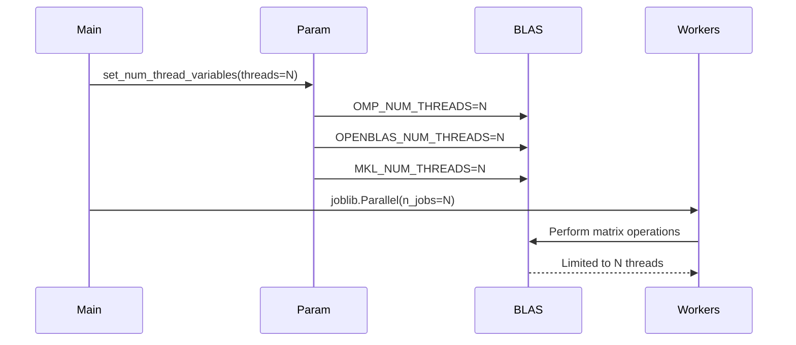

This document examines the computational architecture of csubst's performance optimization strategies and memory management systems. The framework employs a multi-layered approach combining Cython-accelerated computations, memory-mapped data structures, and parallel processing pipelines to handle large-scale combinatorial substitution analysis efficiently.

## Computational Performance Architecture

### Cython Acceleration Layer

The core computational bottlenecks are addressed through Cython-compiled modules with aggressive optimization directives. Three primary Cython modules handle critical path operations: combinatorial substitution calculations, branch combination generation, and permutation-based statistical testing.

The combinatorial substitution function `calc_combinatorial_sub_float32` in [substitution_cy.pyx](csubst/substitution_cy.pyx#L1-L35) demonstrates the optimization pattern. The function applies three critical Cython decorators: `@cython.boundscheck(False)` eliminates array boundary validation overhead, `@cython.wraparound(False)` disables negative index support, and `@cython.nonecheck(False)` removes NULL-checking. These optimizations collectively reduce Python interpreter overhead in tight loops processing multi-dimensional tensors.

**Sources:** [substitution_cy.pyx](csubst/substitution_cy.pyx#L1-L35)

The branch combination generation function `generate_id_chunk` in [combination_cy.pyx](csubst/combination_cy.pyx#L11-L29) implements a similar optimization strategy. This function efficiently generates index combinations from node relationship matrices, a computationally intensive step in higher-order convergence detection. The optimization enables processing of millions of branch combinations in practical timeframes.

**Sources:** [combination_cy.pyx](csubst/combination_cy.pyx#L11-L29)

For statistical null model generation, the permutation algorithm `get_permutations` in [omega_cy.pyx](csubst/omega_cy.pyx#L8-L44) handles complex randomization tasks. This function generates random site assignments across branches while maintaining specified probability distributions, a requirement for accurate convergence rate estimation. The Cython implementation makes permutation-based hypothesis testing computationally feasible.

**Sources:** [omega_cy.pyx](csubst/omega_cy.pyx#L8-L44)

### Data Type Precision Control

The framework provides configurable floating-point precision through the `--float_type` parameter in [param.py](csubst/param.py#L48-L53), enabling memory-speed tradeoffs tailored to dataset characteristics:

| Float Type | Precision | Memory Savings | Typical Use Case |
|------------|-----------|----------------|------------------|
| float16 | 10⁻¹ | 75% vs float64 | Large-scale exploratory analysis |
| float32 | 10⁻³ | 50% vs float64 | Standard production analysis |
| float64 | 10⁻⁹ | Baseline | High-precision requirements |

The parameter mapping in [param.py](csubst/param.py#L48-L53) automatically adjusts float tolerance thresholds alongside precision settings, ensuring numerical stability across precision levels.

**Sources:** [param.py](csubst/param.py#L48-L53)

## Memory Management Strategy

### Memory-Mapped Tensor Architecture

The substitution tensor infrastructure leverages NumPy's memory-mapped array facility to handle data structures exceeding available RAM. The `initialize_substitution_tensor` function in [substitution.py](csubst/substitution.py#L12-L25) creates memory-mapped tensors with configurable axes: [branch, site, matrix_group, state_from, state_to]. This architecture enables analysis of large phylogenetic datasets by streaming tensor operations through disk-backed storage.

**Sources:** [substitution.py](csubst/substitution.py#L12-L25)

The tensor generation process in `get_substitution_tensor` [substitution.py](csubst/substitution.py#L31-L60) implements careful memory management by performing in-place operations where possible. The function uses `numpy.nan_to_num` with `copy=False` to avoid memory duplication when converting NaN values to zero. The tensor structure accommodates two modes: 'asis' for direct codon-to-codon transitions and 'syn' for synonymous codon group transitions.

**Sources:** [substitution.py](csubst/substitution.py#L31-L60)

### Parallel Processing with Memory Efficiency

The parallel processing framework integrates memory management with computational distribution. The `get_chunks` function in [parallel.py](csubst/parallel.py#L1-L17) intelligently partitions input data across available threads while handling both NumPy arrays and standard Python sequences. The chunking strategy ensures balanced workload distribution while maintaining memory locality.

**Sources:** [parallel.py](csubst/parallel.py#L1-L17)

> [!TIP]
> The chunk calculation uses ceiling division `(input.shape[0] + i) // threads` which ensures all elements are assigned to a chunk, even when the input size is not evenly divisible by the number of threads. This prevents data loss during parallel processing.

For large-scale combinatorial substitution calculations, the framework implements a sophisticated memory-mapped parallel processing pattern. In `get_cbs` function [substitution.py](csubst/substitution.py#L243-L268), parallel workers write results directly to a shared memory-mapped array, eliminating the need to merge separate result arrays. The pattern includes:

1. Memory-mapped output file creation with pre-allocated shape
2. Thread-pool limits on BLAS operations to prevent CPU oversubscription
3. Multiprocessing backend with `max_nbytes=None` for large data handling
4. Post-computation cleanup of temporary memory-mapped files

**Sources:** [substitution.py](csubst/substitution.py#L243-L268)

### Omega Calculation Memory Optimization

The omega (dN/dS) estimation pipeline in [omega.py](csubst/omega.py#L95-L135) demonstrates memory-efficient expectation value computation. For multi-threaded scenarios, the framework uses memory-mapped arrays (`dfEb`) to accumulate partial results from parallel workers. The expectation value calculation `calc_E_stat` [omega.py](csubst/omega.py#L95-L135) implements both mean and quantile computation strategies, with quantile mode requiring additional memory for storing permutation results.

**Sources:** [omega.py](csubst/omega.py#L95-L135)

> [!TIP]
> The quantile computation mode stores an N × M matrix where N is the number of branch combinations and M is the number of permutation iterations. This can require substantial memory; for large analyses, the mean mode provides a more memory-efficient alternative.

## Computational Complexity Management

### Branch-and-Bound Search Strategy

The higher-order convergence detection in [main_analyze.py](csubst/main_analyze.py#L20-L130) implements a heuristic branch-and-bound algorithm to manage combinatorial explosion. For arity K ≥ 3, the system filters K-1 combinations based on statistical cutoffs (`--cutoff_stat`) before generating K combinations. This strategy dramatically reduces the search space for higher-order convergence detection.

**Sources:** [main_analyze.py](csubst/main_analyze.py#L20-L130)

The search process includes:

1. **Arity 2**: Exhaustive search or targeted foreground branch combinations
2. **Arity 3+**: Heuristic search using K-1 results as candidates
3. **Cutoff application**: Statistical threshold to prune search space
4. **Maximum combination limit**: Hard limit on candidate combinations via `--max_combination`

### Thread Pool Control

The framework implements explicit thread pool management to prevent CPU oversubscription. In [param.py](csubst/param.py#L72-L81), the `set_num_thread_variables` function configures environment variables for multiple numerical libraries (OMP, OpenBLAS, MKL, VECLIB, NUMEXPR). This ensures that underlying BLAS/LAPACK operations respect the specified thread count.

**Sources:** [param.py](csubst/param.py#L72-L81)

During parallel processing operations, the framework uses `threadpoolctl` to temporarily limit BLAS threads to 1 per process [substitution.py](csubst/substitution.py#L258-L262). This prevents thread explosion when multiple worker processes simultaneously invoke BLAS operations.

**Sources:** [substitution.py](csubst/substitution.py#L258-L262)

## Memory Cleanup and Resource Management

### Temporary File Management

The framework implements aggressive cleanup of temporary memory-mapped files to prevent disk space exhaustion. Pattern throughout the codebase:

1. Create memory-mapped file with `.mmap` extension
2. Perform parallel computation writing to mmap
3. Load results into standard data structures
4. Unlink/delete temporary mmap files

Examples in [substitution.py](csubst/substitution.py#L254-L268) and [omega.py](csubst/omega.py#L110-L114) show this pattern in action. The cleanup occurs immediately after data transfer to in-memory structures, minimizing disk usage.

**Sources:** [substitution.py](csubst/substitution.py#L254-L268), [omega.py](csubst/omega.py#L110-L114)

### Explicit Memory Deallocation

Large intermediate objects are explicitly deleted after use. In [main_analyze.py](csubst/main_analyze.py#L86-L87), after merging combinatorial substitution tables (cbS and cbN), both intermediate tables are deleted before downstream operations. This pattern reduces peak memory consumption during complex analysis pipelines.

**Sources:** [main_analyze.py](csubst/main_analyze.py#L86-L87)

## Performance Monitoring and Reporting

### Progress Tracking

Long-running operations include comprehensive progress reporting with time metrics. The combinatorial substitution calculation in [substitution.py](csubst/substitution.py#L162-L166) reports progress every 10,000 combinations with elapsed time. This enables users to monitor computation progress and estimate completion times for large analyses.

**Sources:** [substitution.py](csubst/substitution.py#L162-L166)

The expectation value calculation in [omega.py](csubst/omega.py#L78-L79) reports progress for matrix group/ancestral state/derived state combinations, providing fine-grained visibility into the computational progress for statistical estimation.

**Sources:** [omega.py](csubst/omega.py#L78-L79)

### Memory Consumption Reporting

The framework reports actual memory consumption of generated data structures. In [main_analyze.py](csubst/main_analyze.py#L115-L116), the memory consumption of combinatorial branch tables is reported in MB with dtype information. This transparency helps users understand the memory footprint of their analyses and make informed decisions about precision settings and filtering strategies.

**Sources:** [main_analyze.py](csubst/main_analyze.py#L115-L116)

## Optimization Guidelines for Large-Scale Analysis

### Dataset-Specific Optimization Strategies

For large phylogenetic datasets (>1000 taxa), consider these optimization approaches:

1. **Use float32 precision**: Provides adequate precision for most convergence detection tasks while reducing memory footprint by 50% compared to float64
2. **Enable exhaustive_until setting**: Limit exhaustive search to K=2, then use heuristic branch-and-bound for higher arities
3. **Apply stringent cutoff statistics**: Reduce search space early with `--cutoff_stat` to prevent combinatorial explosion
4. **Limit maximum combinations**: Use `--max_combination` to cap candidate combinations at each arity level

### Parallel Processing Configuration

The optimal thread count depends on both CPU cores and memory bandwidth. Consider these factors:

1. **BLAS-bound operations**: Set threads ≤ physical cores to avoid hyperthreading overhead
2. **Memory-bound operations**: Higher thread counts may be limited by memory bandwidth rather than compute capacity
3. **Small datasets**: Oversubscription may hurt performance due to parallelization overhead

The framework's automatic thread pool management ensures BLAS operations respect specified thread limits, but users should monitor system resource utilization during analysis.

**Sources:** [param.py](csubst/param.py#L72-L81)