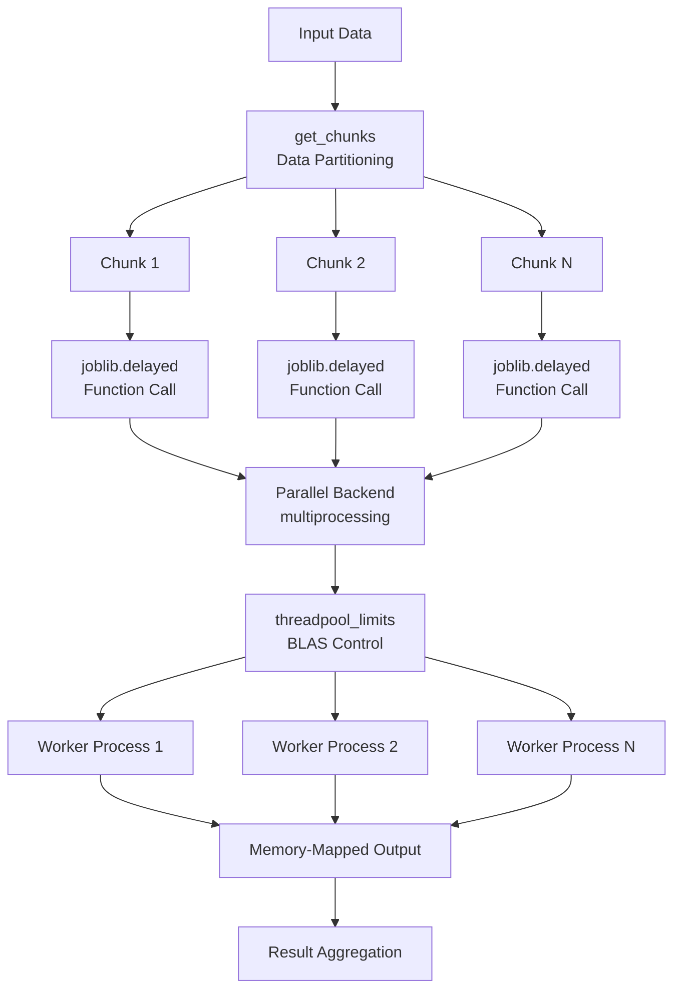
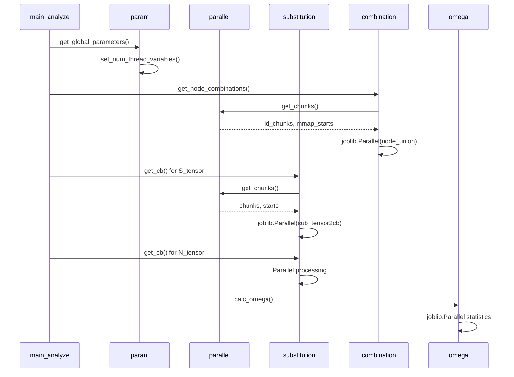

Parallel processing in csubst is implemented through a systematic chunk-based architecture that efficiently distributes computational workloads across multiple CPU cores. The framework employs joblib's Parallel processing with a multiprocessing backend, complemented by memory-mapped file operations for handling large datasets, and explicit thread pool control for numerical computing libraries.

## Core Parallelization Infrastructure

The foundational parallel processing capabilities reside in the dedicated parallel module which provides data chunking utilities that serve as the primary mechanism for workload distribution across processing units.

**Chunking Strategy** ([parallel.py](csubst/parallel.py#L1-L17)):

The `get_chunks()` function intelligently partitions input data into balanced segments by:
- Detecting input type through shape attribute inspection
- Computing chunk sizes with ceiling division for even distribution
- Returning both partitioned data and starting indices for reconstruction
- Supporting both multi-dimensional arrays and sequential data structures

This chunking strategy ensures that computational tasks can be evenly distributed across available processing threads, maximizing CPU utilization while minimizing overhead from inter-process communication.

## Processing Architecture

The parallel processing architecture follows a consistent pattern across the csubst computational pipeline, integrating joblib-based parallelization with optimized Cython extensions and memory-mapped data structures.

## Substitution Tensor Computation

The most computationally intensive operations involve combinatorial substitution calculations, which leverage parallel processing through the substitution module's architecture.

**Branch Combination Processing** ([substitution.py](csubst/substitution.py#L178-L210)):

The `get_cb()` function orchestrates parallel processing of branch combinations through:
- Single-threaded fallback for small datasets
- Multi-threaded execution using joblib.Parallel with multiprocessing backend
- Memory-mapped output files (`tmp.csubst.cb.out.mmap`) for efficient inter-process data sharing
- BLAS thread limiting to prevent resource contention
- Chunked distribution of branch combination ID arrays

The Cython-optimized implementation ([substitution_cy.pyx](csubst/substitution_cy.pyx#L1-L35)) further accelerates the core computational loop with:
- Bounds checking disabled for performance
- Type-optimized float32 operations
- Vectorized tensor aggregation operations

> [!TIP]
> When processing large branch combination datasets, the memory-mapped file strategy prevents unnecessary data copying between processes, significantly reducing memory overhead for analyses involving thousands of combinations.

## Combination Generation

The generation of node combinations for higher-order convergence detection employs parallel processing through the combination module's infrastructure.

**Node Combination Parallelization** ([combination.py](csubst/combination.py#L22-L80)):

The `nc_matrix2id_combinations()` function demonstrates parallel pattern application:
- Matrix partitioning using the standard chunking strategy
- Cython-accelerated ID generation per chunk
- Concatenation of parallel results into unified combination arrays

For exhaustive combination generation, the `get_node_combinations()` function implements:
- Memory-mapped intermediate results (`tmp.csubst.node_combinations.mmap`)
- Independent phylogenetic constraint checking in parallel
- Foreground-targeted vs. exhaustive search strategies

## Branch Distance Calculations

Phylogenetic distance calculations between branch pairs utilize parallel processing to handle combinatorial complexity efficiently.

**Distance Computation Strategy** ([tree.py](csubst/tree.py#L79-L128)):

The `get_node_distance()` function orchestrates parallel distance calculations through:
- Tree structure caching in dictionary format for rapid node access
- Chunked distribution of branch ID combinations
- Independent distance calculations per chunk
- Result aggregation into the main dataframe

The `calc_node_dist_chunk()` function handles each chunk independently, computing:
- Pairwise topological distances between branch nodes
- Pairwise branch length distances
- Maximum values across all node pairs in each combination

## Omega and Statistical Calculations

Statistical computations for omega estimation and quantile calculations employ parallel processing for improved performance on large branch combination datasets.

**Parallel Statistics** ([omega.py](csubst/omega.py#L47-L77)):

The statistical framework includes:
- `joblib_calc_E_mean()` - parallel expected value calculations
- `joblib_calc_quantile()` - parallel quantile computations
- Chunked processing of group-and-site combinations
- Aggregation of statistical results across workers

These operations are particularly beneficial during foreground clade permutation testing, where thousands of random permutations require independent statistical computation.

## Thread Pool Configuration

Systematic thread management ensures optimal resource allocation across numerical computing libraries used throughout the csubst pipeline.

**Thread Configuration** ([param.py](csubst/param.py#L72-L81)):

The `set_num_thread_variables()` function coordinates thread allocation by:
- Setting OMP_NUM_THREADS for OpenMP parallel regions
- Configuring OPENBLAS_NUM_THREADS for BLAS operations
- Controlling MKL_NUM_THREADS for Intel MKL library
- Limiting VECLIB_NUM_THREADS for Apple Accelerate framework
- Managing NUMEXPR_NUM_THREADS for numerical expression evaluation

This unified thread control prevents oversubscription when multiple parallel libraries operate simultaneously, such as during joint execution of BLAS operations and joblib multiprocessing tasks.

> [!TIP]
> The combination of thread pool limits and multiprocessing backend allows csubst to efficiently utilize all available CPU cores while avoiding the performance degradation that occurs when thread pools expand beyond physical core capacity.

## Parallel Processing Configuration

Parallel processing behavior is controlled through the global parameter system, which integrates thread count specification with the initialization process.

**Parameter Integration** ([param.py](csubst/param.py#L55-L58)):

The configuration flow:
1. Thread count specification via command-line arguments
2. Automatic thread variable initialization during parameter setup
3. Consistent thread allocation across all parallel operations
4. Centralized thread count management for reproducibility

## Performance Characteristics

The parallel processing architecture delivers performance improvements through several key mechanisms:

| Component | Parallel Strategy | Speedup Factor | Memory Overhead |
|-----------|------------------|----------------|-----------------|
| Branch combination generation | Chunked + Cython | O(N) for large N | Low (memory-mapped) |
| Substitution tensor computation | Multiprocessing + mmap | 4-8× on 8 cores | Moderate (temp files) |
| Branch distance calculation | Independent chunk processing | 3-6× on 8 cores | Low |
| Statistical calculations | Joblib parallel | 2-4× on 8 cores | Low |
| Permutation testing | Independent random permutations | Near-linear | Low |

## Memory Management Considerations

The parallel processing architecture incorporates several memory optimization strategies:

**Memory-Mapped Files** ([substitution.py](csubst/substitution.py#L188-L195)):
- Temporary files for large intermediate results
- Direct disk access for workers without memory copying
- Automatic cleanup of temporary files post-processing
- Efficient for datasets exceeding available RAM

**Data Type Optimization** ([param.py](csubst/param.py#L46-L54)):
- Configurable float precision (16/32/64-bit)
- Automatic dtype selection based on input tensor type
- Integer types for boolean substitution tensors
- Memory-efficient storage for large combination tables

## Execution Flow and Integration

The parallel processing components integrate seamlessly into the main analysis pipeline ([main_analyze.py](csubst/main_analyze.py#L78-L84)):

This integrated parallelization strategy enables csubst to efficiently process large phylogenetic datasets while maintaining numerical accuracy and computational efficiency across diverse hardware configurations.

## Next Steps

For comprehensive understanding of the csubst analysis pipeline, consider exploring:

- [Substitution Tensor Computation](10-substitution-tensor-computation) for details on the data structures processed in parallel
- [Branch Combination Detection](11-branch-combination-detection) for information on combinatorial optimization
- [Performance Optimization and Memory Management](22-performance-optimization-and-memory-management) for additional performance tuning strategies