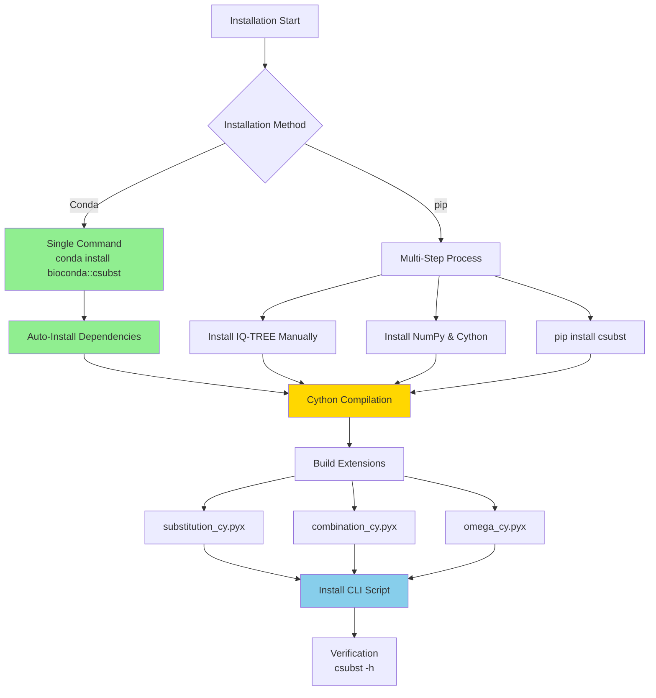

This guide covers the installation process for CSUBST, a toolkit for detecting molecular convergence in coding sequences. CSUBST requires Python 3.6 or higher and includes **Cython-optimized computational modules** for efficient tensor calculations on phylogenetic trees. The installation process involves setting up both Python dependencies and external tools like IQ-TREE for ancestral state reconstruction.


## System Requirements

CSUBST is designed to run on **Python 3.6 or later** and has been tested on macOS, Linux, and Windows systems. The package includes compiled Cython extensions that require a working C compiler during installation. The build system automatically handles platform-specific configurations, such as macOS-specific NumPy include path adjustments.

**Minimum Requirements:**
- Python 3.6.0+ (officially tested version)
- GCC, Clang, or MSVC compiler for Cython compilation
- 4GB RAM minimum (8GB+ recommended for large datasets)
- Multiple CPU cores recommended for parallel computations

Sources: [setup.py](setup.py#L1-L47), [README.md](README.md#L24-L25)

## Installation Methods

CSUBST offers two primary installation approaches. The **conda method** is strongly recommended for beginners as it automatically handles all dependencies including IQ-TREE. The pip method provides flexibility for advanced users who need specific version control.

### Option 1: Conda Installation (Recommended)

The conda installation via Bioconda is the most straightforward approach, automatically managing all dependencies including the critical IQ-TREE executable:

```bash
conda install bioconda::csubst
```

This single command installs CSUBST along with all required Python packages (ete3, numpy, scipy, pandas, joblib, cython, matplotlib, threadpoolctl) and IQ-TREE for phylogenetic analysis. The Bioconda channel ensures version compatibility and simplifies environment management.

Sources: [README.md](README.md#L27-L30), [setup.py](setup.py#L30)

### Option 2: pip Installation

For pip installation, you must manually install prerequisites before installing CSUBST. This two-step process ensures proper compilation of Cython extensions:

```bash
# Step 1: Install IQ-TREE separately
# Download from: https://iqtree.github.io/

# Step 2: Install NumPy and Cython first (critical requirement)
pip install numpy cython

# Step 3: Install CSUBST from GitHub
pip install git+https://github.com/kfuku52/csubst
```

> [!TIP]
> **Critical**: NumPy and Cython must be installed **before** CSUBST installation because the setup.py script imports NumPy's C headers during the Cython extension compilation process. Installing them afterward will cause build failures.

Sources: [README.md](README.md#L32-L37), [setup.py#L9-L10](setup.py#L9-L10)

## Installation Architecture

The CSUBST installation process involves several components working together to create a functional analysis environment:



## Dependency Breakdown

CSUBST requires a comprehensive set of Python packages and external tools. The table below provides detailed information about each dependency:

| Dependency | Category | Version Requirement | Purpose |
|-----------|----------|-------------------|---------|
| **Python** | Runtime | ≥3.6.0 | Core execution environment |
| **ete3** | Phylogenetics | Latest | Tree manipulation and analysis |
| **numpy** | Computation | Latest | Numerical operations and tensor storage |
| **scipy** | Scientific | Latest | Statistical functions |
| **pandas** | Data I/O | Latest | DataFrame operations and CSV/TSV handling |
| **joblib** | Parallelization | Latest | Multi-CPU processing |
| **matplotlib** | Visualization | Latest | Plotting and chart generation |
| **threadpoolctl** | Performance | Latest | Thread pool management |
| **cython** | Compilation | Latest | Python-to-C compilation |
| **setuptools** | Build | ≥18.0 | Package installation framework |
| **IQ-TREE** | External Tool | Latest | Ancestral state reconstruction |

> [!TIP]
> **Build Tools**: A C compiler (GCC on Linux, Clang on macOS, MSVC on Windows) is required for Cython compilation. Conda environments typically include necessary compilers automatically.

Sources: [setup.py](setup.py#L30-L32), [csubst/csubst#L80-L99](csubst/csubst#L80-L99)

## Cython Extensions

CSUBST includes three Cython-optimized modules that provide significant performance improvements for computationally intensive operations:

- **substitution_cy.pyx**: Computes combinatorial substitution tensors with NumPy array operations optimized through Cython decorators that disable bounds checking and negative index wrapping for maximum speed
- **combination_cy.pyx**: Handles branch combination detection logic
- **omega_cy.pyx**: Calculates dN/dS ratios (ω) for convergent sites

These extensions are automatically compiled during installation using the `cythonize()` function with NumPy include paths. The compilation process generates platform-specific shared libraries (.so files on Unix, .pyd files on Windows) that are loaded transparently when CSUBST runs.

Sources: [setup.py#L33-L37](setup.py#L33-L37), [csubst/substitution_cy.pyx#L7-L9](csubst/substitution_cy.pyx#L7-L9)

## Installation Verification

After installation, verify that CSUBST is correctly installed by checking the version and available commands:

```bash
# Check installation
csubst --version

# List available subcommands
csubst -h
```

Expected output should show version information (e.g., "CSUBST version: 1.4.20") and available subcommands including `analyze`, `dataset`, `site`, and `simulate`.

Sources: [csubst/__init__.py](csubst/__init__.py#L1), [csubst/csubst#L57-L59](csubst/csubst#L57-L59)

## Package Data Installation

CSUBST includes essential data files that are automatically installed with the package:

- **substitution_matrix/** directory: Contains ECMrest.dat and ECMunrest.dat substitution matrices for empirical codon models
- **dataset/** directory: Includes example datasets (PGK, PEPC) for testing and tutorials

These files are specified in the `package_data` section of setup.py and are installed to the Python site-packages directory, making them accessible to CSUBST commands via relative imports.

Sources: [setup.py#L41-L44](setup.py#L41-L44), [get_repo_structure](csubst/substitution_matrix)

## CLI Script Installation

The installation creates a command-line interface script named `csubst` that provides access to all analysis functions:

```bash
# The installed script location
csubst/csubst  →  /path/to/python/bin/csubst
```

This script serves as the main entry point and provides four primary subcommands:
- `csubst analyze`: Main convergence analysis pipeline
- `csubst dataset`: Generate test datasets
- `csubst site`: Site-wise substitution mapping
- `csubst simulate`: Simulate convergent evolution

Sources: [setup.py#L31](setup.py#L31), [csubst/csubst#L11-L49](csubst/csubst#L11-L49)

## Licensing

CSUBST is distributed under the **BSD 3-Clause License**, which permits redistribution and use in source and binary forms with or without modification, provided that the copyright notice and disclaimer are retained. This license is compatible with both academic and commercial use.

Sources: [LICENSE](LICENSE#L1-L30), [setup.py#L23](setup.py#L23)

## Troubleshooting

### Common Installation Issues

**Problem**: `fatal error: numpy/arrayobject.h file not found`

**Solution**: Ensure NumPy is installed **before** CSUBST installation. On macOS, the setup.py script includes automatic environment variable handling for this issue, but manual installation order is still critical.

**Problem**: IQ-TREE not found after pip installation

**Solution**: When using pip, IQ-TREE must be installed separately. Download from https://iqtree.github.io/ and ensure the executable is in your system PATH. You can also specify the IQ-TREE path using the `--iqtree_exe` parameter during analysis.

**Problem**: Cython compilation failures

**Solution**: Verify you have a working C compiler. On Ubuntu: `sudo apt-get install build-essential`. On macOS: Xcode Command Line Tools (`xcode-select --install`). The setup.py script includes platform-specific handling for macOS to ensure proper NumPy header inclusion.

Sources: [setup.py#L11-L13](setup.py#L11-L13), [csubst/csubst#L81-L82](csubst/csubst#L81-L82)

## Next Steps

After successful installation, proceed to the following pages based on your needs:

- **[Quick Start](2-quick-start)**: Get started with a test run using the PGK dataset
- **[Basic Usage](4-basic-usage)**: Learn the fundamental workflow and command-line options
- **[Input Processing and Tree Parsing](8-input-processing-and-tree-parsing)**: Understand how CSUBST processes your phylogenetic data