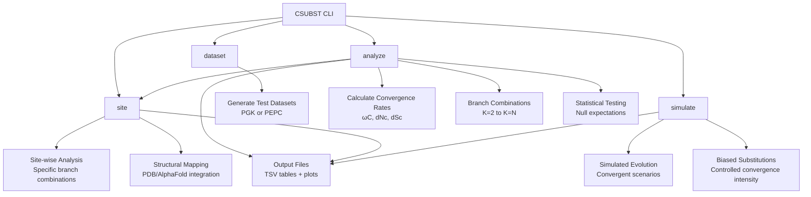
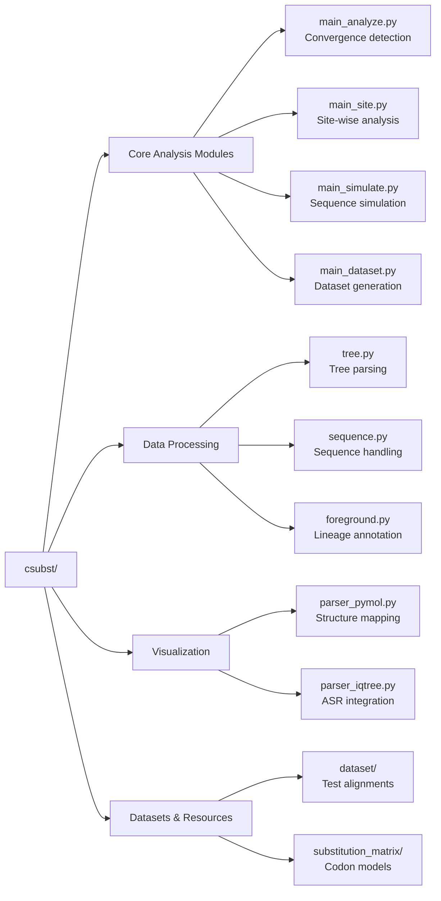
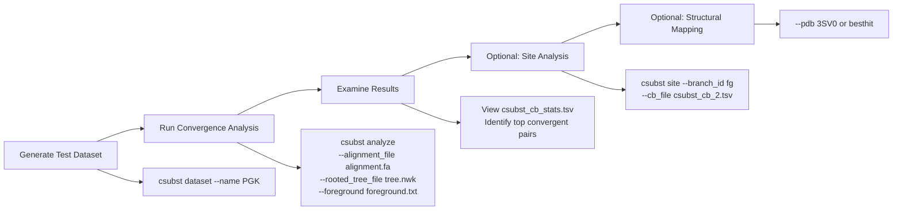

This guide provides a practical introduction to running csubst for molecular convergence detection. You'll learn how to prepare your data, execute analyses, and interpret the results through CSUBST's four primary subcommands. CSUBST analyzes combinatorial substitutions—recurrent substitutions at the same protein site across multiple independent phylogenetic branches—using error-corrected statistical methods that account for neutral substitution expectations.


## Command Architecture

CSUBST follows a modular command-line interface design with four main subcommands that address different aspects of convergence analysis. The architecture enables flexible workflows ranging from quick test runs to comprehensive evolutionary studies.



Sources: [csubst](csubst/csubst#L1-L100), [README.md](README.md#L35-L50)

## Subcommand Overview

Each CSUBST subcommand serves a distinct purpose in the analysis pipeline, from data preparation to detailed investigation and simulation.

| Subcommand | Primary Function | Key Outputs | Typical Use Case |
|------------|------------------|-------------|------------------|
| **dataset** | Generate ready-to-use test datasets | alignment.fa, tree.nwk, foreground.txt | Quick testing, learning the workflow |
| **analyze** | Detect combinatorial substitutions across branch combinations | csubst_cb_*.tsv (convergence statistics), csubst_b.tsv (branches), csubst_s.tsv (sites) | Main convergence detection analysis |
| **site** | Characterize site-wise substitutions on specific branches and map to structures | Visualization plots, structure files, csubst_site.tsv | Detailed investigation of convergent sites |
| **simulate** | Generate synthetic alignments under controlled convergent evolution | Simulated alignments, control datasets | Method validation, power analysis |

Sources: [README.md](README.md#L35-L50), [csubst](csubst/csubst#L100-L250)

## Project Structure

The CSUBST package organizes its functionality across multiple specialized modules, with the main entry point providing unified access to all analytical workflows.



Sources: [setup.py](setup.py#L29-L44), [get_repo_structure](csubst)

## Quick Start Workflow

Get started immediately with CSUBST's built-in test datasets. This complete workflow demonstrates the typical analysis pipeline from data preparation through convergence detection.



Sources: [README.md](README.md#L35-L40), [main_dataset.py](csubst/main_dataset.py#L4-L13)

### Step 1: Generate Test Dataset

CSUBST includes curated test datasets to help you understand the analysis workflow without needing to prepare your own data. The **PGK** dataset (vertebrate phosphoglycerate kinase genes) provides a smaller, faster-running example, while **PEPC** (phosphoenolpyruvate carboxylase genes) offers a more complex scenario with multiple foreground lineage categories.

```bash
# Generate the PGK test dataset
csubst dataset --name PGK
```

This command copies the following files to your current directory:

- **PGK.alignment.fa** → `alignment.fa`: In-frame codon alignment in FASTA format
- **PGK.tree.nwk** → `tree.nwk`: Rooted phylogenetic tree in Newick format
- **PGK.foreground.txt** → `foreground.txt`: Foreground lineage specification file

Sources: [README.md](README.md#L35-L40), [main_dataset.py](csubst/main_dataset.py#L4-L13)

### Step 2: Run Convergence Analysis

The `analyze` subcommand performs the core convergence detection analysis. This step reconstructs ancestral states using IQ-TREE, computes substitution tensors, and searches for combinatorial substitutions across branch combinations.

```bash
csubst analyze \
  --alignment_file alignment.fa \
  --rooted_tree_file tree.nwk \
  --foreground foreground.txt \
  --threads 4 \
  --iqtree_model ECMK07+F+R4 \
  --genetic_code 1
```

> [!TIP]
> Ensure that IQ-TREE is installed and accessible in your system PATH. If you installed CSUBST via conda, IQ-TREE is typically included as a dependency.

Key parameters for this command:
- **--alignment_file**: Path to your codon alignment (in-frame coding sequences)
- **--rooted_tree_file**: Path to your rooted phylogenetic tree
- **--foreground**: Optional file specifying foreground lineages of interest
- **--threads**: Number of CPU cores to use for parallel computation (default: 1)
- **--iqtree_model**: Codon substitution model for ancestral state reconstruction (default: ECMK07+F+R4)
- **--genetic_code**: NCBI codon table ID (default: 1 for standard genetic code)

Sources: [README.md](README.md#L40-L55), [csubst](csubst/csubst#L44-L60), [main_analyze.py](csubst/main_analyze.py#L127-L288)

### Step 3: Examine Results

The analysis generates multiple output files containing convergence statistics at different levels of resolution.

**Primary output files:**
- **csubst_cb_stats.tsv**: Summary statistics for each branch combination, including ωC (omega C), dNc, and dSc
- **csubst_cb_2.tsv**: Detailed branch combination statistics for K=2 (branch pairs)
- **csubst_b.tsv**: Branch-wise substitution statistics
- **csubst_s.tsv**: Site-wise substitution statistics (if `--s yes`)

For the PGK dataset, the csubst_cb_stats.tsv file will rank branch combinations by their convergence statistics, allowing you to identify which pairs show the strongest evidence for convergent evolution.

Sources: [main_analyze.py](csubst/main_analyze.py#L250-L288), [README.md](README.md#L50-L55)

### Step 4: Site-wise Analysis (Optional)

Once you've identified interesting branch combinations, use the `site` subcommand to perform detailed site-wise analysis and optionally map substitutions onto protein structures.

```bash
# Analyze all foreground branch pairs
csubst site \
  --alignment_file alignment.fa \
  --rooted_tree_file tree.nwk \
  --branch_id fg \
  --cb_file csubst_cb_2.tsv
```

The `--branch_id` parameter accepts either:
- **fg**: Analyze all foreground branch pairs
- **INT,INT,INT,...**: Specific branch IDs (comma-separated)

Sources: [csubst](csubst/csubst#L182-L200), [main_site.py](csubst/main_site.py#L635-L720)

### Step 5: Structural Mapping (Optional)

CSUBST can map convergent substitutions onto 3D protein structures from PDB, AlphaFold, or AlphaFill databases.

```bash
csubst site \
  --alignment_file alignment.fa \
  --rooted_tree_file tree.nwk \
  --branch_id fg \
  --cb_file csubst_cb_2.tsv \
  --pdb besthit \
  --database pdb,alphafill,alphafold
```

This option will:
1. Search structure databases using your sequence
2. Align the sequence to the best-matching structure
3. Generate PyMOL sessions and rendered images
4. Color-code residues based on convergence probabilities

Sources: [csubst](csubst/csubst#L200-L250), [parser_pymol.py](csubst/parser_pymol.py)

## Foreground Lineage Specification

The foreground file allows you to specify lineages of particular interest for targeted convergence analysis. This is particularly useful when you have a priori hypotheses about which branches might be experiencing convergent evolution.

### Format

The foreground file is a tab-delimited text file with two columns:
1. **Lineage ID**: A unique identifier for each lineage (integer or string)
2. **Regex pattern**: Regular expression matching tip labels belonging to that lineage

### Example: PGK Foreground File

```
1	Monodelphis_domestica_ENSMODG00000023385
2	Homo_sapiens_ENSG00000170950
2	Macaca_mulatta_ENSMMUG00000011998
2	Callithrix_jacchus_ENSCJAG00000022394
2	Mus_musculus_ENSMUSG00000031233
2	Rattus_norvegicus_ENSRNOG00000013600
2	Oryctolagus_cuniculus_ENSOCUG00000005270
2	Ovis_aries_ENSOARG00000008736
2	Sus_scrofa_ENSSSCG00000001738
```

In this example:
- Lineage 1: Outgroup species (Monodelphis domestica - opossum)
- Lineage 2: Multiple placental mammal species for comparison

The regex pattern matches exact species names, but you can use more complex patterns (e.g., `.*_ENS.*` to match all species with Ensembl identifiers).

Sources: [foreground.py](csubst/foreground.py#L240-L260), [dataset/PGK.foreground.txt](csubst/dataset/PGK.foreground.txt#L1-L10)

### Example: PEPC Foreground File (Multi-category)

The PEPC dataset demonstrates how to specify multiple foreground categories:

```
name	C4	C4_monocot	C4_dicot	crop
Alternanthera_pungens_.*	1	0	1	0
Amaranthus_hypochondriacus_.*	1	0	1	1
Cyperus_sanguinolentus_.*	1	1	0	0
Eleocharis_vivipara_.*	1	1	0	0
```

This multi-column format allows you to analyze convergence with respect to different traits simultaneously (e.g., C4 photosynthesis, monocot vs. dicot classification, crop status).

Sources: [dataset/PEPC.foreground.tsv](csubst/dataset/PEPC.foreground.tsv#L1-L20)

## Common Parameters Reference

This section provides a comprehensive reference for the most commonly used parameters across CSUBST subcommands.

### Essential Parameters

| Parameter | Default | Description | Applies To |
|-----------|---------|-------------|------------|
| `--alignment_file` | Required | PATH to in-frame codon alignment (FASTA) | analyze, site, simulate |
| `--rooted_tree_file` | Required | PATH to rooted tree (Newick format) | analyze, site, simulate |
| `--genetic_code` | 1 | NCBI codon table ID (1 = Standard) | analyze, site, simulate |
| `--threads` | 1 | Number of CPUs for parallel computation | analyze, site, simulate |
| `--iqtree_model` | ECMK07+F+R4 | Codon substitution model for ASR | analyze, site, simulate |
| `--foreground` | None | Foreground lineage specification file | analyze, simulate |

### IQ-TREE Related Parameters

| Parameter | Default | Description |
|-----------|---------|-------------|
| `--iqtree_exe` | iqtree | PATH to IQ-TREE executable |
| `--iqtree_model` | ECMK07+F+R4 | Substitution model (MG, GY, ECMK07, ECMrest supported) |
| `--iqtree_redo` | no | Rerun IQ-TREE even if intermediate files exist |

### Analyze-Specific Parameters

| Parameter | Default | Description |
|-----------|---------|-------------|
| `--max_arity` | 2 | Maximum number of branches in combinations (K) |
| `--exhaustive_until` | 2 | Search all combinations until this arity |
| `--max_combination` | 10000 | Max combinations to generate at K+1 |
| `--exclude_sister_pair` | yes | Exclude sister branch combinations |
| `--omegaC_method` | submodel | Method for omega_C calculation (submodel/modelfree) |

Sources: [csubst](csubst/csubst#L44-L250), [README.md](README.md#L40-L60)

> [!TIP]
> When analyzing larger datasets (hundreds of species), use `--exhaustive_until 1` with a foreground file to limit the search space and avoid combinatorial explosion.

## Simulation and Validation

The `simulate` subcommand enables you to generate synthetic sequence alignments under controlled convergent evolutionary scenarios, which is valuable for method validation and power analysis.

```bash
csubst simulate \
  --alignment_file alignment.fa \
  --rooted_tree_file tree.nwk \
  --foreground foreground.txt \
  --background_omega 0.2 \
  --foreground_omega 0.2 \
  --percent_convergent_site 100 \
  --convergent_amino_acids random1 \
  --percent_biased_sub 90
```

Key simulation parameters:
- **--background_omega**: dN/dS for background branches (default: 0.2)
- **--foreground_omega**: dN/dS for foreground branches (default: 0.2)
- **--percent_convergent_site**: Percentage of sites evolving convergently (default: 100)
- **--convergent_amino_acids**: Target amino acids (e.g., AQTS or randomN)
- **--percent_biased_sub**: Percentage of substitutions biased toward convergent amino acids (default: 90)

Sources: [main_simulate.py](csubst/main_simulate.py#L345-L394), [csubst](csubst/csubst#L150-L180)

## Troubleshooting Guide

| Issue | Possible Cause | Solution |
|-------|----------------|----------|
| **IQ-TREE not found** | IQ-TREE not installed or not in PATH | Install IQ-TREE or provide path with `--iqtree_exe` |
| **Alignment not in-frame** | Sequence length not divisible by 3 | Verify codon alignment and remove gaps that disrupt reading frame |
| **Tree tip labels mismatch** | Tip names don't match alignment headers | Ensure exact consistency between tree and FASTA labels |
| **Memory error** | Large dataset with limited RAM | Reduce `--threads`, use `--float_type 32` or 64, or analyze subsets |
| **No foreground combinations** | Incompatible foreground specification | Check regex patterns in foreground file match tip labels |

## Next Steps

After mastering the basic usage, explore these advanced topics:

- **Foreground Lineages**: Learn advanced specification techniques and lineage randomization for statistical testing. See [Foreground Lineages](6-foreground-lineages) for comprehensive strategies.

- **Combinatorial Substitutions**: Understand the theoretical foundation and statistical methods underlying combinatorial substitution detection. See [Combinatorial Substitutions](5-combinatorial-substitutions) for mathematical details.

- **Codon Substitution Models**: Deepen your understanding of codon models (MG, GY, ECM) and their impact on ancestral state reconstruction. See [Codon Substitution Models](7-codon-substitution-models) for model comparison.

- **Ancestral State Reconstruction**: Learn about IQ-TREE integration and ASR methods used in CSUBST. See [Ancestral State Reconstruction with IQ-TREE](9-ancestral-state-reconstruction-with-iq-tree).

- **Input Processing**: Understand how CSUBST parses and validates your tree and alignment inputs. See [Input Processing and Tree Parsing](8-input-processing-and-tree-parsing).

These pages provide deeper technical insights and advanced techniques for extending your convergence analyses beyond the basic workflow demonstrated here.
