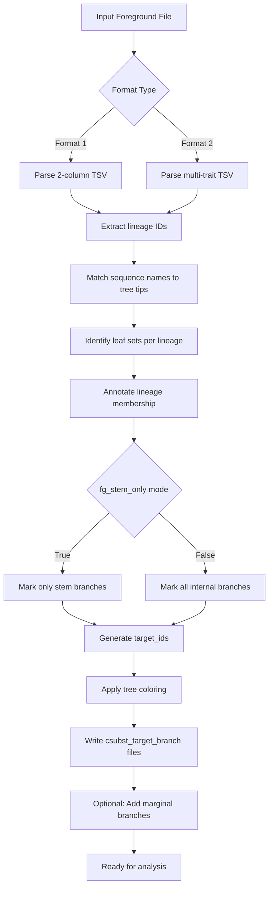
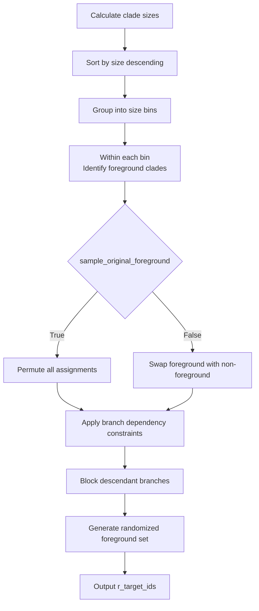

Foreground lineages represent the evolutionary branches of primary interest in combinatorial substitution analysis. This specification system enables targeted investigation of convergent evolution by defining specific lineages where patterns of parallel or convergent amino acid changes are expected or hypothesized. The foreground lineage framework provides the foundation for branch combination detection, statistical hypothesis testing through randomization, and comparative analysis against background evolutionary rates.

## Core Concept and Biological Rationale

Foreground lineages in CSUBST are user-defined evolutionary lineages that demonstrate shared phenotypic traits or ecological adaptations, making them candidates for convergent molecular evolution. Rather than analyzing all branches indiscriminately, CSUBST focuses computational and statistical power on branches where convergent substitutions are most biologically plausible. This targeted approach increases sensitivity to detect genuine convergence while enabling robust statistical inference through controlled randomization against appropriate null distributions.

The system supports multiple foreground lineages per analysis, allowing comparative studies across different evolutionary scenarios. For example, independent origins of C4 photosynthesis in grasses versus eudicots, or echolocation adaptations in bats versus whales, can be analyzed simultaneously or independently to quantify convergence rates and test macroevolutionary hypotheses about genotype-phenotype associations.


Sources: [foreground.py](csubst/foreground.py#L269-L290), [README.md](README.md#L17-L23)

## Input File Formats

CSUBST provides two flexible formats for specifying foreground lineages, supporting both simple and complex annotation schemes. The choice between formats depends on analysis complexity and the number of independent lineages under investigation.

### Format 1: Simple Two-Column Specification

Format 1 uses a minimal two-column tab-separated file without headers, optimized for single-trait analyses with minimal configuration overhead.

**Structure:**
- Column 1: Lineage identifier (integer or string)
- Column 2: Regular expression-compatible sequence names matching tips in the phylogenetic tree

**Example (PEPC C4 photosynthesis study):**
```
1	Alternanthera_pungens_AY950665
1	Amaranthus_hypochondriacus_Z68125
1	Bienertia_sinuspersici_DQ538352
1	Cyperus_sanguinolentus_FM208046
1	Eleocharis_vivipara_AB085948
1	Fimbristylis_littoralis_FM208037
1	Flaveria_australasica_Z25853
1	Setaria_italica_AF495586
1	Sorghum_bicolor_X17379
1	Suaeda_aralocaspica_DQ538353
1	Suaeda_eltonica_DQ538354
1	Zea_mays_X15239
```

**Example (PGK mammalian study):**
```
1	Monodelphis_domestica_ENSMODG00000023385
2	Homo_sapiens_ENSG00000170950
2	Macaca_mulatta_ENSMMUG00000011998
2	Callithrix_jacchus_ENSCJAG00000022394
2	Mus_musculus_ENSMUSG00000031233
2	Rattus_norvegicus_ENSRNOG00000013600
2	Oryctolagus_cuniculus_ENSOCUG00000005270
2	Ovis_aries_ENSOARG00000008736
2	Sus_scrofa_ENSSSCG00000001738
```

Sources: [PEPC.foreground.txt](csubst/dataset/PEPC.foreground.txt#L1-L12), [PGK.foreground.txt](csubst/dataset/PGK.foreground.txt#L1-L10), [foreground.py](csubst/foreground.py#L240-L260)

### Format 2: Multi-Trait Specification with Headers

Format 2 supports complex experimental designs with multiple traits and hierarchical lineage classifications, using a tab-separated file with named headers.

**Structure:**
- Column 1: Regex-compatible sequence names (required header: "name")
- Columns 2+: Trait columns with user-defined header names (e.g., "C4", "C4_monocot", "C4_dicot", "crop")
- Value 0: Background (no foreground assignment)
- Non-zero values: Foreground lineage identifiers

**Example (Multi-trait PEPC analysis):**
```
name	C4	C4_monocot	C4_dicot	crop
Alternanthera_ficoidea_.*	0	0	0	0
Alternanthera_pungens_.*	1	0	1	0
Amaranthus_hypochondriacus_.*	1	0	1	1
Bienertia_sinuspersici_.*	1	0	1	0
Cyperus_sanguinolentus_.*	1	1	0	0
Eleocharis_vivipara_.*	1	1	0	0
Flaveria_australasica_.*	1	0	1	0
Setaria_italica_.*	1	1	0	1
Sorghum_bicolor_.*	1	1	0	1
Zea_mays_.*	1	1	0	1
```

This format enables simultaneous analysis of multiple evolutionary hypotheses—for instance, testing whether C4 photosynthesis convergence differs between monocots and dicots, or whether crop domestication shows distinct substitution patterns independent of photosynthetic pathway.

Sources: [PEPC.foreground.tsv](csubst/dataset/PEPC.foreground.tsv#L1-L51), [foreground.py](csubst/foreground.py#L251-L261)

### Format Comparison

| Feature | Format 1 | Format 2 |
|---------|----------|----------|
| Header requirement | None (no header) | Required (first line) |
| Column structure | Fixed (2 columns) | Flexible (2+ columns) |
| Trait support | Single trait | Multiple traits |
| Sequence naming | Direct specification | Regex pattern matching |
| Usage scenario | Simple analyses | Complex experimental designs |
| Background designation | Implicit (unlisted tips) | Explicit (value 0) |

Sources: [foreground.py](csubst/foreground.py#L240-L261)

## Foreground Lineage Processing Pipeline

The foreground lineage specification undergoes systematic transformation from file input to tree annotation through a multi-stage pipeline. This process converts text-based lineage definitions into branch identifiers that drive combinatorial substitution analysis.



**Stage 1: File Parsing and Validation**
The pipeline begins by reading and validating the foreground file according to the specified format. Format 1 expects exactly two columns without headers, while Format 2 requires at least two columns with valid headers starting with "name". Invalid formats trigger descriptive exceptions guiding users to correct specifications. The parser skips blank lines and respects comment lines starting with "#".

**Stage 2: Sequence Name Matching**
Using regular expression matching, the system maps lineage definitions to actual tree tips. This approach accommodates incomplete species names or wildcard patterns, enabling flexible mapping. Each lineage builds a set of matched leaf names, with warnings issued for ambiguous or failed matches. The matching process is case-sensitive and follows Python's regular expression syntax.

**Stage 3: Lineage Annotation**
For each lineage, the system annotates tree nodes with lineage membership using the `is_lineage_fg_TRAIT_N` feature, where N is the lineage number. This annotation propagates upward from matched tips through the tree, marking all ancestral nodes as belonging to the lineage. This hierarchical annotation enables stem-only mode and branch identification.

**Stage 4: Target Branch Identification**
Depending on the `fg_stem_only` parameter, the system identifies target branches for analysis. In stem-only mode (default for Format 1), only the branches connecting lineages to their common ancestors are marked as foreground. In full lineage mode, all internal branches within lineages are included. The target identification algorithm traces lineage roots through parent-child relationships, ensuring complete branch sets are captured.

**Stage 5: Tree Coloring and Output**
The final stage applies visual annotation to the tree, assigning distinct colors to each lineage for visualization purposes. The system writes `csubst_target_branch_TRAIT.txt` files listing the numerical branch IDs of foreground branches, which serve as the reference for combinatorial substitution detection.

Sources: [foreground.py](csubst/foreground.py#L220-L290), [foreground.py](csubst/foreground.py#L136-L195)

## Branch Classification System

CSUBST implements a hierarchical branch classification system that distinguishes foreground branches from other tree components based on evolutionary context. This classification enables precise statistical comparisons and hypothesis testing.

### Foreground Branch Types

**Stem Branches (fg_stem)**
Stem branches represent the evolutionary branches that connect a lineage to its closest common ancestor with other lineages or the root. These are typically the branches where convergent substitutions between independent lineages are most informative. In stem-only mode, only these branches are analyzed, focusing on the most phylogenetically independent branches for convergence detection.

**Internal Lineage Branches**
When `fg_stem_only=False`, all internal branches within each lineage are included as foreground branches. This captures substitutions occurring throughout lineage diversification, useful for testing hypotheses about pervasive selection pressure across entire clades. The algorithm identifies these branches by tracing all nodes where the `is_lineage_fg_TRAIT_N` attribute is true.

**Leaf Branches**
Tip branches connecting internal nodes to actual taxa are not typically foreground branches, as they lack direct descendants for combinatorial substitution analysis. However, they are part of the ancestral state reconstruction process and contribute to the overall substitution history.

### Marginal Branches

Marginal branches represent branches adjacent to foreground lineages that provide phylogenetic context and serve as natural controls. The identification of marginal branches uses two complementary strategies:

**Parent Branches (mg_parent)**
When enabled, the parent branch of each foreground branch is marked as marginal. This captures the immediate evolutionary history preceding lineage-specific evolution, providing baseline rates and substitution patterns.

**Sister Branches (mg_sister)**
Sister branches are branches descending from the same parent as a foreground branch. The system supports two modes:
- **Stem-only mode**: Only the immediate sister stem branches are marked
- **Full mode**: All descendant branches of sister clades are marked

Marginal branches are automatically excluded from the foreground branch set but included in extended analyses for comparative purposes. They are written to `csubst_marginal_branch_TRAIT.txt` files and annotated with the `is_marginal_TRAIT` feature.

Sources: [foreground.py](csubst/foreground.py#L323-L365), [foreground.py](csubst/foreground.py#L195-L220)

### Branch Classification Summary

| Branch Type | Symbol | Description | Analysis Role |
|-------------|--------|-------------|---------------|
| Foreground stem | `fg_ids` | Branches connecting lineages to ancestors | Primary convergence detection |
| Foreground internal | `fg_ids` (stem-only=False) | All branches within lineages | Lineage-wide substitution analysis |
| Marginal parent | `mg_ids` | Parents of foreground branches | Contextual baseline rates |
| Marginal sister | `mg_ids` | Sisters of foreground branches | Phylogenetic control branches |
| Background | (default) | All other branches | Null distribution calculation |

Sources: [foreground.py](csubst/foreground.py#L365-L420)

## Randomization and Permutation Strategies

Statistical inference in CSUBST relies on comparing observed convergence rates against null distributions generated through foreground branch randomization. The system implements sophisticated permutation strategies that preserve phylogenetic structure while randomizing foreground assignment.

### Clade-Based Permutation

The default randomization strategy uses clade-based permutation, which respects the hierarchical nature of phylogenetic trees. This approach prevents invalid foreground assignments that would break tree topology or create logically impossible branch sets.

**Algorithm Overview:**
1. Calculate clade sizes for all branches in the tree
2. Group clades into bins based on size similarity
3. Within each bin, randomly shuffle foreground/non-foreground assignments
4. Apply branch dependency constraints to prevent descendant-ancestor conflicts
5. Generate randomized foreground branch sets

The binning strategy ensures that randomized foreground branches are comparable in size and taxonomic scope to the original foreground, maintaining ecological and evolutionary plausibility. The `min_clade_bin_count` parameter controls the minimum number of clades per bin, balancing granularity against randomization flexibility.



**Branch Dependency Constraints**
After initial random assignment, the system applies dependency constraints to ensure phylogenetic validity. If a branch is assigned as foreground, all its descendant branches are blocked from receiving independent foreground assignments. This prevents multiple nested foreground assignments within the same clade, which would violate statistical independence assumptions.

**Randomization Modes:**
- **Original sampling** (`sample_original_foreground=True`): Permutes among all branches in each bin, including the original foreground branches
- **Exclusion sampling** (`sample_original_foreground=False`): Excludes original foreground branches from the randomization pool, generating novel foreground sets

The system reports the number of possible permutations and the bin structure, enabling users to assess the randomization space. For studies with extensive foreground branches, this number can be astronomically large, justifying heuristic sampling approaches.

Sources: [foreground.py](csubst/foreground.py#L42-L105), [foreground.py](csubst/foreground.py#L290-L325)

### Randomization Output Files

Randomization generates several output data structures used for null distribution calculation:

**Randomized Branch IDs** (`r_target_ids`)
The primary output containing the numerical branch IDs of randomized foreground sets for each trait. These serve as the null branch sets for statistical testing.

**Randomized Foreground Leaf Names** (`r_fg_leaf_names`)
Corresponding taxon names for randomized foreground branches, useful for verifying randomization results and reporting the biological composition of null sets.

**Statistics Reporting**
The system prints summary statistics including:
- Number of clade permutation bins
- Bin size limits and clade counts
- Total number of possible permutations (without dependency constraints)
- Enrichment factors comparing randomized sets to observed patterns

> [!TIP]
> Randomization complexity increases exponentially with the number of foreground branches. For large foreground sets, the system may report astronomically large permutation counts—this is expected and indicates a rich null distribution space rather than an error. Use the `num_trial` parameter to control the number of randomizations performed for statistical testing.

Sources: [foreground.py](csubst/foreground.py#L290-L325), [foreground.py](csubst/foreground.py#L442-L458)

## Configuration Parameters

Foreground lineage behavior is controlled through several global parameters specified at runtime, typically through command-line arguments or configuration files.

### Essential Parameters

| Parameter | Type | Default | Description |
|-----------|------|---------|-------------|
| `foreground` | string | None | Path to foreground specification file. Required for lineage-based analysis. |
| `fg_format` | integer | 1 | Input format: 1 = simple 2-column, 2 = multi-trait with headers |
| `fg_stem_only` | boolean | True | If True, only analyze stem branches. If False, include all internal branches |
| `fg_clade_permutation` | integer | 0 | Number of foreground clade permutation trials for randomization |

### Marginal Branch Parameters

| Parameter | Type | Default | Description |
|-----------|------|---------|-------------|
| `mg_parent` | boolean | True | Include parent branches as marginal foreground |
| `mg_sister` | boolean | True | Include sister branches as marginal foreground |
| `mg_sister_stem_only` | boolean | True | If True, include only sister stem branches. If False, include all sister descendants |

### Permutation Parameters

| Parameter | Type | Default | Description |
|-----------|------|---------|-------------|
| `min_clade_bin_count` | integer | 10 | Minimum number of clades per permutation bin |
| `sample_original_foreground` | boolean | False | If True, allow original foreground branches in randomization pool |

These parameters are loaded into the global configuration dictionary `g` during initialization and accessed throughout the foreground processing pipeline. Parameter validation occurs during loading, with descriptive exceptions raised for invalid combinations.

Sources: [param.py](csubst/param.py#L10-L65), [foreground.py](csubst/foreground.py#L42-L105)

## Foreground Integration with Analysis Pipeline

Foreground lineages serve as the foundation for combinatorial substitution detection, influencing multiple stages of the CSUBST analysis pipeline beyond simple branch identification.

### Branch Combination Filtering

During combinatorial substitution analysis, foreground branch IDs are used to identify which branch combinations (K-tuples) involve foreground evolution. The `get_foreground_branch_num()` function counts the number of foreground branches in each combination and annotates combinations as foreground-involving (`is_fg_TRAIT = 'Y'`) if all branches in the combination are foreground branches.

**Dependency-aware filtering:**
The system respects branch dependencies when determining foreground status. Branch combinations that include both a foreground branch and its descendant are flagged and excluded from pure foreground analysis, maintaining phylogenetic independence. This filtering is controlled by `fg_dependent_id_combinations` which tracks forbidden branch pairings.

**Enrichment calculation:**
The system calculates enrichment factors comparing the proportion of foreground combinations meeting statistical cutoffs against the null expectation. This quantifies whether foreground branches are disproportionately associated with significant convergence signals.

Sources: [foreground.py](csubst/foreground.py#L365-L420), [main_analyze.py](csubst/main_analyze.py#L20-L130)

### Output File Generation

Foreground analysis produces several output files for downstream interpretation:

**Target branch files** (`csubst_target_branch_TRAIT.txt`)
List of numerical branch IDs identified as foreground, serving as reference for all subsequent analyses. These files are automatically generated when foreground specification is provided.

**Marginal branch files** (`csubst_marginal_branch_TRAIT.txt`)
List of numerical branch IDs identified as marginal foreground, providing context branches for comparative analysis.

**Statistics integration**
Foreground statistics are integrated into the global `df_cb_stats` dataframe, including enrichment factors and foreground-specific convergence rates. These statistics appear in summary output files and inform statistical testing.

### Visualization Integration

Foreground lineages are annotated with color attributes (`color_TRAIT`, `labelcolor_TRAIT`) that enable visualization tools to distinguish foreground from background branches. Tree visualization scripts can use these annotations to highlight foreground branches, facilitating intuitive interpretation of convergence patterns.

The lineage color palette includes 11 distinct colors (red, blue, darkorange, brown, mediumseagreen, purple, hotpink, olive, darkturquoise, green, darkorchid) that are cycled for analyses with multiple lineages.

Sources: [foreground.py](csubst/foreground.py#L120-L136), [foreground.py](csubst/foreground.py#L195-L220)

## Practical Usage Examples

### Example 1: Simple Foreground Specification

Analyzing C4 photosynthesis convergence using Format 1:

```bash
csubst analyze \
  --alignment_file csubst/dataset/PEPC.alignment.fa \
  --rooted_tree_file csubst/dataset/PEPC.tree.nwk \
  --foreground csubst/dataset/PEPC.foreground.txt \
  --fg_format 1 \
  --fg_stem_only \
  --iqtree_model ECMrest+F+R \
  --threads 4
```

This analysis uses stem-only mode, focusing on the most phylogenetically independent branches where convergence between independent C4 origins is expected.

### Example 2: Multi-Trait Analysis

Comparing multiple evolutionary traits using Format 2:

```bash
csubst analyze \
  --alignment_file csubst/dataset/PEPC.alignment.fa \
  --rooted_tree_file csubst/dataset/PEPC.tree.nwk \
  --foreground csubst/dataset/PEPC.foreground.tsv \
  --fg_format 2 \
  --fg_stem_only \
  --mg_parent \
  --mg_sister \
  --iqtree_model ECMrest+F+R \
  --threads 8
```

This setup analyzes the "C4", "C4_monocot", "C4_dicot", and "crop" traits simultaneously, with marginal branches providing contextual controls for statistical testing.

### Example 3: Randomization-Based Testing

Performing statistical inference through foreground permutation:

```bash
csubst analyze \
  --alignment_file csubst/dataset/PEPC.alignment.fa \
  --rooted_tree_file csubst/dataset/PEPC.tree.nwk \
  --foreground csubst/dataset/PEPC.foreground.txt \
  --fg_clade_permutation 1000 \
  --min_clade_bin_count 5 \
  --iqtree_model ECMrest+F+R \
  --threads 4
```

This configuration generates 1000 randomized foreground sets for null distribution calculation, enabling robust statistical testing of convergence rates.

> [!TIP]
> When analyzing large phylogenetic trees with many foreground branches, consider increasing `min_clade_bin_count` to reduce the number of bins and simplify randomization. For small trees or limited foreground branches, use smaller values to increase randomization granularity and statistical power.

## Troubleshooting Common Issues

### Sequence Name Matching Failures

**Symptom:** Warning messages about unmatchable foreground leaf names.

**Cause:** Regex patterns in the foreground file do not exactly match tip names in the phylogenetic tree.

**Solution:** Verify that sequence names in the alignment and tree match the patterns in the foreground file. Use explicit names or adjust regex patterns to accommodate naming conventions. Consider the `^` and `$` anchors for exact matching.

### Format Validation Errors

**Symptom:** Exception about incorrect column counts or missing headers.

**Cause:** Mismatch between specified `fg_format` and actual file structure.

**Solution:** Ensure Format 1 files have exactly 2 columns without headers, and Format 2 files have at least 2 columns with valid headers starting with "name". Check that tabs, not spaces, separate columns.

### Insufficient Randomization Space

**Symptom:** Very few or no possible permutation combinations reported.

**Cause:** Tree topology or foreground structure limits valid randomization possibilities.

**Solution:** Consider increasing `min_clade_bin_count` to merge bins, or use `sample_original_foreground=True` to include original foreground branches in the randomization pool. For extremely constrained trees, alternative null models may be required.

### Branch Dependency Violations

**Symptom:** Unexpected exclusion of branch combinations from foreground analysis.

**Cause:** `fg_dependent_id_combinations` flagging descendant-ancestor pairs as dependent.

**Solution:** This is expected behavior maintaining phylogenetic independence. Review the tree structure and consider whether stem-only mode is appropriate. For analyses requiring inclusive branch sets, carefully evaluate independence assumptions.

Sources: [foreground.py](csubst/foreground.py#L136-L195), [foreground.py](csubst/foreground.py#L290-L325)

## Integration with Other CSUBST Components

Foreground lineages are deeply integrated with multiple CSUBST subsystems, forming the foundation for comprehensive convergence analysis.

### Interaction with Substitution Tensor Computation

The foreground branch IDs (`target_ids`) directly influence which substitution tensors are computed and analyzed. The substitution tensor computation process focuses on foreground branch pairs or K-tuples, enabling targeted calculation of joint substitution frequencies that form the basis for convergence rate estimation.

### Integration with Omega (dN/dS) Estimation

Foreground-specific omega estimates are calculated by restricting branch length calculations to foreground branches. This enables comparison of selective pressures in foreground versus background lineages, providing context for convergence patterns. The `Omega (dN/dS) Estimation` [page](13-omega-dn-ds-estimation) details this integration.

### Connection to Error-Correction and Null Expectations

Foreground randomization generates the null distributions used in error correction. By comparing observed convergence rates in foreground branches against rates in randomized foreground sets, the system quantifies statistical significance and corrects for multiple testing. The `Error-Correction and Null Expectations` [page](14-error-correction-and-null-expectations) describes this statistical framework.

### Relationship to Higher-Order Convergence Detection

Foreground lineages provide the branch pool for higher-order convergence analysis. The `Higher-Order Convergence Detection` [page](15-higher-order-convergence-detection) extends the framework to detect substitution patterns involving more than two branches, with foreground specification defining which branch combinations are biologically meaningful.

### Simulation Framework Integration

In simulated evolution analyses, foreground lineages define which branches receive biased substitution parameters or increased convergence rates. The `Foreground and Background Evolution Parameters` [page](18-foreground-and-background-evolution-parameters) explains how foreground specification drives simulation scenarios.

## Advanced Topics

### Custom Genetic Codes and Foreground Assignment

When using non-standard genetic codes, foreground assignment proceeds identically, but the biological interpretation of foreground substitutions must account for alternative codon-amino acid mappings. The `Custom Codon Tables and Genetic Codes` [page](24-custom-codon-tables-and-genetic-codes) provides guidance on combining these features.

### Performance Considerations for Large Trees

Large phylogenetic trees with extensive foreground branches can increase computational complexity, particularly for randomization and permutation testing. The `Performance Optimization and Memory Management` [page](22-performance-optimization-and-memory-management) discusses strategies for scaling foreground analysis to large datasets.

### Parallel Processing with Foreground Lineages

Foreground branch analysis supports parallel processing across multiple CPU cores. The `Parallel Processing Strategies` [page](23-parallel-processing-strategies) details how foreground calculations are parallelized and optimized for multi-threaded execution.

Sources: [foreground.py](csubst/foreground.py#L365-L420), [param.py](csubst/param.py#L65-L81)

## Further Reading and Next Steps

Understanding foreground lineages provides the foundation for exploring CSUBST's broader analytical capabilities. Key concepts for continued learning include:

- **[Combinatorial Substitutions](5-combinatorial-substitutions)**: Learn how foreground branches enable detection of higher-order substitution patterns
- **[Input Processing and Tree Parsing](8-input-processing-and-tree-parsing)**: Understand how phylogenetic trees are processed and annotated with foreground information
- **[Branch Combination Detection](11-branch-combination-detection)**: Explore how foreground branch combinations are identified and analyzed
- **[Error-Correction and Null Expectations](14-error-correction-and-null-expectations)**: See how foreground randomization generates robust statistical tests
- **[Foreground and Background Evolution Parameters](18-foreground-and-background-evolution-parameters)**: Apply foreground concepts to simulation studies

For comprehensive usage examples and advanced configurations, consult the [CSUBST wiki](https://github.com/kfuku52/csubst/wiki) and test datasets included with the package.
