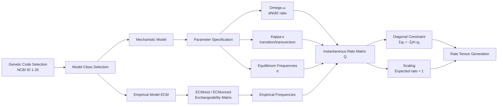

The csubst framework implements a sophisticated codon substitution model system that bridges empirical and mechanistic approaches to molecular evolution analysis. This system enables precise detection of convergent molecular evolution by calculating synonymous and nonsynonymous substitution patterns across phylogenetic trees while accounting for branch-specific evolutionary dynamics and site-specific rate variation.

## Genetic Code Architecture

The framework supports the complete NCBI genetic code collection (currently 25 variants), enabling analysis across diverse taxonomic groups including nuclear genomes, mitochondrial genomes, and specialized genetic systems. Each genetic code defines the codon-to-amino-acid mapping, stop codons, and start codons required for accurate substitution classification into synonymous versus nonsynonymous categories.

The `get_codon_table()` function retrieves the specified genetic code and constructs the codon ordering used throughout the analysis pipeline, organizing codons by their amino acid translations and synonymous codon groups for efficient tensor operations [genetic_code.py](csubst/genetic_code.py#L20-L430). This architecture ensures that S and N substitutions are correctly classified regardless of the genetic code variant being analyzed.

## Substitution Model Classes

The csubst framework implements two distinct classes of codon substitution models, each serving different analytical needs and providing complementary insights into evolutionary processes.

### Mechanistic Models

Mechanistic models provide theoretical substitution rates based on fundamental biochemical properties and evolutionary parameters. The `get_mechanistic_instantaneous_rate_matrix()` function constructs a 61×61 instantaneous rate matrix incorporating three key parameters:

- **Omega (ω)**: The dN/dS ratio controlling nonsynonymous substitution rates relative to synonymous rates. Omega multiplies all rate elements, then synonymous substitution rates are restored to baseline by dividing by omega, effectively scaling only nonsynonymous rates by the omega factor [parser_misc.py](csubst/parser_misc.py#L100-L105)
- **Kappa (κ)**: The transition/transversion ratio applied to single-nucleotide substitutions between purines (A↔G) or pyrimidines (C↔T) [parser_misc.py](csubst/parser_misc.py#L106-L113)
- **Equilibrium frequencies**: Codon frequency estimates derived from either empirical data or maximum-likelihood estimation, scaled to ensure the expected substitution rate equals one per unit time [parser_misc.py](csubst/parser_misc.py#L114-L116)

The model enforces the biological constraint that only single-nucleotide substitutions are permitted, prohibiting double or triple nucleotide changes in a single evolutionary event [parser_misc.py](csubst/parser_misc.py#L98-L99).

### Empirical Models

Empirical models leverage observed substitution patterns across large protein alignments to capture context-dependent mutation biases and selection pressures. The framework incorporates ECM (Empirical Codon Model) matrices from the ECMrest.dat and ECMunrest.dat files, which contain exchangeability rates estimated from vertebrate protein alignments [substitution_matrix/ECMrest.dat](csubst/substitution_matrix/ECMrest.dat#L1-L50). The `read_exchangeability_matrix()` function parses these 61×61 matrices (excluding stop codons) and maps them to the user-specified codon ordering [parser_misc.py](csubst/parser_misc.py#L226-L241).

> [!TIP]
> The ECMunrest model includes stop codons and should be used for analyses involving mitochondrial genomes where genetic codes differ from the standard nuclear code, while ECMrest excludes stop codons and is appropriate for standard nuclear analyses.



## Rate Tensor Construction

The substitution system transforms instantaneous rate matrices into multi-dimensional tensors optimized for combinatorial substitution analysis across branches and sites. Two distinct construction modes support different analytical objectives.

### Synonymous/Synonymous Mode

The 'syn' mode constructs separate tensors for synonymous (S) and nonsynonymous (N) substitutions, each organized by amino acid group to isolate substitution patterns within degenerate codon families. The `get_rate_tensor()` function creates tensors with shape [num_syngroup, num_state, num_state] where num_syngroup equals the number of amino acids (20 for standard code) and num_state equals the maximum synonymous codon family size [parser_misc.py](csubst/parser_misc.py#L139-L150). This organization enables precise tracking of substitutions within versus between amino acid families.

### As-Is Mode

The 'asis' mode preserves the complete codon-state space without synonymous grouping, creating tensors with shape [1, num_codon, num_codon] [parser_misc.py](csubst/parser_misc.py#L135-L138). This mode is useful when preserving the full codon substitution context is required rather than separating by synonymous family.

### Substitution Tensor Computation

The `get_substitution_tensor()` function calculates branch- and site-specific substitution tensors by multiplying ancestral and derived state probabilities with the appropriate rate matrix, incorporating site-specific rate heterogeneity when available [substitution.py](csubst/substitution.py#L31-L62). The computation employs memory-mapped arrays for efficient handling of large datasets, enabling analysis of phylogenies with hundreds of branches and thousands of codons.

The core computation uses Einstein summation to efficiently calculate the probability of each possible state transition:

```
sub_matrix = numpy.einsum("as,ds,ad->sad", parent_matrix, child_matrix, diag_zero)
```

where `a` represents ancestral codons, `d` represents derived codons, and `s` represents sites, with `diag_zero` excluding diagonal elements (no-change events) from the count [substitution.py](csubst/substitution.py#L48-L59).

## Expected Substitution Calculation

The framework provides two complementary approaches for calculating expected substitution counts, essential for distinguishing convergence from null expectations.

### Model-Free Approach

The modelfree method (`omegaC_method='modelfree'`) uses observed substitution patterns across the tree to construct expected values. The `calc_E_stat()` function computes mean expected nonsynonymous (ECN) and synonymous (ECS) substitutions for each combinatorial substitution class by aggregating observed data across relevant branch combinations and site categories [omega.py](csubst/omega.py#L194-L195).

### Submodel Approach

The submodel method (`omegaC_method='submodel'`) calculates expected states through matrix exponentiation of the instantaneous rate matrix scaled by branch lengths and site-specific rates. The `get_exp_state()` function implements this by:

1. Scaling the instantaneous rate matrix by branch length (SNdist for synonymous, Ndist for nonsynonymous) [omega.py](csubst/omega.py#L236-L241)
2. Further scaling by site-specific rate categories derived from IQ-TREE's rate heterogeneity model [omega.py](csubst/omega.py#L247-L248)
3. Computing the matrix exponential to obtain transition probabilities: `transition_prob = expm(inst_bl_site)` [omega.py](csubst/omega.py#L251)
4. Multiplying ancestral state probabilities by transition probabilities to obtain expected derived state distributions [omega.py](csubst/omega.py#L254-L258)

This approach provides theoretically grounded expected substitution counts that account for branch-specific evolutionary distances and site-specific rate variation.

> [!TIP]
> The matrix exponentiation approach correctly follows the continuous-time Markov model formulation described in standard phylogenetic inference frameworks, ensuring that expected state probabilities sum to one across all possible derived codons at each site.

## Combinatorial Substitution Classification

The substitution system categorizes codon changes into nine combinatorial classes that distinguish between convergent, divergent, and background substitution patterns across foreground and background lineages:

| Substitution Class | Description | Interpretation |
|-------------------|-------------|----------------|
| any2any | All substitutions between any codon pair | Total substitution rate |
| spe2spe | Specific to specific codon substitutions | Convergent substitution rate |
| any2spe | Any to specific codon substitutions | One-sided convergence |
| spe2any | Specific to any codon substitutions | One-sided divergence |
| dif2dif | Different to different codon substitutions | Background variation |

The `sub_tensor2cb()` function calculates these categories across branch combinations, enabling the detection of elevated convergence rates relative to background expectations [substitution.py](csubst/substitution.py#L147-L176). This combinatorial approach forms the foundation for statistical testing of convergent molecular evolution.

## Omega Calculation Framework

The final ω estimates are computed from observed and expected substitution counts for each combinatorial substitution class. The `get_omega()` function implements this calculation:

```
dNc = OCN / ECN
dSc = OCS / ECS
omegaC = dNc / dSc
```

where OCN and OCS are observed nonsynonymous and synonymous counts, and ECN and ECS are expected counts [omega.py](csubst/omega.py#L263-L286). Zero-count handling ensures numerical stability while maintaining biological interpretability.

Additionally, the framework calculates the Convergence-to-Divergence ratio (CoD) as the ratio of any2spe to any2dif substitutions, providing a normalized measure of convergence intensity independent of overall substitution rate [omega.py](csubst/omega.py#L288-L295).

## Configuration and Parameter Management

The substitution model system integrates with the global parameter management infrastructure through the `get_global_parameters()` function, which parses command-line arguments and performs validation of model parameter specifications [param.py](csubst/param.py#L10-L63). Key model parameters include:

- `omega`: Global dN/dS ratio for mechanistic models
- `kappa`: Transition/transversion ratio
- `equilibrium_frequency`: Codon frequency estimates (overrides empirical defaults)
- `omegaC_method`: Choice between 'modelfree' and 'submodel' approaches
- `float_type`: Numerical precision (16, 32, or 64 bit) affecting computational performance
- `calc_quantile`: Enable quantile-based calibrations for robust statistical inference

These parameters are stored in the global dictionary `g` and propagated throughout the analysis pipeline, ensuring consistent application of substitution model specifications across tensor computation, expected value calculation, and statistical testing.

## Next Steps

Understanding codon substitution models provides the foundation for comprehending how the framework measures evolutionary convergence. Continue your exploration with:

- [Substitution Tensor Computation](10-substitution-tensor-computation) - Learn how the substitution tensor enables efficient combinatorial analysis
- [Omega (dN/dS) Estimation](13-omega-dn-ds-estimation) - Deep dive into statistical methods for convergent selection detection
- [Foreground and Background Evolution Parameters](18-foreground-and-background-evolution-parameters) - Understand how evolutionary models are customized for foreground lineages
