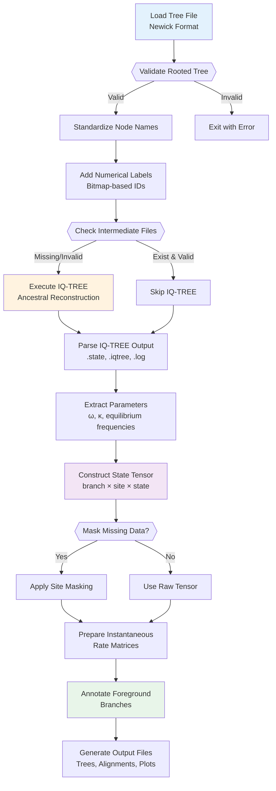

The csubst framework implements a robust input processing pipeline that validates phylogenetic data, executes external phylogenetic inference software, parses complex ancestral state reconstructions, and prepares structured data tensors for combinatorial substitution analysis. This architecture bridges raw phylogenetic inputs with the high-performance tensor operations that drive convergence detection.

## Architecture Overview

The input processing pipeline follows a linear sequence of validation, integration, and transformation steps that convert raw phylogenetic files into analysis-ready data structures. The design prioritizes data integrity validation at each stage, ensuring downstream computations operate on consistent and well-defined inputs.



## Tree File Processing

The framework loads and validates phylogenetic trees using the ete3 library, with comprehensive validation checks ensuring structural integrity and compatibility with downstream analysis.

### Tree Loading and Validation

The `read_treefile()` function serves as the entry point for tree processing, performing three critical operations: loading the Newick format tree, validating root structure (ensuring exactly two children at the root indicates proper rooting), and initializing numerical labeling for efficient computation [tree.py](csubst/tree.py#L357-L365).

```python
def read_treefile(g):
    g['rooted_tree'] = ete3.PhyloNode(g['rooted_tree_file'], format=1)
    assert len(g['rooted_tree'].get_children())==2, 'The input tree may be unrooted'
    g['rooted_tree'] = standardize_node_names(g['rooted_tree'])
    g['rooted_tree'] = add_numerical_node_labels(g['rooted_tree'])
    g['num_node'] = len(list(g['rooted_tree'].traverse()))
```

### Node Name Standardization

The `standardize_node_names()` function sanitizes taxon labels by removing Newick format annotations, forward slashes (used by some phylogenetics software), and leading/trailing quotes [tree.py](csubst/tree.py#L128-L143). This normalization prevents parsing ambiguities while enforcing uniqueness constraints on both leaf and internal node labels.

> [!TIP]
> The framework enforces strict uniqueness checks for internal node labels—if duplicate internal names exist, the analysis aborts with instructions to use tools like nwkit drop to remove them. This prevents ambiguous branch reference during combination detection.

### Numerical Labeling Scheme

The `add_numerical_node_labels()` function implements a bitmap-based numerical labeling system that enables efficient branch identification and combination algorithms [tree.py](csubst/tree.py#L15-L31). Each node receives a unique integer based on the set of leaf names in its clade: leaf names are sorted and assigned powers of two (2⁰, 2¹, 2²...), then internal node labels are computed as the sum of leaf bitmasks in their descendant set.

| Label Type | Purpose | Value Range | Computation |
|------------|---------|-------------|-------------|
| Leaf labels | Taxon identification | 0 to N-1 (N = #taxa) | Sorted assignment |
| Internal labels | Clade identification | Unique integers | Sum of descendant leaf bitmasks |

This scheme allows O(1) tests for ancestor-descendant relationships and enables fast subset queries during combination enumeration.

### Tree-Alignment Consistency Validation

The `is_consistent_tree_and_aln()` function performs bidirectional validation between tree taxa and alignment sequence names [tree.py](csubst/tree.py#L367-L379). The function identifies discrepancies by computing set differences and reports missing taxa in each direction, preventing downstream errors from mismatched inputs.

```python
def is_consistent_tree_and_aln(g):
    leaf_names = [ l.name for l in g['rooted_tree'].get_leaves() ]
    fasta_dict = sequence.read_fasta(path=g['alignment_file'])
    seq_names = list(fasta_dict.keys())
    is_consistent = set(leaf_names) == set(seq_names)
    # Report discrepancies...
    return is_consistent
```

## IQ-TREE Integration and Intermediate File Management

The framework uses IQ-TREE for ancestral state reconstruction and parameter estimation, with intelligent caching and validation to avoid redundant computations.

### Dependency and File Checking

The `generate_intermediate_files()` function implements a three-tiered file existence check: first verifying all required IQ-TREE outputs exist (.state, .iqtree, .log), then comparing the substitution model specification against user configuration, and finally determining whether to skip or rerun IQ-TREE [parser_misc.py](csubst/parser_misc.py#L14-L37).

> [!TIP]
> When intermediate files exist but the model mismatched the user-specified `--iqtree_model`, the framework automatically reruns IQ-TREE with the correct model, preventing silent parameter mismatches that could invalidate downstream convergence analysis.

### Ancestral State Execution

The `run_iqtree_ancestral()` function constructs and executes IQ-TREE command-line calls with appropriate parameters for codon-based phylogenetic analysis [parser_iqtree.py](csubst/parser_iqtree.py#L40-L64). The execution path branches based on tree-alignment consistency: when consistent, IQ-TREE receives the user-provided tree via `-te` option; when inconsistent, the framework either aborts (default) or runs IQ-TREE without tree input if `--force_notree_run` is enabled.

**Key IQ-TREE parameters:**
- `-s`: Input alignment file
- `-te`: User tree file (if consistent)
- `-m`: Substitution model (e.g., ECM+, GY94, MG94)
- `--seqtype CODON{code}`: Codon sequences with genetic code
- `--threads-max`: Parallel processing
- `--ancestral`: Ancestral state reconstruction
- `--rate`: Rate heterogeneity estimation
- `--redo`: Force recomputation

## Parameter Extraction from IQ-TREE Output

The framework parses multiple IQ-TREE output files to extract evolutionary parameters required for substitution model construction and state tensor generation.

### State File Parsing

The `read_state()` function processes the `.state` file generated by IQ-TREE's ancestral state reconstruction, determining input data type and initializing codon-level data structures [parser_iqtree.py](csubst/parser_iqtree.py#L65-L96). The parser identifies nucleotide (4 states), peptide (20 states), or codon (>20 states) input based on the number of state columns, then builds codon orders, matrix groups (synonymous codon sets per amino acid), and synonymous indices for subsequent tensor construction.

For codon data, the function constructs:
- `codon_orders`: Array of codon labels (e.g., ["TTT", "TTC", ...])
- `matrix_groups`: Dictionary mapping amino acids to synonymous codons
- `synonymous_indices`: Position indices for each synonymous group
- `max_synonymous_size`: Size of largest synonymous codon group (for dimension allocation)

### Model and Frequency Extraction

The `read_iqtree()` function extracts substitution model specification and codon equilibrium frequencies from the `.iqtree` file [parser_iqtree.py](csubst/parser_iqtree.py#L104-L120). Using regular expression matching, the parser identifies the model string (e.g., "ECMK07+F+G+R", "GY94+F") and extracts individual codon frequency parameters (π values) for constructing the instantaneous rate matrix.

```python
def read_iqtree(g, eq=True):
    with open(g['path_iqtree_iqtree']) as f:
        lines = f.readlines()
    for line in lines:
        model = re.match(r'Model of substitution: (.+)', line)
        if model is not None:
            g['substitution_model'] = model.group(1)
    # Extract equilibrium frequencies...
```

### Log File Parameter Extraction

The `read_log()` function parses IQ-TREE's `.log` file to extract three critical evolutionary parameters: ω (dN/dS ratio), κ (transition/transversion ratio), and the genetic code used during reconstruction [parser_iqtree.py](csubst/parser_iqtree.py#L121-L138). These parameters are essential for constructing mechanistic substitution matrices when not using empirical codon models.

### Rate Heterogeneity Parsing

The `read_rate()` function reads site-specific rate heterogeneity values from the `.rate` file [parser_iqtree.py](csubst/parser_iqtree.py#L97-L103). When rate variation is not estimated (e.g., simple models), the function defaults to uniform rates across all sites.

## Tree Annotation and Root Transfer

The framework integrates the user-provided rooted tree with IQ-TREE's output tree to create a unified annotated tree structure for analysis.

### Root Position Transfer

The `annotate_tree()` function implements bipartition-based root transfer between the user's rooted tree and IQ-TREE's output tree [parser_misc.py](csubst/parser_misc.py#L279-L300). First, the function validates leaf set consistency between trees; when consistent, it applies `transfer_root()` to position the root according to the user's specification while preserving IQ-TREE's branch lengths and internal node labels.

The `transfer_root()` function identifies the root bipartition by comparing leaf sets between subroot children, then repositions the root in the target tree using ete3's `set_outgroup()` method [tree.py](csubst/tree.py#L37-L67). Branch lengths are proportionally rescaled to maintain total tree length, ensuring that the root position change doesn't alter evolutionary distance estimates.

## State Tensor Construction

The core data structure for csubst analysis is the state tensor—a 3D array storing ancestral state probabilities across branches, sites, and character states.

### Tensor Structure and Dimensions

The `get_state_tensor()` function constructs the state tensor with dimensions `[num_node, num_site, num_state]` [parser_iqtree.py](csubst/parser_iqtree.py#L154-L204). For codon-based analyses with N taxa, S sites, and C codons, this produces an N+1 × S × C tensor (including root). The tensor can store either probability distributions (posterior ancestral probabilities) or binary states (maximum likelihood reconstruction), controlled by the `--ml_anc` parameter.

| Dimension | Index | Meaning | Example for codon data |
|-----------|-------|---------|------------------------|
| 0 | `b` | Branch/node ID | 0 to N (N+1 total) |
| 1 | `s` | Site position | 0 to S-1 (S codon sites) |
| 2 | `i` | Character state | 0 to C-1 (61 sense codons) |

### Tensor Population Algorithm

The tensor population algorithm handles three node types differently:

1. **Root node** (skipped): Not populated as root states are derived from children
2. **Leaf nodes**: Sequence data extracted from alignment, converted to probability vectors. For ambiguous codons (e.g., "Y" = C/T), probability is distributed equally among matching states
3. **Internal nodes**: Posterior probabilities read from IQ-TREE `.state` file, with missing data (`???`) masked as zero vectors

The function links the tree to the alignment using ete3's `link_to_alignment()` method, enabling direct sequence access via node attributes [parser_iqtree.py](csubst/parser_iqtree.py#L154-L157).

```python
g['tree'].link_to_alignment(alignment=g['alignment_file'], alg_format='fasta')
for node in g['tree'].traverse():
    if node.is_leaf():
        seq = node.sequence.upper()
        # Convert sequence to probability matrix...
    else: # Internal nodes
        state_matrix = state_table.loc[(state_table['Node']==node.name),:].iloc[:,3:]
        # Handle missing data...
```

### Missing Data Handling

The `mask_missing_sites()` function applies site-level masking based on alignment gaps and ambiguous characters [parser_iqtree.py](csubst/parser_iqtree.py#L139-L153). This ensures that sites with incomplete data across the tree don't contribute spurious substitution signals to downstream convergence detection.

### Maximum Likelihood Conversion

When the `--ml_anc` flag is set, the framework converts probabilistic ancestral states to binary ML states using `argmax` selection [parser_iqtree.py](csubst/parser_iqtree.py#L169-L183). This binary representation simplifies downstream combinatorial analysis but discards uncertainty information that may be informative for convergent site detection.

## Instantaneous Rate Matrix Construction

The `read_input()` function builds the instantaneous rate matrix (Q) that describes instantaneous substitution rates between character states [parser_misc.py](csubst/parser_misc.py#L38-L91). The matrix construction depends on the substitution model type:

### Empirical Codon Models (ECM)

For ECMK07 and ECMrest models, the framework loads pre-computed exchangeability matrices from `substitution_matrix/ECMunrest.dat` or `substitution_matrix/ECMrest.dat` [parser_misc.py](csubst/parser_misc.py#L52-L66). These empirical matrices capture codon substitution patterns derived from large-scale protein evolution data.

The `exchangeability2Q()` function converts exchangeability matrices to rate matrices using the formula Q_ij = S_ij × π_j, where S_ij is the exchangeability and π_j is the equilibrium frequency [parser_misc.py](csubst/parser_misc.py#L174-L178).

### Mechanistic Models (GY94, MG94)

For Goldman-Yang 1994 (GY94) and Muse-Gaut 1994 (MG94) models, the `get_mechanistic_instantaneous_rate_matrix()` function constructs Q matrices from first principles using ω (dN/dS) and κ (transition/transversion) parameters [parser_misc.py](csubst/parser_misc.py#L92-L118). These models require explicit ω and κ values, which must be provided via command-line arguments if not estimated by IQ-TREE.

### Matrix Validation

The framework validates constructed Q matrices for time-reversibility using the detailed balance condition: q_ij × π_i = q_ji × π_j [parser_misc.py](csubst/parser_misc.py#L81-L84). Violations indicate computational errors or model misspecification and trigger assertion failures.

## Output File Generation

Following input processing, the framework generates several output files for verification and downstream analysis:

### Alignment Files

- `csubst_alignment_codon.fa`: Codon alignment with standardized sequence names
- `csubst_alignment_aa.fa`: Translated amino acid alignment
- Both are generated via `sequence.write_alignment()` [sequence.py](csubst/sequence.py#L48-L63)

### Tree Files

- `csubst_tree.nwk`: Processed tree with numerical labels and foreground annotations
- Generated via `tree.write_tree()` [tree.py](csubst/tree.py#L152-L157)

### Parameter Files

- `csubst_instantaneous_rate_matrix.tsv`: Q matrix in tabular format
- Saved via `numpy.savetxt()` in `read_input()` [parser_misc.py](csubst/parser_misc.py#L79)

### Visualization Files

Branch ID plots (all nodes, leaf-only, no-label variants) and state trees (amino acid and codon) are generated when corresponding flags are enabled via `tree.plot_branch_category()` and `tree.plot_state_tree()` [tree.py](csubst/tree.py#L211-L280).

## Foreground Branch Annotation

The framework supports foreground branch annotation for lineage-specific convergence analysis. The `annotate_foreground()` function in `foreground.py` applies foreground flags and color attributes to tree nodes based on user-specified lineages [foreground.py](csubst/foreground.py#L200-L230).

### Lineage-Based Annotation

For each foreground lineage, the framework identifies descendant leaves using regular expression matching, then propagates foreground flags up the tree to include all ancestral branches [foreground.py](csubst/parser_misc.py#L149-L173). The `--fg_stem_only` parameter controls whether only the stem branch (first branch from ancestor) or all lineage branches are marked as foreground.

### Branch Categorization

Annotated branches receive multiple attributes:
- `is_fg_{trait}`: Boolean foreground indicator
- `color_{trait}`: Visualization color assignment
- `numerical_label`: Unique branch identifier for tensor indexing

## Validation and Error Handling

The framework implements comprehensive validation at each processing stage:

| Stage | Validation | Error Type | Recovery |
|-------|------------|------------|----------|
| Tree loading | Root structure check | Invalid root | Exit with error message |
| Name standardization | Uniqueness check | Duplicate labels | Exit with instructions |
| Alignment comparison | Taxon set equality | Mismatched taxa | Report differences |
| IQ-TREE execution | Return code check | Execution failure | Exit with subprocess output |
| Tensor construction | Dimension consistency | Size mismatch | Exit with assertion |
| Matrix construction | Time-reversibility | Violated detailed balance | Exit with error |

## Integration with Downstream Analysis

The input processing pipeline outputs structured data objects that directly feed into combinatorial substitution analysis:

- `g['tree']`: Ete3 tree object with numerical labels and annotations
- `g['state_cdn']`: Codon state tensor [branch × site × codon]
- `g['state_pep']`: Amino acid state tensor [branch × site × aa]
- `g['instantaneous_codon_rate_matrix']`: Q matrix for codon substitutions
- `g['rate_syn_tensor']`: Synonymous rate tensor
- `g['rate_aa_tensor`]`: Amino acid rate tensor
- `g['fg_leaf_names']`: Leaf names for each foreground lineage

These structures enable the next stages of analysis: ancestral state reconstruction refinement (covered in [Ancestral State Reconstruction with IQ-TREE](9-ancestral-state-reconstruction-with-iq-tree)), substitution tensor computation, and branch combination detection.

## Next Steps

With input processing complete, the framework proceeds to [Ancestral State Reconstruction with IQ-TREE](9-ancestral-state-reconstruction-with-iq-tree), which details the IQ-TREE integration for probabilistic ancestral state estimation and the transformation of these estimates into the tensor structures used for convergence detection. Alternatively, for understanding the combinatorial framework that analyzes these states, see [Combinatorial Substitutions](5-combinatorial-substitutions).