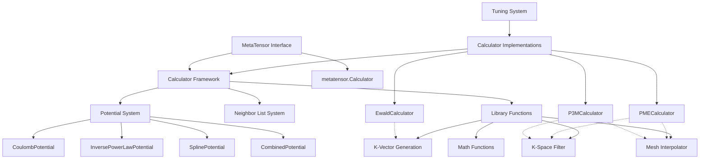
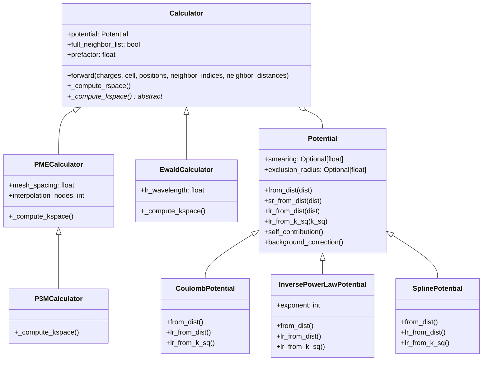
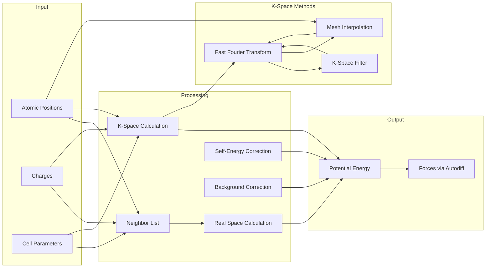
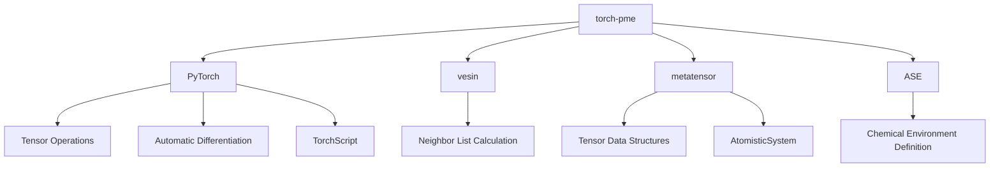

# Overview

<details>
<summary>Relevant source files</summary>

The following files were used as context for generating this wiki page:

- [README.rst](README.rst)
- [docs/src/references/changelog.rst](docs/src/references/changelog.rst)
- [examples/basic-usage.py](examples/basic-usage.py)
- [pyproject.toml](pyproject.toml)
- [src/torchpme/__init__.py](src/torchpme/__init__.py)
- [src/torchpme/calculators/__init__.py](src/torchpme/calculators/__init__.py)
- [src/torchpme/calculators/calculator.py](src/torchpme/calculators/calculator.py)
- [src/torchpme/metatensor/__init__.py](src/torchpme/metatensor/__init__.py)
- [src/torchpme/potentials/potential.py](src/torchpme/potentials/potential.py)
- [tests/calculators/test_calculator.py](tests/calculators/test_calculator.py)
- [tests/requirements.txt](tests/requirements.txt)
- [tox.ini](tox.ini)

</details>


torch-pme is a PyTorch-based library for efficient and auto-differentiable computation of long-range interactions in atomistic systems. It enables the calculation of potentials and forces for particles with charges or dipoles, with a particular focus on electrostatic interactions.

The library provides a framework for computing long-range interactions using various methods, supporting both research applications and machine learning workflows through auto-differentiation capabilities. This allows not only the automatic computation of forces but also enables gradient-based optimization in machine learning models for atomistic systems.

For **monopoles** (charges), the library offers Particle-Particle Particle-Mesh Ewald (P3M), Particle Mesh Ewald (PME), standard Ewald, and non-periodic methods. For **dipolar** interactions, it provides the standard Ewald method for calculating the 1/r³ potential.

Sources: [README.rst:12-22](), [pyproject.toml:24]()

## Key Features

torch-pme provides several key features:

1. **Multiple Calculation Methods**: Support for various approaches (Ewald, PME, P3M) allowing users to choose the most appropriate method for their system size and accuracy requirements.

2. **Flexible Potential Models**: Support for the Coulomb potential (1/r), inverse power-law potentials (1/r^p), dipolar potentials (1/r³), and custom potentials defined by splines.

3. **Auto-Differentiation**: Full support for calculating gradients with respect to positions, charges, and cell parameters, making it straightforward to compute forces and other derivatives.

4. **Performance Optimization**: Optimized for both CPU and GPU devices, with full TorchScript compatibility for high-performance production environments.

5. **Integration Capabilities**: Optional integration with libraries like metatensor for tensor operations and atomistic system representation.

Sources: [README.rst:12-28](), [pyproject.toml:26-38]()

## Core Architecture

The architecture of torch-pme is organized around several key components that work together to enable efficient calculation of long-range interactions:

### Core System Components Diagram



The primary components include:

1. **Calculator Framework**: The foundation for computing potentials and energies, implemented in the `Calculator` base class and specialized in implementations like `EwaldCalculator`, `PMECalculator`, and `P3MCalculator`.

2. **Potential System**: Defines the interaction models used by calculators, with the `Potential` base class and implementations like `CoulombPotential`, `InversePowerLawPotential`, and `SplinePotential`.

3. **K-Space Methods**: Systems for efficient long-range calculations including mesh interpolation and k-space filtering, crucial for the PME and P3M methods.

4. **Library Functions**: Core mathematical functions and utilities that support the calculators and potentials.

5. **Tuning System**: Provides methods to automatically optimize parameters for different calculators.

6. **MetaTensor Interface**: Optional integration with metatensor for handling tensor-based atomistic data.

Sources: [src/torchpme/calculators/calculator.py:7-46](), [src/torchpme/potentials/potential.py:6-55](), [src/torchpme/__init__.py:1-36]()

## Calculator Class Hierarchy

The calculators in torch-pme follow a hierarchical structure that allows for code reuse and consistent interfaces:

### Calculator and Potential Class Hierarchy Diagram



- The `Calculator` base class provides common functionality for all calculators, including real-space calculations via `_compute_rspace()`.
- Specific implementations like `EwaldCalculator`, `PMECalculator`, and `P3MCalculator` inherit from `Calculator` and implement different approaches to calculating the long-range (k-space) contribution via `_compute_kspace()`.
- Each calculator works with a `Potential` object that defines the form of the interaction.
- The `Potential` base class defines the interface for all potentials, including methods for computing the short-range and long-range parts of the potential in both real and reciprocal space.

Sources: [src/torchpme/calculators/calculator.py:8-163](), [src/torchpme/potentials/potential.py:6-173](), [src/torchpme/calculators/__init__.py:1-13]()

## Computational Pipeline

The computational workflow in torch-pme involves several stages, from input preparation to output generation:

### Computational Pipeline Diagram



1. **Input**: The system takes atomic positions, charges, and cell parameters as input.
2. **Neighbor List**: A list of neighboring atom pairs is computed, typically using external libraries like vesin.
3. **Real Space Calculation**: The short-range part of the potential is computed by summing over neighbors via `_compute_rspace()`.
4. **K-Space Calculation**: The long-range part of the potential is computed in reciprocal space via `_compute_kspace()`, using Fast Fourier Transforms and other techniques.
5. **Corrections**: Self-energy and background corrections are applied as needed through methods like `self_contribution()` and `background_correction()`.
6. **Output**: The potential energy is computed and can be differentiated to obtain forces using PyTorch's automatic differentiation.

Sources: [src/torchpme/calculators/calculator.py:47-163](), [src/torchpme/potentials/potential.py:56-173](), [examples/basic-usage.py:106-242]()

## Integration with External Libraries

torch-pme integrates with several external libraries to provide a comprehensive solution for atomistic simulations:

### External Library Integration Diagram



- **PyTorch**: Provides tensor operations, automatic differentiation, and TorchScript support, forming the foundation of torch-pme's computational capabilities.
- **vesin**: Used for neighbor list calculation, an essential preprocessing step for efficiently computing real-space interactions.
- **metatensor**: Optional integration for tensor data structures and atomistic system representation, providing enhanced functionality for machine learning applications.
- **ASE**: Can be used for chemical environment definition and visualization, supporting the creation and manipulation of atomistic systems.

This integration allows torch-pme to fit seamlessly into existing workflows and leverage the strengths of these specialized libraries.

Sources: [pyproject.toml:23](), [pyproject.toml:45-54](), [src/torchpme/metatensor/__init__.py:1-6](), [examples/basic-usage.py:24-30]()

## Example Usage

Here's a simple example demonstrating how to use torch-pme to compute electrostatic potentials and forces:

```python
import torch
import torchpme

# Single charge in a cubic box
positions = torch.zeros((1, 3))
cell = 8 * torch.eye(3)
charges = torch.tensor([[1.0]])

# No neighbors for a single atom; use `vesin` for neighbors if needed
neighbor_indices = torch.zeros((0, 2), dtype=torch.int64)
neighbor_distances = torch.zeros((0,))

# Tune P3M parameters
smearing, p3m_parameters, _ = torchpme.tuning.tune_p3m(
   charges=charges,
   cell=cell,
   positions=positions,
   cutoff=5.0,
   neighbor_indices=neighbor_indices,
   neighbor_distances=neighbor_distances,
)

# Initialize potential and calculator
potential = torchpme.CoulombPotential(smearing)
calculator = torchpme.P3MCalculator(potential, **p3m_parameters)

# Start recording operations done to ``positions``
_ = positions.requires_grad_()

# Compute (per-atom) potentials
potentials = calculator.forward(
   charges=charges,
   cell=cell,
   positions=positions,
   neighbor_indices=neighbor_indices,
   neighbor_distances=neighbor_distances,
)

# Calculate total energy and forces
energy = torch.sum(charges * potentials)
energy.backward()
forces = -positions.grad
```

This example illustrates the core workflow:
1. Define system parameters (positions, charges, cell)
2. Tune calculator parameters
3. Initialize potential and calculator
4. Enable gradient tracking for positions
5. Compute potentials using the calculator
6. Calculate energy and forces using automatic differentiation

For more detailed information on specific components, please refer to the corresponding wiki pages:
- For more on the architecture, see [Architecture](#2)
- For implementation details, see [Implementation Details](#3)
- For integration with other libraries, see [Integration](#4)

Sources: [README.rst:73-119](), [examples/basic-usage.py:88-242]()

---