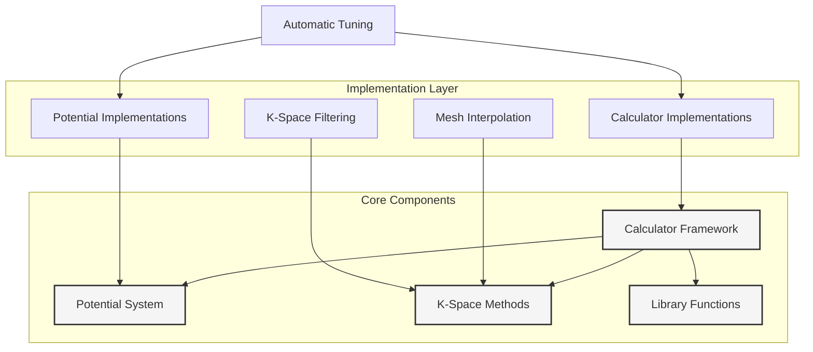
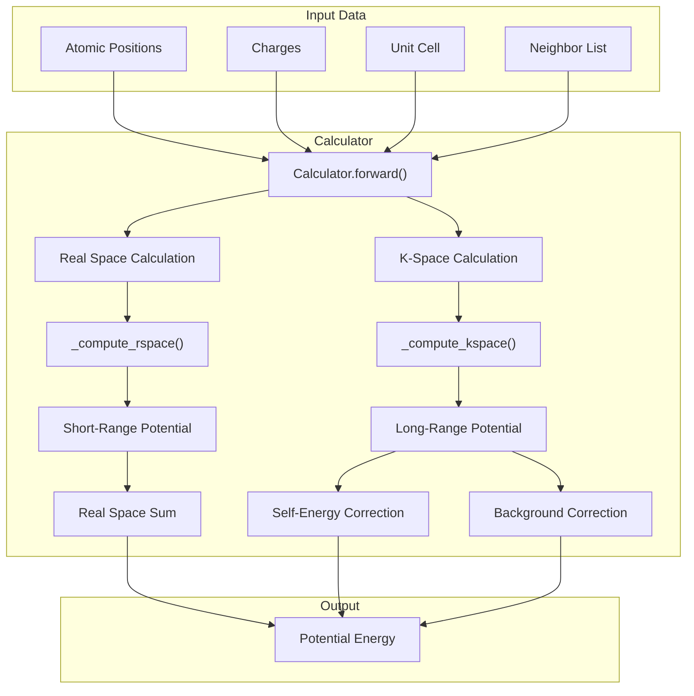
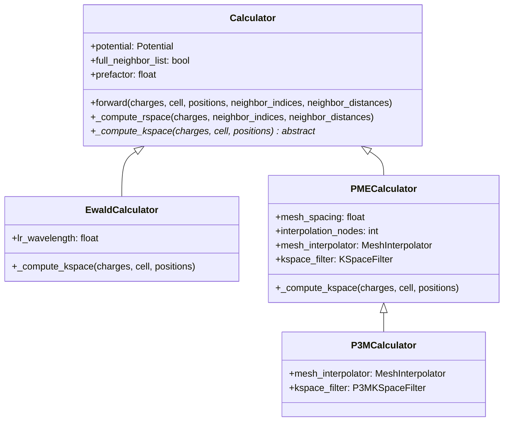
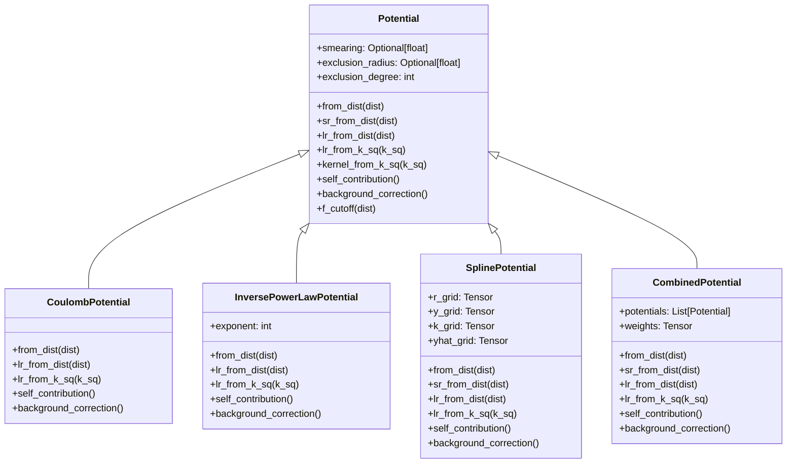
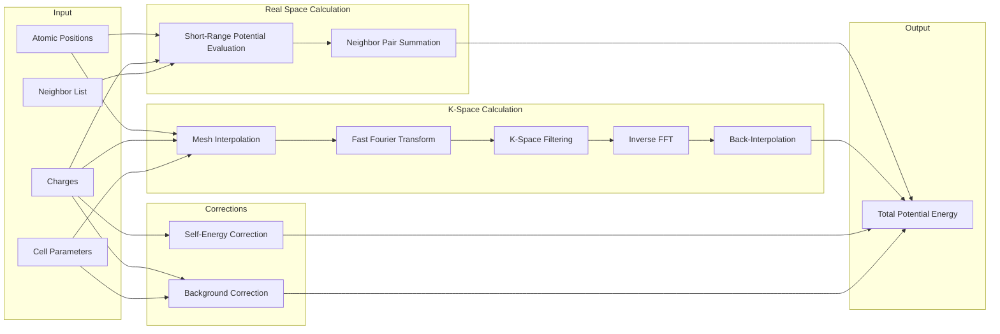
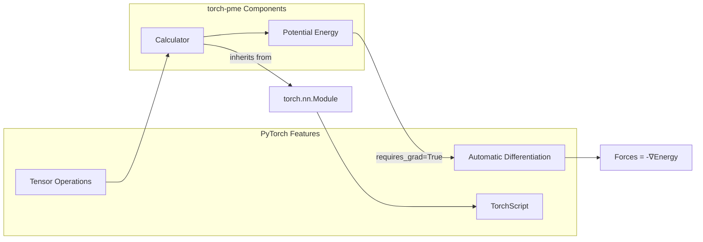

# Architecture

Relevant source files

The following files were used as context for generating this wiki page:

- [docs/src/references/changelog.rst](docs/src/references/changelog.rst)
- [src/torchpme/calculators/calculator.py](src/torchpme/calculators/calculator.py)
- [src/torchpme/calculators/ewald.py](src/torchpme/calculators/ewald.py)
- [src/torchpme/calculators/p3m.py](src/torchpme/calculators/p3m.py)
- [src/torchpme/calculators/pme.py](src/torchpme/calculators/pme.py)
- [src/torchpme/potentials/combined.py](src/torchpme/potentials/combined.py)
- [src/torchpme/potentials/coulomb.py](src/torchpme/potentials/coulomb.py)
- [src/torchpme/potentials/inversepowerlaw.py](src/torchpme/potentials/inversepowerlaw.py)
- [src/torchpme/potentials/potential.py](src/torchpme/potentials/potential.py)
- [src/torchpme/potentials/spline.py](src/torchpme/potentials/spline.py)
- [tests/calculators/test_calculator.py](tests/calculators/test_calculator.py)
- [tests/test_potentials.py](tests/test_potentials.py)

This page provides a high-level overview of the torch-pme architecture, explaining the main components and their relationships. For implementation details of specific components, see the respective child pages.

The torch-pme library is designed to efficiently compute long-range potentials in molecular simulations, with a primary focus on electrostatic interactions. It provides a flexible, modular framework that enables different calculation strategies with varying trade-offs between computational efficiency and accuracy.

## Core Architecture Components

The architecture of torch-pme is built around several key abstractions that work together to provide an efficient implementation of various potential calculation methods:

The architecture follows a modular design where:

1. The **Calculator Framework** provides the base functionality for computing potentials, and serves as the primary interface for users.
2. The **Potential System** defines the mathematical forms of interactions through a set of interchangeable potential classes.
3. **K-Space Methods** handle the computation of long-range interactions in reciprocal space.
4. **Library Functions** provide utility functions, mathematical operations, and specialized algorithms used throughout the system.

Sources: [src/torchpme/calculators/calculator.py](), [src/torchpme/potentials/potential.py](), [src/torchpme/calculators/pme.py]()

## Computational Pipeline

The following diagram illustrates the computational pipeline in torch-pme:

The computational process follows these steps:
1. Input data includes atomic positions, charges, unit cell parameters, and a neighbor list
2. The `Calculator.forward()` method splits the computation into real space and k-space components
3. Real space calculations handle short-range interactions using the neighbor list
4. K-space calculations handle long-range interactions using FFT-based methods
5. Self-energy and background corrections are applied as needed
6. The components are combined to produce the final potential energy

Sources: [src/torchpme/calculators/calculator.py:97-163](), [src/torchpme/calculators/pme.py:95-147](), [src/torchpme/calculators/ewald.py:76-134]()

## Calculator and Potential Class Hierarchies

The library is structured around two primary class hierarchies: Calculators and Potentials.

### Calculator Hierarchy

The `Calculator` class serves as the base abstraction for all potential calculators. It implements the common logic for real-space calculations while leaving k-space calculations to be implemented by subclasses through the abstract `_compute_kspace` method.

Sources: [src/torchpme/calculators/calculator.py:8-163](), [src/torchpme/calculators/ewald.py:8-134](), [src/torchpme/calculators/pme.py:11-147](), [src/torchpme/calculators/p3m.py:9-96]()

### Potential Hierarchy

The `Potential` class defines the interface for all potential functions used in torch-pme. It provides methods for calculating potentials in both real space and reciprocal space, as well as methods for computing self-energy and background corrections.

Sources: [src/torchpme/potentials/potential.py:6-173](), [src/torchpme/potentials/coulomb.py:8-107](), [src/torchpme/potentials/inversepowerlaw.py:11-145](), [src/torchpme/potentials/spline.py:14-159](), [src/torchpme/potentials/combined.py:8-120]()

## Calculation Methods and Space Complexity

torch-pme implements several methods for computing long-range potentials, each with different computational characteristics:

| Method | Implementation | Space Complexity | Main Features |
|--------|---------------|------------------|---------------|
| Ewald | `EwaldCalculator` | O(N²) | Direct k-space summation, accurate but computationally expensive |
| PME | `PMECalculator` | O(N·log(N)) | Fast Fourier Transform-based with mesh interpolation |
| P3M | `P3MCalculator` | O(N·log(N)) | Optimized PME with improved accuracy through modified influence functions |

Where N is the number of particles in the system.

Sources: [src/torchpme/calculators/ewald.py:8-15](), [src/torchpme/calculators/pme.py:11-17](), [src/torchpme/calculators/p3m.py:9-21]()

## Data Flow for Long-Range Potential Calculation

The following diagram illustrates how data flows through the system when calculating a long-range potential:

This detailed flow shows how:
1. The real space calculation evaluates the short-range part of the potential directly from the neighbor list
2. The k-space calculation uses mesh interpolation and Fourier transforms to efficiently compute the long-range part
3. Correction terms account for self-interaction and background charge
4. All components contribute to the final potential energy

Sources: [src/torchpme/calculators/calculator.py:97-163](), [src/torchpme/calculators/pme.py:95-147]()

## Integration with PyTorch and Automatic Differentiation

torch-pme is built on top of PyTorch, allowing it to leverage automatic differentiation for computing forces:

By implementing calculators and potentials as PyTorch modules and using PyTorch tensors for all calculations, torch-pme enables:
1. Automatic computation of forces through gradient backpropagation
2. GPU acceleration of calculations
3. Integration with PyTorch-based machine learning models
4. Just-in-time compilation through TorchScript for improved performance

Sources: [src/torchpme/calculators/calculator.py:8](), [src/torchpme/potentials/potential.py:6]()

## Summary and Component Relationships

The overall architecture of torch-pme follows a modular design that separates concerns:
- `Calculator` classes handle the overall computation strategy and implementation details
- `Potential` classes define the mathematical form of the interaction
- Supporting components like `MeshInterpolator` and `KSpaceFilter` provide specialized functionality

This architecture allows for flexible combination of different calculators and potentials, enabling efficient calculation of a wide range of interaction types.

For more detailed information on specific components, see the following pages:
- [Calculator Framework](#2.1)
- [Potential System](#2.2)
- [K-Space Methods](#2.3)
- [Library Functions](#2.4)

---