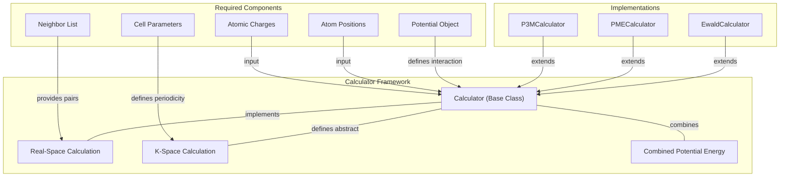
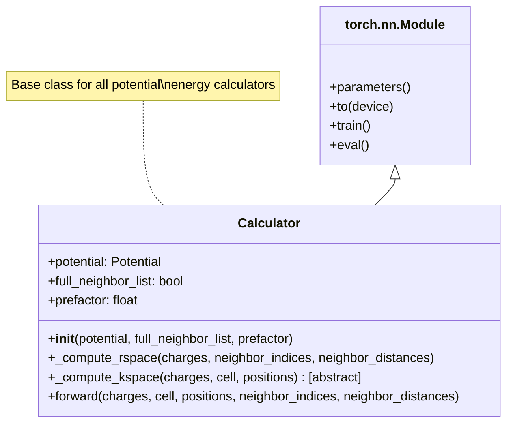
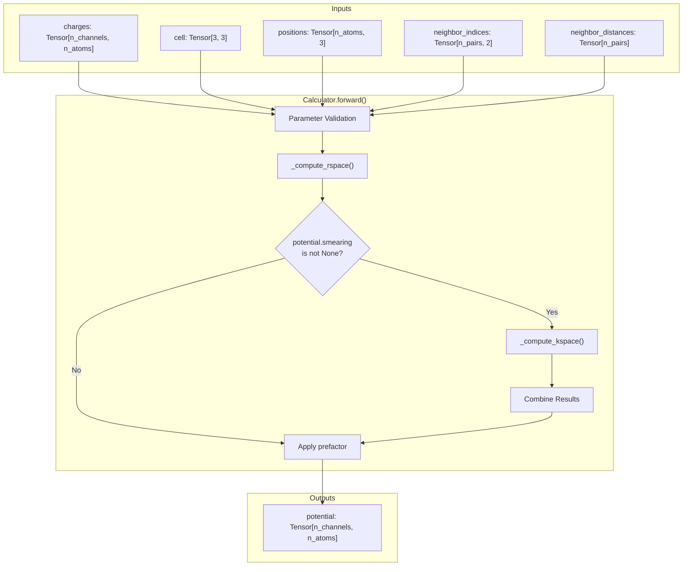
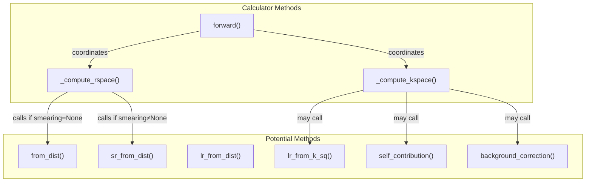

# Calculator Framework

Relevant source files

The following files were used as context for generating this wiki page:

- [docs/src/references/changelog.rst](docs/src/references/changelog.rst)
- [src/torchpme/calculators/calculator.py](src/torchpme/calculators/calculator.py)
- [src/torchpme/potentials/potential.py](src/torchpme/potentials/potential.py)
- [tests/calculators/test_calculator.py](tests/calculators/test_calculator.py)
- [tests/calculators/test_values_direct.py](tests/calculators/test_values_direct.py)

The Calculator Framework is the core computational engine of torch-pme, providing the foundation for computing interaction potentials and energies in atomistic systems. This page details the base `Calculator` class, its design principles, and how it forms the computational backbone for different calculation methods.

For information about specific calculator implementations such as EwaldCalculator, PMECalculator, and P3MCalculator, see [Calculator Implementations](#3.1). For details on potential models used by calculators, see the [Potential System](#2.2) page.

## Overview

The Calculator Framework provides a unified interface for computing potential energy and forces in atomistic systems, with a focus on long-range interactions. It separates the calculation algorithm (handled by calculators) from the interaction form (defined by potentials), enabling a flexible and modular approach to molecular simulations.

**Diagram: Calculator Framework Overview and Interactions**

Sources: [src/torchpme/calculators/calculator.py:8-164](), [src/torchpme/potentials/potential.py:6-174]()

## Calculator Base Class

The `Calculator` class is a PyTorch Module (`torch.nn.Module`) that serves as the foundation for all calculators in torch-pme. It manages the computation of potentials by either:

1. Directly summing over atom pairs in real space, or
2. Combining a short-range component calculated in real space with a long-range component calculated in Fourier space (k-space)

**Diagram: Calculator Class Structure**

Sources: [src/torchpme/calculators/calculator.py:8-46]()

### Key Parameters

- `potential`: A `Potential` object that defines the interaction form
- `full_neighbor_list`: Boolean indicating whether the neighbor list contains all pairs (true) or only half (false)
- `prefactor`: Scaling factor for the potential (e.g., electrostatic prefactor)

### Key Methods

- `_compute_rspace`: Computes the real-space contribution to the potential
- `_compute_kspace`: Abstract method to be implemented by subclasses to compute the k-space contribution
- `forward`: Main method that combines real-space and k-space contributions

Sources: [src/torchpme/calculators/calculator.py:47-163]()

## Computational Pipeline

The typical computational flow in a Calculator involves several steps that transform input data (positions, charges, cell) into potential energy values.

**Diagram: Calculator Computational Pipeline**

Sources: [src/torchpme/calculators/calculator.py:97-163]()

### Real-Space Calculation

The real-space calculation in `_compute_rspace` processes neighbor pairs to compute potential contributions:

1. Compute the bare potential value for each neighbor pair using the potential object
2. Multiply these values by the corresponding charges
3. Sum contributions for each atom
4. Apply adjustments for half/full neighbor lists

This provides the short-range part of the potential when using range separation, or the complete potential for non-range-separated calculations.

Sources: [src/torchpme/calculators/calculator.py:47-81]()

### K-Space Calculation

The k-space calculation in `_compute_kspace` (implemented by subclasses) computes the long-range part of the potential using Fourier-domain methods. Different calculator implementations (Ewald, PME, P3M) provide different algorithms for this step.

Sources: [src/torchpme/calculators/calculator.py:83-95]()

## Integration with Potentials

The Calculator Framework is designed to work closely with the Potential System, allowing different potential forms to be used with the same calculation algorithms.

**Diagram: Calculator-Potential Interaction**

Sources: [src/torchpme/calculators/calculator.py:47-81](), [src/torchpme/potentials/potential.py:80-173]()

### Range Separation

When the potential has a `smearing` parameter set, the calculator performs range separation, splitting the computation into:

1. Short-range part: Computed in real space using `potential.sr_from_dist`
2. Long-range part: Computed in k-space by a subclass implementation of `_compute_kspace`

This approach is essential for efficiently handling slowly-decaying interactions like Coulomb potentials in periodic systems.

Sources: [src/torchpme/calculators/calculator.py:154-162]()

## Implementation Details

### Parameter Validation

The Calculator performs extensive validation of input parameters to ensure computational correctness:
- Checking tensor shapes
- Ensuring consistent data types and devices
- Validating cell parameters for periodic calculations

Sources: [src/torchpme/calculators/calculator.py:138-145](), [tests/calculators/test_calculator.py:46-257]()

### PyTorch Integration

As a PyTorch Module, the Calculator inherits key PyTorch functionality:
- Automatic differentiation for force calculations
- GPU acceleration
- TorchScript compatibility

### Performance Considerations

The implementation includes performance optimizations:
- Profiler annotations for performance analysis
- Efficient tensor operations
- Support for both half and full neighbor lists

## Usage Example

A simple example of Calculator usage would typically include:

1. Creating a Potential object
2. Creating a Calculator (or subclass) with the potential
3. Providing input data (charges, positions, cell, neighbor information)
4. Computing the potential energy

This base Calculator is typically not used directly but extended by specific implementations like EwaldCalculator, PMECalculator, and P3MCalculator. See [Calculator Implementations](#3.1) for details on these concrete calculators.

Sources: [tests/calculators/test_values_direct.py:16-25](), [tests/calculators/test_values_direct.py:197-208]()

---