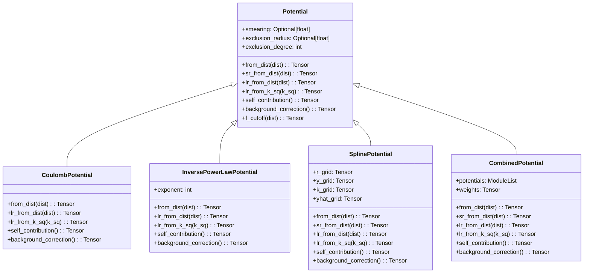
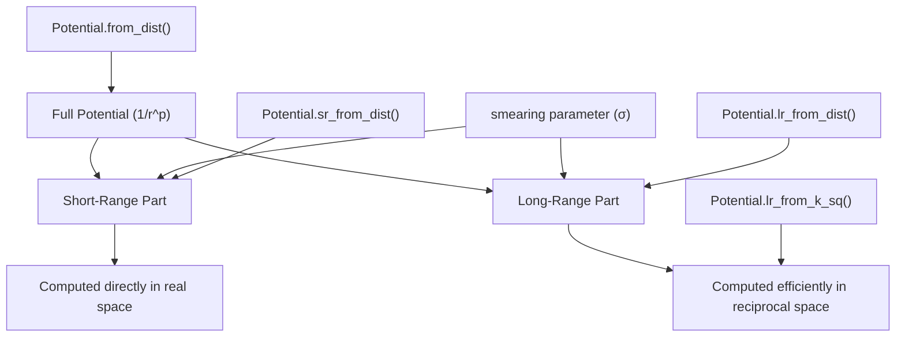
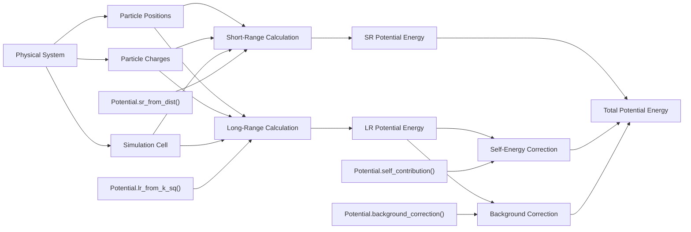

# Potential System

<details>
<summary>Relevant source files</summary>

The following files were used as context for generating this wiki page:

- [src/torchpme/calculators/ewald.py](src/torchpme/calculators/ewald.py)
- [src/torchpme/calculators/p3m.py](src/torchpme/calculators/p3m.py)
- [src/torchpme/calculators/pme.py](src/torchpme/calculators/pme.py)
- [src/torchpme/potentials/combined.py](src/torchpme/potentials/combined.py)
- [src/torchpme/potentials/coulomb.py](src/torchpme/potentials/coulomb.py)
- [src/torchpme/potentials/inversepowerlaw.py](src/torchpme/potentials/inversepowerlaw.py)
- [src/torchpme/potentials/spline.py](src/torchpme/potentials/spline.py)
- [tests/test_potentials.py](tests/test_potentials.py)

</details>


The Potential System in torch-pme defines the interaction models used by calculators for computing potential energy in atomistic systems. It provides a framework for representing different physical potentials, including Coulomb interactions, inverse power-law potentials, and customizable spline-based potentials. For information about how calculators use these potentials, see [Calculator Framework](#2.1).

## Overview

The Potential System centers around the `Potential` base class, which defines methods for evaluating both the full potential and its range-separated components (short-range and long-range parts). This separation is crucial for efficient long-range electrostatics calculations, as implemented in the various calculator classes.



Sources: [src/torchpme/potentials/coulomb.py](), [src/torchpme/potentials/inversepowerlaw.py](), [src/torchpme/potentials/spline.py](), [src/torchpme/potentials/combined.py]()

## Potential Base Class

The `Potential` base class defines the core interface for all potential implementations. It provides methods for evaluating potentials in both real and reciprocal space, as well as handling range separation.

### Key Properties

- **smearing**: Length scale parameter that determines the split between short-range and long-range parts of the potential. This is often referred to as sigma (σ) in literature.
- **exclusion_radius**: Defines a local environment within which the potential should be smoothly zeroed out.
- **exclusion_degree**: Controls the sharpness of the transition in the cutoff function applied within the exclusion radius.

### Core Methods

| Method | Description |
|--------|-------------|
| `from_dist(dist)` | Evaluates the full potential as a function of distance |
| `sr_from_dist(dist)` | Evaluates the short-range part of the potential |
| `lr_from_dist(dist)` | Evaluates the long-range part of the potential |
| `lr_from_k_sq(k_sq)` | Evaluates the Fourier transform of the long-range part |
| `self_contribution()` | Calculates the self-energy correction term |
| `background_correction()` | Calculates the background charge correction term |
| `f_cutoff(dist)` | Applies a smooth cutoff function based on exclusion radius |

Each specific potential implementation must provide these methods, which are used by the calculator classes to compute potential energy.

Sources: [tests/test_potentials.py:246-278]()

## Range Separation

One of the key features of the Potential System is the ability to separate potentials into short-range and long-range components. This separation is critical for efficient computation of long-range interactions using methods like PME (Particle Mesh Ewald).



Sources: [src/torchpme/potentials/coulomb.py:51-88](), [src/torchpme/potentials/inversepowerlaw.py:62-119]()

## Potential Implementations

The torch-pme library provides several implementations of the Potential base class for different interaction models.

### CoulombPotential

Implements the electrostatic Coulomb potential (1/r). Features include:

- Standard Coulomb interaction (`1/r`)
- Range separation with error function (`erf/r` and `erfc/r`)
- Optimized Fourier transform calculation

```python
# Usage example
coulomb = CoulombPotential(smearing=1.0, exclusion_radius=2.0)
```

Sources: [src/torchpme/potentials/coulomb.py:8-107]()

### InversePowerLawPotential

Implements a general inverse power-law potential of the form 1/r^p, where p is an integer exponent:

- Supports different exponents (p=1, 2, 3, etc.)
- Range separation with incomplete gamma functions
- Special handling for different exponent ranges

```python
# Usage example
ipl = InversePowerLawPotential(exponent=2, smearing=1.0)
```

Sources: [src/torchpme/potentials/inversepowerlaw.py:11-145]()

### SplinePotential

Provides a flexible approach to define potentials through spline interpolation:

- Custom potential shapes via numerical spline definition
- Automatically computes Fourier transforms for k-space calculations
- Supports both direct and reciprocal axis splines

```python
# Usage example
x_grid = torch.linspace(0, 20, 100)
y_grid = torch.exp(-(x_grid**2) * 0.5)
spline = SplinePotential(r_grid=x_grid, y_grid=y_grid)
```

Sources: [src/torchpme/potentials/spline.py:14-159]()

### CombinedPotential

Allows creating linear combinations of multiple potential functions:

- Weighted combination of different potential forms
- Supports learnable weights for potential optimization
- Maintains compatibility with calculator framework

```python
# Usage example
coulomb = CoulombPotential(smearing=1.0)
ipl = InversePowerLawPotential(exponent=2, smearing=1.0)
combined = CombinedPotential(
    potentials=[coulomb, ipl], 
    smearing=1.0,
    initial_weights=torch.tensor([1.0, 0.5])
)
```

Sources: [src/torchpme/potentials/combined.py:8-120]()

## Potential Components

The calculations performed by the potential implementations can be broken down into several key components that are required by calculators:



Sources: [src/torchpme/calculators/ewald.py:76-134](), [src/torchpme/calculators/pme.py:95-147]()

## Integration with Calculators

The potential objects are used by calculator implementations to compute energies. Each calculator uses the potential's methods differently:

### EwaldCalculator

Uses the potential's `lr_from_k_sq` to compute the Fourier transform of the long-range part directly for discrete k-vectors.

```python
G = self.potential.lr_from_k_sq(knorm_sq)
```

Sources: [src/torchpme/calculators/ewald.py:101]()

### PMECalculator

Uses the potential to:
1. Create a k-space filter for the long-range part
2. Apply self-energy correction
3. Apply background correction

```python
self.kspace_filter: KSpaceFilter = KSpaceFilter(
    cell=cell,
    ns_mesh=ns_mesh,
    kernel=self.potential,
    fft_norm="backward",
    ifft_norm="forward",
)
```

Sources: [src/torchpme/calculators/pme.py:78-84](), [src/torchpme/calculators/pme.py:134-144]()

### P3MCalculator

Similar to PMECalculator but uses a specialized k-space filter optimized for particle-particle particle-mesh calculations.

```python
self.kspace_filter: P3MKSpaceFilter = P3MKSpaceFilter(
    cell=cell,
    ns_mesh=ns_mesh,
    interpolation_nodes=self.interpolation_nodes,
    kernel=self.potential,
    mode=0,
    differential_order=2,
    fft_norm="backward",
    ifft_norm="forward",
)
```

Sources: [src/torchpme/calculators/p3m.py:79-88]()

## Validation and Compatibility

The Potential System includes extensive validation to ensure potentials are used correctly:

- Raises errors when attempting to compute range-separated components without setting a smearing parameter
- Validates compatibility between different potentials when combining them
- Ensures proper handling of special cases (k=0 in Fourier space, r→0 in real space)

For example, the range separation tests in the test suite verify that the sum of short-range and long-range parts equals the full potential:

```python
# Check that SR + LR = full potential
potential_from_dist = ipl.from_dist(dists)
potential_sr_from_dist = ipl.sr_from_dist(dists)
potential_lr_from_dist = ipl.lr_from_dist(dists)
potential_from_sum = potential_sr_from_dist + potential_lr_from_dist
assert_close(potential_from_dist, potential_from_sum)
```

Sources: [tests/test_potentials.py:61-83]()

## Summary

The Potential System in torch-pme provides a flexible framework for defining interaction potentials used in molecular simulations. From basic Coulomb interactions to complex custom potentials, the system offers a unified interface that integrates seamlessly with the calculator implementations. The range separation approach enables efficient computation of long-range interactions using advanced methods like PME and P3M.

---