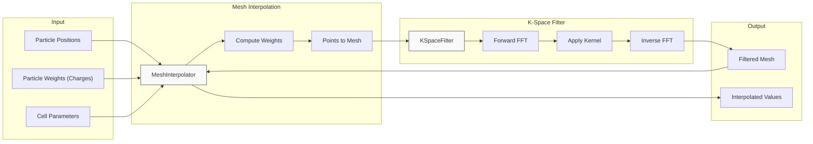
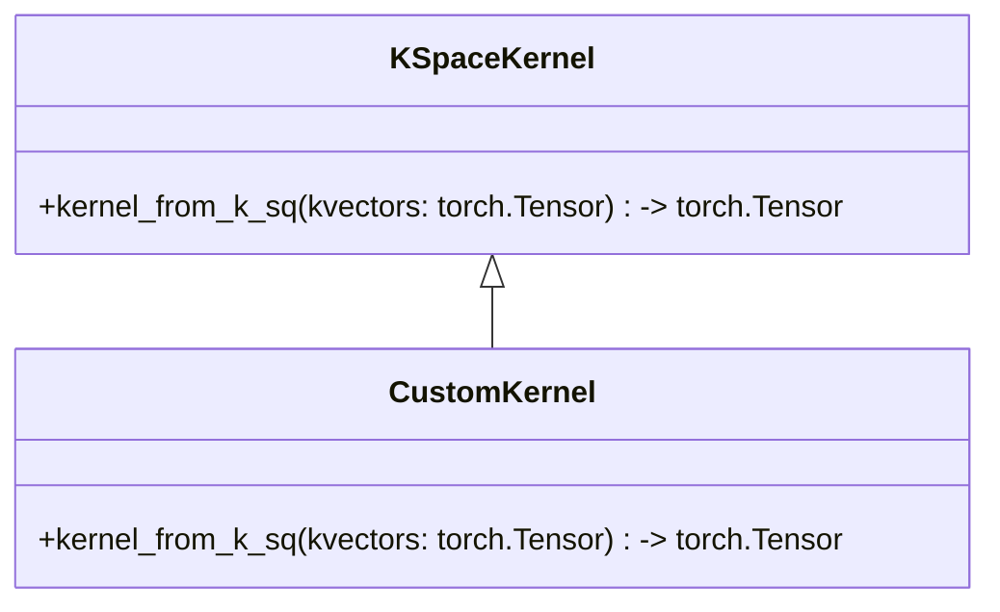
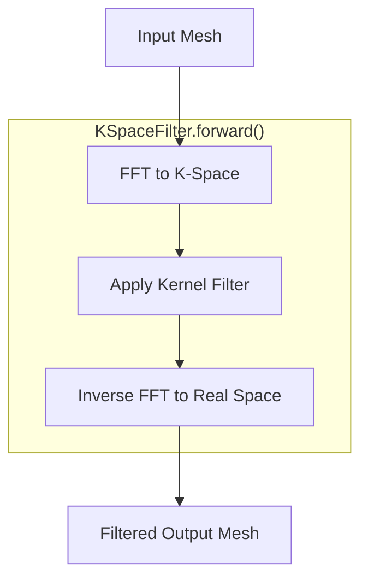
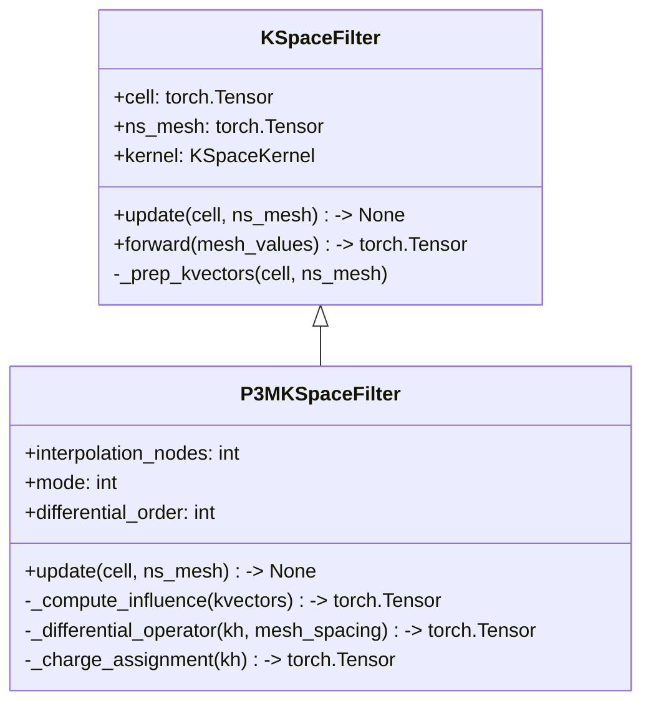
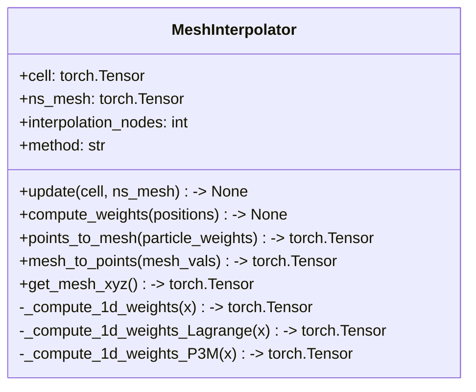
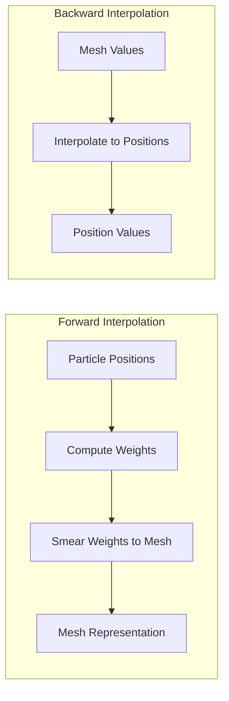
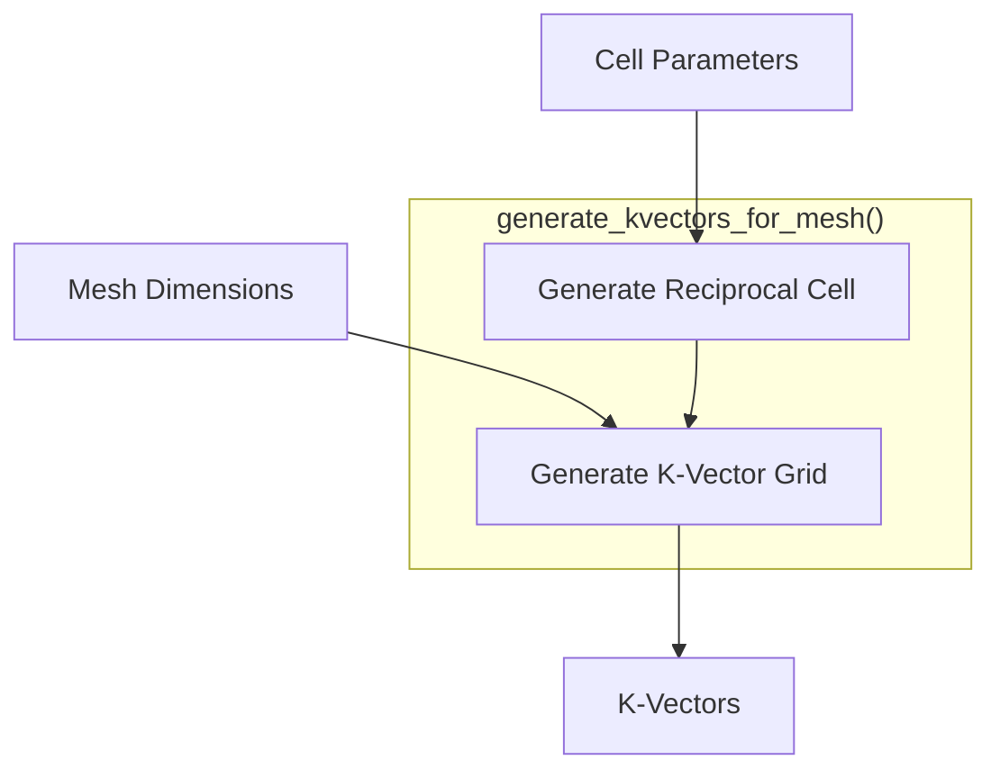
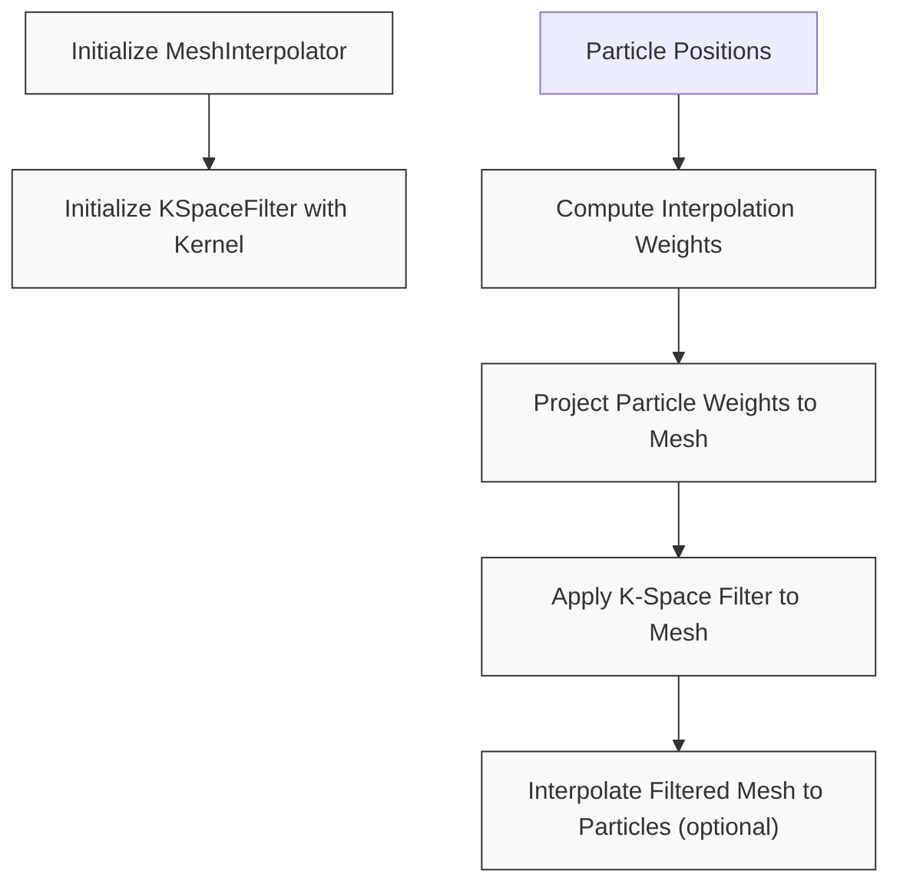

# K-Space Methods

<details>
<summary>Relevant source files</summary>

The following files were used as context for generating this wiki page:

- [src/torchpme/lib/kspace_filter.py](src/torchpme/lib/kspace_filter.py)
- [src/torchpme/lib/kvectors.py](src/torchpme/lib/kvectors.py)
- [src/torchpme/lib/mesh_interpolator.py](src/torchpme/lib/mesh_interpolator.py)
- [tests/lib/test_kspace_filter.py](tests/lib/test_kspace_filter.py)
- [tests/lib/test_kvectors.py](tests/lib/test_kvectors.py)
- [tests/lib/test_mesh_interpolator.py](tests/lib/test_mesh_interpolator.py)

</details>


## Purpose and Scope

This document describes the k-space filtering and mesh interpolation systems used in torch-pme for efficient long-range calculations. These components form the core of the reciprocal space calculations that are essential for accurate and performant electrostatic simulations. This page covers the computational approach for k-space calculations, including mesh interpolation, Fourier transforms, and reciprocal space filtering. For information on specific calculator implementations that use these methods, see [Calculator Implementations](#3.1).

Sources: [src/torchpme/lib/kspace_filter.py:39-199](), [src/torchpme/lib/mesh_interpolator.py:6-24]()

## Overview of K-Space Calculations

K-space methods provide an efficient way to compute the long-range contributions to the potential energy in atomistic systems. By dividing the computation into real-space and k-space components, these methods can achieve O(N log N) scaling, making them significantly faster than direct summation approaches which scale as O(N²).



Sources: [src/torchpme/lib/kspace_filter.py:39-199](), [src/torchpme/lib/mesh_interpolator.py:6-24]()

## Main Components

The k-space methods in torch-pme consist of three main components:

1. **K-Space Filter System**: Applies filters in reciprocal space to real-space meshes
2. **Mesh Interpolation System**: Handles the interpolation between discrete mesh points and particle positions
3. **K-Vector Generation**: Generates the reciprocal space vectors needed for Fourier transforms

Let's explore each of these components in detail.

Sources: [src/torchpme/lib/kspace_filter.py:39-199](), [src/torchpme/lib/mesh_interpolator.py:6-448](), [src/torchpme/lib/kvectors.py:4-136]()

## K-Space Filter System

The K-Space Filter System converts real-space meshes to reciprocal space, applies a filter, and then converts back to real space. This is implemented through two main classes: `KSpaceKernel` and `KSpaceFilter`.

### KSpaceKernel Class

The `KSpaceKernel` class defines the interface for reciprocal-space kernel calculation:



`KSpaceKernel` serves as a base class for defining specific filter functions in reciprocal space. It provides a common interface that can be easily customized and jitted with TorchScript.

Sources: [src/torchpme/lib/kspace_filter.py:9-36](), [tests/lib/test_kspace_filter.py:14-49]()

### KSpaceFilter Class

The `KSpaceFilter` class applies a reciprocal-space filter to a real-space mesh:



Key functionality of the `KSpaceFilter` class:

1. Construction of a reciprocal-space grid using `generate_kvectors_for_mesh`
2. Calculation of a scalar filter function using a provided `KSpaceKernel`
3. Application of the filter to a real-space function defined on a mesh

The filter application involves:
1. Forward Fourier transform of the input mesh
2. Multiplication by the kernel in k-space
3. Inverse Fourier transform back to real space

Sources: [src/torchpme/lib/kspace_filter.py:39-199](), [tests/lib/test_kspace_filter.py:52-103]()

### P3MKSpaceFilter Class

For the Particle-Particle Particle-Mesh (P3M) method, a specialized filter implementation is provided through the `P3MKSpaceFilter` class, which inherits from `KSpaceFilter` but implements a more complex influence function:



The `P3MKSpaceFilter` includes additional functionality specifically designed for P3M calculations, including:

1. Specialized influence function computation
2. Differential operator approximation
3. Charge assignment function

Sources: [src/torchpme/lib/kspace_filter.py:229-367]()

## Mesh Interpolation System

The Mesh Interpolation System handles the interpolation between particle positions and a discrete mesh. This is a crucial component for mesh-based methods like PME and P3M.

### MeshInterpolator Class

The `MeshInterpolator` class provides methods for both forward (particles to mesh) and backward (mesh to particles) interpolation:



The mesh interpolation process involves:

1. Computing interpolation weights based on particle positions relative to mesh points
2. Distributing particle weights (e.g., charges) onto the mesh
3. Interpolating mesh values back to arbitrary positions when needed

Sources: [src/torchpme/lib/mesh_interpolator.py:6-448]()

### Interpolation Methods

`MeshInterpolator` supports two interpolation methods:

1. **Lagrange Interpolation**: Uses Lagrange polynomials for smooth interpolation. Supports orders 3-7 (corresponding to polynomial degrees 2-6).
2. **P3M Interpolation**: Specialized for the P3M method. Supports orders 1-5.

The interpolation order determines the degree of the polynomial used for interpolation and affects both accuracy and computational cost.



Sources: [src/torchpme/lib/mesh_interpolator.py:139-291](), [tests/lib/test_mesh_interpolator.py:10-148]()

## K-Vector Generation

The K-Vector Generation system provides functions to create the reciprocal space vectors needed for Fourier transforms and k-space calculations.

### Key Functions

The system includes two main functions for generating k-vectors:

1. **`generate_kvectors_for_mesh`**: Creates k-vectors optimized for mesh-based calculators (PME, P3M)
2. **`generate_kvectors_for_ewald`**: Creates k-vectors for the Ewald calculator, where the sum is performed explicitly



The generated k-vectors satisfy the duality relation with the real-space cell and are used in the Fourier transforms within the `KSpaceFilter` class.

Sources: [src/torchpme/lib/kvectors.py:4-136](), [tests/lib/test_kvectors.py:10-132]()

## Computational Pipeline

Putting all the components together, the typical computational pipeline for k-space calculations in torch-pme is:



This pipeline allows for efficient computation of long-range interactions, achieving O(N log N) scaling through the use of Fast Fourier Transforms.

Sources: [src/torchpme/lib/kspace_filter.py:124-197](), [src/torchpme/lib/mesh_interpolator.py:293-447]()

## Technical Details

### Mesh Spacing and Resolution

The mesh resolution is a critical parameter that balances accuracy and computational cost. The `get_ns_mesh` function in `kvectors.py` helps determine an appropriate mesh size given a target mesh spacing and cell parameters:

```python
ns_approx = basis_norms / mesh_spacing
ns_actual_approx = 2 * ns_approx + 1
ns = torch.tensor(2).pow(torch.ceil(torch.log2(ns_actual_approx)).long())
```

Powers of 2 are preferred for mesh dimensions as they optimize FFT performance.

Sources: [src/torchpme/lib/kvectors.py:4-20]()

### Interpolation Weight Calculation

The calculation of interpolation weights is a key step in the mesh interpolation process. For each interpolation method ("Lagrange" or "P3M"), the weights are computed based on the relative position of particles to mesh points:

For P3M with 3 interpolation nodes:
```python
return torch.stack([
    1/8 * (1 - 4*x + 4*x2),
    1/4 * (3 - 4*x2),
    1/8 * (1 + 4*x + 4*x2),
])
```

For Lagrange with 3 interpolation nodes:
```python
return torch.stack([
    1/2 * (-x + x2),
    1/2 * (2 - 2*x2),
    1/2 * (x + x2),
])
```

Where `x` represents the relative position between mesh points.

Sources: [src/torchpme/lib/mesh_interpolator.py:146-201](), [src/torchpme/lib/mesh_interpolator.py:202-291]()

### FFT Normalization

The `KSpaceFilter` class allows customization of the FFT normalization through the `fft_norm` and `ifft_norm` parameters, which can be "forward", "backward", or "ortho":

```python
mesh_hat = torch.fft.rfftn(mesh_values, norm=self._fft_norm, dim=dims)
filter_hat = mesh_hat * self._kfilter
result = torch.fft.irfftn(filter_hat, norm=self._ifft_norm, dim=dims, s=mesh_values.shape[-3:])
```

This ensures compatibility with different conventions and allows for optimization of the calculation.

Sources: [src/torchpme/lib/kspace_filter.py:172-189]()

## Usage Examples

Here's how the k-space methods are typically used together in torch-pme:

```python
# Initialize components
mesh_interpolator = MeshInterpolator(
    cell=cell,
    ns_mesh=ns_mesh,
    interpolation_nodes=4,
    method="P3M"
)

kernel = CustomKernel(...)
kspace_filter = KSpaceFilter(
    cell=cell,
    ns_mesh=ns_mesh,
    kernel=kernel
)

# Compute mesh representation
mesh_interpolator.compute_weights(positions)
mesh_values = mesh_interpolator.points_to_mesh(charges)

# Apply k-space filter
filtered_mesh = kspace_filter.forward(mesh_values)

# Interpolate back to particles (if needed)
interpolated_values = mesh_interpolator.mesh_to_points(filtered_mesh)
```

This pipeline is at the core of the PME and P3M calculator implementations in torch-pme.

Sources: [tests/lib/test_kspace_filter.py:52-103](), [tests/lib/test_mesh_interpolator.py:10-328]()

## Conclusion

The k-space methods in torch-pme provide efficient algorithms for handling long-range interactions in periodic systems. Through the combination of mesh interpolation, Fourier transforms, and reciprocal space filtering, these methods achieve O(N log N) scaling, making them suitable for large-scale atomistic simulations.

The modular design of the system allows for flexibility in choosing interpolation methods, filter kernels, and computational parameters to balance accuracy and performance for specific applications.

---