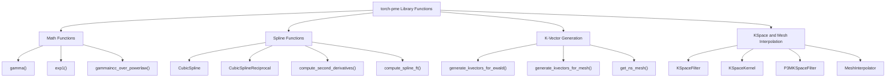
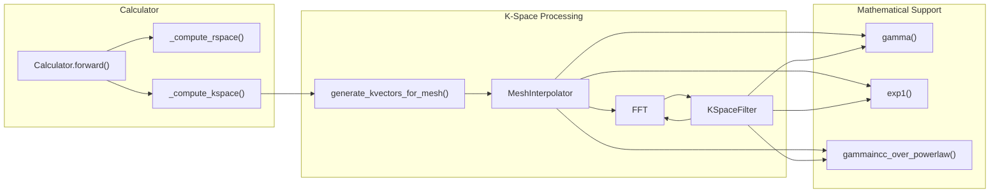

# Library Functions

<details>
<summary>Relevant source files</summary>

The following files were used as context for generating this wiki page:

- [docs/src/references/lib/math.rst](docs/src/references/lib/math.rst)
- [docs/src/references/lib/splines.rst](docs/src/references/lib/splines.rst)
- [docs/src/references/prefactors.rst](docs/src/references/prefactors.rst)
- [src/torchpme/lib/__init__.py](src/torchpme/lib/__init__.py)
- [src/torchpme/lib/math.py](src/torchpme/lib/math.py)
- [tests/lib/test_math.py](tests/lib/test_math.py)

</details>


## Overview

The Library Functions module in torch-pme provides essential mathematical utilities and specialized operations that support the efficient computation of long-range interactions in atomistic systems. These functions form the foundation for calculator implementations (see [Calculator Framework](#2.1)) and handle complex mathematical operations required for potential energy calculations.

The library offers several categories of functions:
- Mathematical special functions
- Spline interpolation utilities
- K-vector generation tools
- K-space filtering and mesh interpolation capabilities



Sources: [src/torchpme/lib/__init__.py:1-33]()

## Mathematical Special Functions

The math module provides specialized mathematical functions needed for potential energy calculations, particularly for analytical expressions in long-range potentials.

### Gamma Function

The `gamma` function implements the complete Gamma function using PyTorch's `gammaln` function:

```
gamma(x) = exp(gammaln(x))
```

This implementation ensures that automatic differentiation works correctly within the PyTorch framework.

Sources: [src/torchpme/lib/math.py:5-13]()

### Exponential Integral E1

The `exp1` function implements the exponential integral E1, defined as:

```
E1(x) = ∫(x to ∞) (e^(-t)/t) dt  for x > 0
```

This is implemented as a custom PyTorch autograd function (`_CustomExp1`) to ensure proper gradient computation. The implementation uses different algorithms for x ≤ 1 and x > 1 to ensure numerical stability.

Sources: [src/torchpme/lib/math.py:16-76](), [tests/lib/test_math.py:12-20]()

### Incomplete Gamma Function Complement

The `gammaincc_over_powerlaw` function computes the regularized incomplete gamma function complement for specific integer exponents (1 through 6). This function is particularly useful for computing analytical expressions in long-range potentials.

For different exponent values, specialized implementations are used:
- For exponent = 1: `exp(-z) / z`
- For exponent = 2: `sqrt(π/z) * erfc(sqrt(z))`
- For exponent = 3: `exp1(z)`
- For exponent = 4: `2 * (exp(-z) - sqrt(π*z) * erfc(sqrt(z)))`
- For exponent = 5: `exp(-z) - z * exp1(z)`
- For exponent = 6: A more complex expression

Sources: [src/torchpme/lib/math.py:79-104]()

## Spline Functions

The spline functions provide interpolation capabilities essential for mesh-based methods like PME and P3M.

### Cubic Spline

The `CubicSpline` class implements cubic spline interpolation, which is used to smoothly interpolate values between discrete points. This is crucial for spreading particle charges onto a mesh.

### Cubic Spline Reciprocal

The `CubicSplineReciprocal` class implements reciprocal cubic spline interpolation, which is used in the Fourier transform of the spline for k-space calculations.

### Spline Utilities

Two utility functions support the spline operations:
- `compute_second_derivatives`: Computes second derivatives for cubic spline construction
- `compute_spline_ft`: Computes the Fourier transform of a spline, essential for k-space calculations

Sources: [src/torchpme/lib/__init__.py:9-14]()

## K-Vector Generation

The k-vector generation functions create the reciprocal lattice vectors used in k-space calculations.

### Ewald K-Vectors

The `generate_kvectors_for_ewald` function generates k-vectors for Ewald summation, which is used in the `EwaldCalculator`.

### Mesh K-Vectors

The `generate_kvectors_for_mesh` function generates k-vectors for mesh-based methods like PME and P3M.

### Mesh Size Determination

The `get_ns_mesh` function determines the mesh size based on system parameters, ensuring optimal performance for mesh-based calculations.

Sources: [src/torchpme/lib/__init__.py:2-6]()

## KSpace and Mesh Interpolation

These utilities handle the core operations of k-space methods.

### KSpace Filtering

Three classes provide k-space filtering capabilities:
- `KSpaceFilter`: Base class that applies filters in reciprocal space to optimize accuracy and performance
- `KSpaceKernel`: Defines kernels for k-space operations
- `P3MKSpaceFilter`: A specialized filter for P3M calculations

### Mesh Interpolator

The `MeshInterpolator` class handles interpolation between particles and mesh points, which is essential for mesh-based methods like PME and P3M. It provides:
- Forward operations: Spreading particle charges onto a mesh
- Backward operations: Gathering forces from the mesh back to particles

Sources: [src/torchpme/lib/__init__.py:1-8]()

## Integration in the Calculation Pipeline

These library functions are integrated into the calculation pipeline as follows:



In this pipeline:
1. The Calculator's forward method performs both real-space and k-space calculations
2. K-space calculations use k-vector generation, mesh interpolation, FFT, and k-space filtering
3. Mathematical special functions support both real-space and k-space calculations
4. Spline functions are used within the mesh interpolator for accurate particle-mesh operations

By providing these essential utilities, the Library Functions module enables the efficient computation of long-range interactions in atomistic systems.

Sources: [src/torchpme/lib/__init__.py:1-33]()

---