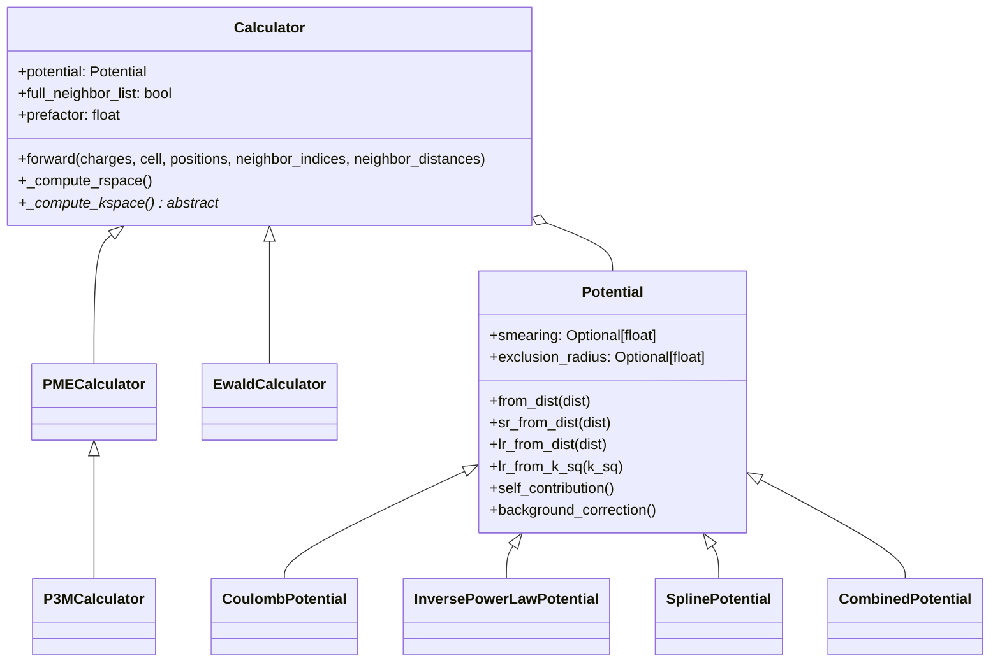
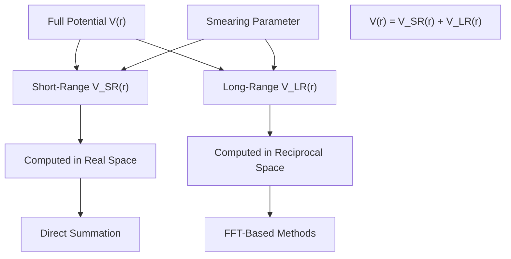
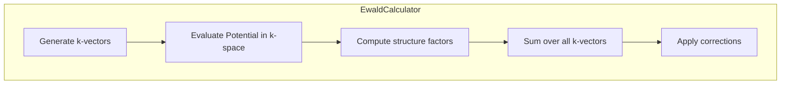
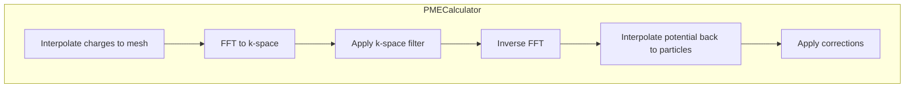
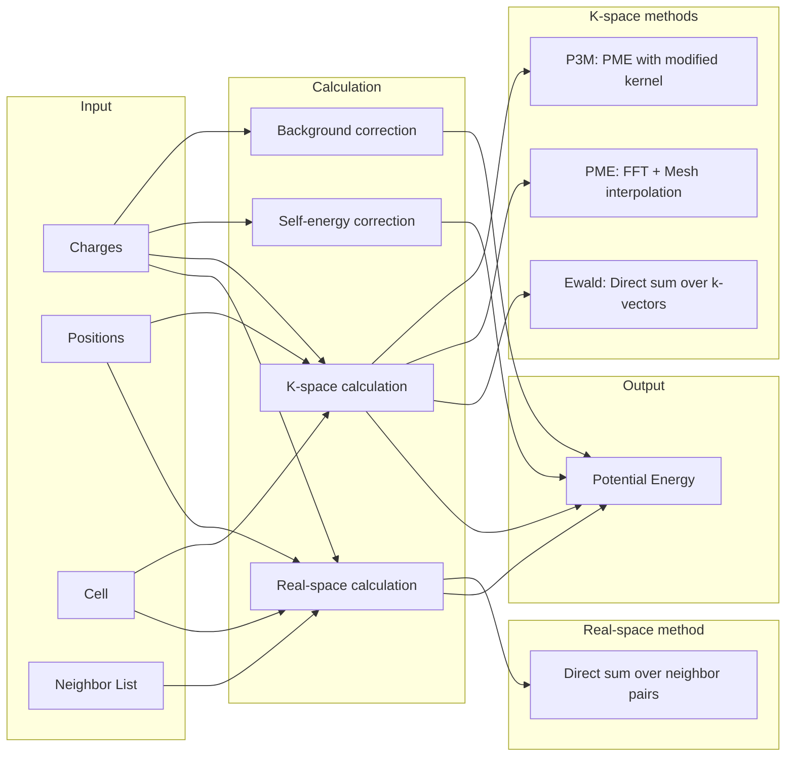

# Implementation Details

<details>
<summary>Relevant source files</summary>

The following files were used as context for generating this wiki page:

- [src/torchpme/calculators/ewald.py](src/torchpme/calculators/ewald.py)
- [src/torchpme/calculators/p3m.py](src/torchpme/calculators/p3m.py)
- [src/torchpme/calculators/pme.py](src/torchpme/calculators/pme.py)
- [src/torchpme/potentials/combined.py](src/torchpme/potentials/combined.py)
- [src/torchpme/potentials/coulomb.py](src/torchpme/potentials/coulomb.py)
- [src/torchpme/potentials/inversepowerlaw.py](src/torchpme/potentials/inversepowerlaw.py)
- [src/torchpme/potentials/spline.py](src/torchpme/potentials/spline.py)
- [tests/test_potentials.py](tests/test_potentials.py)

</details>


This page provides a comprehensive overview of the key implementation aspects in the torch-pme library, focusing on how the different components are implemented and interact. For information about the high-level architecture, see [Architecture](#2).

## Core Implementation Structure

The implementation of torch-pme follows a clear separation between the abstract interfaces and their concrete implementations. This allows for a modular and extensible design where new potentials and calculators can be added without modifying existing code.



Sources: [src/torchpme/potentials/coulomb.py](), [src/torchpme/potentials/inversepowerlaw.py](), [src/torchpme/potentials/spline.py](), [src/torchpme/potentials/combined.py](), [src/torchpme/calculators/ewald.py](), [src/torchpme/calculators/pme.py](), [src/torchpme/calculators/p3m.py]()

## Range Separation Concept

A fundamental concept in the implementation is the separation of potentials into short-range (SR) and long-range (LR) components. This separation is controlled by the `smearing` parameter, which determines the length scale at which the transition between SR and LR occurs.



Sources: [src/torchpme/potentials/inversepowerlaw.py:62-88](), [src/torchpme/potentials/coulomb.py:51-66]()

## Implementation of Potentials

### Base Potential Interface

The `Potential` base class defines the interface that all potential implementations must follow. The key methods are:

- `from_dist(dist)`: Evaluates the full potential at given distances
- `sr_from_dist(dist)`: Evaluates the short-range part
- `lr_from_dist(dist)`: Evaluates the long-range part
- `lr_from_k_sq(k_sq)`: Evaluates the Fourier transform of the long-range part
- `self_contribution()`: Computes the self-interaction correction
- `background_correction()`: Computes the background correction for non-neutral systems

### Specific Potential Implementations

#### Coulomb Potential

`CoulombPotential` implements the 1/r electrostatic interaction with Gaussian smearing. The implementation includes specialized formulas for error functions (erf/erfc) to handle the range separation.

```python
# Short-range part (erfc)
def sr_from_dist(self, dist: torch.Tensor) -> torch.Tensor:
    return torch.erfc(dist / self.smearing / 2.0**0.5) / dist

# Long-range part (erf)
def lr_from_dist(self, dist: torch.Tensor) -> torch.Tensor:
    return torch.erf(dist / self.smearing / 2.0**0.5) / dist
```

Sources: [src/torchpme/potentials/coulomb.py:42-66]()

#### Inverse Power Law Potential

`InversePowerLawPotential` generalizes the interaction to 1/r^p form, where p is the exponent parameter. This implementation handles various exponents (1, 2, 3, etc.) and computes the appropriate mathematical forms for range separation.

```python
# Full potential
def from_dist(self, dist: torch.Tensor) -> torch.Tensor:
    return torch.pow(dist, -self.exponent)

# Long-range part uses incomplete gamma functions
def lr_from_dist(self, dist: torch.Tensor) -> torch.Tensor:
    x = 0.5 * dist**2 / self.smearing**2
    peff = self.exponent / 2
    prefac = 1.0 / (2 * self.smearing**2) ** peff
    return prefac * gammainc(peff, x) / x**peff
```

Sources: [src/torchpme/potentials/inversepowerlaw.py:52-88]()

#### Spline Potential

`SplinePotential` allows arbitrary potentials to be defined via cubic spline interpolation. This implementation is particularly useful for empirical potentials that don't have a simple analytical form.

```python
# Initializes splines for both real and reciprocal space
def __init__(self, r_grid, y_grid, k_grid=None, yhat_grid=None, reciprocal=False):
    # Create spline for real space
    self._spline = CubicSpline(r_grid, y_grid)
    
    # Create spline for k-space (Fourier transform)
    if yhat_grid is None:
        yhat_grid = compute_spline_ft(k_grid, r_grid, y_grid, ...)
    self._krn_spline = CubicSpline(k_grid**2, yhat_grid)
```

Sources: [src/torchpme/potentials/spline.py:50-101]()

#### Combined Potential

`CombinedPotential` allows multiple potentials to be linearly combined with weights. These weights can be fixed or learned during training.

```python
# Combines multiple potential evaluations with weights
def from_dist(self, dist: torch.Tensor) -> torch.Tensor:
    potentials = [pot.from_dist(dist) for pot in self.potentials]
    potentials = torch.stack(potentials, dim=-1)
    return torch.inner(self.weights, potentials)
```

Sources: [src/torchpme/potentials/combined.py:83-86]()

## Implementation of Calculators

### Base Calculator Interface

The `Calculator` base class defines the interface for computing energies using potentials. It handles general aspects like real-space calculations, but leaves the k-space implementation to derived classes.

Key methods include:
- `forward()`: Main entry point for calculations
- `_compute_rspace()`: Computes real-space contributions
- `_compute_kspace()`: Abstract method implemented differently by each calculator

### Specific Calculator Implementations

#### Ewald Calculator

`EwaldCalculator` implements the traditional Ewald summation method, which scales as O(N²) with the number of particles. The k-space calculation involves explicit summation over reciprocal lattice vectors.



Sources: [src/torchpme/calculators/ewald.py:76-134]()

#### PME Calculator

`PMECalculator` implements the Particle Mesh Ewald method, which scales as O(N log N). It uses Fast Fourier Transforms for efficient k-space calculations.



Sources: [src/torchpme/calculators/pme.py:95-147]()

#### P3M Calculator

`P3MCalculator` extends PME with different interpolation schemes and error handling. It uses specialized filters and interpolators designed for the P3M method.

```python
# The key difference from PME is in the initialization
self.kspace_filter = P3MKSpaceFilter(
    cell=cell,
    ns_mesh=ns_mesh,
    interpolation_nodes=self.interpolation_nodes,
    kernel=self.potential,
    mode=0,  # Green's function for point-charge potentials
    differential_order=2  # Order of the discretization
)

self.mesh_interpolator = MeshInterpolator(
    cell=cell,
    ns_mesh=ns_mesh,
    interpolation_nodes=self.interpolation_nodes,
    method="P3M"  # Different interpolation scheme
)
```

Sources: [src/torchpme/calculators/p3m.py:79-95]()

## Computational Pipeline

The computational pipeline in torch-pme follows a consistent pattern across calculator implementations, with the main differences being in how the k-space calculations are performed.



Sources: [src/torchpme/calculators/ewald.py:76-134](), [src/torchpme/calculators/pme.py:95-147](), [src/torchpme/calculators/p3m.py:46-95]()

## Mathematical Implementation Details

### Range Separation

For a potential V(r), the range separation is generally implemented as:

V(r) = V_SR(r) + V_LR(r)

For the Coulomb potential (1/r):
- V_SR(r) = erfc(r/√(2σ))/r
- V_LR(r) = erf(r/√(2σ))/r

For inverse power law potentials (1/r^p):
- V_SR(r) = specialized forms involving incomplete gamma functions
- V_LR(r) = specialized forms involving incomplete gamma functions

Sources: [src/torchpme/potentials/inversepowerlaw.py:62-88](), [src/torchpme/potentials/coulomb.py:51-66]()

### Self-Energy Correction

When using range-separated potentials, a self-energy correction must be applied to account for the interaction of a particle with its own potential:

For Coulomb:
```python
def self_contribution(self) -> torch.Tensor:
    return (2 / torch.pi) ** 0.5 / self.smearing
```

For inverse power law:
```python
def self_contribution(self) -> torch.Tensor:
    phalf = self.exponent / 2
    return 1 / gamma(phalf + 1) / (2 * self.smearing**2) ** phalf
```

Sources: [src/torchpme/potentials/coulomb.py:90-96](), [src/torchpme/potentials/inversepowerlaw.py:121-128]()

### Background Correction

For systems that aren't charge-neutral, a background correction is applied:

For Coulomb:
```python
def background_correction(self) -> torch.Tensor:
    return torch.pi * self.smearing**2
```

For inverse power law:
```python
def background_correction(self) -> torch.Tensor:
    # Zero for exponents >= 3
    if self.exponent >= 3:
        return torch.zeros_like(self.smearing)
    
    prefac = torch.pi**1.5 * (2 * self.smearing**2) ** ((3 - self.exponent) / 2)
    prefac /= (3 - self.exponent) * gamma(self.exponent / 2)
    return prefac
```

Sources: [src/torchpme/potentials/coulomb.py:98-104](), [src/torchpme/potentials/inversepowerlaw.py:130-142]()

## Implementation Validation

The implementation is extensively validated through unit tests that verify:

1. The sum of SR and LR parts equals the full potential
2. Special cases like Coulomb (p=1) match known analytical expressions
3. Implementations agree with reference solutions
4. Self-energy and background corrections are correct
5. Implementations can be scripted with TorchScript

```python
def test_sr_lr_split(exponent, smearing):
    """
    This test verifies the splitting 1/r^p = V_SR(r) + V_LR(r), meaning that it tests
    whether the sum of the SR and LR parts combine to the standard inverse power-law
    potential.
    """
    # ... test implementation ...
    assert_close(potential_from_dist, potential_from_sum, rtol=rtol, atol=atol)
```

Sources: [tests/test_potentials.py:61-83](), [tests/test_potentials.py:117-150]()

## Performance Considerations

The performance characteristics of the different implementations are:

| Calculator Type | Complexity  | Best Use Case |
|-----------------|-------------|---------------|
| EwaldCalculator | O(N²)       | Small systems, high accuracy |
| PMECalculator   | O(N log N)  | Medium to large systems |
| P3MCalculator   | O(N log N)  | Systems requiring different interpolation schemes |

The actual performance also depends on the potential used, the mesh size, and the number of interpolation nodes.

For optimal performance:
- Use JIT compilation through TorchScript
- Choose the appropriate calculator for your system size
- Use appropriate mesh spacing and cutoffs
- Consider using the tuning system to optimize parameters

Sources: [src/torchpme/calculators/ewald.py:12-13](), [src/torchpme/calculators/pme.py:13-16]()

---