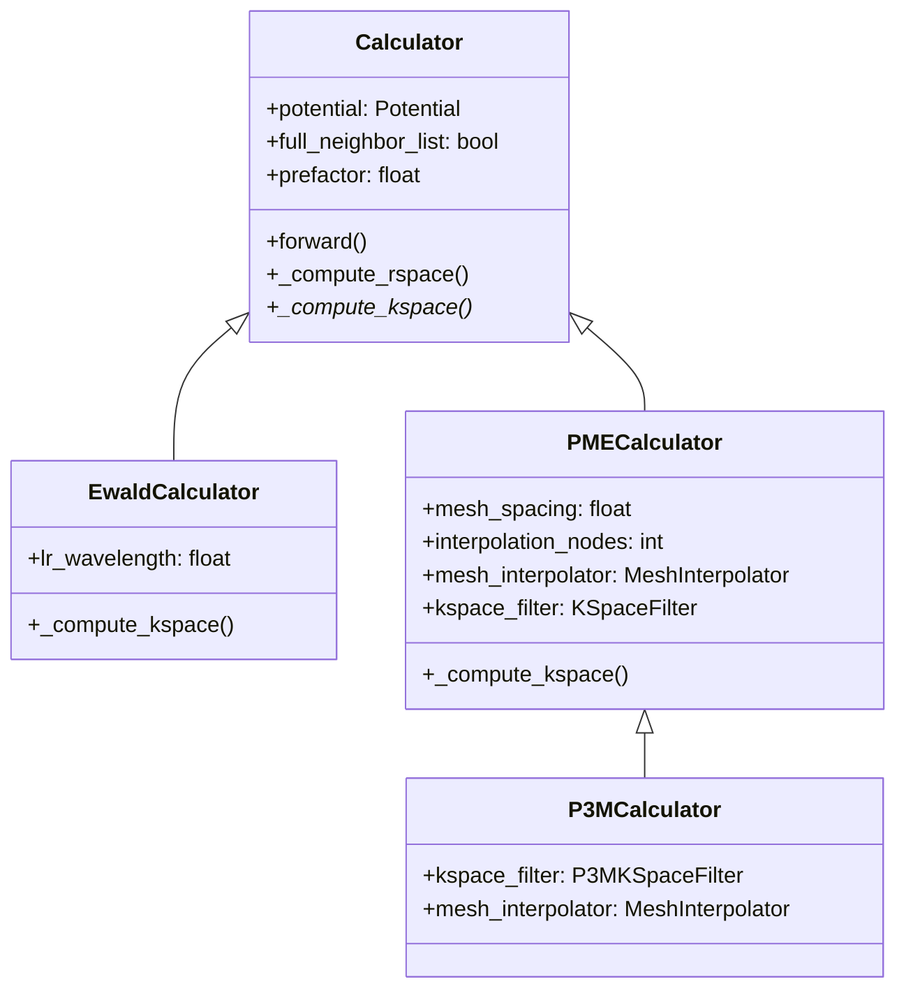
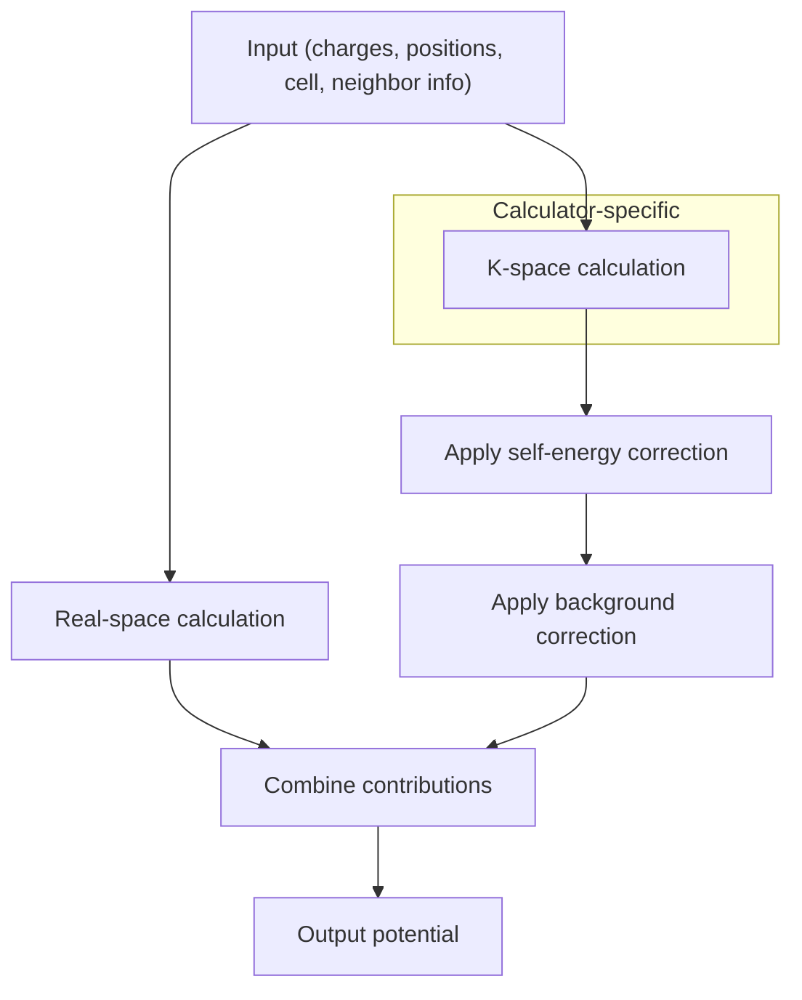
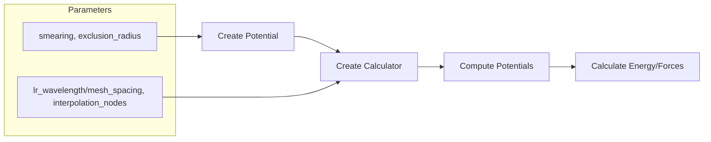

# Calculator Implementations

<details>
<summary>Relevant source files</summary>

The following files were used as context for generating this wiki page:

- [src/torchpme/calculators/ewald.py](src/torchpme/calculators/ewald.py)
- [src/torchpme/calculators/p3m.py](src/torchpme/calculators/p3m.py)
- [src/torchpme/calculators/pme.py](src/torchpme/calculators/pme.py)
- [src/torchpme/metatensor/calculator.py](src/torchpme/metatensor/calculator.py)
- [src/torchpme/potentials/combined.py](src/torchpme/potentials/combined.py)
- [src/torchpme/potentials/coulomb.py](src/torchpme/potentials/coulomb.py)
- [tests/calculators/test_values_ewald.py](tests/calculators/test_values_ewald.py)
- [tests/calculators/test_workflow.py](tests/calculators/test_workflow.py)
- [tests/helpers.py](tests/helpers.py)
- [tests/metatensor/test_workflow_metatensor.py](tests/metatensor/test_workflow_metatensor.py)

</details>


This page details the calculator implementations in torch-pme, which are responsible for computing long-range potentials in atomistic systems. These calculators apply different mathematical techniques to efficiently compute potentials in periodic systems. For information about the potential models used by these calculators, see [Potential System](#2.2).

## Overview of Calculator Classes

The torch-pme library provides three main calculator implementations:

1. **EwaldCalculator** - Implements the classical Ewald summation method (scales as O(N²))
2. **PMECalculator** - Implements Particle Mesh Ewald method using FFTs (scales as O(N·log N))
3. **P3MCalculator** - Implements Particle-Particle Particle-Mesh method, a variant of PME

All calculators inherit from a common base `Calculator` class, which provides the framework for computing potentials, while the specialized implementations focus on different approaches to computing the long-range (k-space) contributions.



Sources: [src/torchpme/calculators/ewald.py](), [src/torchpme/calculators/pme.py](), [src/torchpme/calculators/p3m.py]()

## Calculators and Computation Pipeline

The calculators follow a common pattern when computing potentials:



Sources: [src/torchpme/calculators/ewald.py:76-134](), [src/torchpme/calculators/pme.py:95-147]()

## EwaldCalculator

The `EwaldCalculator` implements the classical Ewald summation method, which directly computes reciprocal space contributions by summing over k-vectors.

### Key Features

- **Mathematical approach**: Explicit summation over k-vectors
- **Performance scaling**: O(N²) with respect to the number of particles
- **Best for**: Small systems (<1000 atoms)
- **Key parameters**:
  - `lr_wavelength`: Controls reciprocal space resolution

### Implementation Details

The `EwaldCalculator` computes k-space contributions by:
1. Generating k-vectors based on the cell dimensions and `lr_wavelength`
2. Computing trigonometric factors for each particle and k-vector
3. Summing contributions from all k-vectors
4. Applying self-energy and background corrections

```python
# Example usage from tests
calc = EwaldCalculator(
    CoulombPotential(smearing=smearing),
    lr_wavelength=lr_wavelength,
    full_neighbor_list=full_neighbor_list,
    prefactor=torchpme.prefactors.eV_A,
)
```

Sources: [src/torchpme/calculators/ewald.py:58-134](), [tests/calculators/test_values_ewald.py:100-108](), [tests/calculators/test_values_ewald.py:206-210]()

## PMECalculator

The `PMECalculator` implements the Particle Mesh Ewald method, which uses Fast Fourier Transforms (FFTs) and mesh interpolation to accelerate k-space calculations.

### Key Features

- **Mathematical approach**: FFT-based mesh calculations
- **Performance scaling**: O(N·log N) with respect to the number of particles
- **Best for**: Medium to large systems
- **Key parameters**:
  - `mesh_spacing`: Controls mesh resolution
  - `interpolation_nodes`: Controls interpolation accuracy (default: 4)

### Implementation Details

The `PMECalculator` uses two key components:
- `MeshInterpolator`: Handles interpolation between particles and mesh
- `KSpaceFilter`: Applies the potential kernel in k-space

The computation proceeds through these steps:
1. Initialize mesh interpolator and k-space filter
2. Interpolate charges to a regular mesh
3. Apply FFT to transform to k-space
4. Apply the potential kernel in k-space
5. Apply inverse FFT to return to real space
6. Interpolate from mesh back to particle positions
7. Apply self-energy and background corrections

```python
# Example usage from tests
calc = PMECalculator(
    CoulombPotential(smearing=smearing),
    mesh_spacing=smearing / 8,
    full_neighbor_list=full_neighbor_list,
    prefactor=torchpme.prefactors.eV_A,
)
```

Sources: [src/torchpme/calculators/pme.py:50-147](), [tests/calculators/test_values_ewald.py:113-121]()

## P3MCalculator

The `P3MCalculator` is a variant of PME that uses an optimized approach to k-space filtering.

### Key Features

- **Mathematical approach**: PME with optimized k-space filters
- **Performance scaling**: Similar to PME (O(N·log N))
- **Best for**: Systems requiring high accuracy with the same mesh resolution as PME
- **Key parameters**: Same as PMECalculator
  - `mesh_spacing`: Controls mesh resolution
  - `interpolation_nodes`: Limited to values 1-5 (default: 4)

### Implementation Details

The `P3MCalculator` inherits from `PMECalculator` but uses a specialized `P3MKSpaceFilter` that implements optimized filtering. It also uses a specialized mesh interpolation method designed for P3M.

```python
# Example usage from tests
calc = P3MCalculator(
    CoulombPotential(smearing=smearing),
    mesh_spacing=smearing / 8,
    full_neighbor_list=full_neighbor_list,
    prefactor=torchpme.prefactors.eV_A,
)
```

Sources: [src/torchpme/calculators/p3m.py:47-95](), [tests/calculators/test_values_ewald.py:123-130](), [tests/calculators/test_workflow.py:213-219]()

## Common Usage Pattern

All calculators follow this common usage pattern:



The calculators are generally used in this sequence:

1. Create a potential (e.g., `CoulombPotential` with appropriate `smearing`)
2. Initialize a calculator with the potential and method-specific parameters
3. Call `forward()` with positions, charges, cell, and neighbor information
4. Use the returned potentials to compute energies and/or forces

Sources: [tests/calculators/test_workflow.py:121-125](), [tests/calculators/test_workflow.py:157-166]()

## Performance Comparison

Different calculators are suitable for different system sizes:

| Calculator | Scaling | Best for | Key Parameters |
|------------|---------|----------|----------------|
| EwaldCalculator | O(N²) | Small systems (<1000 atoms) | `lr_wavelength` |
| PMECalculator | O(N·log N) | Medium to large systems | `mesh_spacing`, `interpolation_nodes` |
| P3MCalculator | O(N·log N) | Systems requiring high accuracy | `mesh_spacing`, `interpolation_nodes` |

For optimal parameter selection, the library provides tuning functions:
- `tune_ewald()`: Optimizes parameters for EwaldCalculator
- `tune_pme()`: Optimizes parameters for PMECalculator
- `tune_p3m()`: Optimizes parameters for P3MCalculator

Sources: [src/torchpme/calculators/ewald.py:16-18](), [src/torchpme/calculators/pme.py:18-21](), [src/torchpme/calculators/p3m.py:13-16]()

## MetaTensor Interface

In addition to the basic calculators, torch-pme provides MetaTensor equivalents that integrate with the MetaTensor library for handling atomistic data:

- `metatensor.Calculator`
- `metatensor.EwaldCalculator`
- `metatensor.PMECalculator`
- `metatensor.P3MCalculator`

These classes wrap the corresponding torch calculators and adapt them to work with `metatensor.torch.atomistic.System` objects.

Sources: [src/torchpme/metatensor/calculator.py:15-175](), [tests/metatensor/test_workflow_metatensor.py:26-56]()

## Error Handling and Validation

The calculators include comprehensive error handling for common issues:

- Non-positive `smearing` parameters
- Invalid `interpolation_nodes` values
- Incompatible potential types
- NaNs in k-space filters

Sources: [tests/calculators/test_workflow.py:76-84](), [tests/calculators/test_workflow.py:86-92](), [tests/calculators/test_workflow.py:186-198](), [tests/calculators/test_workflow.py:210-246]()

---