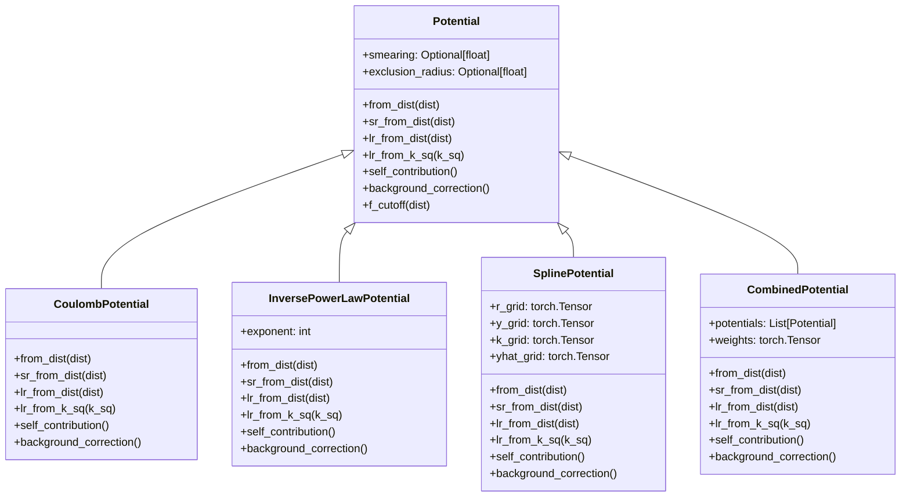
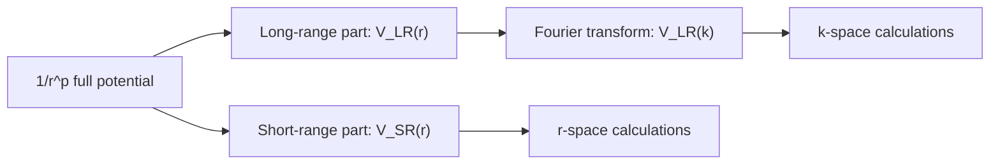
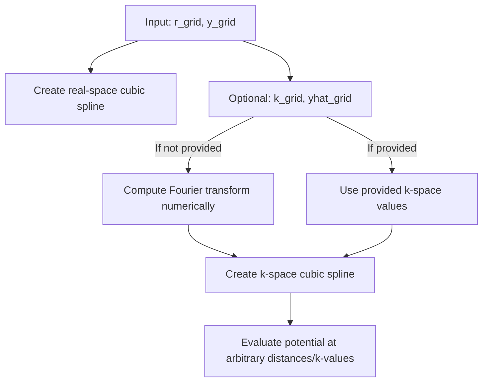
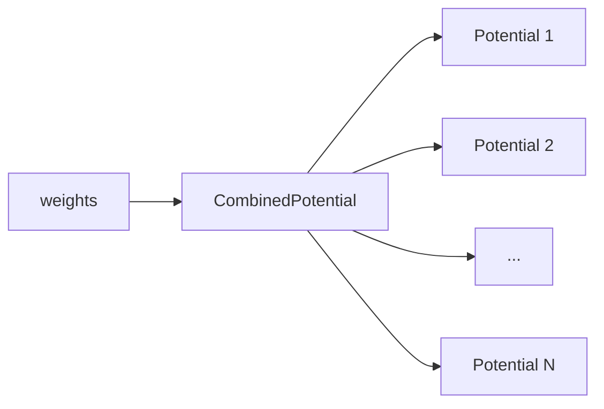
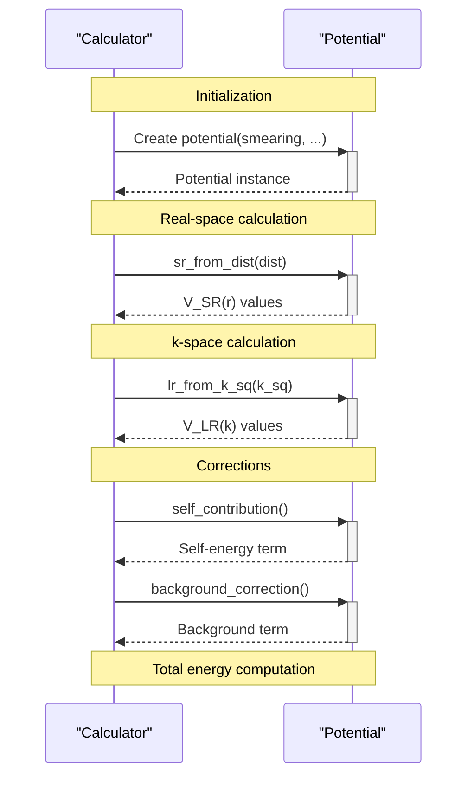

# Potential Implementations

<details>
<summary>Relevant source files</summary>

The following files were used as context for generating this wiki page:

- [src/torchpme/potentials/inversepowerlaw.py](src/torchpme/potentials/inversepowerlaw.py)
- [src/torchpme/potentials/spline.py](src/torchpme/potentials/spline.py)
- [tests/test_potentials.py](tests/test_potentials.py)

</details>


This page documents the specific potential function implementations available in the torch-pme library. These potentials define the interaction models that are used by calculators (see [Calculator Implementations](#3.1)) to compute energies and forces between particles in an atomistic system.

## Overview of Available Potentials

The torch-pme library provides several potential implementations, each deriving from a common base class:



Sources: [src/torchpme/potentials/inversepowerlaw.py](), [src/torchpme/potentials/spline.py](), [tests/test_potentials.py]()

## Potential Base Class

All potential implementations derive from the `Potential` base class, which defines a common interface with the following key methods:

1. `from_dist(dist)`: Returns the full potential as a function of distance
2. `sr_from_dist(dist)`: Returns the short-range part of the potential
3. `lr_from_dist(dist)`: Returns the long-range part of the potential
4. `lr_from_k_sq(k_sq)`: Returns the Fourier transform of the long-range part
5. `self_contribution()`: Returns the self-interaction energy correction
6. `background_correction()`: Returns the background energy correction

Each potential also supports the following important parameters:

- `smearing`: Length scale for splitting the potential into short-range and long-range parts
- `exclusion_radius`: Length scale defining a local environment where the potential is smoothly zeroed out
- `exclusion_degree`: Controls the sharpness of the transition in the cutoff function

Sources: [src/torchpme/potentials/inversepowerlaw.py:8-11](), [src/torchpme/potentials/spline.py:11-14]()

## InversePowerLawPotential

The `InversePowerLawPotential` implements potentials of the form 1/r^p, where r is the distance and p is the exponent parameter.

### Key Features

- Supports arbitrary power law exponents (though currently limited to 0 < p < 3)
- Implements both the full potential and its range-separated components
- Provides analytical Fourier transforms for the long-range component
- Handles self-interaction and background corrections analytically

### Implementation Details

The `InversePowerLawPotential` class splits the original 1/r^p potential into short-range and long-range parts:



Sources: [src/torchpme/potentials/inversepowerlaw.py:11-145]()

For the specific methods:

1. `from_dist(dist)` returns the full 1/r^p potential
2. `lr_from_dist(dist)` returns the long-range part using special functions (gamma and incomplete gamma)
3. `lr_from_k_sq(k_sq)` returns the Fourier transform of the long-range part
4. `self_contribution()` computes the self-energy correction
5. `background_correction()` computes the background correction (relevant for p < 3)

The mathematical formulation for the range-separated potential is:

For p = 1 (Coulomb):
- V_SR(r) = erfc(r/√(2σ))/r
- V_LR(r) = erf(r/√(2σ))/r

For p = 2:
- V_SR(r) = exp(-r²/(2σ²))/r²
- V_LR(r) = (1 - exp(-r²/(2σ²)))/r²

For general p:
- V_LR(r) = (1/2σ²)^(p/2) · γ(p/2, r²/(2σ²))/(r²/(2σ²))^(p/2)

Where γ is the lower incomplete gamma function.

Sources: [src/torchpme/potentials/inversepowerlaw.py:53-142](), [tests/test_potentials.py:61-150]()

## SplinePotential

The `SplinePotential` class implements potentials using cubic spline interpolation, allowing for arbitrary potential forms that might not have simple analytical expressions.

### Key Features

- Supports custom potential shapes through grid-based interpolation
- Provides automatic computation of Fourier transforms
- Handles both regular and reciprocal-space splines
- Useful for representing complex potentials or fitting to data

### Implementation Details

The potential is constructed from provided grid points and values:



Sources: [src/torchpme/potentials/spline.py:14-159]()

The `SplinePotential` assumes that the potential has only a long-range part by default, though custom short-range parts can be added by inheriting and overriding `sr_from_dist`.

- `lr_from_dist(dist)` evaluates the cubic spline at the given distances
- `lr_from_k_sq(k_sq)` evaluates the Fourier transform spline at the given k² values
- `self_contribution()` returns the value at r = 0 (or a specified value)
- `background_correction()` returns 0 by default

The spline can be configured in two ways:
1. Regular spline: Interpolates directly along the r-axis
2. Reciprocal spline: Interpolates along 1/r, which is better suited for long-range potentials

Sources: [src/torchpme/potentials/spline.py:50-154](), [tests/test_potentials.py:340-401]()

## CombinedPotential

The `CombinedPotential` allows combining multiple potentials with optional weights:



This implementation:
- Combines multiple potentials into a single object
- Supports fixed or learnable weights
- Ensures consistent treatment of range-separation
- All component potentials must be either range-separated or direct

Sources: [tests/test_potentials.py:464-597]()

## Usage Examples

### Creating a Coulomb Potential (1/r)

```python
from torchpme import CoulombPotential

# Direct Coulomb potential (no range separation)
coulomb_direct = CoulombPotential()

# Range-separated Coulomb potential with σ = 1.0
coulomb_rs = CoulombPotential(smearing=1.0)
```

### Creating an Inverse Power Law Potential

```python
from torchpme import InversePowerLawPotential

# 1/r² potential with range separation
ipl = InversePowerLawPotential(exponent=2, smearing=1.0)
```

### Creating a Spline Potential from Data

```python
from torchpme import SplinePotential
import torch

# Create grid points and values
r_grid = torch.linspace(0, 20, 100)
y_grid = torch.exp(-(r_grid**2) * 0.5)  # Gaussian-like potential

# Create spline potential
spline = SplinePotential(r_grid=r_grid, y_grid=y_grid)
```

### Combining Multiple Potentials

```python
from torchpme import CombinedPotential, CoulombPotential, InversePowerLawPotential

coulomb = CoulombPotential(smearing=1.0)
ipl = InversePowerLawPotential(exponent=2, smearing=1.0)

# Combine with equal weights
combined = CombinedPotential(
    potentials=[coulomb, ipl],
    smearing=1.0,
    initial_weights=torch.tensor([1.0, 1.0])
)

# Combine with learnable weights
learnable = CombinedPotential(
    potentials=[coulomb, ipl],
    smearing=1.0,
    initial_weights=torch.tensor([1.0, 1.0]),
    learnable_weights=True
)
```

## Technical Implementation Details



Sources: [src/torchpme/potentials/inversepowerlaw.py](), [src/torchpme/potentials/spline.py](), [tests/test_potentials.py]()

## Important Implementation Notes

1. **Range Separation**: All potentials support splitting into short-range and long-range parts via the `smearing` parameter. This is essential for efficient calculation of long-range interactions.

2. **Self-Energy Correction**: When computing energies with range-separated potentials, the self-energy must be subtracted to avoid double-counting self-interactions.

3. **Background Correction**: For potentials with p < 3, a background correction is needed to handle the divergence of the Fourier transform at k = 0.

4. **Exclusion Radius**: Potentials support an exclusion radius that defines a region where the potential is smoothly zeroed out, useful when combining with other short-range models.

5. **JIT Compatibility**: All potentials are compatible with TorchScript JIT compilation for improved performance.

Sources: [src/torchpme/potentials/inversepowerlaw.py:120-142](), [tests/test_potentials.py:435-456]()

---