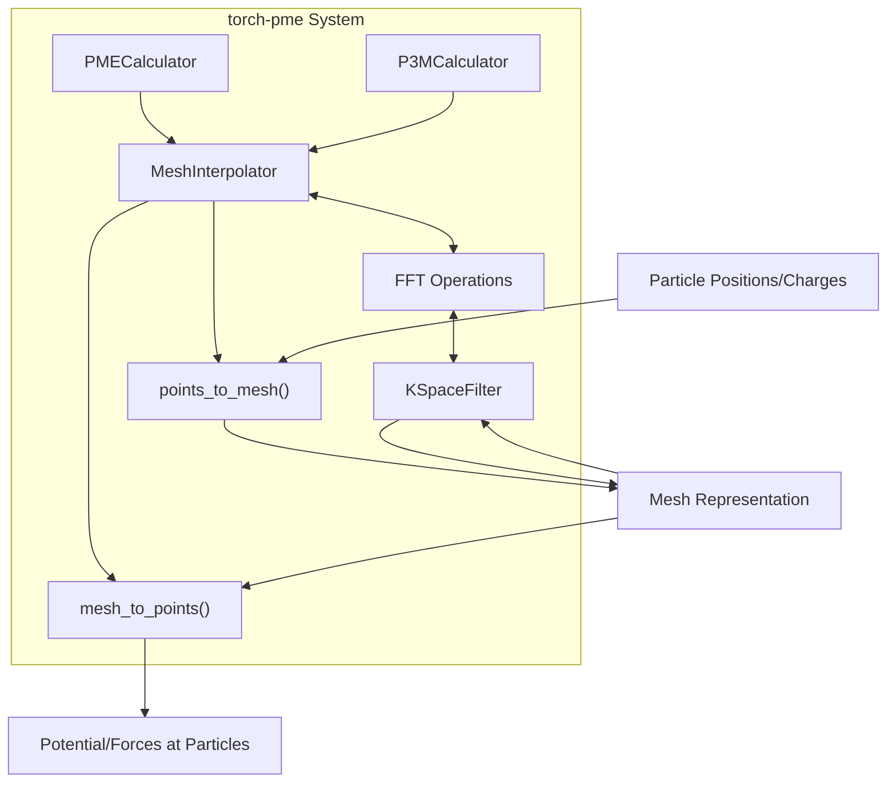
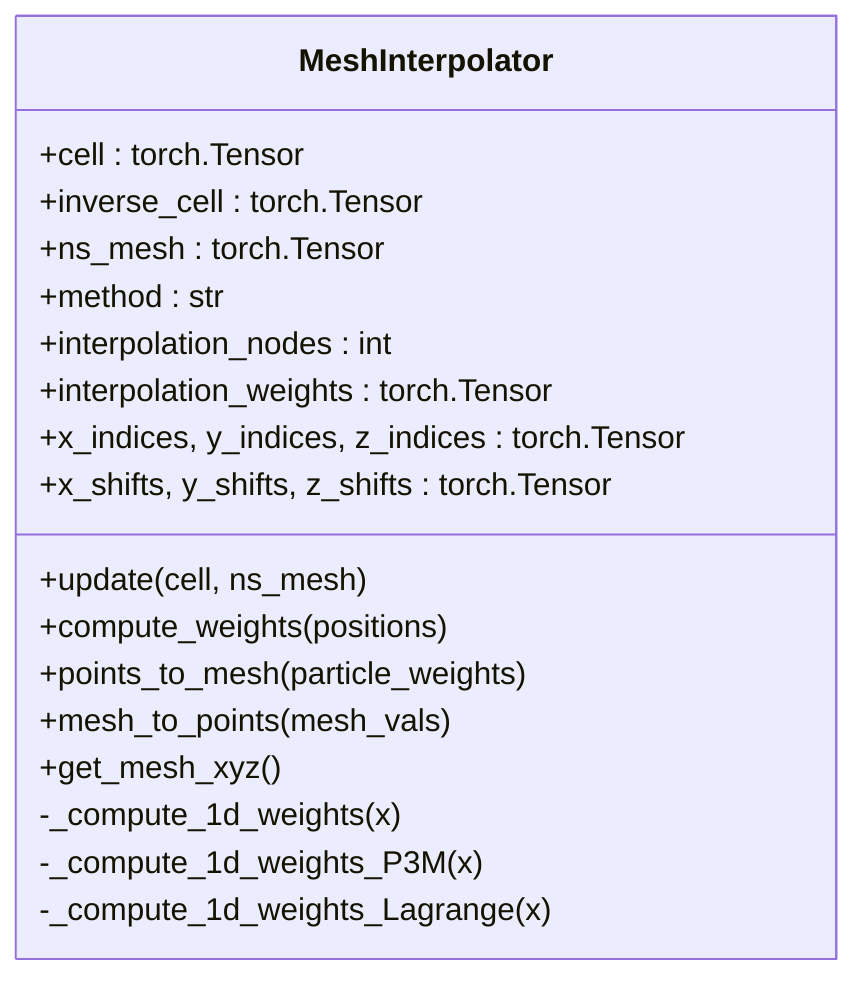
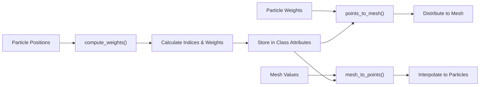
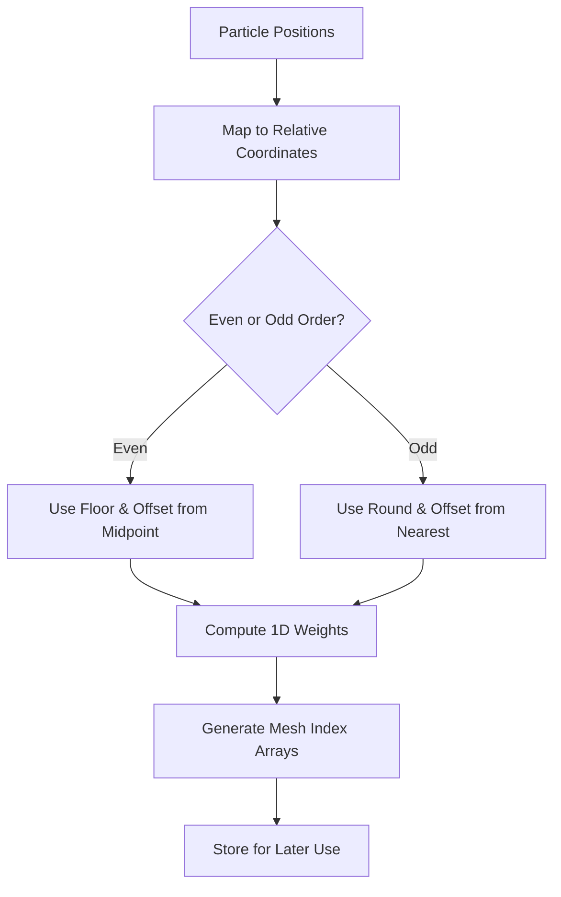

# Mesh Interpolator

<details>
<summary>Relevant source files</summary>

The following files were used as context for generating this wiki page:

- [docs/generate_examples/generate-examples.py](docs/generate_examples/generate-examples.py)
- [examples/coulomb_test_frames.xyz](examples/coulomb_test_frames.xyz)
- [src/torchpme/lib/mesh_interpolator.py](src/torchpme/lib/mesh_interpolator.py)
- [tests/lib/test_mesh_interpolator.py](tests/lib/test_mesh_interpolator.py)

</details>


## Purpose and Scope

The `MeshInterpolator` class provides efficient interpolation operations essential for mesh-based Ewald summation methods. It serves as a core component in the `torch-pme` library, enabling the translation between particle properties (like charges) and mesh-discretized values. This page covers the design, functionality, and implementation details of the mesh interpolation system. For information about how these interpolations are used in specific calculation methods, see [K-Space Methods](#2.3). For details on filters applied in the reciprocal space, see [K-Space Filter](#3.4).

Sources: [src/torchpme/lib/mesh_interpolator.py:6-25]()

## Overview

The mesh interpolation system solves a fundamental problem in particle-mesh methods: how to accurately map between discrete particles and continuous fields represented on a mesh. The `MeshInterpolator` class implements this bidirectional mapping with two core operations:

1. **Forward interpolation** - Assigns particle properties (like charges) to mesh points
2. **Backward interpolation** - Maps values from mesh points back to particle positions

These operations allow for efficient computation of long-range interactions by leveraging Fast Fourier Transforms (FFTs) while maintaining accuracy.

Sources: [src/torchpme/lib/mesh_interpolator.py:6-25]()

## Architecture and Integration

The `MeshInterpolator` class is designed as a standalone but essential component in the `torch-pme` framework. It integrates with calculators that implement mesh-based Ewald methods, particularly PME and P3M calculators.



The `MeshInterpolator` functions as a transformation layer between particle space and mesh space, enabling calculations that would be inefficient or impossible in either domain alone.

Sources: [src/torchpme/lib/mesh_interpolator.py:6-25](), [src/torchpme/lib/mesh_interpolator.py:293-368]()

## Class Structure

The `MeshInterpolator` class is implemented as a `torch.nn.Module` to enable integration with PyTorch's automatic differentiation system. This is crucial for computing forces as derivatives of energy.



Sources: [src/torchpme/lib/mesh_interpolator.py:6-69]()

## Initialization and Configuration

The `MeshInterpolator` is initialized with several key parameters:

- **cell**: Unit cell basis vectors (3×3 tensor)
- **ns_mesh**: Number of mesh points along each axis (3-element tensor)
- **interpolation_nodes**: Number of nodes used in interpolation (integer)
- **method**: Interpolation method, either "Lagrange" or "P3M"

The class supports two interpolation methods:
1. **P3M** (Particle-Particle Particle-Mesh): Supports orders 1-5
2. **Lagrange**: Supports orders 3-7

The `interpolation_nodes` parameter determines the order of the interpolation polynomial, with higher values providing more accurate but computationally expensive interpolation.

Sources: [src/torchpme/lib/mesh_interpolator.py:41-57](), [src/torchpme/lib/mesh_interpolator.py:71-115]()

## Core Functionality

### Interpolation Flow

The interpolation process follows a specific workflow:



This separation of weight computation from actual interpolation allows for efficient reuse when multiple properties need to be interpolated using the same particle positions.

Sources: [src/torchpme/lib/mesh_interpolator.py:293-447]()

### Computing Weights

The `compute_weights` method is a critical first step in both forward and backward interpolation. It:

1. Converts particle positions to mesh-relative coordinates
2. Determines nearest mesh points based on interpolation order
3. Computes interpolation weights based on the chosen method
4. Prepares indexing arrays for efficient tensor operations



The 1D weights are computed differently for P3M and Lagrange methods, with each supporting different polynomial orders.

Sources: [src/torchpme/lib/mesh_interpolator.py:293-368](), [src/torchpme/lib/mesh_interpolator.py:139-291]()

### Forward Interpolation (points_to_mesh)

The `points_to_mesh` method maps particle weights (such as charges) to a mesh. It:

1. Takes particle weights as input (shape: `[n_points, n_channels]`)
2. Creates an empty mesh (shape: `[n_channels, nx, ny, nz]`)
3. Accumulates weighted contributions at each relevant mesh point
4. Returns the filled mesh

This function relies on the weights and indices previously calculated by `compute_weights`.

Sources: [src/torchpme/lib/mesh_interpolator.py:369-416]()

### Backward Interpolation (mesh_to_points)

The `mesh_to_points` method performs the inverse operation, interpolating values from a mesh back to particle positions. It:

1. Takes mesh values as input (shape: `[n_channels, nx, ny, nz]`)
2. Extracts values at relevant mesh points using stored indices
3. Applies interpolation weights
4. Sums contributions to get interpolated values at each particle position
5. Returns interpolated values (shape: `[n_points, n_channels]`)

Like forward interpolation, this function also depends on the pre-computed weights and indices.

Sources: [src/torchpme/lib/mesh_interpolator.py:418-447]()

## Mathematical Methods

The `MeshInterpolator` implements two interpolation schemes with different mathematical formulations:

### P3M Method

The P3M method uses polynomial weight functions of different orders to distribute particle properties to nearby mesh points. The implementation supports orders 1-5, with higher orders providing more accurate but computationally expensive interpolation.

For example, the 3rd-order P3M weights are:
- W₀(x) = (1 - 4x + 4x²)/8
- W₁(x) = (3 - 4x²)/4
- W₂(x) = (1 + 4x + 4x²)/8

Where x is the relative position in [-1/2, 1/2].

Sources: [src/torchpme/lib/mesh_interpolator.py:146-200]()

### Lagrange Method

The Lagrange method uses Lagrange polynomials for interpolation, supporting orders 3-7. These provide smooth, high-order interpolation with different characteristics than the P3M method.

For example, the 3rd-order Lagrange weights are:
- W₀(x) = (-x + x²)/2
- W₁(x) = (2 - 2x²)/2
- W₂(x) = (x + x²)/2

Sources: [src/torchpme/lib/mesh_interpolator.py:202-291]()

## Implementation Details

### Weight Calculation Optimization

The weight calculations are implemented efficiently using vectorized operations in PyTorch, avoiding loops where possible. The weights are computed once per set of particle positions and then reused for both forward and backward interpolation operations.

For performance reasons, the code uses specialized approaches for different interpolation orders rather than a general algorithm, with explicit polynomial coefficients for each supported order.

Sources: [src/torchpme/lib/mesh_interpolator.py:139-291]()

### Memory Management

The class uses a careful approach to memory management:
- Weights and indices are stored as class attributes to avoid recomputation
- The `update` method allows changing cell parameters or mesh resolution without recreating the object
- TorchScript compatibility is maintained for potential performance optimization

Sources: [src/torchpme/lib/mesh_interpolator.py:71-115]()

## Properties and Guarantees

The implementation provides several important mathematical guarantees that are verified by tests:

1. **Charge conservation**: The total "charge" is conserved when mapping between particles and mesh
2. **Invertibility**: For certain interpolation orders, the forward followed by backward interpolation recovers the original values
3. **Sum rules**: For applicable interpolation orders, derivatives with respect to positions and cell parameters are zero

These properties are crucial for ensuring physical correctness in simulations.

Sources: [tests/lib/test_mesh_interpolator.py:10-328]()

## Usage Example

A typical usage pattern for the `MeshInterpolator` involves:

1. Creating an instance with appropriate parameters
2. Computing weights for a set of particle positions
3. Performing forward interpolation (points_to_mesh) to create a mesh representation
4. Manipulating the mesh data (often in Fourier space)
5. Performing backward interpolation (mesh_to_points) to retrieve values at particle positions

```
# Create interpolator
interpolator = MeshInterpolator(cell, ns_mesh, interpolation_nodes=4, method="P3M")

# Compute weights for current particle positions
interpolator.compute_weights(positions)

# Forward interpolation: map charges to mesh
mesh_values = interpolator.points_to_mesh(charges)

# [Perform operations on the mesh, e.g., FFT, filtering, etc.]

# Backward interpolation: map potential from mesh to particles
potential_at_particles = interpolator.mesh_to_points(potential_mesh)
```

Sources: [tests/lib/test_mesh_interpolator.py:42-55](), [tests/lib/test_mesh_interpolator.py:182-188]()

---