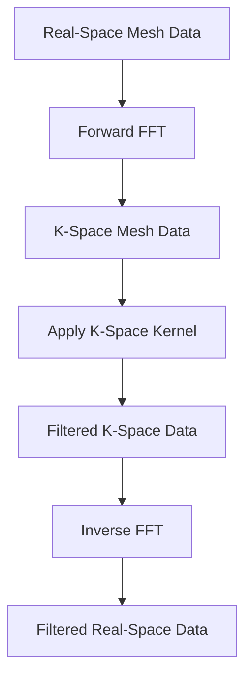
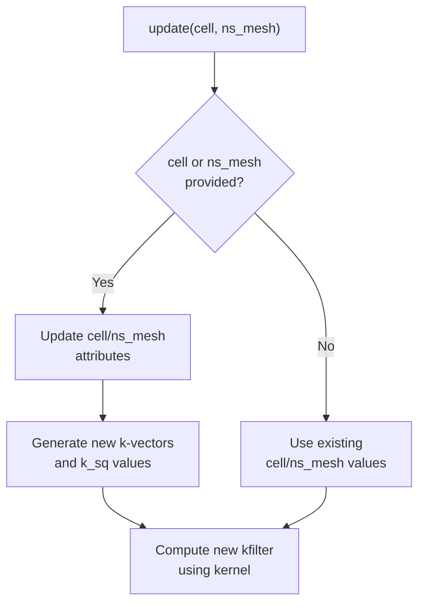
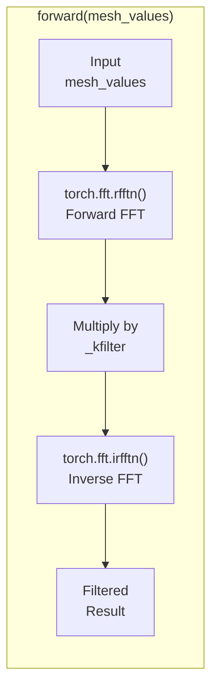
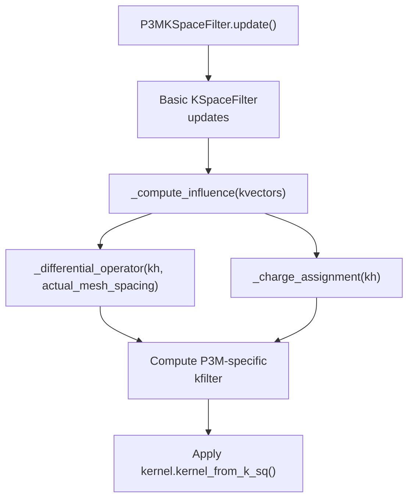
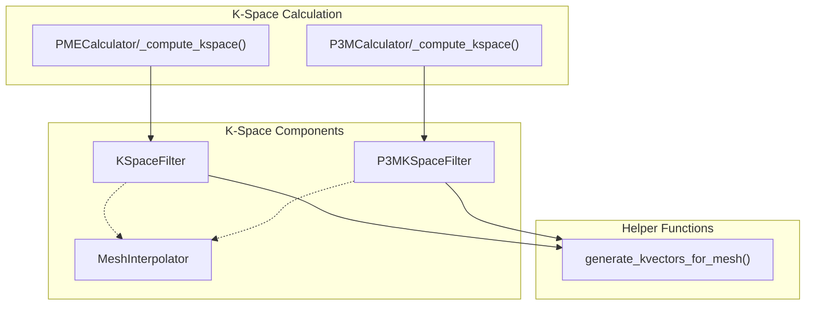

# K-Space Filter

<details>
<summary>Relevant source files</summary>

The following files were used as context for generating this wiki page:

- [src/torchpme/lib/kspace_filter.py](src/torchpme/lib/kspace_filter.py)
- [tests/lib/test_kspace_filter.py](tests/lib/test_kspace_filter.py)

</details>


The K-Space Filter system in torch-pme provides functionality for applying reciprocal-space filtering operations to real-space mesh data. This is a critical component for efficient long-range interaction calculations, particularly in the Particle Mesh Ewald (PME) and Particle-Particle Particle-Mesh (P3M) methods. For information about mesh interpolation between particles and grids, see [Mesh Interpolator](#3.3).

## Purpose and Core Concepts

The K-Space Filter performs three essential operations:
1. Forward Fourier transformation of real-space data to reciprocal space
2. Application of a kernel function to the reciprocal-space data
3. Inverse Fourier transformation back to real space

This process is fundamental to many molecular simulation algorithms as it enables efficient computation of long-range interactions through the use of Fast Fourier Transforms (FFTs).



Sources: [src/torchpme/lib/kspace_filter.py:160-189]()

## System Architecture

The K-Space Filter system consists of two primary classes:

1. `KSpaceKernel`: Abstract base class defining the interface for reciprocal-space kernel functions
2. `KSpaceFilter`: Class that applies the kernel to real-space data through Fourier transformations

Additionally, there is a specialized implementation called `P3MKSpaceFilter` for the P3M method.

```mermaid
classDiagram
    class "torch.nn.Module" {
        +forward()
    }
    
    class "KSpaceKernel" {
        +kernel_from_k_sq(kvectors)
    }
    
    class "KSpaceFilter" {
        -_fft_norm: str
        -_ifft_norm: str
        -_kvectors: torch.Tensor
        -_k_sq: torch.Tensor
        -_kfilter: torch.Tensor
        +cell: torch.Tensor
        +ns_mesh: torch.Tensor
        +kernel: KSpaceKernel
        +update(cell, ns_mesh)
        +forward(mesh_values)
    }
    
    class "P3MKSpaceFilter" {
        +interpolation_nodes: int
        +mode: int
        +differential_order: int
        -_compute_influence(kvectors)
        -_differential_operator(kh, actual_mesh_spacing)
        -_charge_assignment(kh)
    }
    
    "torch.nn.Module" <|-- "KSpaceKernel"
    "torch.nn.Module" <|-- "KSpaceFilter"
    "KSpaceFilter" <|-- "P3MKSpaceFilter"
    "KSpaceFilter" o-- "KSpaceKernel"
```

Sources: [src/torchpme/lib/kspace_filter.py:9-38](), [src/torchpme/lib/kspace_filter.py:39-228](), [src/torchpme/lib/kspace_filter.py:229-367]()

## The KSpaceKernel Interface

The `KSpaceKernel` class defines the interface for reciprocal-space kernel functions. It's a base class that requires subclasses to implement the `kernel_from_k_sq` method, which computes the reciprocal-space kernel value given k-vectors.

```mermaid
classDiagram
    class "KSpaceKernel" {
        +kernel_from_k_sq(kvectors): torch.Tensor
    }
    
    class "CustomKernel" {
        +parameters
        +kernel_from_k_sq(kvectors): torch.Tensor
    }
    
    "KSpaceKernel" <|-- "CustomKernel"
```

The `kernel_from_k_sq` method takes as input a tensor containing k-vectors and returns a tensor with kernel values. This design allows for customizable filter implementations while maintaining compatibility with TorchScript.

Sources: [src/torchpme/lib/kspace_filter.py:9-36](), [tests/lib/test_kspace_filter.py:14-49]()

## KSpaceFilter Implementation

The `KSpaceFilter` class is a PyTorch module that applies a reciprocal-space filter to real-space mesh data. It handles the construction of the reciprocal-space grid, calculation of the filter function, and application of the filter through Fourier transformations.

### Initialization

```python
KSpaceFilter(cell, ns_mesh, kernel, fft_norm="ortho", ifft_norm="ortho")
```

Parameters:
- `cell`: 3x3 tensor representing the unit cell
- `ns_mesh`: 3-element tensor specifying the mesh size along each axis
- `kernel`: A `KSpaceKernel` instance that provides the filter function
- `fft_norm`: Normalization mode for forward Fourier transform
- `ifft_norm`: Normalization mode for inverse Fourier transform

Sources: [src/torchpme/lib/kspace_filter.py:75-97]()

### The Update Method

The `update` method updates the internal state of the filter, typically after changes to the cell, mesh size, or kernel parameters.



Sources: [src/torchpme/lib/kspace_filter.py:99-126](), [tests/lib/test_kspace_filter.py:106-134]()

### The Forward Method

The `forward` method applies the filter to input mesh data through a three-step process:

1. Perform forward Fast Fourier Transform (FFT) on the input mesh
2. Multiply the transformed mesh by the precomputed k-space filter
3. Perform inverse FFT to obtain the filtered result



The method requires the input mesh to have shape `(n_channels, nx, ny, nz)` and returns a tensor of the same shape containing the filtered data.

Sources: [src/torchpme/lib/kspace_filter.py:124-198](), [tests/lib/test_kspace_filter.py:84-103]()

## P3MKSpaceFilter Specialization

The `P3MKSpaceFilter` is a specialized implementation for the Particle-Particle Particle-Mesh (P3M) method. It extends the base `KSpaceFilter` with additional parameters and methods specific to P3M calculations.

### Key Features

- Includes parameters for interpolation order, mode, and differential operator order
- Implements specialized methods for differential operators and charge assignment functions
- Modifies the filter computation to incorporate P3M-specific optimizations



Sources: [src/torchpme/lib/kspace_filter.py:229-367]()

## Usage Examples

To use the K-Space Filter system, you typically:

1. Create a custom `KSpaceKernel` implementation
2. Initialize a `KSpaceFilter` with cell, mesh size, and kernel parameters
3. Call the `forward` method with real-space mesh data

Example testing code demonstrates:
- Creating and using custom kernels
- Verifying filter linearity
- Testing with identity (no-op) filters
- Updating filter parameters

Sources: [tests/lib/test_kspace_filter.py:14-103]()

## Implementation Considerations

When working with the K-Space Filter system, consider the following:

1. **Device compatibility**: Ensure cell, mesh_size, and input data are on the same device
2. **Mesh consistency**: The input real-space mesh must be compatible with the k-space grid
3. **Numerical stability**: Problematic grid sizes can cause NaN values in the results
4. **Performance**: FFT operations are computationally intensive; optimize mesh size when possible

Sources: [src/torchpme/lib/kspace_filter.py:154-197]()

## Integration with Other Components

The K-Space Filter integrates with other torch-pme components, particularly:



The filter is a key component in k-space calculations within PME and P3M methods, working alongside mesh interpolation to efficiently handle long-range interactions.

Sources: [src/torchpme/lib/kspace_filter.py:6](), [tests/lib/test_kspace_filter.py:6-11]()

---