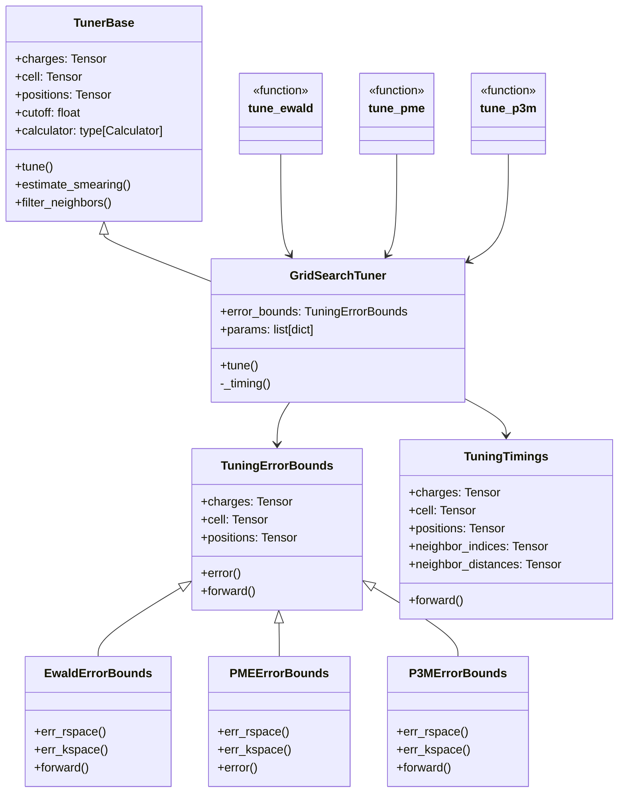
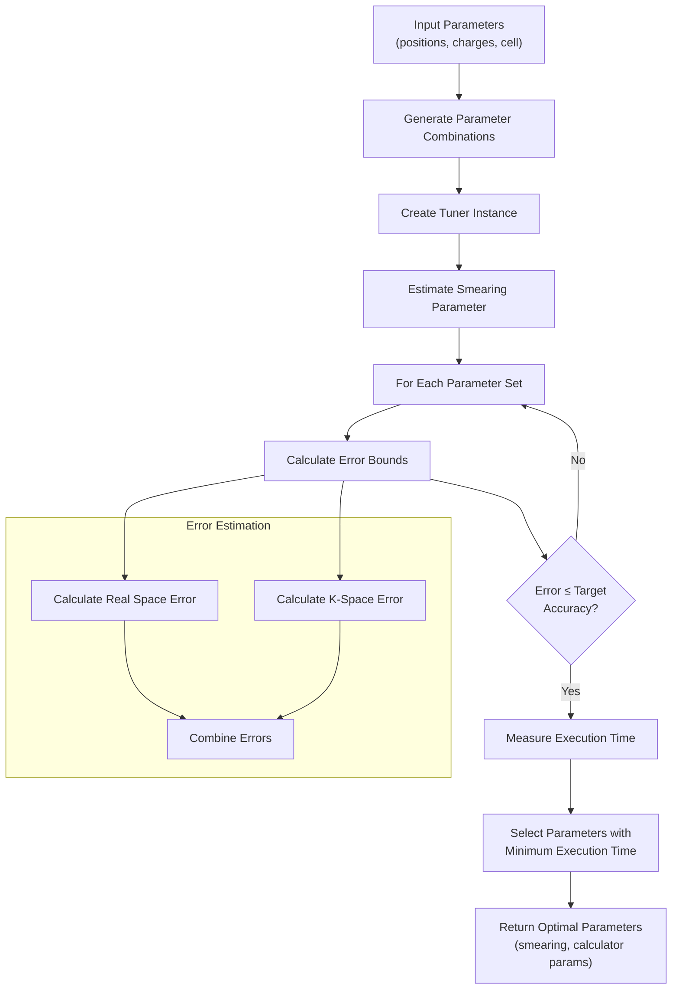
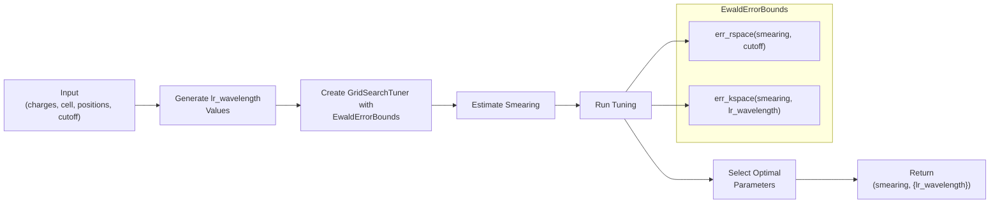
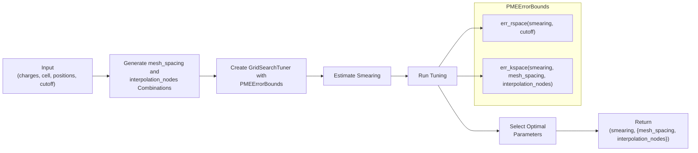
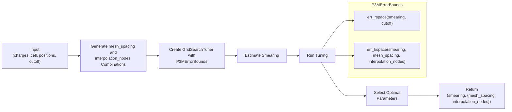

# Parameter Tuning

<details>
<summary>Relevant source files</summary>

The following files were used as context for generating this wiki page:

- [src/torchpme/_utils.py](src/torchpme/_utils.py)
- [src/torchpme/tuning/ewald.py](src/torchpme/tuning/ewald.py)
- [src/torchpme/tuning/p3m.py](src/torchpme/tuning/p3m.py)
- [src/torchpme/tuning/pme.py](src/torchpme/tuning/pme.py)
- [src/torchpme/tuning/tuner.py](src/torchpme/tuning/tuner.py)
- [tests/tuning/test_tuning.py](tests/tuning/test_tuning.py)

</details>


This page documents the parameter tuning system in torch-pme, which automatically optimizes the performance of different calculators while satisfying user-defined accuracy requirements. The tuning system selects the optimal parameters for Ewald, PME, and P3M calculators based on error formulas and benchmarking.

For information about specific calculator implementations, see [Calculator Implementations](#3.1). For details on potential implementations, see [Potential Implementations](#3.2).

## Overview of the Tuning System

The parameter tuning system in torch-pme serves to select optimal parameters for electrostatic calculators. Long-range electrostatic calculations involve trade-offs between accuracy and performance, with multiple parameters affecting both. The tuning system:

1. Estimates error bounds using analytical error formulas
2. Performs grid search over parameter combinations
3. Times calculator execution for acceptable parameter sets
4. Returns optimal parameters that meet accuracy requirements with minimal computational cost

Sources: [src/torchpme/tuning/tuner.py:21-283](), [src/torchpme/tuning/pme.py:12-138](), [src/torchpme/tuning/p3m.py:69-195](), [src/torchpme/tuning/ewald.py:11-121]()

## Tuning Architecture

The tuning system is built around several core components that work together to provide parameter optimization.



**Class Hierarchy and Relationships Diagram**

Sources: [src/torchpme/tuning/tuner.py:12-42](), [src/torchpme/tuning/tuner.py:45-169](), [src/torchpme/tuning/tuner.py:171-283](), [src/torchpme/tuning/tuner.py:285-376](), [src/torchpme/tuning/ewald.py:124-210](), [src/torchpme/tuning/pme.py:141-270](), [src/torchpme/tuning/p3m.py:198-323]()

### Base Components

1. **TuningErrorBounds**: Abstract base class for error estimation
   - Provides framework for calculating real-space and k-space errors
   - Implemented by calculator-specific error bounds classes
   
2. **TunerBase**: Base class for parameter tuning
   - Handles common functionality for parameter tuning
   - Provides `estimate_smearing()` method for initial parameter estimation
   - Defines the interface for tuning through the `tune()` method
   
3. **GridSearchTuner**: Implementation of parameter tuning using grid search
   - Evaluates multiple parameter combinations
   - Uses error bounds to filter viable parameter sets
   - Times remaining candidates to find the most efficient

4. **TuningTimings**: Measures execution time of calculators
   - Handles warmup runs to ensure accurate timing
   - Optionally includes backward pass in timing measurements
   - Returns average execution time

Sources: [src/torchpme/tuning/tuner.py:12-42](), [src/torchpme/tuning/tuner.py:45-169](), [src/torchpme/tuning/tuner.py:171-283](), [src/torchpme/tuning/tuner.py:285-376]()

## Tuning Workflow

The parameter tuning process follows a consistent workflow across all calculator types:



**Parameter Tuning Workflow Diagram**

Sources: [src/torchpme/tuning/tuner.py:246-269](), [src/torchpme/tuning/pme.py:12-138](), [src/torchpme/tuning/p3m.py:69-195](), [src/torchpme/tuning/ewald.py:11-121]()

### Key Steps in the Workflow

1. **Parameter Set Generation**:
   - Different parameter combinations are created based on user constraints
   - For Ewald: Different k-space wavelengths
   - For PME/P3M: Different mesh spacings and interpolation nodes

2. **Smearing Parameter Estimation**:
   - The smearing parameter is estimated based on the real-space cutoff
   - This ensures the real-space error is below the target accuracy

3. **Error Estimation**:
   - For each parameter set, error bounds are calculated
   - Includes both real-space and k-space error components
   - Only parameter sets meeting accuracy requirements proceed to timing

4. **Timing Measurement**:
   - Parameter sets meeting accuracy requirements are timed
   - Includes warmup runs to ensure stable measurements
   - Can include both forward and backward pass timing

5. **Parameter Selection**:
   - The parameter set with the lowest execution time is selected
   - If no parameter sets meet accuracy requirements, the one with lowest error is returned with a warning

Sources: [src/torchpme/tuning/tuner.py:246-269](), [src/torchpme/tuning/tuner.py:340-376](), [src/torchpme/tuning/pme.py:129-138](), [src/torchpme/tuning/p3m.py:186-195](), [src/torchpme/tuning/ewald.py:113-121]()

## Calculator-Specific Tuning

Each calculator type has specialized tuning functions and error bound calculations:

### Ewald Tuning

The `tune_ewald` function optimizes the `lr_wavelength` parameter for Ewald summation:



**Ewald Parameter Tuning Diagram**

Sources: [src/torchpme/tuning/ewald.py:11-121](), [src/torchpme/tuning/ewald.py:124-210]()

### PME Tuning

The `tune_pme` function optimizes the `mesh_spacing` and `interpolation_nodes` parameters for Particle Mesh Ewald:



**PME Parameter Tuning Diagram**

Sources: [src/torchpme/tuning/pme.py:12-138](), [src/torchpme/tuning/pme.py:141-270]()

### P3M Tuning

The `tune_p3m` function optimizes the `mesh_spacing` and `interpolation_nodes` parameters for Particle-Particle Particle-Mesh method:



**P3M Parameter Tuning Diagram**

Sources: [src/torchpme/tuning/p3m.py:69-195](), [src/torchpme/tuning/p3m.py:198-323]()

## Error Formulas and Estimation

The tuning system uses analytical error formulas to estimate the accuracy of parameter sets. These formulas are derived from theoretical analyses of the respective algorithms.

### Real-Space Error

The real-space error formula is the same for all three methods:

```
err_rspace = prefactor / sqrt(cutoff * volume) * exp(-(cutoff²)/(2*smearing²))
```

Where:
- `prefactor` is proportional to the sum of squared charges divided by the square root of the number of particles
- `cutoff` is the real-space cutoff distance
- `volume` is the simulation cell volume
- `smearing` is the Gaussian smearing parameter

### K-Space Error

The k-space error formulas differ between methods:

| Method | K-Space Error Formula | Key Parameters |
|--------|----------------------|----------------|
| Ewald | Proportional to `exp(-π²*smearing²/lr_wavelength)` | `lr_wavelength` |
| PME | Depends on interpolation order and mesh spacing | `mesh_spacing`, `interpolation_nodes` |
| P3M | Uses coefficients from literature for error estimation | `mesh_spacing`, `interpolation_nodes` |

The total error is calculated as the square root of the sum of squares of real-space and k-space errors.

Sources: [src/torchpme/tuning/ewald.py:165-179](), [src/torchpme/tuning/ewald.py:181-192](), [src/torchpme/tuning/pme.py:191-222](), [src/torchpme/tuning/pme.py:224-235](), [src/torchpme/tuning/p3m.py:250-282](), [src/torchpme/tuning/p3m.py:284-295]()

## Usage Examples

### Basic Usage

The tuning functions provide a simple interface for parameter optimization:

```python
# Example: Tuning PME calculator parameters
smearing, params, timing = tune_pme(
    charges=charges,
    cell=cell,
    positions=positions,
    cutoff=4.4,
    neighbor_indices=neighbor_indices,
    neighbor_distances=neighbor_distances,
    accuracy=1e-3
)

# Create calculator with optimized parameters
calculator = PMECalculator(
    potential=CoulombPotential(smearing=smearing),
    **params
)
```

### Customizing the Tuning Process

Users can control the tuning process by adjusting the range of parameters to search:

| Parameter | Description | Default Range |
|-----------|-------------|---------------|
| `nodes_lo`/`nodes_hi` | Min/max interpolation nodes (PME/P3M) | 3-7 (PME), 2-5 (P3M) |
| `mesh_lo`/`mesh_hi` | Min/max mesh size exponent (PME/P3M) | 2-7 |
| `ns_lo`/`ns_hi` | Min/max spatial resolution (Ewald) | 1-14 |
| `accuracy` | Target accuracy | 1e-3 |

Sources: [src/torchpme/tuning/pme.py:12-138](), [src/torchpme/tuning/p3m.py:69-195](), [src/torchpme/tuning/ewald.py:11-121]()

## Advanced Considerations

### Error When No Parameters Meet Accuracy Requirements

If no parameter set can meet the specified accuracy requirement, the tuning system will:
1. Select the parameter set with the lowest error
2. Issue a warning to notify the user
3. Return the best available parameters

```python
warn(
    f"No parameter meets the accuracy requirement.\n"
    f"Returning the parameter with the smallest error, which is {min(errs)}.\n",
    stacklevel=1,
)
```

### Using Pre-computed Neighbor Lists

For efficiency, the tuner can work with pre-computed neighbor lists. It also provides a `filter_neighbors` method to filter neighbor lists based on the cutoff:

```python
neighbor_indices, neighbor_distances = TunerBase.filter_neighbors(
    cutoff, neighbor_indices, neighbor_distances
)
```

This allows users to pre-compute neighbor lists with a larger cutoff and reuse them during tuning.

Sources: [src/torchpme/tuning/tuner.py:152-168](), [src/torchpme/tuning/pme.py:133-138](), [src/torchpme/tuning/p3m.py:190-195](), [src/torchpme/tuning/ewald.py:116-121]()

### Limitations

Currently, the tuning system has some limitations:

1. Only supports exponent = 1 (Coulomb potential), not other inverse power law potentials
2. The cutoff is treated as a fixed hyperparameter during tuning, not as a parameter to be optimized
3. Error formulas are based on theoretical analyses and may not perfectly reflect actual errors

Sources: [src/torchpme/tuning/tuner.py:94-97](), [src/torchpme/tuning/tuner.py:173-185]()

---