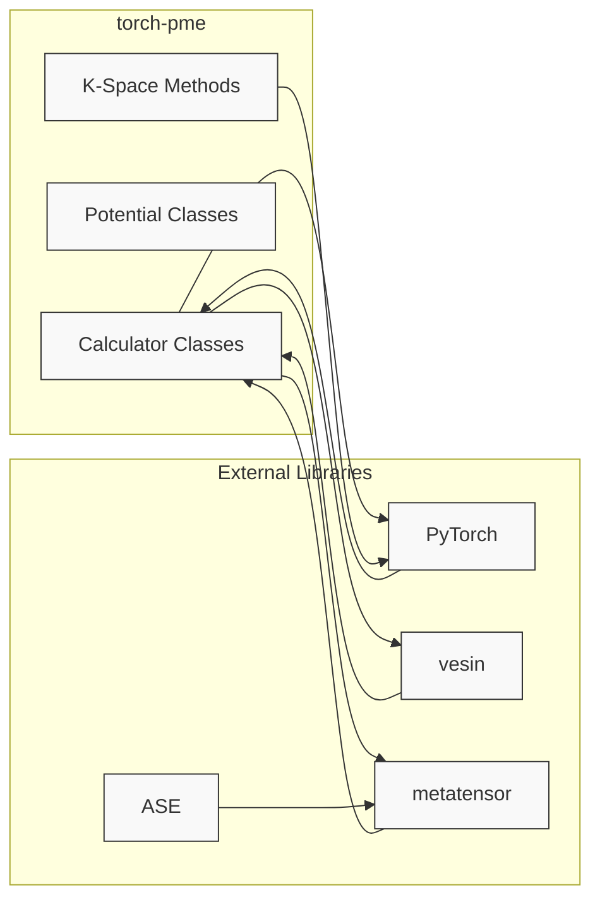
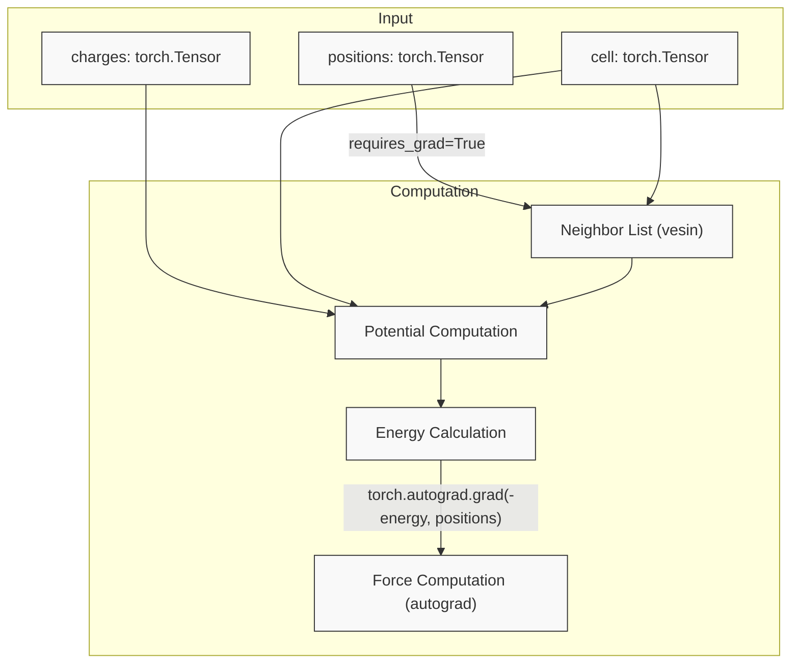
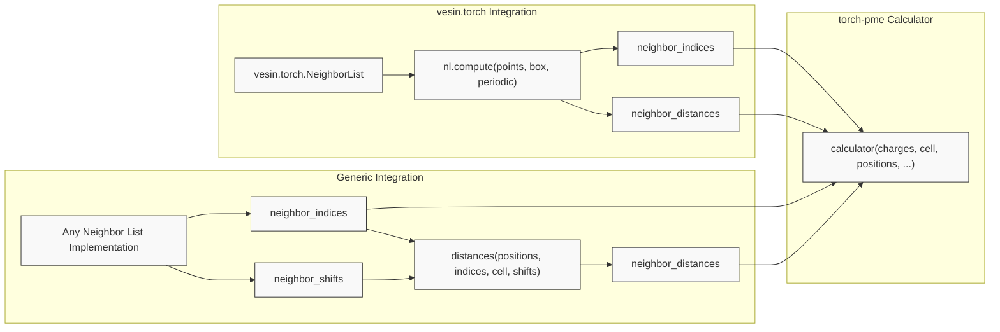
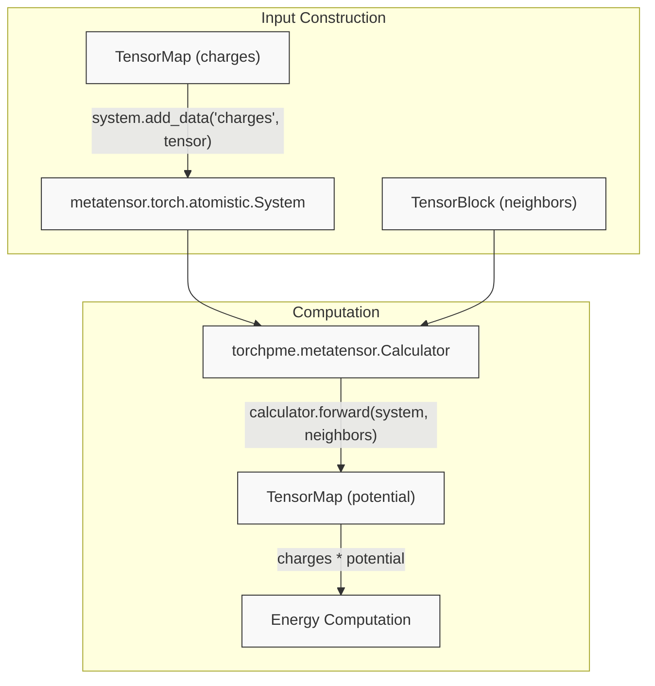
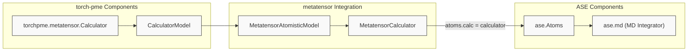
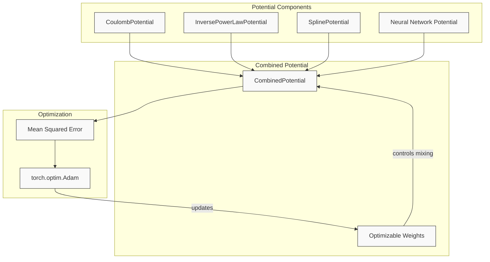

# Integration

<details>
<summary>Relevant source files</summary>

The following files were used as context for generating this wiki page:

- [docs/src/references/metatensor.rst](docs/src/references/metatensor.rst)
- [examples/01-charges-example.py](examples/01-charges-example.py)
- [examples/02-neighbor-lists-usage.py](examples/02-neighbor-lists-usage.py)
- [examples/08-combined-potential.py](examples/08-combined-potential.py)
- [examples/09-atomistic-model.py](examples/09-atomistic-model.py)
- [examples/10-tuning.py](examples/10-tuning.py)
- [tests/metatensor/test_calculator_metatensor.py](tests/metatensor/test_calculator_metatensor.py)

</details>


This page documents how `torch-pme` integrates with external libraries and frameworks. The library is designed to work seamlessly with several key scientific computing libraries, facilitating its use in broader computational workflows for molecular dynamics, machine learning, and atomistic simulations.

For detailed information about MetaTensor-specific integration, see [MetaTensor Integration](#4.1).

## Overview of Integration Points

`torch-pme` leverages several external libraries to provide its functionality, with each integration serving a specific purpose in the computational pipeline.



Sources: [docs/src/references/metatensor.rst](), [examples/09-atomistic-model.py](), [examples/01-charges-example.py]()

## PyTorch Integration

`torch-pme` is built on top of PyTorch, leveraging its tensor operations, automatic differentiation, and optimization capabilities.

### Tensor Operations

All core computations in `torch-pme` use PyTorch tensors, enabling GPU acceleration and vectorized operations. The library supports both `float32` and `float64` precision through PyTorch's dtype system.

### Automatic Differentiation

One of the most important integrations is with PyTorch's autograd system, which allows for automatic computation of forces as derivatives of the potential energy. This is essential for both molecular dynamics simulations and machine learning applications.



Sources: [examples/02-neighbor-lists-usage.py:180-220](), [examples/09-atomistic-model.py:200-235]()

### Example: Computing Forces with Autograd

To compute forces using PyTorch's automatic differentiation:

1. Set `requires_grad=True` on the positions tensor
2. Compute the energy
3. Use `torch.autograd.grad()` to obtain forces

```python
positions.requires_grad = True
potential = calculator(
    charges=charges,
    cell=cell,
    positions=positions,
    neighbor_indices=neighbor_indices,
    neighbor_distances=neighbor_distances,
)
energy = charges.T @ potential
forces = torch.autograd.grad(-energy, positions)[0]
```

Sources: [examples/02-neighbor-lists-usage.py:174-220]()

## vesin Integration

`torch-pme` integrates with the `vesin` library for efficient neighbor list calculations, which are essential for determining which particles interact with each other in the real-space portion of the calculations.

### Neighbor List Computation

There are two approaches to using neighbor lists with `torch-pme`:

1. **Generic Neighbor Lists**: Using any neighbor list implementation and manually reconstructing distances in a differentiable way
2. **Backpropagable Neighbor Lists**: Using `vesin.torch` which tracks operations in the computational graph



Sources: [examples/02-neighbor-lists-usage.py:131-166](), [examples/02-neighbor-lists-usage.py:243-258]()

### Tuning with vesin

`torch-pme` also uses `vesin` in its tuning system to optimize parameters for accuracy and performance.

Sources: [examples/10-tuning.py:93-98](), [examples/01-charges-example.py:62-76]()

## metatensor Integration

`torch-pme` provides specialized bindings for the `metatensor` library, which offers a more structured approach to handling tensor data in atomistic simulations. The detailed integration is covered in [MetaTensor Integration](#4.1).

### Core metatensor Interfaces

`torch-pme` offers calculator implementations that work directly with `metatensor` data structures:

- `torchpme.metatensor.Calculator`
- `torchpme.metatensor.EwaldCalculator`
- `torchpme.metatensor.PMECalculator`
- `torchpme.metatensor.P3MCalculator`

These interfaces allow seamless integration with `metatensor`'s atomistic modeling framework.

```mermaid
classDiagram
    class "Calculator" {
        +forward(system, neighbors)
    }
    
    class "EwaldCalculator" {
        +forward(system, neighbors)
    }
    
    class "PMECalculator" {
        +forward(system, neighbors)
    }
    
    class "P3MCalculator" {
        +forward(system, neighbors)
    }
    
    class "System" {
        +types: torch.Tensor
        +positions: torch.Tensor
        +cell: torch.Tensor
        +pbc: torch.Tensor
        +add_data(name, tensor)
        +get_data(name)
    }
    
    class "TensorMap" {
        +keys: Labels
        +blocks: List[TensorBlock]
    }
    
    class "TensorBlock" {
        +values: torch.Tensor
        +samples: Labels
        +components: List[Labels]
        +properties: Labels
    }
    
    Calculator <|-- EwaldCalculator
    Calculator <|-- PMECalculator
    PMECalculator <|-- P3MCalculator
    
    Calculator ..> System : "takes as input"
    Calculator ..> TensorMap : "returns"
    System --> TensorMap : "contains data as"
```

Sources: [docs/src/references/metatensor.rst:19-29](), [tests/metatensor/test_calculator_metatensor.py:72-77]()

### Data Flow in metatensor Integration



Sources: [examples/01-charges-example.py:248-265](), [examples/01-charges-example.py:270-277](), [examples/09-atomistic-model.py:185-235]()

## ASE Integration

`torch-pme` can be used with the Atomic Simulation Environment (ASE) for molecular dynamics simulations and other atomistic modeling tasks.

### Through metatensor Interface

`torch-pme` calculators can be wrapped within `metatensor`'s ASE calculator interface to enable direct use with ASE:



Sources: [examples/09-atomistic-model.py:330-347](), [examples/09-atomistic-model.py:359-394]()

### Using Multiple Charge Channels

ASE integration supports multiple charge channels, allowing for more complex simulations:

| Use Case | Description | Example |
|----------|-------------|---------|
| Standard Charges | Single charge value per atom | `charges = torch.tensor([[1.0], [-1.0]])` |
| One-Hot Encoding | One channel per species | `charges = torch.tensor([[1.0, 0.0], [0.0, 1.0]])` |
| Machine Learning | Multiple learned charge channels | Custom charge assignments based on ML model |

Sources: [examples/01-charges-example.py:112-123](), [examples/01-charges-example.py:164-183]()

## Example: Molecular Dynamics with ASE

`torch-pme` can be used to run molecular dynamics simulations through its integration with ASE. Here's the typical flow:

1. Create an `ase.Atoms` object with positions, cell, and types
2. Set up a `torch-pme` calculator with appropriate parameters
3. Wrap the calculator with `metatensor` and assign to the atoms
4. Use ASE's MD modules to run the simulation

```python
# Set up calculator
calculator = torchpme.metatensor.EwaldCalculator(
    torchpme.CoulombPotential(smearing=smearing),
    **ewald_params,
    prefactor=torchpme.prefactors.eV_A,
)

# Create model and wrap with metatensor
model = CalculatorModel(calculator=calculator, cutoff=cutoff)
atomistic_model = MetatensorAtomisticModel(model.eval(), ModelMetadata(), model_capabilities)
atoms.calc = MetatensorCalculator(atomistic_model)

# Run MD simulation
integrator = ase.md.Langevin(
    atoms,
    timestep=2 * ase.units.fs,
    temperature_K=10_000,
    friction=0.1 / ase.units.fs,
)
for i_step in range(n_steps):
    integrator.run(1)
    # Collect data
```

Sources: [examples/09-atomistic-model.py:276-394]()

## Integration with Neural Network Potentials

`torch-pme` can be integrated with neural network potentials by combining it with other potentials. The `CombinedPotential` class allows mixing different potentials with optimizable weights.



Sources: [examples/08-combined-potential.py:70-80](), [examples/08-combined-potential.py:195-254]()

## Summary

`torch-pme` has been designed with integration in mind, providing multiple interfaces to connect with the broader ecosystem of scientific computing libraries:

- **PyTorch**: Core tensor operations and automatic differentiation
- **vesin**: Efficient neighbor list calculation with differentiability
- **metatensor**: Structured tensor data for atomistic simulations
- **ASE**: Molecular dynamics and atomistic simulation environment

These integration points make `torch-pme` a versatile tool that can be used in a variety of computational workflows, from simple potential energy calculations to complex molecular dynamics simulations and machine learning applications.

Sources: [examples/09-atomistic-model.py:1-20](), [docs/src/references/metatensor.rst:1-14]()

---