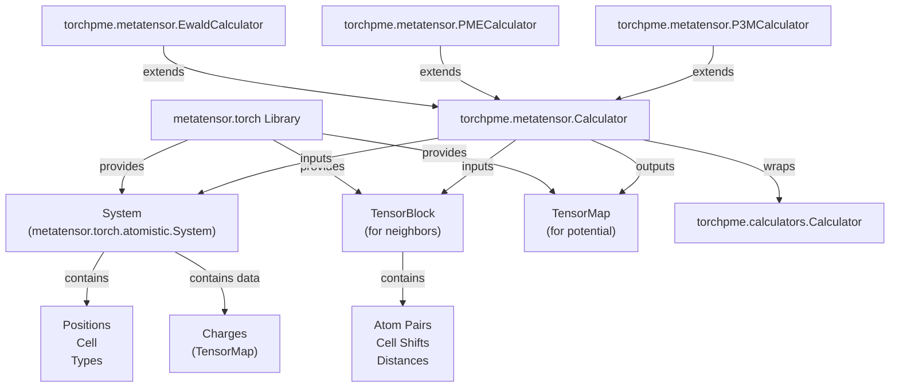
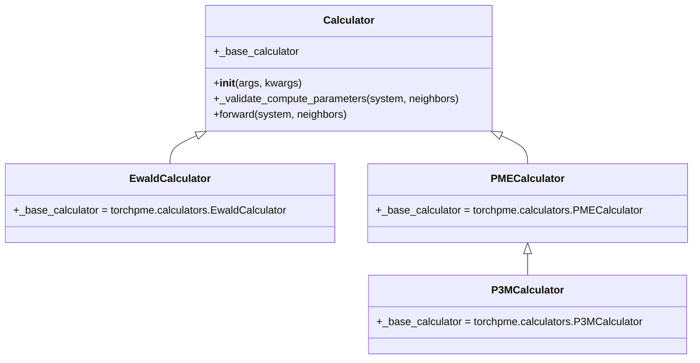
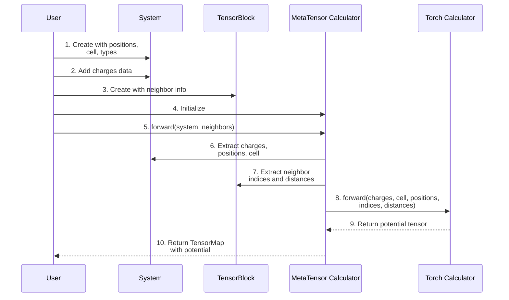

# MetaTensor Integration

<details>
<summary>Relevant source files</summary>

The following files were used as context for generating this wiki page:

- [docs/src/references/metatensor.rst](docs/src/references/metatensor.rst)
- [examples/01-charges-example.py](examples/01-charges-example.py)
- [examples/02-neighbor-lists-usage.py](examples/02-neighbor-lists-usage.py)
- [examples/08-combined-potential.py](examples/08-combined-potential.py)
- [examples/09-atomistic-model.py](examples/09-atomistic-model.py)
- [examples/10-tuning.py](examples/10-tuning.py)
- [src/torchpme/metatensor/calculator.py](src/torchpme/metatensor/calculator.py)
- [tests/calculators/test_workflow.py](tests/calculators/test_workflow.py)
- [tests/metatensor/test_calculator_metatensor.py](tests/metatensor/test_calculator_metatensor.py)
- [tests/metatensor/test_workflow_metatensor.py](tests/metatensor/test_workflow_metatensor.py)

</details>


This page documents the integration of torch-pme with the MetaTensor library, which provides structured tensor operations for atomistic simulations. The integration allows torch-pme calculators to work with MetaTensor's data structures, enabling seamless interoperability with other atomistic simulation tools in the MetaTensor ecosystem.

## Overview

MetaTensor provides data structures for representing atomistic systems and operations in a standardized way, while torch-pme offers efficient implementations of long-range electrostatic calculations. The integration layer bridges these two components, allowing torch-pme's algorithms to consume and produce MetaTensor data structures.

### Key Components

The integration is implemented through wrapper classes in the `torchpme.metatensor` namespace that adapt the base torch-pme calculators to work with MetaTensor's data structures.



Sources: [src/torchpme/metatensor/calculator.py:15-26](), [tests/metatensor/test_workflow_metatensor.py:27-57]()

## Architecture

The MetaTensor integration is built around the `Calculator` class, which wraps the corresponding torch-pme calculator and adapts the input/output formats.

### Class Hierarchy

All MetaTensor calculators derive from a base `Calculator` class, which provides common functionality for validating input parameters and transforming between MetaTensor and torch-pme data structures.



Sources: [src/torchpme/metatensor/calculator.py:15-32](), [tests/metatensor/test_workflow_metatensor.py:29-55]()

### Data Flow

The integration layer handles the conversion between MetaTensor's data structures and the inputs/outputs expected by torch-pme's calculators.



Sources: [src/torchpme/metatensor/calculator.py:102-175](), [tests/metatensor/test_workflow_metatensor.py:108-115]()

## Input and Output Data Structures

### Input: System and Neighbors

The MetaTensor calculators take two primary inputs:

1. A `metatensor.torch.atomistic.System` object containing:
   - Atomic positions
   - Unit cell vectors
   - Periodic boundary conditions
   - Atomic types
   - Charges (as a TensorMap attached to the system)

2. A `metatensor.torch.TensorBlock` object representing the neighbor list with:
   - First and second atom indices
   - Cell shift vectors
   - Distance vectors

### Output: Potential Energy

The calculators return a `metatensor.torch.TensorMap` containing the computed potential energy values for each atom and charge channel.

## Basic Usage

### Creating a System

First, create a MetaTensor `System` object with atomic positions, cell vectors, and other required data:

```python
from metatensor.torch import Labels, TensorBlock, TensorMap
from metatensor.torch.atomistic import System

# Create a system for a CsCl crystal
system = System(
    types=torch.tensor([55, 17]),  # Cs, Cl
    positions=torch.tensor([(0, 0, 0), (0.5, 0.5, 0.5)], dtype=torch.float64),
    cell=torch.eye(3, dtype=torch.float64),
    pbc=torch.tensor([True, True, True])
)
```

Sources: [examples/01-charges-example.py:45-52](), [examples/09-atomistic-model.py:130-134]()

### Adding Charges

Add charge data to the system as a TensorMap:

```python
# Create charges tensor
charges = torch.tensor([[1.0], [-1.0]], dtype=torch.float64)

# Create TensorBlock for charges
block = TensorBlock(
    values=charges,
    samples=Labels.range("atom", charges.shape[0]),
    components=[],
    properties=Labels.range("charge", charges.shape[1])
)

# Create TensorMap containing the block
tensor = TensorMap(
    keys=Labels("_", torch.zeros(1, 1, dtype=torch.int32)),
    blocks=[block]
)

# Add charges to the system
system.add_data(name="charges", tensor=tensor)
```

Sources: [examples/01-charges-example.py:249-264](), [tests/metatensor/test_calculator_metatensor.py:21-33]()

### Computing the Neighbor List

Use the `vesin` library to compute the neighbor list:

```python
from metatensor.torch.atomistic import NeighborListOptions
import vesin.torch.metatensor

# Create neighbor list options
options = NeighborListOptions(cutoff=4.0, full_list=True, strict=False)

# Create neighbor list computer
nl_mts = vesin.torch.metatensor.NeighborList(options, length_unit="Angstrom")

# Compute neighbors
neighbors = nl_mts.compute(system)
```

Sources: [examples/01-charges-example.py:233-235](), [examples/09-atomistic-model.py:167-168]()

### Initializing a Calculator

Create a MetaTensor calculator with the desired potential:

```python
import torchpme

# Initialize a PME calculator
calculator = torchpme.metatensor.PMECalculator(
    torchpme.CoulombPotential(smearing=0.5),
    mesh_spacing=0.25,
    interpolation_nodes=4
)
calculator.to(dtype=torch.float64)
```

Sources: [examples/01-charges-example.py:208-211](), [examples/09-atomistic-model.py:281-285]()

### Computing the Potential

Compute the potential energy:

```python
# Calculate the potential
potential_metatensor = calculator.forward(system, neighbors)

# The potential is a TensorMap
print(potential_metatensor)

# Access the values
print(potential_metatensor[0].values)
```

Sources: [examples/01-charges-example.py:270-284](), [tests/metatensor/test_workflow_metatensor.py:111-121]()

## Advanced Features

### Multiple Charge Channels

torch-pme supports multiple charge channels, which is useful for machine learning applications that need to work with different species or for techniques like one-hot encoding.

```python
# Create one-hot encoded charges
charges_one_hot = torch.tensor([[1.0, 0.0], [0.0, 1.0]], dtype=torch.float64)

# Create TensorBlock with multiple charge channels
block_one_hot = TensorBlock(
    values=charges_one_hot,
    samples=Labels.range("atom", charges_one_hot.shape[0]),
    components=[],
    properties=Labels.range("charge", charges_one_hot.shape[1])
)

# Create TensorMap
tensor_one_hot = TensorMap(
    keys=Labels("_", torch.zeros(1, 1, dtype=torch.int32)),
    blocks=[block_one_hot]
)

# Update charges in the system
system.add_data(name="charges", tensor=tensor_one_hot, override=True)

# Calculate potential with multiple charge channels
potential = calculator.forward(system, neighbors)
```

Sources: [examples/01-charges-example.py:308-335](), [tests/metatensor/test_calculator_metatensor.py:182-196]()

### TorchScript Compatibility

The MetaTensor calculators are compatible with TorchScript, allowing them to be compiled for faster execution:

```python
import torch
import io

# Initialize calculator
calculator = torchpme.metatensor.PMECalculator(
    torchpme.CoulombPotential(smearing=0.5),
    mesh_spacing=0.25
)

# Compile with TorchScript
scripted = torch.jit.script(calculator)

# Use the compiled calculator
potential = scripted.forward(system, neighbors)

# Save and load the compiled calculator
with io.BytesIO() as buffer:
    torch.jit.save(scripted, buffer)
    buffer.seek(0)
    loaded = torch.jit.load(buffer)
```

Sources: [tests/metatensor/test_workflow_metatensor.py:123-138](), [tests/calculators/test_workflow.py:127-142]()

### Integration with Atomistic Models

The MetaTensor calculators can be used to create atomistic models for molecular dynamics simulations:

```python
from metatensor.torch.atomistic import (
    MetatensorAtomisticModel,
    ModelCapabilities,
    ModelEvaluationOptions,
    ModelMetadata,
    ModelOutput
)
from metatensor.torch.atomistic.ase_calculator import MetatensorCalculator

# Define model capabilities
outputs = {"energy": ModelOutput(quantity="energy", unit="eV", per_atom=False)}
model_capabilities = ModelCapabilities(
    outputs=outputs,
    atomic_types=[1],  # Hydrogen
    interaction_range=torch.inf,
    length_unit="angstrom",
    supported_devices=["cpu", "cuda"],
    dtype="float32"
)

# Create an atomistic model
model = CalculatorModel(calculator=calculator, cutoff=cutoff)
atomistic_model = MetatensorAtomisticModel(
    model.eval(), 
    ModelMetadata(), 
    model_capabilities
)

# Create an ASE calculator
ase_calculator = MetatensorCalculator(atomistic_model)

# Use in molecular dynamics
from ase.md import Langevin
import ase.units

integrator = Langevin(
    atoms,
    timestep=2 * ase.units.fs,
    temperature_K=10_000,
    friction=0.1 / ase.units.fs
)

# Run simulation
integrator.run(500)
```

Sources: [examples/09-atomistic-model.py:309-321](), [examples/09-atomistic-model.py:346-394]()

## Input Validation

The MetaTensor calculators perform extensive validation of input data structures to ensure they have the expected format:

1. Check that the neighbor TensorBlock has the correct sample names ('first_atom', 'second_atom', etc.)
2. Verify the neighbor TensorBlock has the expected components ('xyz')
3. Ensure the system contains charge data
4. Validate that the charges match the number of atoms
5. Check that device and dtype are consistent between system and neighbors

Sources: [src/torchpme/metatensor/calculator.py:33-101](), [tests/metatensor/test_calculator_metatensor.py:94-255]()

## Performance Considerations

When working with the MetaTensor interface, keep in mind:

1. Integer types: The calculator automatically converts 32-bit indices to 64-bit on CPU for better performance
2. Device consistency: Ensure system and neighbors are on the same device and have the same dtype
3. Calculator selection: For small systems (< 1000 atoms), Ewald may be faster than PME

Sources: [src/torchpme/metatensor/calculator.py:146-151](), [examples/09-atomistic-model.py:262-270]()

## Examples and Tutorials

For practical examples of using the MetaTensor integration, see:

1. Multiple Charge Channels: [examples/01-charges-example.py]()
2. Atomistic Model for Molecular Dynamics: [examples/09-atomistic-model.py]()
3. Parameter Tuning: [examples/10-tuning.py]()

---