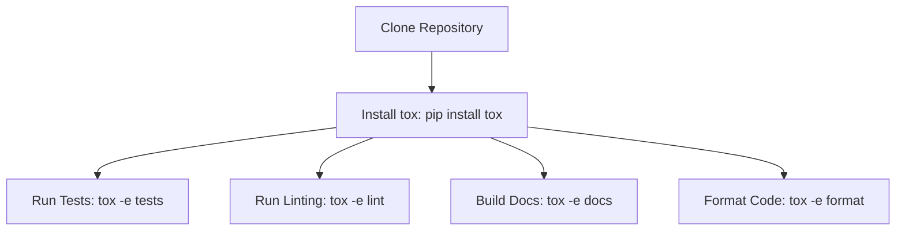
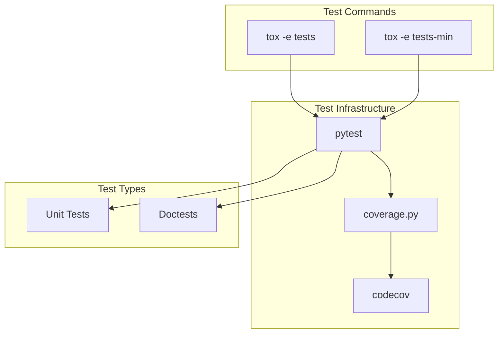
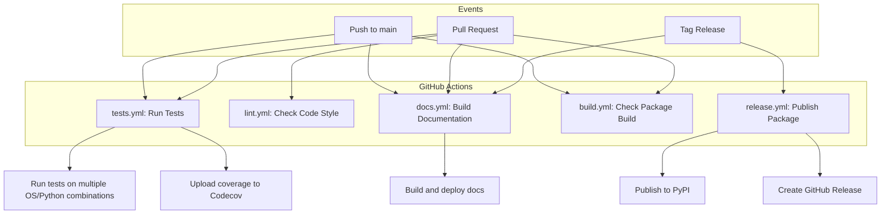
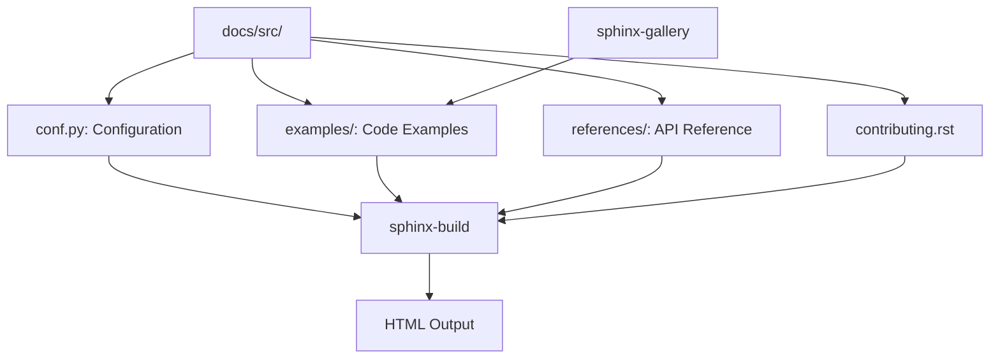

# Development

<details>
<summary>Relevant source files</summary>

The following files were used as context for generating this wiki page:

- [.codecov.yml](.codecov.yml)
- [.github/workflows/build.yml](.github/workflows/build.yml)
- [.github/workflows/docs.yml](.github/workflows/docs.yml)
- [.github/workflows/lint.yml](.github/workflows/lint.yml)
- [.github/workflows/release.yml](.github/workflows/release.yml)
- [.github/workflows/tests.yml](.github/workflows/tests.yml)
- [.readthedocs.yaml](.readthedocs.yaml)
- [CITATION.cff](CITATION.cff)
- [CONTRIBUTING.rst](CONTRIBUTING.rst)
- [MANIFEST.in](MANIFEST.in)
- [README.rst](README.rst)
- [docs/src/contributing.rst](docs/src/contributing.rst)
- [pyproject.toml](pyproject.toml)
- [tests/requirements.txt](tests/requirements.txt)
- [tox.ini](tox.ini)

</details>


This page provides information on development processes, testing, and contributing to torch-pme. It is intended for developers who want to understand the project structure, set up a development environment, run tests, and contribute to the codebase.

## Project Setup

torch-pme uses modern Python packaging tools and follows best practices for project organization. The project requires Python 3.9 or newer and uses PyTorch 2.3 or newer as its primary dependency.

### Dependencies

The core dependencies for torch-pme are defined in `pyproject.toml`:

- **Required**: PyTorch 2.3+
- **Optional**:
  - For examples: ASE, chemiscope, matplotlib, metatensor-operations, scipy, vesin, vesin-torch
  - For metatensor integration: metatensor-torch

### Development Environment

To set up a development environment for torch-pme, you need to:

1. Clone the repository
2. Install `tox` for managing tests and linting
3. Run development commands using `tox`



Sources: [pyproject.toml:23-45](), [tox.ini:1-14](), [CONTRIBUTING.rst:26-36]()

## Development Workflow

The recommended workflow for contributing to torch-pme involves creating a fork of the repository, making changes, running tests, and submitting a pull request.


Sources: [CONTRIBUTING.rst:38-70]()

### Code Style

torch-pme uses `ruff` for code formatting and linting. The configuration is defined in `pyproject.toml` and enforced by CI checks. To ensure your code meets the project standards:

```bash
# Check code style without making changes
tox -e lint

# Automatically format code
tox -e format
```

Sources: [pyproject.toml:100-144](), [tox.ini:53-76]()

## Testing Framework

torch-pme uses pytest for testing. Tests are organized in the `tests/` directory and can be run using tox.

### Running Tests

```bash
# Run all tests
tox -e tests

# Run minimal tests (without optional dependencies)
tox -e tests-min

# Run doctests in modules and README
tox -e tests -- --doctest-modules --pyargs torchpme --doctest-glob=*.rst README.rst
```

Sources: [tox.ini:31-51](), [CONTRIBUTING.rst:72-96]()

### Test Infrastructure

The testing system in torch-pme is designed to ensure code quality and correctness. It includes:

1. Unit tests for core functionality
2. Doctests for documentation examples
3. Coverage reporting via Codecov



Sources: [tox.ini:31-51](), [tests/requirements.txt:1-9](), [.codecov.yml:1-11]()

## Continuous Integration

torch-pme uses GitHub Actions for continuous integration. The CI pipelines automatically run tests, check code style, build documentation, and handle releases.

### CI Workflows



Sources: [.github/workflows/tests.yml:1-69](), [.github/workflows/lint.yml:1-20](), [.github/workflows/docs.yml:1-48](), [.github/workflows/build.yml:1-25](), [.github/workflows/release.yml:1-42]()

### CI Matrix Testing

torch-pme tests on multiple operating systems and Python versions to ensure compatibility:

| OS | Python Versions |
|----|----------------|
| Ubuntu 22.04 | 3.9, 3.13 |
| macOS 14 | 3.13 |
| Windows 2022 | 3.13 |

Sources: [.github/workflows/tests.yml:10-48]()

## Documentation

The documentation for torch-pme is built using Sphinx and hosted on GitHub Pages. It includes API reference, examples, and user guides.

### Building Documentation

To build the documentation locally:

```bash
tox -e docs
```

This will generate the HTML documentation in `docs/build/html/`. You can view it by opening `docs/build/html/index.html` in your browser.

Sources: [tox.ini:78-89](), [CONTRIBUTING.rst:98-120]()

### Documentation Structure



Sources: [.readthedocs.yaml:14-16](), [tox.ini:78-89]()

## Release Process

torch-pme follows a structured release process to ensure quality and stability of releases.

### Release Workflow


Sources: [CONTRIBUTING.rst:122-169](), [.github/workflows/release.yml:1-42]()

### Release Artifacts

When a release is created, the following artifacts are produced:

1. PyPI package (`torch-pme-x.y.z.tar.gz` and wheel)
2. GitHub Release with attached artifacts
3. Documentation version on the project website
4. Conda-forge package (via automated PR)

Sources: [.github/workflows/release.yml:28-41](), [CONTRIBUTING.rst:156-168]()

## References

For detailed information on specific aspects of development, please refer to:

- [Project Setup](#5.1) - For more details on project structure and configuration
- [Testing](#5.2) - For a comprehensive overview of the testing framework
- [CI/CD](#5.3) - For details on continuous integration and deployment
- [Documentation](#5.4) - For information on the documentation system

---