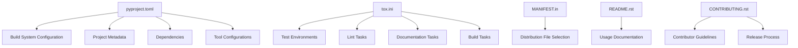
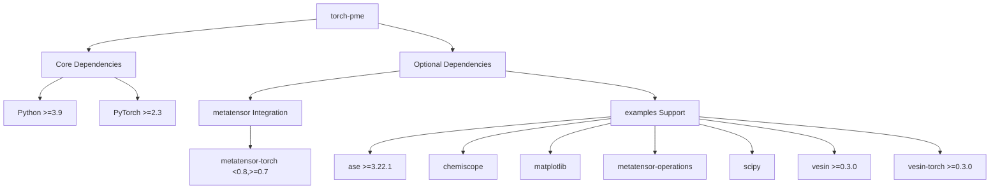
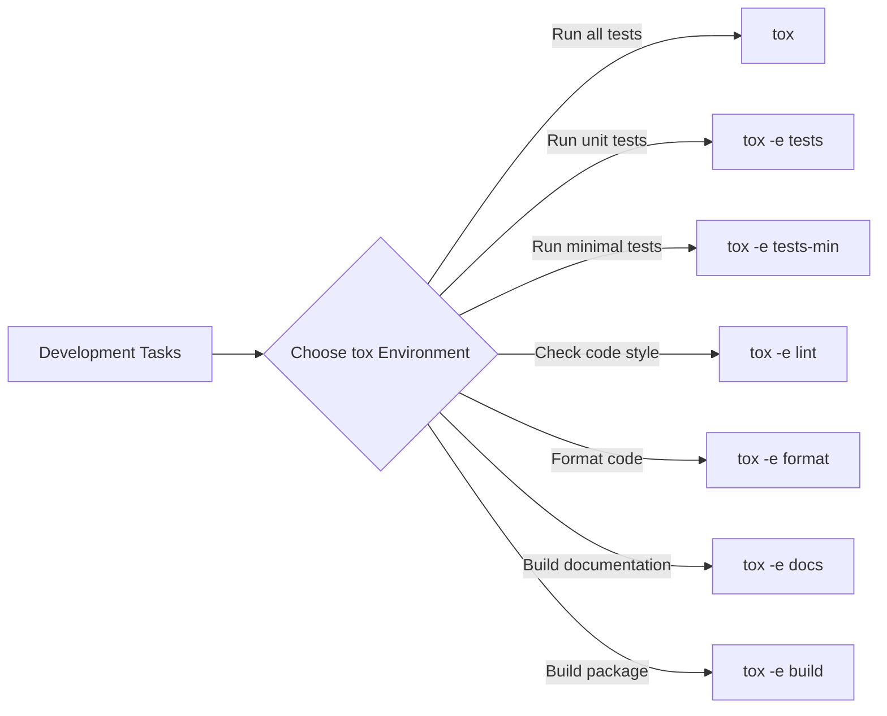
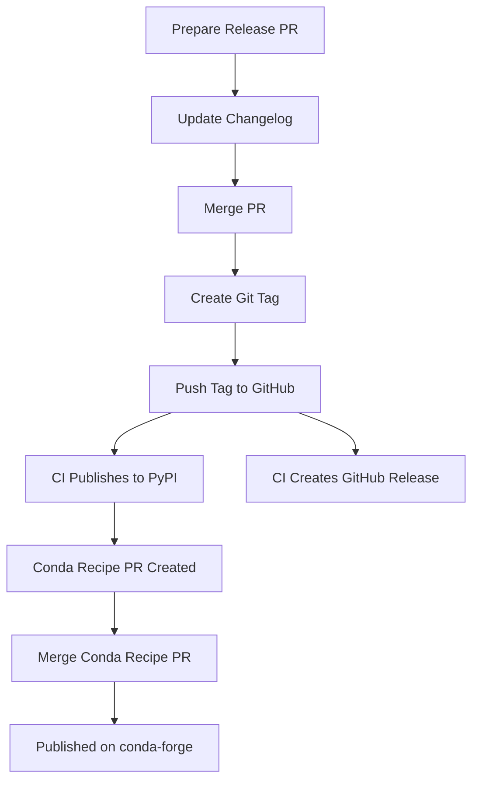

# Project Setup

<details>
<summary>Relevant source files</summary>

The following files were used as context for generating this wiki page:

- [CITATION.cff](CITATION.cff)
- [CONTRIBUTING.rst](CONTRIBUTING.rst)
- [MANIFEST.in](MANIFEST.in)
- [README.rst](README.rst)
- [docs/src/contributing.rst](docs/src/contributing.rst)
- [pyproject.toml](pyproject.toml)
- [tests/requirements.txt](tests/requirements.txt)
- [tox.ini](tox.ini)

</details>


This document details the build system, dependencies, and project configuration for the torch-pme library. It provides a comprehensive guide on how to set up the project for both usage and development. For information about testing the project, see [Testing](#5.2). For details on CI/CD pipelines, see [CI/CD](#5.3).

## Project Configuration Overview

The torch-pme project uses modern Python packaging tools and follows industry best practices for Python package configuration and distribution.



Sources: [pyproject.toml:1-151](), [tox.ini:1-89](), [MANIFEST.in:1-21](), [README.rst:1-180](), [CONTRIBUTING.rst:1-169]()

### Key Configuration Files

| File | Purpose |
|------|---------|
| `pyproject.toml` | Main configuration file defining project metadata, dependencies, build system settings, and tool configurations |
| `tox.ini` | Defines test environments and commands for various development tasks (testing, linting, building docs) |
| `MANIFEST.in` | Controls which files are included in or excluded from package distributions |
| `README.rst` | Project overview, installation instructions, and quickstart guide |
| `CONTRIBUTING.rst` | Guidelines for contributing to the project, including development workflow and release process |
| `tests/requirements.txt` | Dependencies required for running tests |

Sources: [pyproject.toml:1-151](), [tox.ini:1-89](), [MANIFEST.in:1-21](), [README.rst:1-180](), [CONTRIBUTING.rst:1-169](), [tests/requirements.txt:1-9]()

## Dependencies

### Core Dependencies

torch-pme has minimal core dependencies:

| Dependency | Version Requirement |
|------------|---------------------|
| Python     | >=3.9 |
| PyTorch    | >=2.3 |

Sources: [pyproject.toml:23-43]()

### Optional Dependencies

torch-pme offers optional dependency groups for extended functionality:

#### MetaTensor Integration

```bash
pip install torch-pme[metatensor]
```

This installs `metatensor-torch <0.8,>=0.7`.

#### Examples Support

```bash
pip install torch-pme[examples]
```

This installs additional packages needed to run the example code:
- ase ≥ 3.22.1
- chemiscope
- matplotlib
- metatensor-operations
- scipy
- vesin ≥ 0.3.0
- vesin-torch ≥ 0.3.0



Sources: [pyproject.toml:45-55](), [README.rst:55-66]()

## Build System

### Build Configuration

torch-pme uses setuptools as its build backend:

```
[build-system]
requires = ["setuptools >= 77", "setuptools_scm>=8", "wheel"]
build-backend = "setuptools.build_meta"
```

The project uses `setuptools_scm` for version management, which automatically derives the version from git tags and writes it to `src/torchpme/_version.py`.

Sources: [pyproject.toml:1-4](), [pyproject.toml:146-147]()

### Package Structure

The package source code is located in the `src/` directory and organized according to the src-layout pattern:

```
[tool.setuptools.packages.find]
where = ["src"]
```

Sources: [pyproject.toml:149-150]()

### Distribution Configuration

The `MANIFEST.in` file controls which files are included in or excluded from the source distribution:

```
graft src
include LICENSE
include CITATION.cff
include README.rst
prune docs
prune examples
prune tests
...
```

This ensures that only required files are packaged for distribution, keeping the package size optimal.

Sources: [MANIFEST.in:1-21]()

### Building the Package

The package can be built using tox or directly with Python build tools:

```bash
# Using tox
tox -e build

# Using Python build directly
python -m build
```

This generates both wheel (.whl) and source distribution (.tar.gz) files in the `dist/` directory.

Sources: [tox.ini:15-29]()

## Development Environment Setup

### Required Tools

To contribute to torch-pme, you'll need:

- **git**: For version control
- **Python**: Version 3.9 or newer
- **tox**: For running tests, linting, and other development tasks

Sources: [CONTRIBUTING.rst:25-36]()

### Initial Setup

1. **Fork and clone the repository**:
   ```bash
   git clone <your-fork-url>
   cd torch-pme
   git remote add upstream https://github.com/lab-cosmo/torch-pme.git
   git fetch upstream
   git branch main --set-upstream-to=upstream/main
   ```

2. **Create a development branch**:
   ```bash
   git checkout -b <my-branch-name>
   ```

3. **Install development tools**:
   ```bash
   pip install tox
   ```

Sources: [CONTRIBUTING.rst:38-69]()

### Development Workflow

The development workflow is centered around tox environments:



Sources: [tox.ini:1-89](), [CONTRIBUTING.rst:72-96]()

## Testing Framework

torch-pme uses pytest for testing, with additional tools for coverage reporting.

### Test Configuration

The test configuration is defined in `pyproject.toml`:

```
[tool.pytest.ini_options]
python_files = ["*.py"]
testpaths = ["tests"]
addopts = [
    "--cov",
    "--cov-append",
    "--cov-report=",
    "--import-mode=append",
]
```

Sources: [pyproject.toml:83-91]()

### Running Tests

Tests can be run using tox:

```bash
tox -e tests         # Run all tests with optional dependencies
tox -e tests-min     # Run minimal core tests without optional dependencies
```

Sources: [tox.ini:31-51](), [CONTRIBUTING.rst:72-88]()

### Test Dependencies

Test dependencies are defined in `tests/requirements.txt`:

```
ase >= 3.23
coverage[toml]
pytest
pytest-cov
pytest-doctestplus
scipy
vesin >= 0.3.0
vesin[torch] >= 0.3.0
```

Sources: [tests/requirements.txt:1-9]()

## Code Style and Linting

torch-pme enforces consistent code style and quality through automated tools.

### Code Formatting and Linting

The project uses `ruff` for code formatting and linting, and `mypy` for type checking:

```bash
tox -e format        # Format code
tox -e lint          # Run linters and type checks
```

Sources: [tox.ini:53-76](), [CONTRIBUTING.rst:89-96]()

### Linting Configuration

The linting configuration is defined in `pyproject.toml`:

```
[tool.ruff]
exclude = ["docs/src/examples/**", "src/torchpme/_version.py"]
line-length = 88

[tool.ruff.lint]
extend-select = [
    "B",  # Pyflakes checks
    "D",  # PEP 257 docstring conventions
    "E",  # Pycodestyle errors
    "UP",  # PyUpgrade rules
    # ...
]
```

Sources: [pyproject.toml:100-145]()

## Documentation

torch-pme uses Sphinx for documentation.

### Building Documentation

Documentation can be built using tox:

```bash
tox -e docs
```

This generates HTML documentation in `docs/build/html/`.

Sources: [tox.ini:78-89](), [CONTRIBUTING.rst:98-120]()

## Release Process

The release process involves several steps:

1. **Prepare a release PR** with the changes to be released
2. **Update the changelog** in `docs/src/references/changelog.rst`
3. **Merge the PR and create a git tag**:
   ```bash
   git tag -a v0.1.1 -m "Release v0.1.1"
   git push origin --tags
   ```
4. **Finalize the GitHub release** (CI automatically publishes to PyPI and creates GitHub release)
5. **Update the conda recipe** via conda-forge feedstock



Sources: [CONTRIBUTING.rst:122-169]()

---