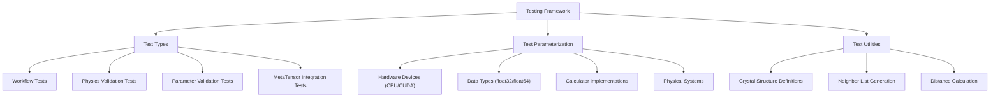
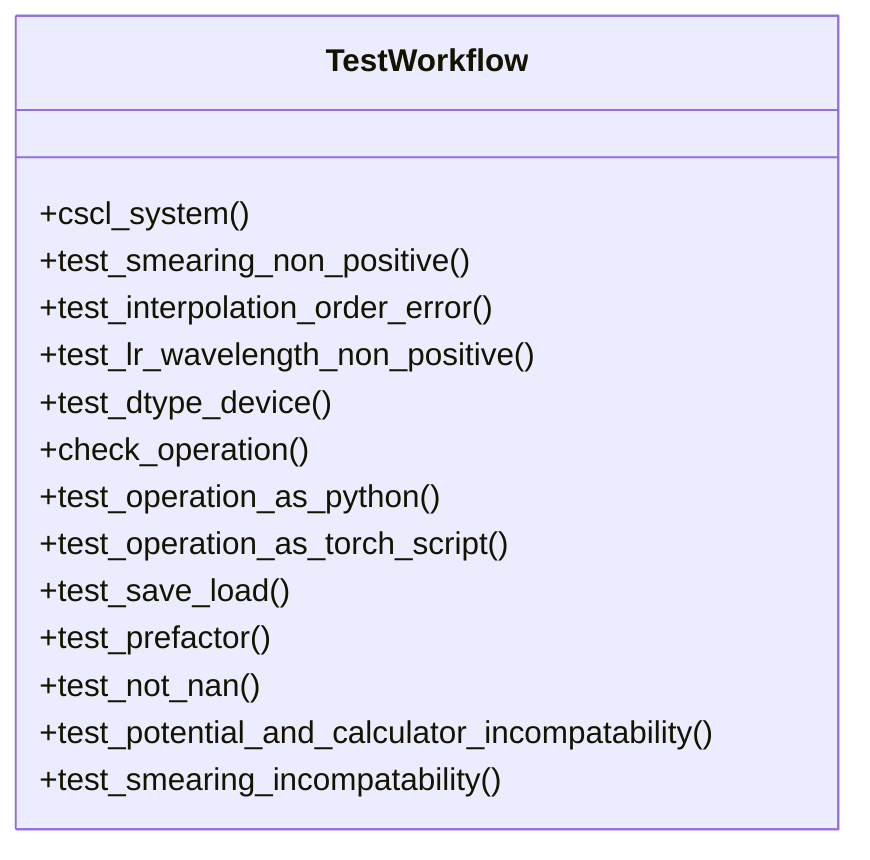
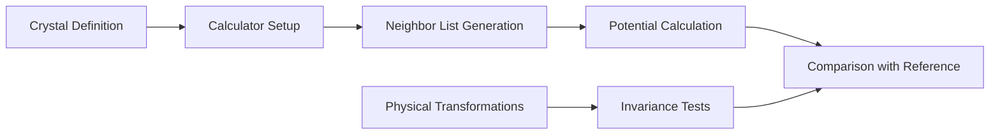
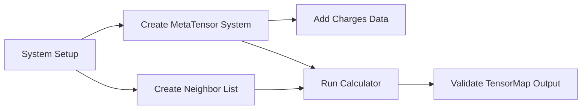
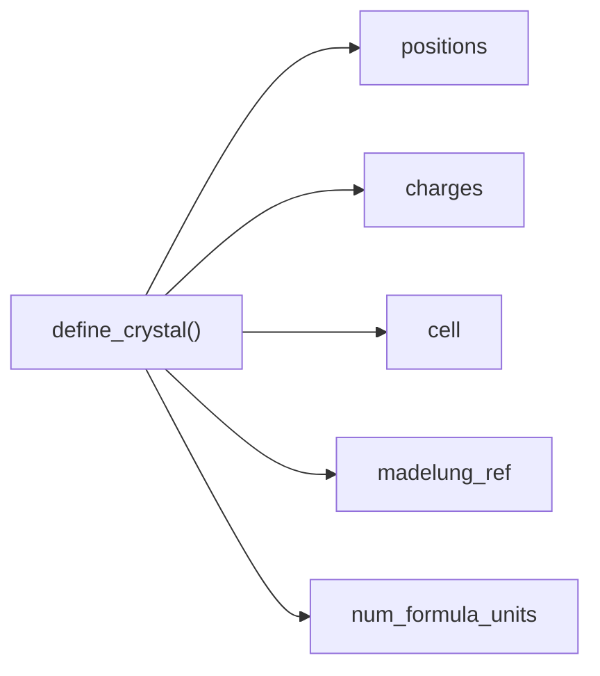
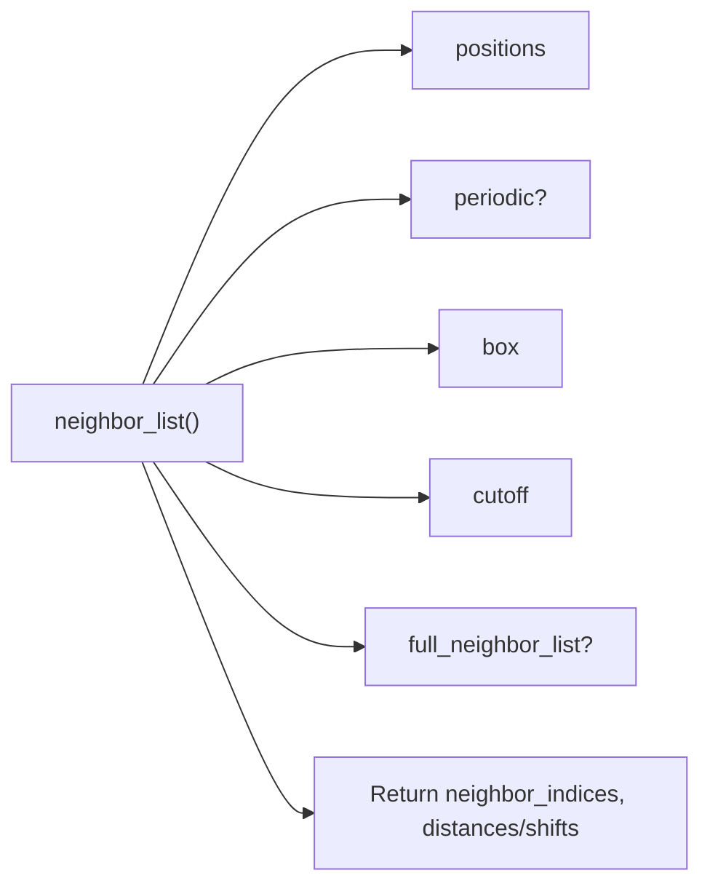
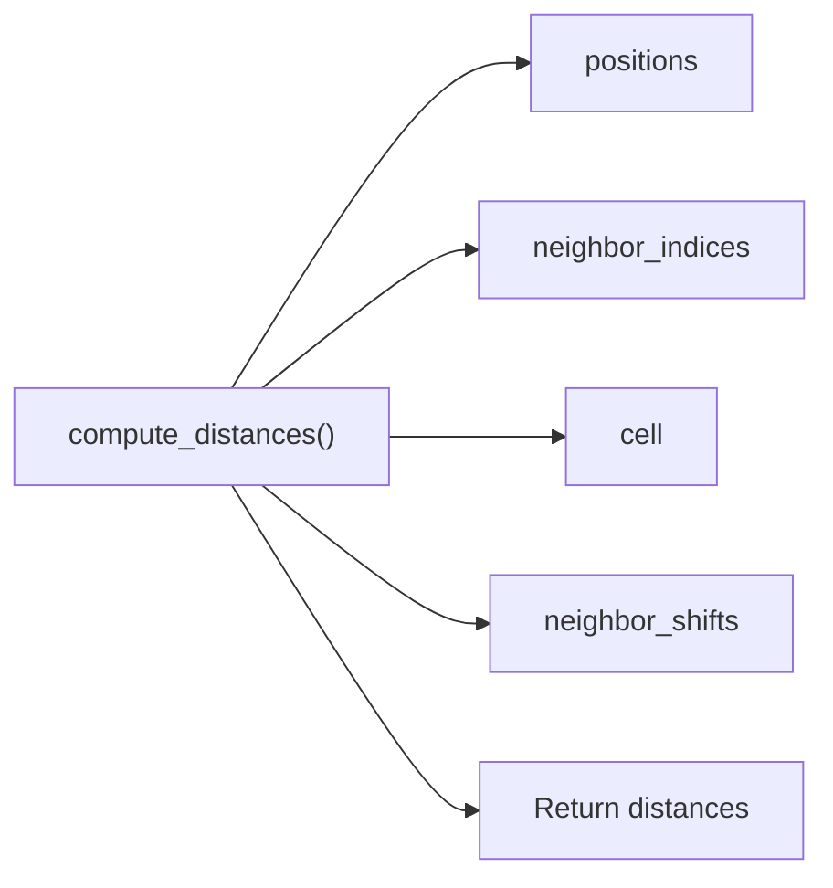

# Testing

<details>
<summary>Relevant source files</summary>

The following files were used as context for generating this wiki page:

- [src/torchpme/metatensor/calculator.py](src/torchpme/metatensor/calculator.py)
- [tests/calculators/test_values_ewald.py](tests/calculators/test_values_ewald.py)
- [tests/calculators/test_workflow.py](tests/calculators/test_workflow.py)
- [tests/helpers.py](tests/helpers.py)
- [tests/metatensor/test_workflow_metatensor.py](tests/metatensor/test_workflow_metatensor.py)

</details>


This wiki page documents the testing framework and methodologies used in the torch-pme library. It covers the structure of tests, test utilities, and explains how different components are tested to ensure correctness and reliability. For information about the Continuous Integration/Deployment pipeline, see [CI/CD](#5.3).

## Testing Framework Overview

torch-pme uses pytest as its primary testing framework. Tests are parameterized across different hardware devices, data types, calculator implementations, and physical systems to ensure broad coverage. The testing strategy focuses on validating both the computational correctness (physics) and the software engineering aspects (API, error handling, serialization).



Sources: [tests/calculators/test_workflow.py:1-32](), [tests/metatensor/test_workflow_metatensor.py:1-22](), [tests/helpers.py:10-18]()

## Test Directory Structure

The tests are organized into several directories based on the components they test:

- `tests/calculators/`: Tests for the core calculator implementations (Ewald, PME, P3M)
- `tests/metatensor/`: Tests for the metatensor integration
- `tests/`: Contains helper modules and common testing utilities

Each test file typically focuses on one specific aspect of functionality, such as workflow validation or physical accuracy.

Sources: [tests/calculators/test_workflow.py](), [tests/metatensor/test_workflow_metatensor.py](), [tests/calculators/test_values_ewald.py]()

## Test Types

### Workflow Tests

Workflow tests validate that the calculators can be properly initialized, used to compute potentials, serialized/deserialized, and have proper TorchScript compatibility. These tests ensure the basic API functionality works as expected.



The workflow tests in `test_workflow.py` check the following aspects:
- Parameter validation (smearing, interpolation order, wavelength)
- Device and dtype consistency
- TorchScript compilation and execution
- Save and load functionality
- Gradient computation (not producing NaN values)
- Parameter interaction (prefactor application)

Sources: [tests/calculators/test_workflow.py:63-208]()

### Physical Validation Tests

These tests verify that the calculators produce physically correct results by comparing against reference values, particularly for well-known crystal structures with established Madelung constants.



Key aspects tested include:
- Madelung constants for various crystal structures (CsCl, NaCl, zincblende, etc.)
- Energy conservation under scaling operations
- Invariance to rotations
- Proper handling of boundary conditions

Sources: [tests/calculators/test_values_ewald.py:65-359]()

### Parameter Validation Tests

These tests ensure that the calculators properly validate input parameters and raise appropriate errors for invalid inputs. Examples include:
- Testing for positive smearing parameters
- Validating interpolation node count ranges
- Checking wavelength parameter positivity
- Validating compatibility between potentials and calculators

Sources: [tests/calculators/test_workflow.py:76-207]()

### MetaTensor Integration Tests

These tests validate the integration with the metatensor library, ensuring that the torch-pme calculators can properly interface with metatensor-based systems and neighbor lists.



The tests verify:
- Proper handling of metatensor System objects
- Correct processing of neighbor lists in TensorBlock format
- Appropriate output formatting as a TensorMap
- TorchScript compatibility when using metatensor interfaces

Sources: [tests/metatensor/test_workflow_metatensor.py:58-138]()

## Test Parameterization

torch-pme tests make extensive use of pytest's parameterization to test multiple configurations:

```python
@pytest.mark.parametrize("device", DEVICES)
@pytest.mark.parametrize("dtype", DTYPES)
@pytest.mark.parametrize(
    ("CalculatorClass", "params"),
    [
        (Calculator, {"potential": CoulombPotential(smearing=None)}),
        (EwaldCalculator, {"potential": CoulombPotential(smearing=SMEARING), "lr_wavelength": LR_WAVELENGTH}),
        # More calculator configurations...
    ],
)
```

This approach tests each calculator implementation across different:
- Hardware devices (CPU and CUDA if available)
- Data types (float32 and float64)
- Calculator configurations (different potentials and parameters)

Sources: [tests/calculators/test_workflow.py:29-62](), [tests/metatensor/test_workflow_metatensor.py:24-56]()

## Test Data and Reference Systems

torch-pme tests use a variety of physical systems with known reference values:

| Crystal System | Structure | Cation:Anion Ratio | Reference Value Type |
|----------------|-----------|-------------------|---------------------|
| CsCl | Cubic | 1:1 | Madelung constant |
| NaCl | Cubic/FCC | 1:1 | Madelung constant |
| Zincblende | FCC | 1:1 | Madelung constant |
| Wurtzite | Triclinic | 1:1 | Madelung constant |
| Fluorite | FCC | 1:2 | Madelung constant |
| Cu₂O | Cubic | 2:1 | Madelung constant |
| Wigner crystals | Various | N/A | Energy values |

Reference values from physics literature are used to validate calculation accuracy. For example, Madelung constants provide a standard benchmark for electrostatic calculations in crystal structures.

Sources: [tests/helpers.py:20-238](), [tests/calculators/test_values_ewald.py:80-220]()

## Helper Functions

The testing framework includes several helper functions to support test cases:

### Crystal Structure Definitions

The `define_crystal` function in `helpers.py` creates reference crystal structures with known positions, charges, and Madelung constants:



Sources: [tests/helpers.py:20-238]()

### Neighbor List Generation

The `neighbor_list` function creates neighbor lists for atom pairs within a cutoff distance:



Sources: [tests/helpers.py:241-273]()

### Distance Calculation

The `compute_distances` function calculates distances between atom pairs, handling periodic boundary conditions:



Sources: [tests/helpers.py:276-302]()

## Running Tests

Tests can be run using pytest:

```bash
pytest tests/
```

Specific test files or test functions can be run with:

```bash
pytest tests/calculators/test_workflow.py
pytest tests/calculators/test_workflow.py::TestWorkflow::test_not_nan
```

The tests are configured to be hardware-aware, automatically detecting and utilizing CUDA when available:

```python
DEVICES = ["cpu", torch.device("cpu")] + torch.cuda.is_available() * ["cuda"]
DTYPES = [torch.float32, torch.float64]
```

Sources: [tests/helpers.py:16-17]()

## Test Coverage Highlights

The test suite includes specific tests for key aspects of the library:

1. **Torch Scriptability**: Tests ensure calculators can be compiled with TorchScript
   ```python
   scripted = torch.jit.script(calculator)
   self.check_operation(calculator=scripted, device=device, dtype=dtype)
   ```

2. **Serialization**: Tests verify calculators can be saved and loaded
   ```python
   with io.BytesIO() as buffer:
       torch.jit.save(scripted, buffer)
       buffer.seek(0)
       torch.jit.load(buffer)
   ```

3. **Autodifferentiation**: Tests check that gradients can be computed without NaN values
   ```python
   energy = calculator.forward(*system).sum()
   assert not torch.isnan(torch.autograd.grad(energy, system[0], retain_graph=True)[0]).any()
   ```

4. **Error Detection**: Tests verify proper error handling for invalid inputs
   ```python
   with pytest.raises(ValueError, match=match):
       CalculatorClass(**params)
   ```

Sources: [tests/calculators/test_workflow.py:127-184](), [tests/metatensor/test_workflow_metatensor.py:123-138]()

## Conclusion

The torch-pme testing framework provides comprehensive validation of the library's functionality, from basic API behavior to physical accuracy. By parameterizing tests across different devices, data types, and calculator implementations, the test suite ensures the library works correctly in a wide variety of environments and use cases.

---