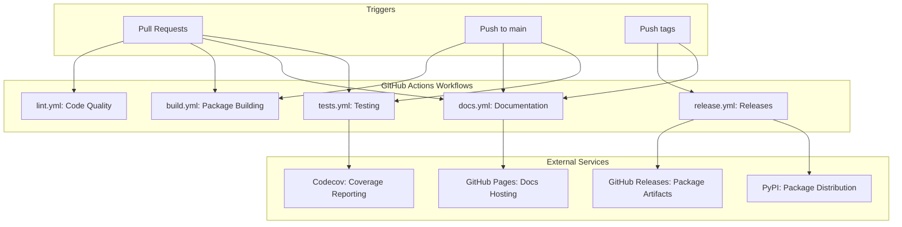
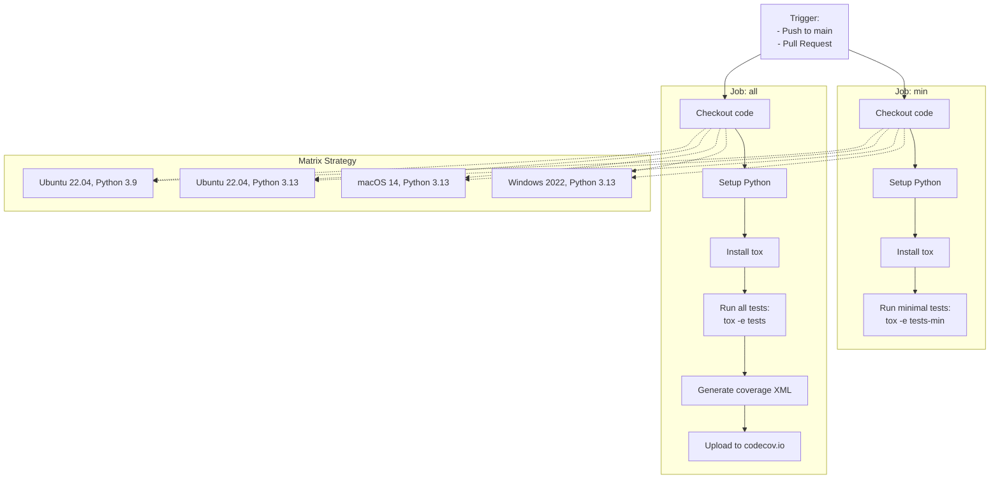
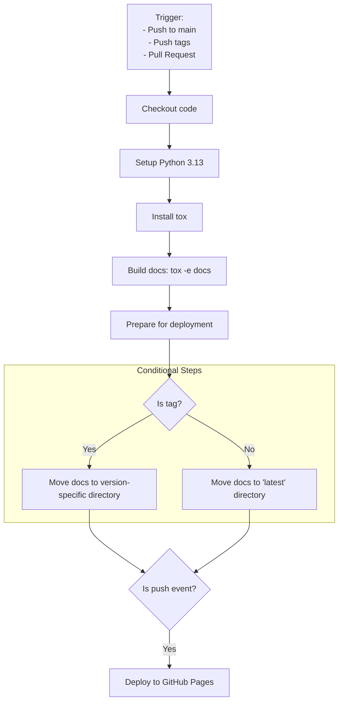
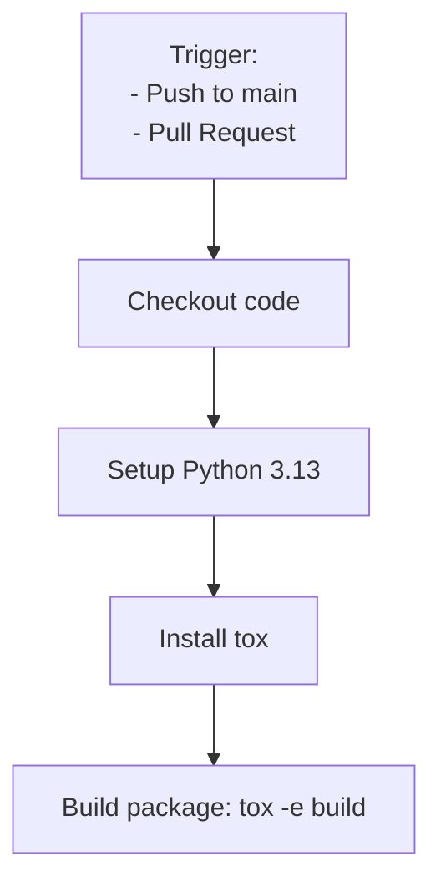
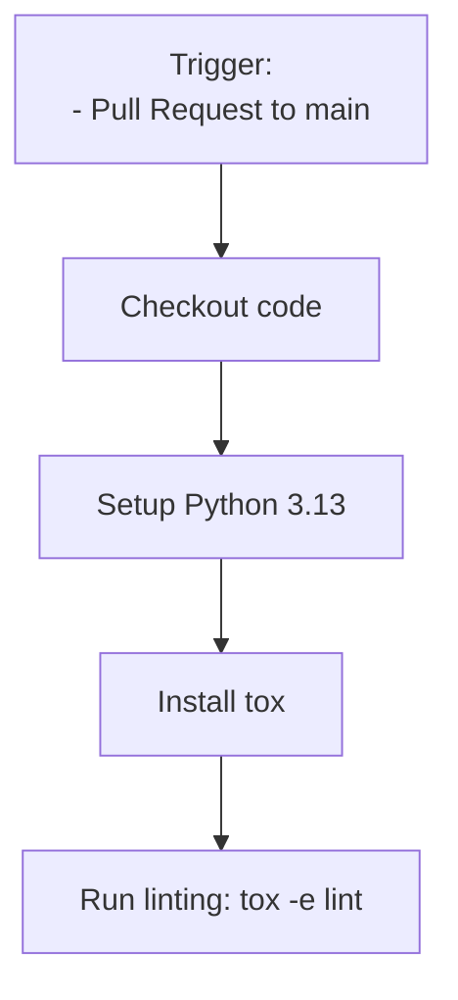
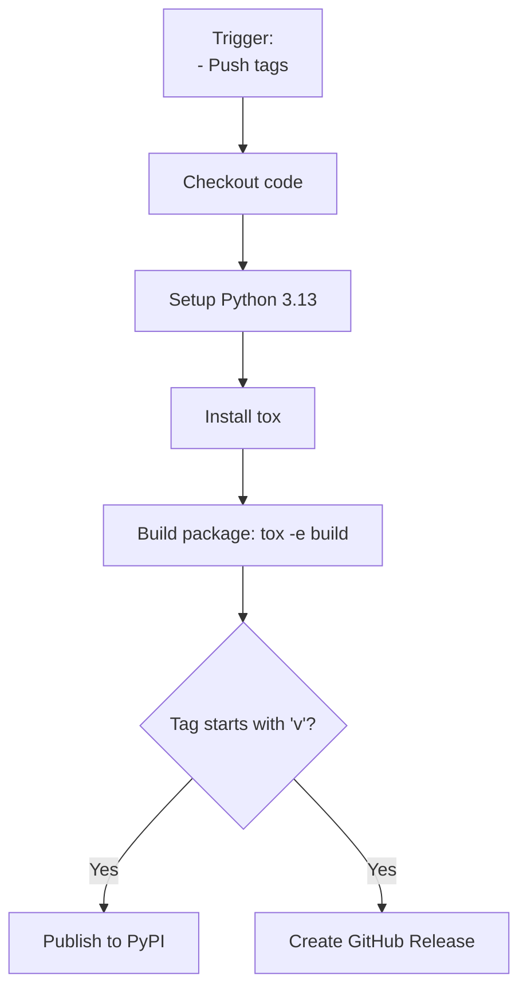
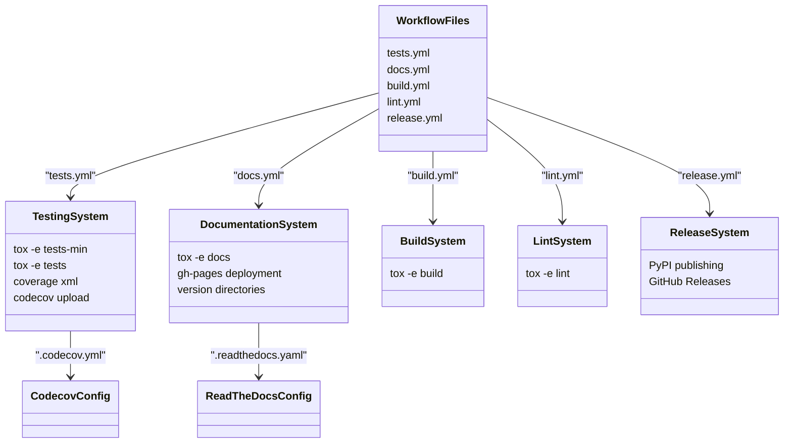

# CI/CD

Relevant source files

The following files were used as context for generating this wiki page:

- [.codecov.yml](.codecov.yml)
- [.github/workflows/build.yml](.github/workflows/build.yml)
- [.github/workflows/docs.yml](.github/workflows/docs.yml)
- [.github/workflows/lint.yml](.github/workflows/lint.yml)
- [.github/workflows/release.yml](.github/workflows/release.yml)
- [.github/workflows/tests.yml](.github/workflows/tests.yml)
- [.readthedocs.yaml](.readthedocs.yaml)

This document details the Continuous Integration (CI) and Continuous Deployment (CD) pipelines used in the torch-pme project. These automated workflows help ensure code quality, test coverage, and streamline the release process. For information about test structure and writing tests, see [Testing](#5.2). For project setup details, see [Project Setup](#5.1).

## CI/CD Infrastructure Overview

The torch-pme project uses GitHub Actions as its primary CI/CD platform. All workflows are defined in the `.github/workflows/` directory.

Sources: [.github/workflows/tests.yml](), [.github/workflows/docs.yml](), [.github/workflows/build.yml](), [.github/workflows/lint.yml](), [.github/workflows/release.yml]()

## Continuous Integration Workflows

### Testing Workflow

The testing workflow ensures that the codebase works correctly across different operating systems and Python versions.

The testing workflow runs two jobs:
1. **min**: Runs minimal tests across all platform configurations
2. **all**: Runs comprehensive tests and collects coverage data

Both jobs are executed on a matrix of operating systems and Python versions to ensure compatibility across environments.

Sources: [.github/workflows/tests.yml]()

### Documentation Workflow

The documentation workflow builds the project's documentation and deploys it to GitHub Pages.

The documentation workflow:
1. Builds the documentation using Sphinx via tox
2. For tags, creates version-specific documentation
3. For pushes to main, updates the "latest" documentation
4. Deploys the documentation to GitHub Pages for push events

Sources: [.github/workflows/docs.yml]()

### Build Workflow

The build workflow ensures the package can be built properly.

This workflow verifies that the package can be built successfully but does not publish it.

Sources: [.github/workflows/build.yml]()

### Linting Workflow

The linting workflow checks code quality.

This workflow runs code quality checks for pull requests to ensure they meet the project's standards before merging.

Sources: [.github/workflows/lint.yml]()

## Continuous Deployment Workflow

### Release Workflow

The release workflow automates the process of publishing new releases.

The release workflow:
1. Builds the package when a tag is pushed
2. If the tag starts with 'v', publishes the package to PyPI
3. Creates a GitHub release with the package artifacts

Sources: [.github/workflows/release.yml]()

## Additional CI Services

### Codecov Integration

Codecov is used for tracking code coverage. Its configuration is defined in `.codecov.yml`.

Key settings include:
- **Ignore pattern**: Tests directory (`tests/.*`) is excluded from coverage calculations
- **Coverage target**: 90% project-wide coverage
- **Patch status**: Disabled
- **Comments**: Disabled

Sources: [.codecov.yml]()

### ReadTheDocs Integration

While GitHub Pages is the primary documentation hosting, the project also has ReadTheDocs configuration in `.readthedocs.yaml`.

Key settings include:
- **Python version**: 3.13
- **Documentation location**: `docs/src/conf.py`
- **Additional formats**: PDF
- **Installation requirements**: Requirements from `docs/requirements.txt`
- **Extra requirements**: `examples` and `metatensor`

Sources: [.readthedocs.yaml]()

## CI/CD Workflow Matrix

The following table summarizes when each workflow is triggered:

| Workflow | Push to main | Pull Request | Push tags |
|----------|--------------|--------------|-----------|
| Tests    | ✅           | ✅           | ❌        |
| Documentation | ✅      | ✅           | ✅        |
| Build    | ✅           | ✅           | ❌        |
| Lint     | ❌           | ✅           | ❌        |
| Release  | ❌           | ❌           | ✅        |

## Workflow to Code Mapping

The following diagram maps workflow files to their corresponding functionality:

Sources: [.github/workflows/tests.yml](), [.github/workflows/docs.yml](), [.github/workflows/build.yml](), [.github/workflows/lint.yml](), [.github/workflows/release.yml](), [.codecov.yml](), [.readthedocs.yaml]()

---