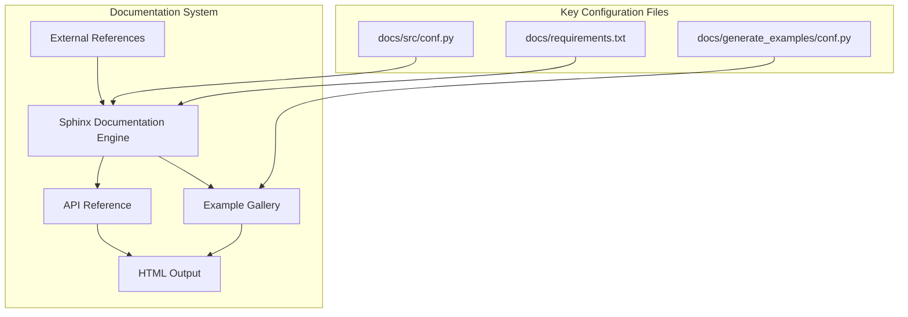
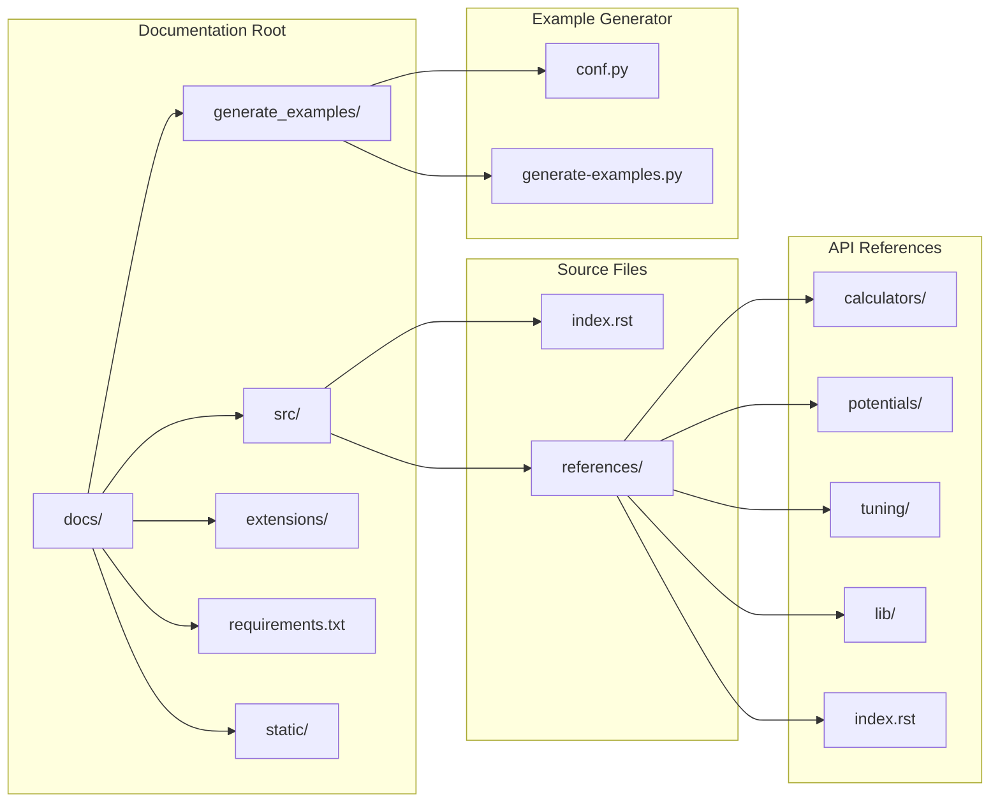
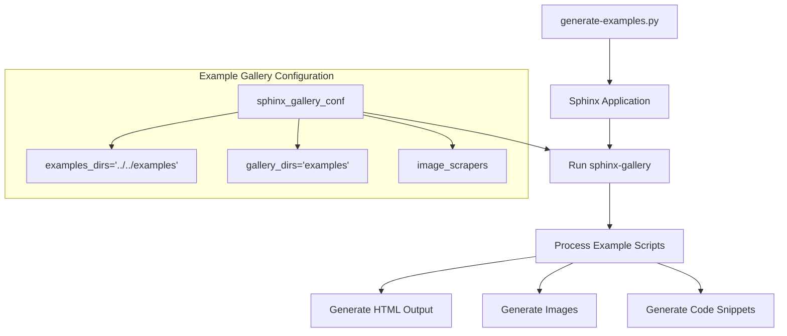
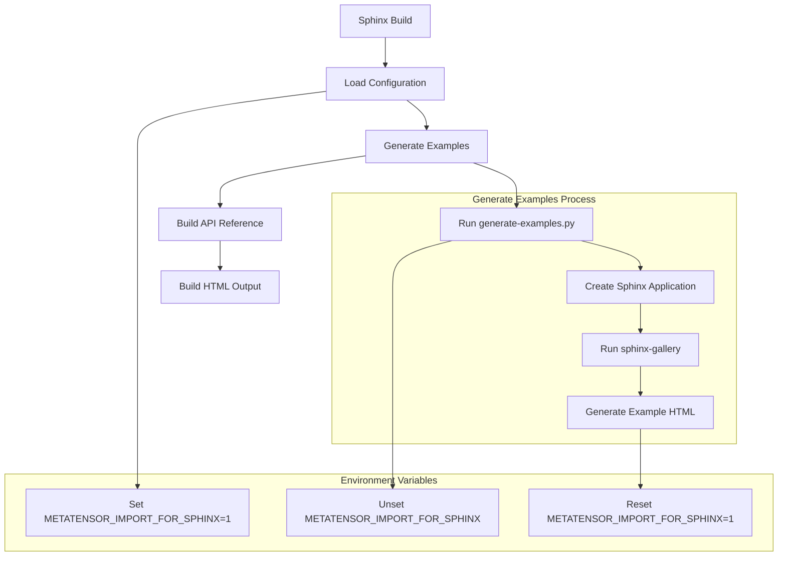

# Documentation

<details>
<summary>Relevant source files</summary>

The following files were used as context for generating this wiki page:

- [docs/generate_examples/conf.py](docs/generate_examples/conf.py)
- [docs/generate_examples/generate-examples.py](docs/generate_examples/generate-examples.py)
- [docs/requirements.txt](docs/requirements.txt)
- [docs/src/conf.py](docs/src/conf.py)
- [docs/src/references/calculators/index.rst](docs/src/references/calculators/index.rst)
- [docs/src/references/index.rst](docs/src/references/index.rst)
- [docs/src/references/potentials/index.rst](docs/src/references/potentials/index.rst)
- [docs/static/images/long-range.jpg](docs/static/images/long-range.jpg)
- [examples/coulomb_test_frames.xyz](examples/coulomb_test_frames.xyz)

</details>


This page describes the documentation system used in the torch-pme project, including how it's structured, configured, and generated. The documentation uses Sphinx, a popular Python documentation generator, with several extensions to enhance functionality.

## Overview

The torch-pme documentation system includes:

1. API reference documentation
2. Gallery of examples
3. Custom extensions for version tracking
4. Integration with external documentation



Sources: [docs/src/conf.py](), [docs/requirements.txt](), [docs/generate_examples/conf.py]()

## Documentation Structure

The documentation is organized into a clear directory structure that separates sources, configuration, and generation tools.



Sources: [docs/src/references/index.rst](), [docs/generate_examples/generate-examples.py]()

## Sphinx Configuration

The documentation system is powered by Sphinx and configured in the `docs/src/conf.py` file. This file defines all the settings, extensions, and customizations for the documentation build process.

### Key Extensions

The documentation uses several Sphinx extensions to provide enhanced functionality:

| Extension | Purpose |
|-----------|---------|
| `sphinx.ext.autodoc` | Automatically extracts documentation from docstrings |
| `sphinx.ext.intersphinx` | Enables linking to documentation from other projects |
| `sphinx.ext.viewcode` | Adds links to source code from documentation |
| `sphinx_gallery.gen_gallery` | Generates example galleries from Python scripts |
| `sphinx_toggleprompt` | Adds toggle buttons for code prompt visibility |
| `sphinx_design` | Provides advanced layout components |
| `chemiscope.sphinx` | Integrates with chemiscope for chemical visualization |
| `versions_list` | Local extension for version management |

### Theme Configuration

The documentation uses the Furo theme with customized settings:

```python
html_theme = "furo"
html_theme_options = {
    "light_logo": "images/torch-pme.png",
    "dark_logo": "images/torch-pme-dark.png",
    "sidebar_hide_name": True,
    "footer_icons": [
        {
            "name": "GitHub",
            "url": project_dict["urls"]["repository"],
            "html": "",
            "class": "fa-brands fa-github fa-2x",
        },
    ],
}
```

Sources: [docs/src/conf.py:117-155]()

## Example Gallery Generation

The torch-pme documentation includes a gallery of examples generated from Python scripts in the `examples` directory. The example gallery generation is handled separately from the main documentation build process due to specific import requirements.



The example gallery generation process is interesting because it requires a separate environment configuration for importing modules compared to the main documentation:

1. It runs a separate Sphinx application instance
2. It temporarily removes the `METATENSOR_IMPORT_FOR_SPHINX` environment variable
3. It processes examples using sphinx-gallery
4. It generates HTML output with runnable code examples

Sources: [docs/generate_examples/generate-examples.py](), [docs/generate_examples/conf.py](), [docs/src/conf.py:52-60]()

## API Reference Documentation

The API reference documentation is organized into several sections, each focused on a specific aspect of the torch-pme library. The main reference index is defined in `docs/src/references/index.rst`.

### API Reference Sections

The API reference is divided into the following sections:

| Section | Description |
|---------|-------------|
| Potentials | Documents the `Potential` base class and its implementations |
| Calculators | Documents the `Calculator` base class and its implementations |
| Tuning | Documents the parameter tuning system |
| Prefactors | Documents prefactor-related functionality |
| Metatensor | Documents integration with the metatensor library |
| Library | Documents internal library functions |
| Changelog | Documents version changes |

```mermaid
classDiagram
    class "references/index.rst" {
        Main API reference index
        Links to all API sections
    }
    
    class "calculators/index.rst" {
        Documents Calculator classes
        Explains the calculation API
    }
    
    class "potentials/index.rst" {
        Documents Potential classes
        Explains interaction models
    }
    
    class "tuning/index.rst" {
        Documents parameter tuning
    }
    
    class "lib/index.rst" {
        Documents library functions
    }
    
    "references/index.rst" --> "calculators/index.rst"
    "references/index.rst" --> "potentials/index.rst"
    "references/index.rst" --> "tuning/index.rst"
    "references/index.rst" --> "lib/index.rst"
    "references/index.rst" --> "prefactors"
    "references/index.rst" --> "metatensor"
    "references/index.rst" --> "changelog"
```

Sources: [docs/src/references/index.rst](), [docs/src/references/calculators/index.rst](), [docs/src/references/potentials/index.rst]()

## Documentation Build Process

The documentation build process involves several steps to generate the complete documentation:



The build process includes some special handling for the metatensor library:

1. Sets `METATENSOR_IMPORT_FOR_SPHINX=1` for the main documentation to include docstrings
2. Temporarily unsets this variable when generating examples
3. Resets the variable after example generation

Sources: [docs/src/conf.py:50-66](), [docs/generate_examples/generate-examples.py]()

## Dependencies and Requirements

The documentation system requires several Python packages, specified in `docs/requirements.txt`:

```
furo
sphinx > 7.0, < 8.2
sphinx-design
sphinx-gallery
sphinx-toggleprompt
tomli
```

Sources: [docs/requirements.txt]()

## Intersphinx Mappings

The documentation system uses intersphinx to link to external documentation for related projects. This allows seamless references to documentation for dependencies like PyTorch, metatensor, and vesin.

```python
intersphinx_mapping = {
    "ase": ("https://wiki.fysik.dtu.dk/ase/", None),
    "metatensor": ("https://docs.metatensor.org/latest/", None),
    "numpy": ("https://numpy.org/doc/stable/", None),
    "python": ("https://docs.python.org/3", None),
    "torch": ("https://pytorch.org/docs/stable/", None),
    "vesin": ("https://luthaf.fr/vesin/latest/", None),
}
```

These mappings allow the documentation to link directly to classes, functions, and modules in these external libraries without needing to specify full URLs.

Sources: [docs/src/conf.py:107-114]()