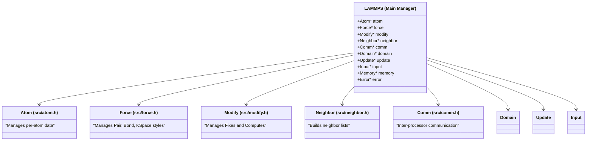
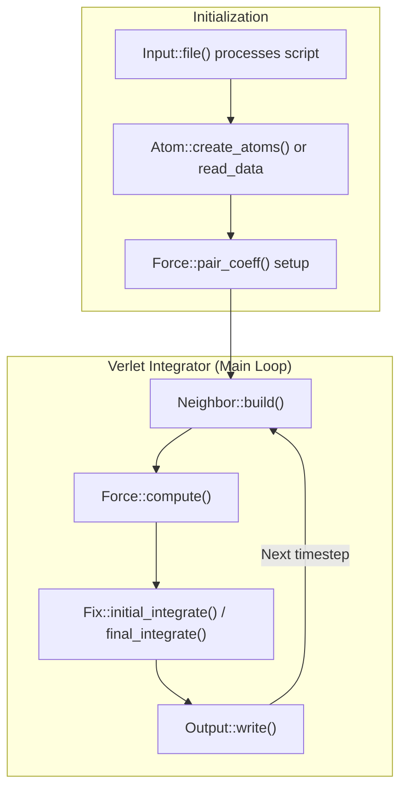

# LAMMPS Overview

Relevant source files

The following files were used as context for generating this wiki page:

- [bench/README](bench/README)
- [bench/data.chain](bench/data.chain)
- [bench/data.chute](bench/data.chute)
- [bench/data.rhodo](bench/data.rhodo)
- [bench/in.chain](bench/in.chain)
- [bench/in.chain.scaled](bench/in.chain.scaled)
- [bench/in.chute](bench/in.chute)
- [bench/in.chute.scaled](bench/in.chute.scaled)
- [bench/in.eam](bench/in.eam)
- [bench/in.lj](bench/in.lj)
- [bench/in.rhodo](bench/in.rhodo)
- [bench/in.rhodo.scaled](bench/in.rhodo.scaled)
- [cmake/.coveragerc.in](cmake/.coveragerc.in)
- [cmake/CMakeLists.txt](cmake/CMakeLists.txt)
- [cmake/LAMMPSConfig.cmake.in](cmake/LAMMPSConfig.cmake.in)
- [cmake/Modules/CodeCoverage.cmake](cmake/Modules/CodeCoverage.cmake)
- [cmake/Modules/Documentation.cmake](cmake/Modules/Documentation.cmake)
- [cmake/Modules/ExternalCMakeProject.cmake](cmake/Modules/ExternalCMakeProject.cmake)
- [cmake/Modules/FindCythonize.cmake](cmake/Modules/FindCythonize.cmake)
- [cmake/Modules/FindVORO.cmake](cmake/Modules/FindVORO.cmake)
- [cmake/Modules/LAMMPSInterfacePlugin.cmake](cmake/Modules/LAMMPSInterfacePlugin.cmake)
- [cmake/Modules/LAMMPSUtils.cmake](cmake/Modules/LAMMPSUtils.cmake)
- [cmake/Modules/MPI4WIN.cmake](cmake/Modules/MPI4WIN.cmake)
- [cmake/Modules/Packages/COLVARS.cmake](cmake/Modules/Packages/COLVARS.cmake)
- [cmake/Modules/Packages/GPU.cmake](cmake/Modules/Packages/GPU.cmake)
- [cmake/Modules/Packages/KIM.cmake](cmake/Modules/Packages/KIM.cmake)
- [cmake/Modules/Packages/KOKKOS.cmake](cmake/Modules/Packages/KOKKOS.cmake)
- [cmake/Modules/Packages/LEPTON.cmake](cmake/Modules/Packages/LEPTON.cmake)
- [cmake/Modules/Packages/MDI.cmake](cmake/Modules/Packages/MDI.cmake)
- [cmake/Modules/Packages/ML-HDNNP.cmake](cmake/Modules/Packages/ML-HDNNP.cmake)
- [cmake/Modules/Packages/ML-QUIP.cmake](cmake/Modules/Packages/ML-QUIP.cmake)
- [cmake/Modules/Packages/ML-RUNNER.cmake](cmake/Modules/Packages/ML-RUNNER.cmake)
- [cmake/Modules/Packages/PLUMED.cmake](cmake/Modules/Packages/PLUMED.cmake)
- [cmake/Modules/Packages/PYTHON.cmake](cmake/Modules/Packages/PYTHON.cmake)
- [cmake/Modules/Packages/SCAFACOS.cmake](cmake/Modules/Packages/SCAFACOS.cmake)
- [cmake/Modules/Packages/VORONOI.cmake](cmake/Modules/Packages/VORONOI.cmake)
- [cmake/Modules/StyleHeaderUtils.cmake](cmake/Modules/StyleHeaderUtils.cmake)
- [cmake/Modules/Testing.cmake](cmake/Modules/Testing.cmake)
- [cmake/patches/runner-cmake.patch](cmake/patches/runner-cmake.patch)
- [cmake/pkgconfig/liblammps.pc.in](cmake/pkgconfig/liblammps.pc.in)
- [cmake/presets/all_off.cmake](cmake/presets/all_off.cmake)
- [cmake/presets/all_on.cmake](cmake/presets/all_on.cmake)
- [cmake/presets/mingw-cross.cmake](cmake/presets/mingw-cross.cmake)
- [cmake/presets/most.cmake](cmake/presets/most.cmake)
- [cmake/presets/nolib.cmake](cmake/presets/nolib.cmake)
- [cmake/presets/windows.cmake](cmake/presets/windows.cmake)
- [doc/lammps.1](doc/lammps.1)
- [doc/src/Bibliography.rst](doc/src/Bibliography.rst)
- [doc/src/Build.rst](doc/src/Build.rst)
- [doc/src/Build_basics.rst](doc/src/Build_basics.rst)
- [doc/src/Build_cmake.rst](doc/src/Build_cmake.rst)
- [doc/src/Build_development.rst](doc/src/Build_development.rst)
- [doc/src/Build_extras.rst](doc/src/Build_extras.rst)
- [doc/src/Build_link.rst](doc/src/Build_link.rst)
- [doc/src/Build_make.rst](doc/src/Build_make.rst)
- [doc/src/Build_package.rst](doc/src/Build_package.rst)
- [doc/src/Build_prerequisites.rst](doc/src/Build_prerequisites.rst)
- [doc/src/Build_settings.rst](doc/src/Build_settings.rst)
- [doc/src/Commands_all.rst](doc/src/Commands_all.rst)
- [doc/src/Commands_bond.rst](doc/src/Commands_bond.rst)
- [doc/src/Commands_compute.rst](doc/src/Commands_compute.rst)
- [doc/src/Commands_dump.rst](doc/src/Commands_dump.rst)
- [doc/src/Commands_fix.rst](doc/src/Commands_fix.rst)
- [doc/src/Commands_kspace.rst](doc/src/Commands_kspace.rst)
- [doc/src/Commands_pair.rst](doc/src/Commands_pair.rst)
- [doc/src/Commands_removed.rst](doc/src/Commands_removed.rst)
- [doc/src/Developer.rst](doc/src/Developer.rst)
- [doc/src/Developer_plugins.rst](doc/src/Developer_plugins.rst)
- [doc/src/Developer_updating.rst](doc/src/Developer_updating.rst)
- [doc/src/Examples.rst](doc/src/Examples.rst)
- [doc/src/Howto_cmake.rst](doc/src/Howto_cmake.rst)
- [doc/src/Intro_portability.rst](doc/src/Intro_portability.rst)
- [doc/src/Packages.rst](doc/src/Packages.rst)
- [doc/src/Packages_details.rst](doc/src/Packages_details.rst)
- [doc/src/Run_basics.rst](doc/src/Run_basics.rst)
- [doc/src/Run_options.rst](doc/src/Run_options.rst)
- [doc/src/Run_windows.rst](doc/src/Run_windows.rst)
- [doc/src/Speed.rst](doc/src/Speed.rst)
- [doc/src/Speed_bench.rst](doc/src/Speed_bench.rst)
- [doc/src/Speed_gpu.rst](doc/src/Speed_gpu.rst)
- [doc/src/Speed_intel.rst](doc/src/Speed_intel.rst)
- [doc/src/Speed_kokkos.rst](doc/src/Speed_kokkos.rst)
- [doc/src/Speed_omp.rst](doc/src/Speed_omp.rst)
- [doc/src/Speed_opt.rst](doc/src/Speed_opt.rst)
- [doc/src/Speed_packages.rst](doc/src/Speed_packages.rst)
- [doc/src/bond_style.rst](doc/src/bond_style.rst)
- [doc/src/commands_list.rst](doc/src/commands_list.rst)
- [doc/src/compute.rst](doc/src/compute.rst)
- [doc/src/compute_composition_atom.rst](doc/src/compute_composition_atom.rst)
- [doc/src/compute_pod_atom.rst](doc/src/compute_pod_atom.rst)
- [doc/src/compute_voronoi_atom.rst](doc/src/compute_voronoi_atom.rst)
- [doc/src/fitpod_command.rst](doc/src/fitpod_command.rst)
- [doc/src/fix.rst](doc/src/fix.rst)
- [doc/src/fix_atc.rst](doc/src/fix_atc.rst)
- [doc/src/fix_ave_spatial.rst](doc/src/fix_ave_spatial.rst)
- [doc/src/fix_ave_spatial_sphere.rst](doc/src/fix_ave_spatial_sphere.rst)
- [doc/src/fix_deposit.rst](doc/src/fix_deposit.rst)
- [doc/src/fix_dpd_source.rst](doc/src/fix_dpd_source.rst)
- [doc/src/fix_ipi.rst](doc/src/fix_ipi.rst)
- [doc/src/fix_langevin.rst](doc/src/fix_langevin.rst)
- [doc/src/fix_numdiff.rst](doc/src/fix_numdiff.rst)
- [doc/src/fix_nve.rst](doc/src/fix_nve.rst)
- [doc/src/fix_pimd.rst](doc/src/fix_pimd.rst)
- [doc/src/fix_poems.rst](doc/src/fix_poems.rst)
- [doc/src/fix_pour.rst](doc/src/fix_pour.rst)
- [doc/src/kspace_style.rst](doc/src/kspace_style.rst)
- [doc/src/pair_mgpt.rst](doc/src/pair_mgpt.rst)
- [doc/src/pair_pod.rst](doc/src/pair_pod.rst)
- [doc/src/pair_runner.rst](doc/src/pair_runner.rst)
- [doc/src/pair_style.rst](doc/src/pair_style.rst)
- [doc/src/plugin.rst](doc/src/plugin.rst)
- [doc/src/read_restart.rst](doc/src/read_restart.rst)
- [doc/src/run_style.rst](doc/src/run_style.rst)
- [doc/src/units.rst](doc/src/units.rst)
- [doc/utils/sphinx-config/false_positives.txt](doc/utils/sphinx-config/false_positives.txt)
- [examples/PACKAGES/pod/Ta/in.pod.compute](examples/PACKAGES/pod/Ta/in.pod.compute)
- [examples/README](examples/README)
- [examples/numdiff/README.md](examples/numdiff/README.md)
- [examples/numdiff/in.numdiff](examples/numdiff/in.numdiff)
- [examples/plugins/LAMMPSInterfaceCXX.cmake](examples/plugins/LAMMPSInterfaceCXX.cmake)
- [src/.gitignore](src/.gitignore)
- [src/BOCS/compute_pressure_bocs.cpp](src/BOCS/compute_pressure_bocs.cpp)
- [src/Depend.sh](src/Depend.sh)
- [src/KOKKOS/Install.sh](src/KOKKOS/Install.sh)
- [src/MISC/fix_ipi.cpp](src/MISC/fix_ipi.cpp)
- [src/MISC/fix_ipi.h](src/MISC/fix_ipi.h)
- [src/ML-RUNNER/Install.sh](src/ML-RUNNER/Install.sh)
- [src/ML-RUNNER/pair_runner.cpp](src/ML-RUNNER/pair_runner.cpp)
- [src/ML-RUNNER/pair_runner.h](src/ML-RUNNER/pair_runner.h)
- [src/Make.sh](src/Make.sh)
- [src/Makefile](src/Makefile)
- [src/PLUGIN/plugin.cpp](src/PLUGIN/plugin.cpp)
- [src/PLUGIN/plugin.h](src/PLUGIN/plugin.h)
- [src/PLUMED/fix_plumed.cpp](src/PLUMED/fix_plumed.cpp)
- [src/Purge.list](src/Purge.list)
- [src/creator_registry.cpp](src/creator_registry.cpp)
- [src/version.h](src/version.h)
- [tools/i-pi/README.md](tools/i-pi/README.md)

LAMMPS (Large-scale Atomic/Molecular Massively Parallel Simulator) is a classical molecular dynamics simulation code designed to model ensembles of particles in liquid, solid, or gaseous states. This overview introduces the high-level architecture and core components of LAMMPS, providing a starting point for understanding how the code is organized and functions.

## Introduction

LAMMPS is a versatile molecular dynamics simulator with robust capabilities for simulating atomic, molecular, solid-state, and coarse-grained systems [doc/lammps.1:27-35](). It provides:

- A rich set of interatomic potentials for various materials [doc/src/Commands_pair.rst:6-9]().
- Support for a wide range of simulation techniques, including MD, minimization, and Monte Carlo [doc/src/Commands_fix.rst:6-8]().
- Extensive parallel computing capabilities via MPI and hardware acceleration [doc/src/Build_extras.rst:192-202]().
- A modular design with optional packages for specialized functionality [src/Makefile:62-130]().
- A command-driven interface through input scripts [doc/lammps.1:87-90]().

The code is designed to efficiently run on a single processor or in parallel using message-passing techniques and a spatial-decomposition of the simulation domain.

Sources: [doc/lammps.1:27-37](), [src/version.h:1-2](), [src/Makefile:62-130]()

## System Architecture

LAMMPS follows an object-oriented design with a modular architecture. The code consists of a core set of classes that manage different aspects of the simulation, along with optional packages that extend functionality.

### Core Architecture Overview

The `LAMMPS` class is the central simulation manager, containing pointers to all the fundamental components of the simulation. It creates, initializes, and coordinates these components throughout the simulation lifecycle.

Sources: [src/Makefile:27-32](), [src/.gitignore:8-12](), [doc/src/Packages_details.rst:11-17]()

### Simulation Data Flow

This diagram shows the basic data flow in a LAMMPS simulation, from initialization through the main timestep loop managed by the integrator.

Sources: [doc/lammps.1:6-25](), [src/Makefile:27-32]()

## Core Subsystems

### Command-line Interface (CLI)
LAMMPS is primarily controlled via a command-line interface where users provide an input script. The executable (often named `lmp` or `lmp_<machine>`) accepts various flags to control MPI partitioning, hardware acceleration (e.g., `-k on` for Kokkos), and logging.

For details, see [Command-line Interface](#1.1).

Sources: [doc/lammps.1:7-25](), [doc/lammps.1:64-187]()

### Package System
Functionality in LAMMPS is modular. While the core provides basic MD capabilities, most specific force fields (like `REAXFF` or `AMOEBA`) and hardware optimizations (like `GPU` or `KOKKOS`) are contained in packages. These must be enabled at build time.

For details, see [Package System](#1.2).

Sources: [src/Makefile:62-130](), [doc/src/Packages_details.rst:4-17]()

### Build System
LAMMPS supports two build systems: a modern **CMake** workflow (recommended) and a legacy **Make** workflow. The build system manages dependencies, compiler optimizations, and the selection of packages to include in the final executable.

For details, see [Build System](#1.3).

Sources: [cmake/CMakeLists.txt:5-34](), [src/Makefile:1-20](), [doc/src/Build_extras.rst:1-32]()

## Core Components

### Force Calculation System
The `Force` class manages interatomic interactions. It is subdivided into:
- **Pair Styles**: Non-bonded interactions (e.g., Lennard-Jones, EAM).
- **Bond/Angle/Dihedral/Improper Styles**: Molecular topology interactions.
- **KSpace Styles**: Long-range solvers (e.g., PPPM, Ewald).

Sources: [doc/src/Commands_pair.rst:4-21](), [doc/src/Commands_bond.rst:1-10]()

### Modify System: Fixes and Computes
The `Modify` class manages extensions that occur during the simulation loop:
- **Fixes**: Operations that change atom properties (e.g., `fix nvt` for thermostats, `fix wall`).
- **Computes**: Operations that calculate quantities (e.g., `compute temp`, `compute pressure`).

Sources: [doc/src/Commands_fix.rst:3-10](), [doc/src/Commands_compute.rst:1-10]()

### Parallel Computation and Acceleration
LAMMPS uses spatial domain decomposition for MPI parallelism. For node-level acceleration, it leverages:
- **KOKKOS**: Performance portability for GPUs and many-core CPUs [cmake/Modules/Packages/KOKKOS.cmake:1-24]().
- **GPU**: Offloading pair styles to CUDA/OpenCL/HIP [doc/src/Build_extras.rst:192-202]().
- **OPENMP**: Thread-level parallelism.

Sources: [src/KOKKOS/Install.sh:18-33](), [cmake/Modules/Packages/KOKKOS.cmake:1-24](), [doc/src/Build_extras.rst:192-202]()

## Summary of Major Subsystems

| Subsystem | Primary Class/File | Purpose |
| :--- | :--- | :--- |
| **Integrator** | `Update` / `Verlet` | Manages the time-stepping loop. |
| **Atoms** | `Atom` | Stores coordinates, velocities, and types. |
| **Communication** | `Comm` | Manages MPI ghost atom exchanges. |
| **Input** | `Input` | Parses the input script commands. |
| **Output** | `Output` | Manages screen, log, and dump file output. |

Sources: [src/Makefile:27-32](), [doc/lammps.1:27-35]()

---