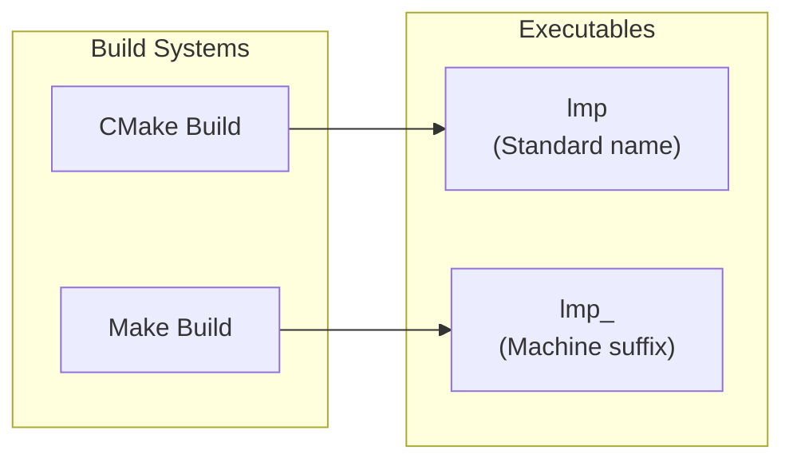
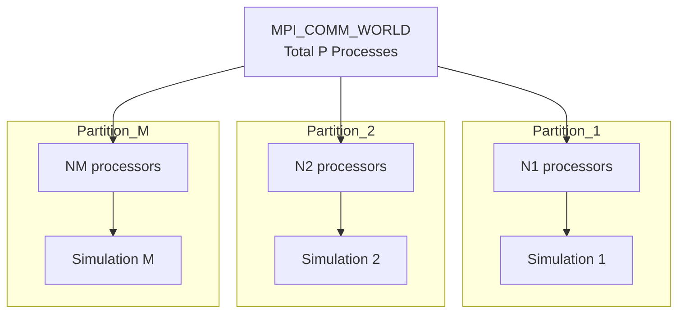
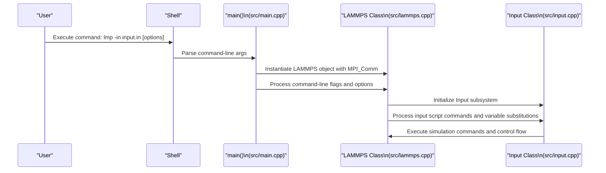
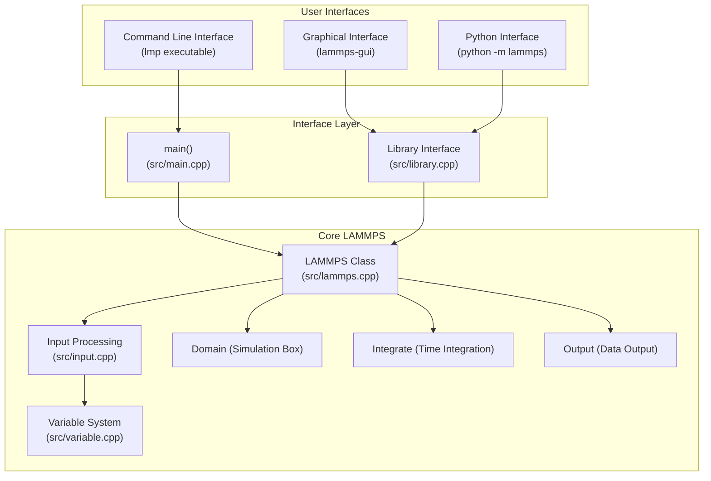

# Command-line Interface

<details>
<summary>Relevant source files</summary>

The following files were used as context for generating this wiki page:

- [cmake/.coveragerc.in](cmake/.coveragerc.in)
- [cmake/Modules/CodeCoverage.cmake](cmake/Modules/CodeCoverage.cmake)
- [cmake/Modules/ExternalCMakeProject.cmake](cmake/Modules/ExternalCMakeProject.cmake)
- [cmake/Modules/Packages/MDI.cmake](cmake/Modules/Packages/MDI.cmake)
- [cmake/Modules/Packages/ML-HDNNP.cmake](cmake/Modules/Packages/ML-HDNNP.cmake)
- [cmake/Modules/Packages/ML-QUIP.cmake](cmake/Modules/Packages/ML-QUIP.cmake)
- [cmake/Modules/Packages/ML-RUNNER.cmake](cmake/Modules/Packages/ML-RUNNER.cmake)
- [cmake/Modules/Packages/PLUMED.cmake](cmake/Modules/Packages/PLUMED.cmake)
- [cmake/Modules/Packages/SCAFACOS.cmake](cmake/Modules/Packages/SCAFACOS.cmake)
- [cmake/patches/runner-cmake.patch](cmake/patches/runner-cmake.patch)
- [doc/lammps.1](doc/lammps.1)
- [doc/src/Commands_removed.rst](doc/src/Commands_removed.rst)
- [doc/src/Intro_portability.rst](doc/src/Intro_portability.rst)
- [doc/src/Run_basics.rst](doc/src/Run_basics.rst)
- [doc/src/Run_options.rst](doc/src/Run_options.rst)
- [doc/src/compute_composition_atom.rst](doc/src/compute_composition_atom.rst)
- [doc/src/compute_voronoi_atom.rst](doc/src/compute_voronoi_atom.rst)
- [doc/src/fix_atc.rst](doc/src/fix_atc.rst)
- [doc/src/fix_ave_spatial.rst](doc/src/fix_ave_spatial.rst)
- [doc/src/fix_ave_spatial_sphere.rst](doc/src/fix_ave_spatial_sphere.rst)
- [doc/src/fix_deposit.rst](doc/src/fix_deposit.rst)
- [doc/src/fix_dpd_source.rst](doc/src/fix_dpd_source.rst)
- [doc/src/fix_ipi.rst](doc/src/fix_ipi.rst)
- [doc/src/fix_langevin.rst](doc/src/fix_langevin.rst)
- [doc/src/fix_pimd.rst](doc/src/fix_pimd.rst)
- [doc/src/fix_poems.rst](doc/src/fix_poems.rst)
- [doc/src/fix_pour.rst](doc/src/fix_pour.rst)
- [doc/src/pair_mgpt.rst](doc/src/pair_mgpt.rst)
- [doc/src/pair_runner.rst](doc/src/pair_runner.rst)
- [doc/src/read_restart.rst](doc/src/read_restart.rst)
- [src/BOCS/compute_pressure_bocs.cpp](src/BOCS/compute_pressure_bocs.cpp)
- [src/MISC/fix_ipi.cpp](src/MISC/fix_ipi.cpp)
- [src/MISC/fix_ipi.h](src/MISC/fix_ipi.h)
- [src/ML-RUNNER/Install.sh](src/ML-RUNNER/Install.sh)
- [src/ML-RUNNER/pair_runner.cpp](src/ML-RUNNER/pair_runner.cpp)
- [src/ML-RUNNER/pair_runner.h](src/ML-RUNNER/pair_runner.h)
- [src/PLUMED/fix_plumed.cpp](src/PLUMED/fix_plumed.cpp)
- [src/fix.cpp](src/fix.cpp)
- [src/fix.h](src/fix.h)
- [src/force.cpp](src/force.cpp)
- [src/force.h](src/force.h)
- [src/info.cpp](src/info.cpp)
- [src/info.h](src/info.h)
- [src/input.cpp](src/input.cpp)
- [src/input.h](src/input.h)
- [src/lammps.cpp](src/lammps.cpp)
- [src/lammps.h](src/lammps.h)
- [src/modify.cpp](src/modify.cpp)
- [src/modify.h](src/modify.h)
- [src/output.cpp](src/output.cpp)
- [src/output.h](src/output.h)
- [src/universe.cpp](src/universe.cpp)
- [src/universe.h](src/universe.h)
- [src/update.cpp](src/update.cpp)
- [src/update.h](src/update.h)
- [src/version.h](src/version.h)
- [src/write_coeff.cpp](src/write_coeff.cpp)
- [src/write_dump.cpp](src/write_dump.cpp)
- [tools/i-pi/README.md](tools/i-pi/README.md)

</details>


This page documents the LAMMPS command-line interface, including the executable names, command-line options, and basic usage patterns. It covers the multi-partition mode, restart conversion flags, and MDI interaction relevant to command-line usage.

## Overview

The LAMMPS command-line interface enables users to execute molecular dynamics simulations and auxiliary operations from a terminal or batch processing scripts. It supports specifying input scripts, controlling output behavior, configuring parallelism, accelerator options, and specialized utilities such as file format conversions and MDI integration.

Sources: [doc/lammps.1:6-25]()

## Executable Names

The executable name for LAMMPS can vary by the build method and system architecture:

- **Standard name:** `lmp` (common and default with CMake builds)
- **Machine-specific suffix:** `lmp_<machine name>`, used with legacy Make builds

Here, `<machine name>` designates the machine or architecture-specific build. CMake builds generally produce a simple `lmp` binary, while Make builds often create multiple binaries with names reflecting target environments.



Sources: [doc/lammps.1:39-59]()

## Basic Command Syntax

LAMMPS is typically invoked in one of these forms:

1. **Standard simulation run (single or MPI parallel)**:
```
lmp -in <input file> [OPTIONS]
```
or (MPI-run)
```
mpirun -np <num_procs> lmp -in <input file> [OPTIONS]
```

2. **Restart file to data file conversion**:
```
lmp -r2data file.restart file.data [remap] [options]
```

3. **Help output**:
```
lmp -h
```

4. **Other special utilities** like restart to dump conversion or restart file info.

Sources: [doc/lammps.1:6-25]()

## Command-line Options

LAMMPS supports numerous command-line options to control execution. These options fall into several categories:

```mermaid
flowchart TD
    subgraph "LAMMPS Command-line Options"
        Input["Input & Script Controls"]
        Output["Output & Logging Controls"]
        Parallel["Parallel & Partitioning Controls"]
        Accel["Acceleration & Package Controls"]
        Special["Special & Utility Operations"]
    end
    
    Input --> in["-in <file>\nInput script"]
    Input --> echo["-echo style\nCommand echoing (none/screen/log/both)"]
    Input --> var["-var name value(s)\nSet variable(s)"]
    
    Output --> log["-log <file>\nLog file, default 'log.lammps'"]
    Output --> screen["-screen <file>\nScreen output redirect"]
    Output --> cite["-cite <style or filename>\nCitation info output"]
    Output --> nocite["-nocite\nDisable citation file output"]
    
    Parallel --> partition["-partition M N ...\nMulti-partition mode"]
    Parallel --> plog["-plog <basename>\nPer-partition log files base"]
    Parallel --> pscreen["-pscreen <basename>\nPer-partition screen base"]
    Parallel --> mpicolor["-mpicolor <number>\nMPI_Comm_split color (client/server mode)"]
    
    Accel --> kokkos["-kokkos on/off [options]\nControl KOKKOS acceleration"]
    Accel --> package["-package <style> [options]\nConfigure packages"]
    Accel --> suffix["-suffix <suffix>\nUse style suffix variants"]
    
    Special --> help["-h or -help\nPrint help and styles info"]
    Special --> r2data["-r2data <restart> <data> [flags]\nConvert restart to data"]
    Special --> r2dump["-r2dump <restart> <dump> [flags]\nConvert restart to dump"]
    Special --> r2info["-r2info <restart> [keywords]\nInfo on restart file"]
    Special --> skiprun["-skiprun\nSkip run commands while processing"]
    Special --> mdi["-mdi '<mdi_flags>'\nMDI interface flags (when MDI package enabled)"]
```



Sources: [doc/lammps.1:61-278]()

### Input & Script Controls

| Option        | Description                               |
|---------------|-------------------------------------------|
| `-in <file>`  | Specify the LAMMPS input script (required) |
| `-echo <style>` | Control how commands from input script are echoed (`none`, `screen`, `log`, `both`) |
| `-var <name> <values>` | Define variables usable inside input script |

Sources: [doc/lammps.1:72-90]()

### Output & Logging Controls

| Option        | Description                                      |
|---------------|------------------------------------------------|
| `-log <file>` | Specify the log file output (default `log.lammps`) |
| `-screen <file>` | Redirect screen output to a file instead of console |
| `-cite <style or filename>` | Control citation message style and destination (`screen`, `log`, `both`, or filename) |
| `-nocite`     | Suppress the creation of the `log.cite` citation file |

Sources: [doc/lammps.1:99-106](), [doc/lammps.1:137-161]()

### Parallel & Partitioning Controls

| Option        | Description                                      |
|---------------|------------------------------------------------|
| `-partition M N ...` | Run in multi-partition mode, dividing processors into partitions (see below) |
| `-plog <basename>` | Base name for log files in multi-partition mode (partition logs will have suffixes) |
| `-pscreen <basename>` | Base name for screen output files in multi-partition mode |
| `-mpicolor <number>` | Specify the color for MPI_Comm_split in hybrid client/server multi-app mode |

The `-mpicolor` flag must be the first command-line argument after the executable name when LAMMPS shares MPI_COMM_WORLD with other applications and needs to split communicators among them.

Sources: [doc/lammps.1:108-124](), [doc/lammps.1:175-196]()

### Acceleration & Package Controls

| Option        | Description                                     |
|---------------|------------------------------------------------|
| `-kokkos on/off [keywords]` | Enable or disable KOKKOS acceleration and pass additional options (e.g., device types) |
| `-package <style> [options]` | Invoke the `package` command style inline at startup to configure accelerator packages |
| `-suffix <style_suffix>` | Enable style suffix for using accelerated or variant styles (e.g., `-suffix kk` for Kokkos) |

Sources: [doc/lammps.1:92-97](), [doc/lammps.1:163-173](), [doc/lammps.1:255-266]()

### Special & Utility Operations

| Option        | Description                                     |
|---------------|------------------------------------------------|
| `-h` or `-help` | Print help message with available styles and settings, then exit |
| `-r2data <restart> <data> [flags]` | Convert a restart file to a data file; exits after completion |
| `-r2dump <restart> <dump> [flags]` | Convert a restart file to a dump file; exits after completion |
| `-r2info <restart> [keywords]` | Output restart file information; exits after completion |
| `-skiprun`     | Skip execution of any `run` commands while processing input script |
| `-mdi '<mdi_flags>'` | Pass flags controlling MolSSI Driver Interface (MDI) behavior; enabled only if MDI package is built |

Sources: [doc/lammps.1:64-70](), [doc/lammps.1:204-240](), [doc/lammps.1:267-278](), [doc/lammps.1:125-136]()

## Multi-partition Mode

LAMMPS can run multiple independent simulations simultaneously on subsets ("partitions") of the available MPI processors. Use the `-partition` flag to specify the number and sizes of these partitions.

### Syntax

```
-partition MxN P Q ...
```

- `MxN` means `M` partitions each with `N` processors
- Numbers alone indicate single partitions of that size
- The sum of processors allocated across all partitions must equal the total number of MPI tasks launched

### Example

Run 10 partitions: 2 partitions with 8 processors each, plus partitions of 4 and 5 processors:

```
mpirun -np 25 lmp -partition 2x8 4 5 -in input.script
```

### Architecture Conceptual Diagram



In multi-partition mode, each partition independently runs a full LAMMPS simulation instance with its own input script. This mode is essential for replica-exchange or multi-replica workflows.

Sources: [doc/lammps.1:175-196](), [src/lammps.cpp:104-194]()

## Restart Conversion Flags

LAMMPS provides built-in flags to convert restart files (`.restart`) into other formats from the command line. These operations are performed immediately and cause LAMMPS to exit after completion.

- **Restart to Data File** (`-r2data`):
  ```
  lmp -r2data file.restart file.data [remap] [options]
  ```
  
- **Restart to Dump File** (`-r2dump`):
  ```
  lmp -r2dump file.restart file.dump [remap] [options]
  ```

- **Restart File Info** (`-r2info`):
  ```
  lmp -r2info file.restart [keyword...]
  ```

These options replace obsolete standalone conversion tools like `restart2data`, which have been removed.

Sources: [doc/lammps.1:204-240](), [doc/src/Commands_removed.rst:197-208]()

## MDI Interface Flag

When LAMMPS is built with the MDI (MolSSI Driver Interface) package, the `-mdi` command-line flag can be used to pass MDI-specific interaction settings in client/server coupling modes.

Example:

```
lmp -mdi "flags for mdi" -in input.mdi
```

Detailed MDI usage is described on the LAMMPS MDI HowTo page. This flag controls how LAMMPS acts as an MDI engine or client.

Sources: [doc/lammps.1:125-136](), [src/lammps.cpp:119-194]()

## Command Processing Flow in LAMMPS

The command-line interface integrates with LAMMPS core classes as follows:



- The `LAMMPS` class constructor parses command-line flags and sets up necessary subsystems.
- The `Input` class handles reading, pre-processing, parsing, and dispatching commands from the input script.
- Command-line options can affect logging, echo, multi-partition setup, accelerator packages, and special utility modes.

Sources: [doc/lammps.1:282-311](), [src/lammps.cpp:104-194](), [src/input.cpp:110-162]()

## Command-line Interface in LAMMPS Architecture

The command-line interface is one of multiple user interfaces to LAMMPS, alongside the Python and GUI interfaces. The system structure is as follows:



This layered structure allows multiple access modes with shared core components.

Sources: [doc/lammps.1:27-37](), [src/lammps.cpp:86-151](), [src/input.cpp:79-162]()

## Version Information

The LAMMPS version is shown with `-h` option and program startup. The current version as per this documentation is:

```
LAMMPS Version: 4 Jul 2026 Development (Git info appended if available)
```

Sources: [src/version.h:1-2](), [src/lammps.cpp:129-146]()

---

This completes the detailed documentation of the LAMMPS command-line interface, covering the executable names, command-line options, multi-partition mode, restart conversion flags, and MDI interaction integration.

# References

- LAMMPS Manual Page: `doc/lammps.1`
- LAMMPS Core Code: `src/lammps.cpp:86-194`  
- Input Processing: `src/input.cpp:79-162`  
- Version Definition: `src/version.h:1-2`

Sources: [doc/lammps.1](), [src/lammps.cpp:86-194](), [src/input.cpp:79-162](), [src/version.h:1-2]()

---