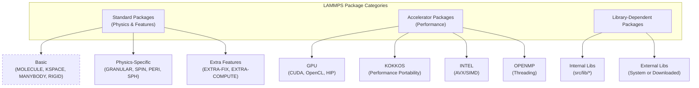
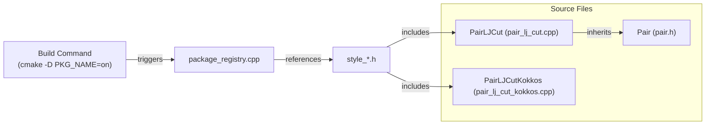
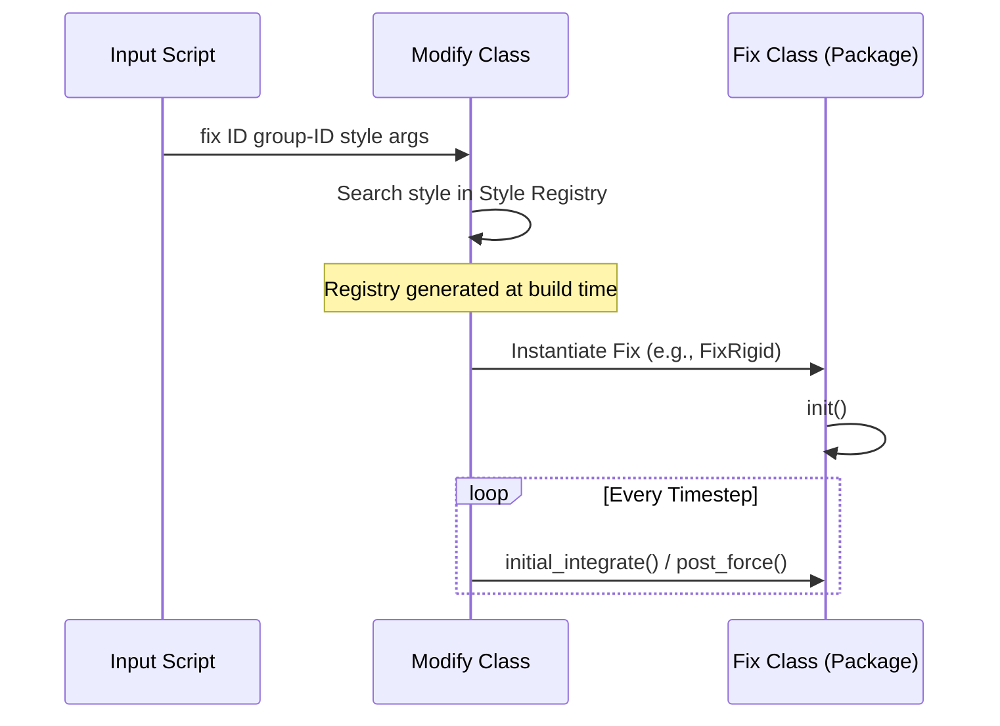

# Package System

Relevant source files

The following files were used as context for generating this wiki page:

- [cmake/CMakeLists.txt](cmake/CMakeLists.txt)
- [cmake/LAMMPSConfig.cmake.in](cmake/LAMMPSConfig.cmake.in)
- [cmake/Modules/Documentation.cmake](cmake/Modules/Documentation.cmake)
- [cmake/Modules/FindCythonize.cmake](cmake/Modules/FindCythonize.cmake)
- [cmake/Modules/FindVORO.cmake](cmake/Modules/FindVORO.cmake)
- [cmake/Modules/LAMMPSInterfacePlugin.cmake](cmake/Modules/LAMMPSInterfacePlugin.cmake)
- [cmake/Modules/LAMMPSUtils.cmake](cmake/Modules/LAMMPSUtils.cmake)
- [cmake/Modules/MPI4WIN.cmake](cmake/Modules/MPI4WIN.cmake)
- [cmake/Modules/Packages/COLVARS.cmake](cmake/Modules/Packages/COLVARS.cmake)
- [cmake/Modules/Packages/GPU.cmake](cmake/Modules/Packages/GPU.cmake)
- [cmake/Modules/Packages/KIM.cmake](cmake/Modules/Packages/KIM.cmake)
- [cmake/Modules/Packages/KOKKOS.cmake](cmake/Modules/Packages/KOKKOS.cmake)
- [cmake/Modules/Packages/LEPTON.cmake](cmake/Modules/Packages/LEPTON.cmake)
- [cmake/Modules/Packages/PYTHON.cmake](cmake/Modules/Packages/PYTHON.cmake)
- [cmake/Modules/Packages/VORONOI.cmake](cmake/Modules/Packages/VORONOI.cmake)
- [cmake/Modules/StyleHeaderUtils.cmake](cmake/Modules/StyleHeaderUtils.cmake)
- [cmake/Modules/Testing.cmake](cmake/Modules/Testing.cmake)
- [cmake/pkgconfig/liblammps.pc.in](cmake/pkgconfig/liblammps.pc.in)
- [cmake/presets/all_off.cmake](cmake/presets/all_off.cmake)
- [cmake/presets/all_on.cmake](cmake/presets/all_on.cmake)
- [cmake/presets/mingw-cross.cmake](cmake/presets/mingw-cross.cmake)
- [cmake/presets/most.cmake](cmake/presets/most.cmake)
- [cmake/presets/nolib.cmake](cmake/presets/nolib.cmake)
- [cmake/presets/windows.cmake](cmake/presets/windows.cmake)
- [doc/src/Bibliography.rst](doc/src/Bibliography.rst)
- [doc/src/Build.rst](doc/src/Build.rst)
- [doc/src/Build_basics.rst](doc/src/Build_basics.rst)
- [doc/src/Build_cmake.rst](doc/src/Build_cmake.rst)
- [doc/src/Build_development.rst](doc/src/Build_development.rst)
- [doc/src/Build_extras.rst](doc/src/Build_extras.rst)
- [doc/src/Build_link.rst](doc/src/Build_link.rst)
- [doc/src/Build_make.rst](doc/src/Build_make.rst)
- [doc/src/Build_package.rst](doc/src/Build_package.rst)
- [doc/src/Build_prerequisites.rst](doc/src/Build_prerequisites.rst)
- [doc/src/Build_settings.rst](doc/src/Build_settings.rst)
- [doc/src/Commands_all.rst](doc/src/Commands_all.rst)
- [doc/src/Commands_bond.rst](doc/src/Commands_bond.rst)
- [doc/src/Commands_compute.rst](doc/src/Commands_compute.rst)
- [doc/src/Commands_dump.rst](doc/src/Commands_dump.rst)
- [doc/src/Commands_fix.rst](doc/src/Commands_fix.rst)
- [doc/src/Commands_kspace.rst](doc/src/Commands_kspace.rst)
- [doc/src/Commands_pair.rst](doc/src/Commands_pair.rst)
- [doc/src/Developer.rst](doc/src/Developer.rst)
- [doc/src/Developer_plugins.rst](doc/src/Developer_plugins.rst)
- [doc/src/Developer_updating.rst](doc/src/Developer_updating.rst)
- [doc/src/Howto_cmake.rst](doc/src/Howto_cmake.rst)
- [doc/src/Packages.rst](doc/src/Packages.rst)
- [doc/src/Packages_details.rst](doc/src/Packages_details.rst)
- [doc/src/bond_style.rst](doc/src/bond_style.rst)
- [doc/src/commands_list.rst](doc/src/commands_list.rst)
- [doc/src/compute.rst](doc/src/compute.rst)
- [doc/src/compute_pod_atom.rst](doc/src/compute_pod_atom.rst)
- [doc/src/fitpod_command.rst](doc/src/fitpod_command.rst)
- [doc/src/fix.rst](doc/src/fix.rst)
- [doc/src/fix_nve.rst](doc/src/fix_nve.rst)
- [doc/src/kspace_style.rst](doc/src/kspace_style.rst)
- [doc/src/package.rst](doc/src/package.rst)
- [doc/src/pair_pod.rst](doc/src/pair_pod.rst)
- [doc/src/pair_style.rst](doc/src/pair_style.rst)
- [doc/src/plugin.rst](doc/src/plugin.rst)
- [doc/src/run_style.rst](doc/src/run_style.rst)
- [doc/src/units.rst](doc/src/units.rst)
- [doc/utils/sphinx-config/false_positives.txt](doc/utils/sphinx-config/false_positives.txt)
- [examples/PACKAGES/pod/Ta/in.pod.compute](examples/PACKAGES/pod/Ta/in.pod.compute)
- [examples/plugins/LAMMPSInterfaceCXX.cmake](examples/plugins/LAMMPSInterfaceCXX.cmake)
- [src/.gitignore](src/.gitignore)
- [src/Depend.sh](src/Depend.sh)
- [src/KOKKOS/Install.sh](src/KOKKOS/Install.sh)
- [src/KOKKOS/angle_charmm_kokkos.cpp](src/KOKKOS/angle_charmm_kokkos.cpp)
- [src/KOKKOS/angle_charmm_kokkos.h](src/KOKKOS/angle_charmm_kokkos.h)
- [src/KOKKOS/angle_class2_kokkos.cpp](src/KOKKOS/angle_class2_kokkos.cpp)
- [src/KOKKOS/angle_class2_kokkos.h](src/KOKKOS/angle_class2_kokkos.h)
- [src/KOKKOS/angle_cosine_kokkos.cpp](src/KOKKOS/angle_cosine_kokkos.cpp)
- [src/KOKKOS/angle_harmonic_kokkos.cpp](src/KOKKOS/angle_harmonic_kokkos.cpp)
- [src/KOKKOS/angle_harmonic_kokkos.h](src/KOKKOS/angle_harmonic_kokkos.h)
- [src/KOKKOS/angle_spica_kokkos.cpp](src/KOKKOS/angle_spica_kokkos.cpp)
- [src/KOKKOS/angle_spica_kokkos.h](src/KOKKOS/angle_spica_kokkos.h)
- [src/KOKKOS/bond_class2_kokkos.cpp](src/KOKKOS/bond_class2_kokkos.cpp)
- [src/KOKKOS/bond_class2_kokkos.h](src/KOKKOS/bond_class2_kokkos.h)
- [src/KOKKOS/bond_fene_kokkos.cpp](src/KOKKOS/bond_fene_kokkos.cpp)
- [src/KOKKOS/bond_fene_kokkos.h](src/KOKKOS/bond_fene_kokkos.h)
- [src/KOKKOS/bond_harmonic_kokkos.cpp](src/KOKKOS/bond_harmonic_kokkos.cpp)
- [src/KOKKOS/bond_harmonic_kokkos.h](src/KOKKOS/bond_harmonic_kokkos.h)
- [src/KOKKOS/dihedral_charmm_kokkos.cpp](src/KOKKOS/dihedral_charmm_kokkos.cpp)
- [src/KOKKOS/dihedral_charmm_kokkos.h](src/KOKKOS/dihedral_charmm_kokkos.h)
- [src/KOKKOS/dihedral_charmmfsw_kokkos.cpp](src/KOKKOS/dihedral_charmmfsw_kokkos.cpp)
- [src/KOKKOS/dihedral_charmmfsw_kokkos.h](src/KOKKOS/dihedral_charmmfsw_kokkos.h)
- [src/KOKKOS/dihedral_class2_kokkos.cpp](src/KOKKOS/dihedral_class2_kokkos.cpp)
- [src/KOKKOS/dihedral_class2_kokkos.h](src/KOKKOS/dihedral_class2_kokkos.h)
- [src/KOKKOS/dihedral_harmonic_kokkos.cpp](src/KOKKOS/dihedral_harmonic_kokkos.cpp)
- [src/KOKKOS/dihedral_opls_kokkos.cpp](src/KOKKOS/dihedral_opls_kokkos.cpp)
- [src/KOKKOS/dihedral_opls_kokkos.h](src/KOKKOS/dihedral_opls_kokkos.h)
- [src/KOKKOS/improper_class2_kokkos.cpp](src/KOKKOS/improper_class2_kokkos.cpp)
- [src/KOKKOS/improper_class2_kokkos.h](src/KOKKOS/improper_class2_kokkos.h)
- [src/KOKKOS/improper_harmonic_kokkos.cpp](src/KOKKOS/improper_harmonic_kokkos.cpp)
- [src/KOKKOS/improper_harmonic_kokkos.h](src/KOKKOS/improper_harmonic_kokkos.h)
- [src/KOKKOS/pair_lj_charmmfsw_coul_long_kokkos.cpp](src/KOKKOS/pair_lj_charmmfsw_coul_long_kokkos.cpp)
- [src/KOKKOS/pair_lj_charmmfsw_coul_long_kokkos.h](src/KOKKOS/pair_lj_charmmfsw_coul_long_kokkos.h)
- [src/KOKKOS/pair_lj_spica_coul_long_kokkos.cpp](src/KOKKOS/pair_lj_spica_coul_long_kokkos.cpp)
- [src/KOKKOS/pair_lj_spica_coul_long_kokkos.h](src/KOKKOS/pair_lj_spica_coul_long_kokkos.h)
- [src/KOKKOS/pair_lj_spica_kokkos.cpp](src/KOKKOS/pair_lj_spica_kokkos.cpp)
- [src/KOKKOS/pair_lj_spica_kokkos.h](src/KOKKOS/pair_lj_spica_kokkos.h)
- [src/KOKKOS/tune_kokkos.cpp](src/KOKKOS/tune_kokkos.cpp)
- [src/KOKKOS/tune_kokkos.h](src/KOKKOS/tune_kokkos.h)
- [src/Make.sh](src/Make.sh)
- [src/Makefile](src/Makefile)
- [src/PLUGIN/plugin.cpp](src/PLUGIN/plugin.cpp)
- [src/PLUGIN/plugin.h](src/PLUGIN/plugin.h)
- [src/Purge.list](src/Purge.list)
- [src/creator_registry.cpp](src/creator_registry.cpp)

The LAMMPS Package System is a modular architecture that enables functional components to be selectively included in or excluded from a LAMMPS build. Packages extend LAMMPS capabilities by providing additional commands, atom styles, pair potentials, fixes, computes, and other features. This modularity allows users to minimize the executable size and dependency requirements by only including necessary features.

## Package Organization

LAMMPS packages are categorized based on their purpose and dependency requirements.

Sources: [src/Makefile:51-130](), [src/Makefile:135-135](), [src/Makefile:200-207]()

### Package Categories
*   **Standard Packages**: These provide core MD functionality, such as `MOLECULE` for molecular systems [src/Makefile:63-63](), `KSPACE` for long-range solvers [src/Makefile:64-64](), and `GRANULAR` for particle-based mechanics [src/Makefile:93-93]().
*   **Accelerator Packages**: These provide optimized versions of existing styles. For example, `PKG_KOKKOS` enables performance portability across CPUs and GPUs [cmake/Modules/Packages/KOKKOS.cmake:1-6](), and `PKG_GPU` provides specialized kernels for CUDA, OpenCL, and HIP [cmake/Modules/Packages/GPU.cmake:16-20]().
*   **Library Packages**: Packages like `ADIOS` [src/Makefile:65-65]() or `KIM` [doc/src/Build_extras.rst:48-48]() require linking against external libraries.

## Build System Integration

The package system is managed through two primary build interfaces: CMake (preferred) and legacy GNU Make.

### Entity Mapping: Build to Code

The following diagram maps build-time commands to the internal file structures they manipulate.

Sources: [src/Makefile:23-32](), [src/.gitignore:8-11](), [src/KOKKOS/Install.sh:1-4]()

### CMake Configuration
In CMake, packages are enabled using the `PKG_<NAME>` variable. 
*   **Command**: `cmake -D PKG_MOLECULE=yes -D PKG_KOKKOS=yes ../cmake` [doc/src/Build_extras.rst:17-17]()
*   **Implementation**: CMake scripts in `cmake/Modules/Packages/` handle the logic for each package, such as setting compile definitions like `-DLMP_KOKKOS` [cmake/Modules/Packages/KOKKOS.cmake:147-147]() or `-DLMP_GPU` [cmake/Modules/Packages/GPU.cmake:14-14]().

### Legacy Make Configuration
The traditional make system uses shell scripts to copy files into the `src` directory.
*   **Commands**: `make yes-<name>` to install and `make no-<name>` to remove [src/Makefile:232-233]().
*   **Mechanism**: The `Make.sh` and `Install.sh` scripts manage the physical presence of source files in the `src` folder [src/KOKKOS/Install.sh:1-4]().

## Major Package Categories

### 1. Accelerator Packages (GPU, KOKKOS, INTEL)
These packages do not add new commands but provide optimized versions of existing ones. When enabled, they use a suffix system (e.g., `/gpu`, `/kk`, `/omp`) to dispatch calls to optimized kernels [doc/src/Commands_pair.rst:6-9]().

*   **KOKKOS**: Requires C++20 and uses a performance portability layer to target CUDA, HIP, or OpenMP [cmake/Modules/Packages/KOKKOS.cmake:1-6](). It introduces `atom_kokkos.h` and specialized communication `comm_kokkos.cpp` [src/KOKKOS/Install.sh:49-50](), [src/KOKKOS/Install.sh:88-88]().
*   **GPU**: Supports OpenCL, CUDA, and HIP backends [cmake/Modules/Packages/GPU.cmake:16-16](). It relies on a specialized library in `lib/gpu` [cmake/Modules/Packages/GPU.cmake:49-49]().

### 2. Physics & Model Packages
*   **MOLECULE**: Adds support for bonds, angles, dihedrals, and impropers [src/Makefile:63-63]().
*   **GRANULAR**: Implements models for granular flow, including history-dependent contact forces [src/Makefile:93-93]().
*   **ML (Machine Learning)**: Includes `ML-SNAP`, `ML-POD`, and `ML-IAP` for interatomic potentials derived from machine learning [src/Makefile:105-107](), [src/Makefile:129-129]().

### 3. Interface Packages
*   **PYTHON**: Enables the Python wrapper and `fix python` commands [doc/src/Build_extras.rst:66-66]().
*   **KIM**: Provides an interface to the OpenKIM repository of interatomic potentials [doc/src/Build_extras.rst:48-48]().
*   **MDI**: Implements the MolSSI Driver Interface for code coupling (e.g., QM/MM) [src/.gitignore:37-50]().

## Implementation Details

### Style Registration
LAMMPS uses a registration macro system. When a package is enabled, its source files are included in the build. Each style (e.g., `PairLJCut`) uses a macro that adds it to a factory class. During compilation, the build system generates `style_*.h` files (e.g., `style_pair.h`) which contain a list of all enabled styles of that type [src/Makefile:27-32]().

### Data Flow for Package-Specific Fixes

Sources: [doc/src/fix.rst:11-16](), [doc/src/fix.rst:30-37](), [src/Makefile:23-32]()

## Summary Table of Key Packages

| Package | Purpose | Key Files/Classes | Suffix |
| :--- | :--- | :--- | :--- |
| **KOKKOS** | GPU/Multi-core acceleration | `atom_kokkos.cpp`, `kokkos.cpp` | `/kk` |
| **GPU** | NVIDIA/AMD/OpenCL acceleration | `fix_gpu.cpp`, `lal_device.cpp` | `/g` |
| **MOLECULE** | Molecular topology (bonds, etc.) | `atom_vec_molecular.cpp` | N/A |
| **KSPACE** | Long-range electrostatics | `pppm.cpp`, `ewald.cpp` | N/A |
| **ML-IAP** | Machine Learning Potentials | `pair_mliap.cpp` | N/A |
| **PYTHON** | Python scripting integration | `python.cpp` | N/A |

Sources: [src/Makefile:62-130](), [src/KOKKOS/Install.sh:49-50](), [cmake/Modules/Packages/GPU.cmake:9-13](), [doc/src/Commands_pair.rst:6-9]()

---