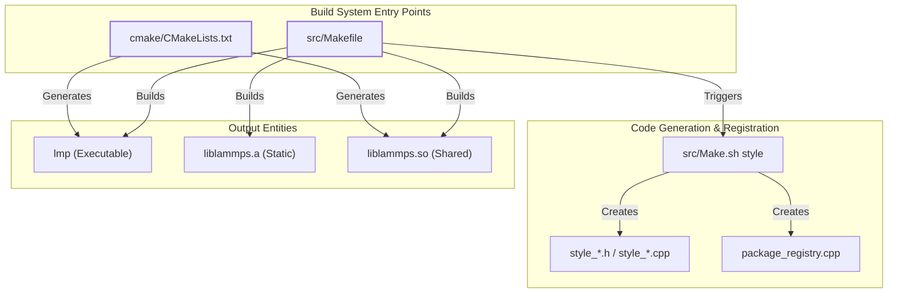
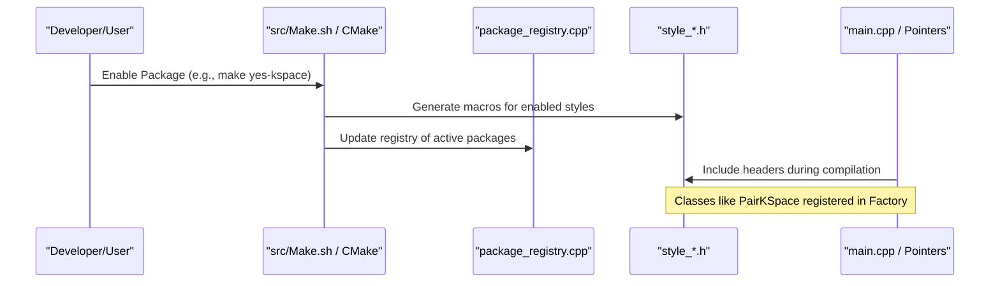

# Build System

Relevant source files

The following files were used as context for generating this wiki page:

- [cmake/CMakeLists.txt](cmake/CMakeLists.txt)
- [cmake/LAMMPSConfig.cmake.in](cmake/LAMMPSConfig.cmake.in)
- [cmake/Modules/CodingStandard.cmake](cmake/Modules/CodingStandard.cmake)
- [cmake/Modules/Documentation.cmake](cmake/Modules/Documentation.cmake)
- [cmake/Modules/FindCythonize.cmake](cmake/Modules/FindCythonize.cmake)
- [cmake/Modules/FindVORO.cmake](cmake/Modules/FindVORO.cmake)
- [cmake/Modules/LAMMPSInterfacePlugin.cmake](cmake/Modules/LAMMPSInterfacePlugin.cmake)
- [cmake/Modules/LAMMPSUtils.cmake](cmake/Modules/LAMMPSUtils.cmake)
- [cmake/Modules/MPI4WIN.cmake](cmake/Modules/MPI4WIN.cmake)
- [cmake/Modules/Packages/COLVARS.cmake](cmake/Modules/Packages/COLVARS.cmake)
- [cmake/Modules/Packages/GPU.cmake](cmake/Modules/Packages/GPU.cmake)
- [cmake/Modules/Packages/KIM.cmake](cmake/Modules/Packages/KIM.cmake)
- [cmake/Modules/Packages/KOKKOS.cmake](cmake/Modules/Packages/KOKKOS.cmake)
- [cmake/Modules/Packages/LEPTON.cmake](cmake/Modules/Packages/LEPTON.cmake)
- [cmake/Modules/Packages/ML-IAP.cmake](cmake/Modules/Packages/ML-IAP.cmake)
- [cmake/Modules/Packages/PYTHON.cmake](cmake/Modules/Packages/PYTHON.cmake)
- [cmake/Modules/Packages/VORONOI.cmake](cmake/Modules/Packages/VORONOI.cmake)
- [cmake/Modules/StyleHeaderUtils.cmake](cmake/Modules/StyleHeaderUtils.cmake)
- [cmake/Modules/Testing.cmake](cmake/Modules/Testing.cmake)
- [cmake/packaging/build_windows_vs.cmake](cmake/packaging/build_windows_vs.cmake)
- [cmake/pkgconfig/liblammps.pc.in](cmake/pkgconfig/liblammps.pc.in)
- [cmake/presets/all_off.cmake](cmake/presets/all_off.cmake)
- [cmake/presets/all_on.cmake](cmake/presets/all_on.cmake)
- [cmake/presets/mingw-cross.cmake](cmake/presets/mingw-cross.cmake)
- [cmake/presets/most.cmake](cmake/presets/most.cmake)
- [cmake/presets/nolib.cmake](cmake/presets/nolib.cmake)
- [cmake/presets/windows.cmake](cmake/presets/windows.cmake)
- [doc/src/Bibliography.rst](doc/src/Bibliography.rst)
- [doc/src/Build.rst](doc/src/Build.rst)
- [doc/src/Build_basics.rst](doc/src/Build_basics.rst)
- [doc/src/Build_cmake.rst](doc/src/Build_cmake.rst)
- [doc/src/Build_development.rst](doc/src/Build_development.rst)
- [doc/src/Build_extras.rst](doc/src/Build_extras.rst)
- [doc/src/Build_link.rst](doc/src/Build_link.rst)
- [doc/src/Build_make.rst](doc/src/Build_make.rst)
- [doc/src/Build_package.rst](doc/src/Build_package.rst)
- [doc/src/Build_prerequisites.rst](doc/src/Build_prerequisites.rst)
- [doc/src/Build_settings.rst](doc/src/Build_settings.rst)
- [doc/src/Commands_all.rst](doc/src/Commands_all.rst)
- [doc/src/Commands_bond.rst](doc/src/Commands_bond.rst)
- [doc/src/Commands_compute.rst](doc/src/Commands_compute.rst)
- [doc/src/Commands_dump.rst](doc/src/Commands_dump.rst)
- [doc/src/Commands_fix.rst](doc/src/Commands_fix.rst)
- [doc/src/Commands_kspace.rst](doc/src/Commands_kspace.rst)
- [doc/src/Commands_pair.rst](doc/src/Commands_pair.rst)
- [doc/src/Developer.rst](doc/src/Developer.rst)
- [doc/src/Developer_plugins.rst](doc/src/Developer_plugins.rst)
- [doc/src/Developer_updating.rst](doc/src/Developer_updating.rst)
- [doc/src/Howto_cmake.rst](doc/src/Howto_cmake.rst)
- [doc/src/Packages.rst](doc/src/Packages.rst)
- [doc/src/Packages_details.rst](doc/src/Packages_details.rst)
- [doc/src/bond_style.rst](doc/src/bond_style.rst)
- [doc/src/commands_list.rst](doc/src/commands_list.rst)
- [doc/src/compute.rst](doc/src/compute.rst)
- [doc/src/compute_pod_atom.rst](doc/src/compute_pod_atom.rst)
- [doc/src/fitpod_command.rst](doc/src/fitpod_command.rst)
- [doc/src/fix.rst](doc/src/fix.rst)
- [doc/src/fix_nve.rst](doc/src/fix_nve.rst)
- [doc/src/kspace_style.rst](doc/src/kspace_style.rst)
- [doc/src/pair_pod.rst](doc/src/pair_pod.rst)
- [doc/src/pair_style.rst](doc/src/pair_style.rst)
- [doc/src/plugin.rst](doc/src/plugin.rst)
- [doc/src/run_style.rst](doc/src/run_style.rst)
- [doc/src/units.rst](doc/src/units.rst)
- [doc/utils/sphinx-config/false_positives.txt](doc/utils/sphinx-config/false_positives.txt)
- [examples/PACKAGES/pod/Ta/in.pod.compute](examples/PACKAGES/pod/Ta/in.pod.compute)
- [examples/plugins/LAMMPSInterfaceCXX.cmake](examples/plugins/LAMMPSInterfaceCXX.cmake)
- [src/.gitignore](src/.gitignore)
- [src/DIPOLE/pair_lj_cut_dipole_cut.cpp](src/DIPOLE/pair_lj_cut_dipole_cut.cpp)
- [src/DIPOLE/pair_lj_cut_dipole_cut.h](src/DIPOLE/pair_lj_cut_dipole_cut.h)
- [src/DIPOLE/pair_lj_cut_dipole_long.cpp](src/DIPOLE/pair_lj_cut_dipole_long.cpp)
- [src/DIPOLE/pair_lj_cut_dipole_long.h](src/DIPOLE/pair_lj_cut_dipole_long.h)
- [src/DIPOLE/pair_lj_long_dipole_long.cpp](src/DIPOLE/pair_lj_long_dipole_long.cpp)
- [src/DIPOLE/pair_lj_long_dipole_long.h](src/DIPOLE/pair_lj_long_dipole_long.h)
- [src/DIPOLE/pair_lj_sf_dipole_sf.h](src/DIPOLE/pair_lj_sf_dipole_sf.h)
- [src/Depend.sh](src/Depend.sh)
- [src/KOKKOS/Install.sh](src/KOKKOS/Install.sh)
- [src/LEPTON/pair_lepton_sphere.h](src/LEPTON/pair_lepton_sphere.h)
- [src/Make.sh](src/Make.sh)
- [src/Makefile](src/Makefile)
- [src/OPENMP/fix_nvt_sllod_omp.h](src/OPENMP/fix_nvt_sllod_omp.h)
- [src/PHONON/fix_phonon.h](src/PHONON/fix_phonon.h)
- [src/PLUGIN/plugin.cpp](src/PLUGIN/plugin.cpp)
- [src/PLUGIN/plugin.h](src/PLUGIN/plugin.h)
- [src/Purge.list](src/Purge.list)
- [src/SPIN/pair_spin_dipole_cut.h](src/SPIN/pair_spin_dipole_cut.h)
- [src/SPIN/pair_spin_dipole_long.h](src/SPIN/pair_spin_dipole_long.h)
- [src/STUBS/Makefile](src/STUBS/Makefile)
- [src/STUBS/Makefile.mingw32-cross](src/STUBS/Makefile.mingw32-cross)
- [src/STUBS/Makefile.mingw64-cross](src/STUBS/Makefile.mingw64-cross)
- [src/STUBS/mpi.cpp](src/STUBS/mpi.cpp)
- [src/STUBS/mpi.h](src/STUBS/mpi.h)
- [src/UEF/fix_nh_uef.h](src/UEF/fix_nh_uef.h)
- [src/creator_registry.cpp](src/creator_registry.cpp)
- [src/fix_nvt_sllod.h](src/fix_nvt_sllod.h)
- [tools/coding_standard/errordocs.py](tools/coding_standard/errordocs.py)
- [tools/coding_standard/homepage.py](tools/coding_standard/homepage.py)
- [tools/coding_standard/permissions.py](tools/coding_standard/permissions.py)
- [tools/coding_standard/whitespace.py](tools/coding_standard/whitespace.py)

This page documents the build system used in LAMMPS, detailing the preferred CMake approach and the legacy Make system. It covers implementation details, package management, accelerator configuration, and dependency handling.

## Overview

LAMMPS utilizes two distinct build systems. The **CMake** system is the modern, preferred method, offering robust dependency discovery and configuration presets. The **Legacy Make** system uses machine-specific Makefiles and manual package installation scripts.

Sources: [cmake/CMakeLists.txt:1-34](), [src/Makefile:1-32](), [src/.gitignore:8-12]()

## CMake Build System (Preferred)

The CMake build system is initialized in `cmake/CMakeLists.txt`. It requires a minimum version of CMake 3.20 [cmake/CMakeLists.txt:5-5]().

### Configuration Flow
1. **Version Detection**: The `get_lammps_version` function in `cmake/Modules/LAMMPSUtils.cmake` extracts version info from `src/version.h` [cmake/CMakeLists.txt:87-87]().
2. **Standard Selection**: LAMMPS requires C++17 without extensions by default [cmake/CMakeLists.txt:143-155](). If the `KOKKOS` package is enabled, the requirement increases to C++20 [cmake/CMakeLists.txt:156-158]().
3. **Dependency Management**: CMake uses `find_package` for MPI, FFT libraries (FFTW3, MKL, KISS), and compression (ZLIB, Zstandard) [cmake/CMakeLists.txt:390-410](), [doc/src/Build_extras.rst:89-113]().

### Preset Files
Presets allow for reproducible builds by defining sets of variables.
- `cmake/presets/all_on.cmake`: Enables all packages.
- `cmake/presets/most.cmake`: Enables most packages without external library requirements.
- `cmake/presets/mingw-cross.cmake`: Configuration for cross-compiling Windows binaries on Linux.

Sources: [cmake/CMakeLists.txt:1-164](), [cmake/Modules/LAMMPSUtils.cmake:1-20](), [doc/src/Build_cmake.rst:1-20]()

## Package System Implementation

Packages extend LAMMPS functionality by adding "Styles" (Pair, Fix, Compute, etc.).

### Package Registration Data Flow
In the legacy Make system, the `src/Make.sh` script performs style registration [src/Makefile:23-32](). In CMake, this is handled by `cmake/Modules/StyleHeaderUtils.cmake`.

Sources: [src/Makefile:23-34](), [src/Makefile:213-218](), [src/Makefile:560-565]()

### Package Categories
Packages are grouped by their dependency level:
- `PACKBASIC`: Core packages like `molecule`, `kspace`, `rigid` [src/Makefile:135-135]().
- `PACKMOST`: Packages without external library requirements [src/Makefile:137-195]().
- `PACKLIB` / `PACKEXT`: Packages requiring internal or external libraries like `ADIOS` or `KIM` [src/Makefile:200-207]().

## Accelerator Packages

Accelerator packages require specialized build configurations for hardware targets.

### GPU Package
The GPU package supports OpenCL, CUDA, and HIP backends [cmake/Modules/Packages/GPU.cmake:16-20]().
- **Precision**: Supports `double`, `mixed` (default), and `single` [cmake/Modules/Packages/GPU.cmake:22-27]().
- **Architecture**: `GPU_ARCH` (e.g., `sm_70`) determines the gencode for NVCC [cmake/Modules/Packages/GPU.cmake:78-78]().
- **Source Management**: Key files like `fix_gpu.cpp` and `fix_nh_gpu.cpp` are added to the build when enabled [cmake/Modules/Packages/GPU.cmake:9-13]().

### KOKKOS Package
KOKKOS provides performance portability across multi-core CPUs and GPUs.
- **Backend Selection**: Controlled via `Kokkos_ENABLE_CUDA`, `Kokkos_ENABLE_OPENMP`, etc. [cmake/Modules/Packages/KOKKOS.cmake:46-68]().
- **Implementation**: KOKKOS-specific styles (e.g., `PairLJCutKokkos`) are conditionally included via `src/KOKKOS/Install.sh` [src/KOKKOS/Install.sh:18-50]().
- **C++ Standard**: Strictly requires C++20 [cmake/Modules/Packages/KOKKOS.cmake:2-6]().

Sources: [cmake/Modules/Packages/GPU.cmake:1-150](), [cmake/Modules/Packages/KOKKOS.cmake:1-147](), [src/KOKKOS/Install.sh:1-100]()

## Legacy Make System

The legacy system relies on `src/Makefile` and machine-specific files in `src/MAKE`.

### Key Makefile Targets
- `make machine`: Builds the executable `lmp_machine` using `src/MAKE/Makefile.machine` [src/Makefile:12-12]().
- `make mode=shared machine`: Builds the shared library `liblammps_machine.so` [src/Makefile:14-14]().
- `make yes-package`: Installs a package by copying files from `src/PACKAGE` to `src/` [src/Makefile:232-232]().

### Internal Library Management
Historically, some packages required building libraries in the `lib/` directory first. 
**Note**: As of version 10Sep2025, the traditional Make system no longer supports packages requiring extra steps in `lib/` [doc/src/Build_extras.rst:30-31](). Users are encouraged to use CMake for these packages.

Sources: [src/Makefile:1-50](), [src/Makefile:222-270](), [doc/src/Build_extras.rst:1-31]()

## External Dependency Management

| Dependency | Package(s) | CMake Variable | Legacy Make Setting |
| :--- | :--- | :--- | :--- |
| **MPI** | Core | `BUILD_MPI` | `MPI_INC`, `MPI_LIB` |
| **FFT** | KSPACE | `FFT` (FFTW3/MKL/KISS) | `FFT_INC`, `FFT_LIB` |
| **ZLIB** | COMPRESS | `ZLIB_LIBRARY` | `JPG_LIB` (includes zlib) |
| **JPEG/PNG** | GRAPHICS | `WITH_JPEG`, `WITH_PNG` | `LMP_INC`, `JPG_LIB` |

Sources: [cmake/CMakeLists.txt:390-428](), [doc/src/Build_extras.rst:75-113](), [doc/src/Build_extras.rst:116-180]()

## Cross-Compilation

LAMMPS supports cross-compiling for Windows using MinGW and for ARM64.
- **CMake Toolchains**: Preset files like `cmake/presets/mingw-cross.cmake` define the `CMAKE_TOOLCHAIN_FILE` and appropriate search paths for cross-compilers [cmake/CMakeLists.txt:62-67]().
- **Python-Config**: Specific policies (e.g., `CMP0109 OLD`) are set to handle cross-compiler python-config scripts [cmake/CMakeLists.txt:19-23]().

Sources: [cmake/CMakeLists.txt:19-27](), [cmake/presets/mingw-cross.cmake:1-20]()

---