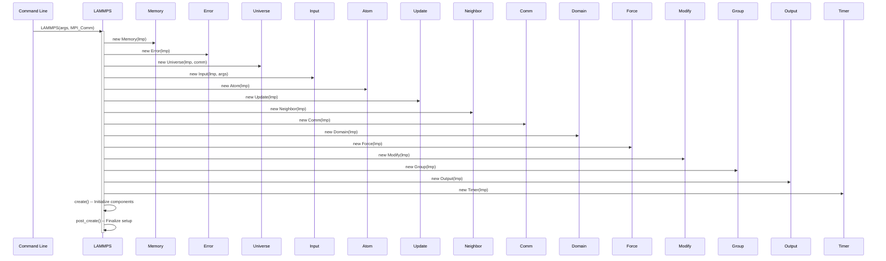
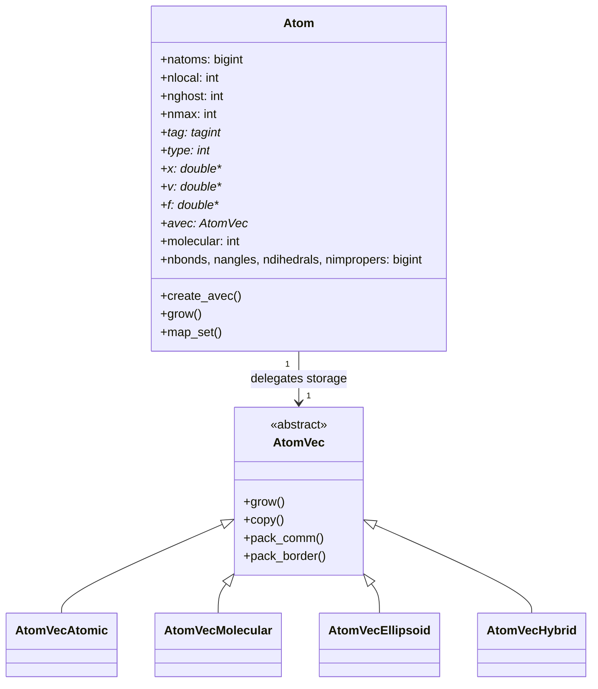
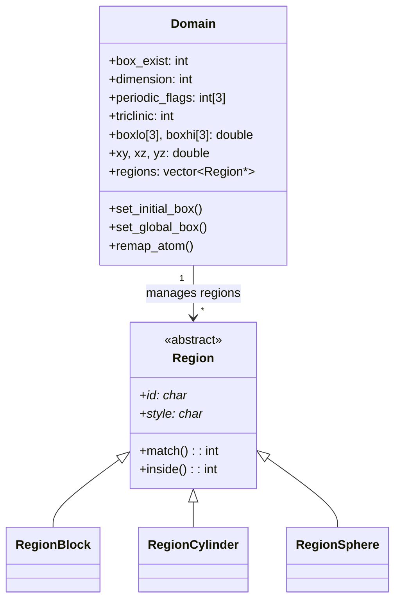
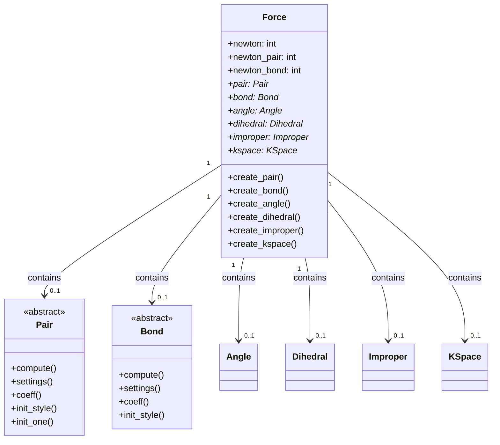
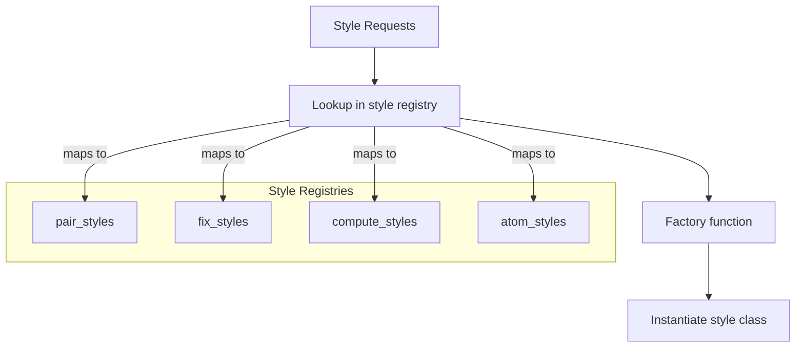
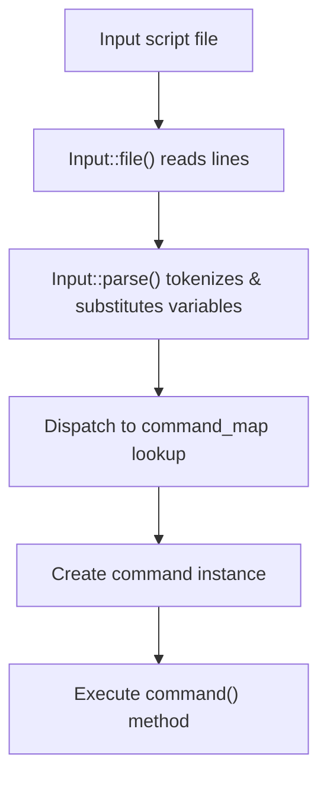
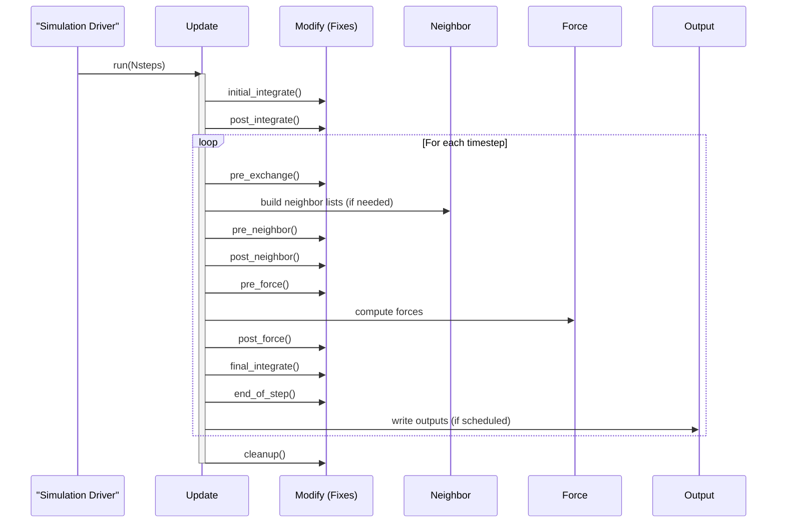
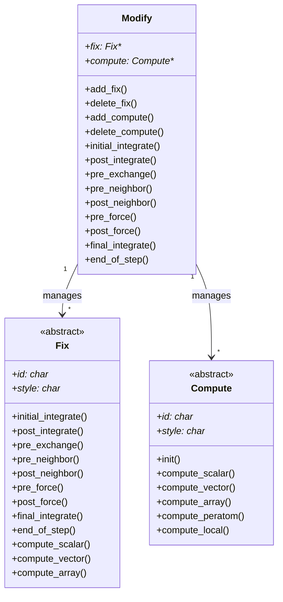
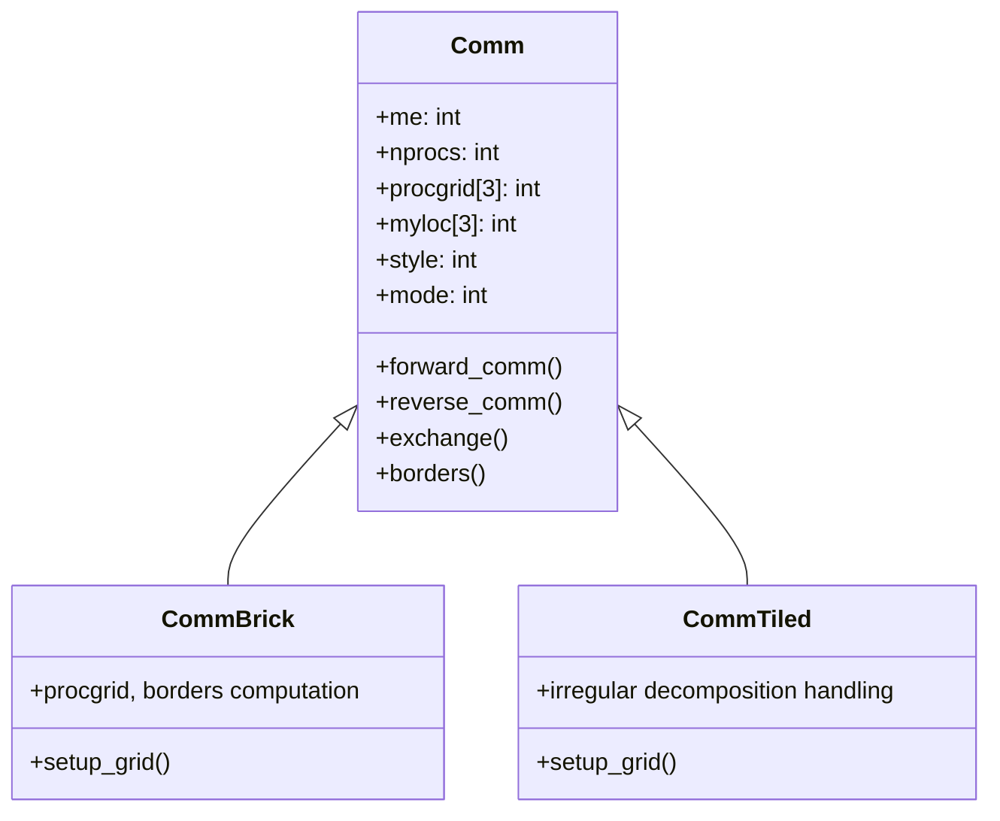

# Core Architecture

<details>
<summary>Relevant source files</summary>

The following files were used as context for generating this wiki page:

- [doc/doxygen/Doxyfile.in](doc/doxygen/Doxyfile.in)
- [doc/src/Developer_utils.rst](doc/src/Developer_utils.rst)
- [doc/src/create_atoms.rst](doc/src/create_atoms.rst)
- [doc/src/fix_print.rst](doc/src/fix_print.rst)
- [doc/src/geturl.rst](doc/src/geturl.rst)
- [doc/src/print.rst](doc/src/print.rst)
- [doc/src/variable.rst](doc/src/variable.rst)
- [examples/gransurf/surf.tri.stl](examples/gransurf/surf.tri.stl)
- [examples/gransurf/surf.tribox.stl](examples/gransurf/surf.tribox.stl)
- [src/EXTRA-COMMAND/geturl.cpp](src/EXTRA-COMMAND/geturl.cpp)
- [src/EXTRA-COMMAND/geturl.h](src/EXTRA-COMMAND/geturl.h)
- [src/EXTRA-DUMP/dump_dcd.cpp](src/EXTRA-DUMP/dump_dcd.cpp)
- [src/GRANULAR/fix_pour.cpp](src/GRANULAR/fix_pour.cpp)
- [src/GRANULAR/fix_pour.h](src/GRANULAR/fix_pour.h)
- [src/KOKKOS/math_special_kokkos.cpp](src/KOKKOS/math_special_kokkos.cpp)
- [src/KOKKOS/math_special_kokkos.h](src/KOKKOS/math_special_kokkos.h)
- [src/MACHDYN/fix_smd_wall_surface.cpp](src/MACHDYN/fix_smd_wall_surface.cpp)
- [src/MACHDYN/fix_smd_wall_surface.h](src/MACHDYN/fix_smd_wall_surface.h)
- [src/atom.cpp](src/atom.cpp)
- [src/atom.h](src/atom.h)
- [src/create_atoms.cpp](src/create_atoms.cpp)
- [src/create_atoms.h](src/create_atoms.h)
- [src/fix.cpp](src/fix.cpp)
- [src/fix.h](src/fix.h)
- [src/fix_deposit.cpp](src/fix_deposit.cpp)
- [src/fix_deposit.h](src/fix_deposit.h)
- [src/fix_evaporate.cpp](src/fix_evaporate.cpp)
- [src/fix_evaporate.h](src/fix_evaporate.h)
- [src/fix_thermal_conductivity.cpp](src/fix_thermal_conductivity.cpp)
- [src/fix_thermal_conductivity.h](src/fix_thermal_conductivity.h)
- [src/force.cpp](src/force.cpp)
- [src/force.h](src/force.h)
- [src/info.cpp](src/info.cpp)
- [src/info.h](src/info.h)
- [src/input.cpp](src/input.cpp)
- [src/input.h](src/input.h)
- [src/label_map.cpp](src/label_map.cpp)
- [src/label_map.h](src/label_map.h)
- [src/lammps.cpp](src/lammps.cpp)
- [src/lammps.h](src/lammps.h)
- [src/lmprestart.h](src/lmprestart.h)
- [src/math_special.cpp](src/math_special.cpp)
- [src/math_special.h](src/math_special.h)
- [src/modify.cpp](src/modify.cpp)
- [src/modify.h](src/modify.h)
- [src/output.cpp](src/output.cpp)
- [src/output.h](src/output.h)
- [src/read_data.cpp](src/read_data.cpp)
- [src/read_data.h](src/read_data.h)
- [src/read_restart.cpp](src/read_restart.cpp)
- [src/read_restart.h](src/read_restart.h)
- [src/replicate.cpp](src/replicate.cpp)
- [src/stl_reader.cpp](src/stl_reader.cpp)
- [src/stl_reader.h](src/stl_reader.h)
- [src/timer.cpp](src/timer.cpp)
- [src/timer.h](src/timer.h)
- [src/universe.cpp](src/universe.cpp)
- [src/universe.h](src/universe.h)
- [src/update.cpp](src/update.cpp)
- [src/update.h](src/update.h)
- [src/utils.cpp](src/utils.cpp)
- [src/utils.h](src/utils.h)
- [src/variable.cpp](src/variable.cpp)
- [src/variable.h](src/variable.h)
- [src/write_coeff.cpp](src/write_coeff.cpp)
- [src/write_data.cpp](src/write_data.cpp)
- [src/write_data.h](src/write_data.h)
- [src/write_dump.cpp](src/write_dump.cpp)
- [src/write_restart.cpp](src/write_restart.cpp)
- [src/write_restart.h](src/write_restart.h)
- [unittest/commands/CMakeLists.txt](unittest/commands/CMakeLists.txt)
- [unittest/commands/test_compute_global.cpp](unittest/commands/test_compute_global.cpp)
- [unittest/commands/test_delete_atoms.cpp](unittest/commands/test_delete_atoms.cpp)
- [unittest/commands/test_groups.cpp](unittest/commands/test_groups.cpp)
- [unittest/commands/test_info.cpp](unittest/commands/test_info.cpp)
- [unittest/commands/test_kim_commands.cpp](unittest/commands/test_kim_commands.cpp)
- [unittest/commands/test_labelmap.cpp](unittest/commands/test_labelmap.cpp)
- [unittest/commands/test_lattice_region.cpp](unittest/commands/test_lattice_region.cpp)
- [unittest/commands/test_regions.cpp](unittest/commands/test_regions.cpp)
- [unittest/commands/test_simple_commands.cpp](unittest/commands/test_simple_commands.cpp)
- [unittest/commands/test_thermo.cpp](unittest/commands/test_thermo.cpp)
- [unittest/commands/test_variables.cpp](unittest/commands/test_variables.cpp)
- [unittest/cplusplus/test_advanced_utils.cpp](unittest/cplusplus/test_advanced_utils.cpp)
- [unittest/cplusplus/test_error_class.cpp](unittest/cplusplus/test_error_class.cpp)
- [unittest/formats/test_atom_styles.cpp](unittest/formats/test_atom_styles.cpp)
- [unittest/formats/test_eim_potential_file_reader.cpp](unittest/formats/test_eim_potential_file_reader.cpp)
- [unittest/formats/test_file_operations.cpp](unittest/formats/test_file_operations.cpp)
- [unittest/formats/test_molecule_file.cpp](unittest/formats/test_molecule_file.cpp)
- [unittest/formats/test_potential_file_reader.cpp](unittest/formats/test_potential_file_reader.cpp)
- [unittest/formats/test_text_file_reader.cpp](unittest/formats/test_text_file_reader.cpp)
- [unittest/utils/test_fmtlib.cpp](unittest/utils/test_fmtlib.cpp)
- [unittest/utils/test_stl_reader.cpp](unittest/utils/test_stl_reader.cpp)
- [unittest/utils/test_utils.cpp](unittest/utils/test_utils.cpp)

</details>


The Core Architecture of LAMMPS (Large-scale Atomic/Molecular Massively Parallel Simulator) defines the fundamental framework that powers molecular dynamics simulations. This document provides a high-level overview of the central classes, their relationships, and key mechanisms enabling LAMMPS to act as a flexible, extensible simulation engine. Detailed technical descriptions of these components are available in dedicated child pages.

## System Overview

LAMMPS employs a modular design centered around the main `LAMMPS` class, which serves as the container and manager of all simulation components. This design facilitates extensibility through factory registries and runtime callback mechanisms, allowing different simulation styles and packages to integrate smoothly.

### Main Components Hierarchy and Relationships

```mermaid
classDiagram
    class LAMMPS {
      +memory
      +error
      +universe
      +input
      +atom
      +update
      +neighbor
      +comm
      +domain
      +force
      +modify
      +group
      +output
      +timer
      +kokkos
    }
    LAMMPS --> Memory : manages
    LAMMPS --> Error : manages
    LAMMPS --> Universe : manages
    LAMMPS --> Input : manages
    LAMMPS --> Atom : manages
    LAMMPS --> Update : manages
    LAMMPS --> Neighbor : manages
    LAMMPS --> Comm : manages
    LAMMPS --> Domain : manages
    LAMMPS --> Force : manages
    LAMMPS --> Modify : manages
    LAMMPS --> Group : manages
    LAMMPS --> Output : manages
    LAMMPS --> Timer : manages
    LAMMPS --> "Kokkos Accelerator" : optional acceleration layer
```

This core `LAMMPS` class tracks and coordinates the simulation state, owning instances of all major subsystems such as memory management, error handling, input parsing, atomic data structures, force computations, and output generation. An optional `kokkos` component provides performance portability to many-core architectures. 

Sources: [src/lammps.cpp:86-743]()

## Initialization Sequence

LAMMPS initializes its internal subsystems in a prescribed order to satisfy dependencies. This sequence includes:

1. Allocating utility classes like `Memory` and `Error`.
2. Creating the `Universe` for global context and MPI communicator wrapping.
3. Parsing command-line arguments and initializing the `Input` class.
4. Creating the main simulation components: `Atom` data, `Update` integrator, `Neighbor` list, `Comm` communication, `Domain` box, `Force` field, `Modify` (fixes and computes), `Group`, `Output`, and the `Timer`.
5. Performing any post-creation setup required for inter-component coordination.



This staged initialization ensures components are ready for simulation command processing and execution.

Sources: [src/lammps.cpp:119-743]()

## Core Data Structures

### Atom System

The `Atom` class manages molecular system data, including per-atom properties and topology (bonds, angles, dihedrals, impropers). It delegates storage to an atom-style-specific `AtomVec` instance, which implements the actual per-atom arrays tailored to the chosen atom style (e.g., atomic, molecular, ellipsoidal).



The `Atom` class holds pointers to arrays representing fundamental atomic properties: IDs, types, positions (`x`), velocities (`v`), forces (`f`), and extended molecular topology arrays. Properties depend on the atom style, which governs how per-atom data is stored and managed.

Sources: [src/atom.cpp:70-384](), [src/atom.h:31-263]()

### Per-Atom Property Management

LAMMPS implements a per-atom data registration system which tracks memory and metadata for each atom property array. This registry enables dynamic allocation, resizing, and access to custom per-atom properties.

```mermaid
flowchart TD
    A["Atom class"] -->|adds property via| B["Per-atom Registry"]
    B -->|stores property metadata| C["Property Descriptors"]
    C -->|manage| D["Pointer arrays for properties"]
    D -->|including| E["tag", "type", "position", ...]
    A -->|direct access via| E
```

This design ensures consistent management and access to the internal atom data arrays, important for parallel migration and serialization of atoms.

Sources: [src/atom.cpp:390-580](), [src/atom.h:270-463]()

### Domain and Simulation Box

The `Domain` class manages the simulation box shape, size, boundary conditions, and coordinate transformations:



The domain handles periodicity in all spatial directions, including triclinic boxes with tilt factors. It also manages geometric regions used for atom creation, deletion, and selections.

Sources: [src/domain.cpp:60-135]()

## Force Calculation System

LAMMPS's `Force` class orchestrates interactions via energy and force computations:



This system efficiently computes short-range pair interactions, bonded terms, and long-range electrostatics. It supports hybridization of pair styles and modular extensibility of interaction models.

Sources: [src/force.cpp:40-101]()

## Extensibility through Style Factories

LAMMPS supports extensive extensibility via factory registration and style lookup mechanisms. This allows new simulation models to plug into the system dynamically.



These factory functions create instances of classes derived from base classes such as `Pair`, `Fix`, `Compute`, and `AtomVec`, based on style strings. The registry mechanism is shared globally for all LAMMPS instances and supports overriding by plugins.

Sources: [src/force.cpp:40-50](), [src/modify.cpp:40-120](), [src/input.cpp:70-75](), [src/lammps.cpp:65-95]()

## Command Processing System

LAMMPS processes input commands via the `Input` class. Commands can come from batch scripts or interactive sessions.



Each input line is parsed, optional variable substitution occurs, the command string is matched to a registered command style, and the corresponding command object is created and executed. This design isolates command parsing from implementation logic.

Sources: [src/input.cpp:185-317](), [src/input.cpp:750-783]()

## Simulation Timestepping

The `Update` class manages the overall timestep integration process. It orchestrates callbacks into fixes and manages neighbor lists and force calculations.



This sequence allows fixes to intervene at multiple points, enabling flexible implementation of integrators, thermostats, constraints, and other processes.

Sources: [src/update.cpp:1-50]()

## Extension through Fixes and Computes

The `Modify` class manages both `Fix` and `Compute` objects, which are general extension mechanisms to augment simulation behavior.



- **Fixes**: Act during simulation timesteps to modify or add to system state, e.g., constraints, thermostats, integrators.
- **Computes**: Calculate properties from the simulation (thermodynamic quantities, per-atom values) without changing system state.

This plugin-like system allows new simulation capabilities while avoiding core source changes.

Sources: [src/modify.cpp:40-124](), [src/fix.h:1-100]()

## Parallel Communication Architecture

The `Comm` class handles domain decomposition and inter-processor communication required for parallel simulations.



LAMMPS supports various communication styles, including `brick` (regular 3D grid) and `tiled` (irregular) decompositions. It implements ghost atom exchange, particle migration, and load balancing.

Sources: [src/lammps.cpp:570-590]()

---

## Summary and Further Reading

This high-level overview of the LAMMPS Core Architecture highlights the main classes that represent and control simulation data, computational methods, and interaction patterns. The modular design with factory registries and callback mechanisms enables extensibility and customization.

For detailed descriptions of each subsystem and their implementations, see the child pages:

- [LAMMPS Main Class](#2.1) — Central simulation manager and initialization.
- [Atom System](#2.2) — Atom representation, styling, and manipulation.
- [Variable System](#2.3) — Dynamic variable handling and expression parsing.
- [Utility Functions](#2.4) — Common utilities for string, file, math, and error handling.

---

# References

- Core `LAMMPS` and component instantiation [src/lammps.cpp:86-743]()
- Atom and `AtomVec` management [src/atom.cpp:70-384](), [src/atom.h:31-263]()
- Input command processing [src/input.cpp:185-317]()
- Modify class managing `Fix` and `Compute` [src/modify.cpp:40-124]()
- Force calculation management [src/force.cpp:40-101]()
- Parallel communication setup [src/lammps.cpp:570-590]()
- Utility functions [src/utils.cpp:10-190]()

---

This overview provides essential orientation to LAMMPS's core architecture to help developers and advanced users understand how simulation components are organized and interact at a system level.

---