# LAMMPS Main Class

Relevant source files

The following files were used as context for generating this wiki page:

- [doc/src/fix_deform.rst](doc/src/fix_deform.rst)
- [doc/src/fix_deform_pressure.rst](doc/src/fix_deform_pressure.rst)
- [examples/gjf/argon.lmp](examples/gjf/argon.lmp)
- [examples/gjf/ff-argon.lmp](examples/gjf/ff-argon.lmp)
- [src/EXTRA-FIX/fix_deform_pressure.cpp](src/EXTRA-FIX/fix_deform_pressure.cpp)
- [src/EXTRA-FIX/fix_deform_pressure.h](src/EXTRA-FIX/fix_deform_pressure.h)
- [src/create_box.cpp](src/create_box.cpp)
- [src/domain.cpp](src/domain.cpp)
- [src/domain.h](src/domain.h)
- [src/fix.cpp](src/fix.cpp)
- [src/fix.h](src/fix.h)
- [src/fix_box_relax.cpp](src/fix_box_relax.cpp)
- [src/fix_box_relax.h](src/fix_box_relax.h)
- [src/fix_deform.cpp](src/fix_deform.cpp)
- [src/fix_deform.h](src/fix_deform.h)
- [src/fix_langevin.cpp](src/fix_langevin.cpp)
- [src/fix_langevin.h](src/fix_langevin.h)
- [src/fix_nh.cpp](src/fix_nh.cpp)
- [src/fix_nh.h](src/fix_nh.h)
- [src/fix_press_berendsen.cpp](src/fix_press_berendsen.cpp)
- [src/fix_press_berendsen.h](src/fix_press_berendsen.h)
- [src/fix_temp_berendsen.cpp](src/fix_temp_berendsen.cpp)
- [src/fix_temp_berendsen.h](src/fix_temp_berendsen.h)
- [src/fix_temp_rescale.cpp](src/fix_temp_rescale.cpp)
- [src/fix_temp_rescale.h](src/fix_temp_rescale.h)
- [src/force.cpp](src/force.cpp)
- [src/force.h](src/force.h)
- [src/info.cpp](src/info.cpp)
- [src/info.h](src/info.h)
- [src/input.cpp](src/input.cpp)
- [src/input.h](src/input.h)
- [src/lammps.cpp](src/lammps.cpp)
- [src/lammps.h](src/lammps.h)
- [src/lattice.cpp](src/lattice.cpp)
- [src/lattice.h](src/lattice.h)
- [src/modify.cpp](src/modify.cpp)
- [src/modify.h](src/modify.h)
- [src/output.cpp](src/output.cpp)
- [src/output.h](src/output.h)
- [src/universe.cpp](src/universe.cpp)
- [src/universe.h](src/universe.h)
- [src/update.cpp](src/update.cpp)
- [src/update.h](src/update.h)
- [src/write_coeff.cpp](src/write_coeff.cpp)
- [src/write_dump.cpp](src/write_dump.cpp)

The LAMMPS main class serves as the central simulation manager for LAMMPS (Large-scale Atomic/Molecular Massively Parallel Simulator). It creates, initializes, manages, and coordinates all the components needed for a molecular dynamics simulation. This page covers the structure and function of the LAMMPS class, which is the top-level container for a LAMMPS simulation instance.

## Purpose and Role

The LAMMPS class provides the following core functions:

1. Creates and manages all core simulation components
2. Processes command-line arguments
3. Coordinates initialization and cleanup of the simulation
4. Manages communication between processors
5. Handles the complete simulation lifecycle

Sources: [src/lammps.cpp:86-97](src/lammps.cpp:86-97), [src/lammps.cpp:104-195](src/lammps.cpp:104-195)

## Class Structure and Key Components

The LAMMPS class contains pointers to all fundamental classes needed for a molecular dynamics simulation:

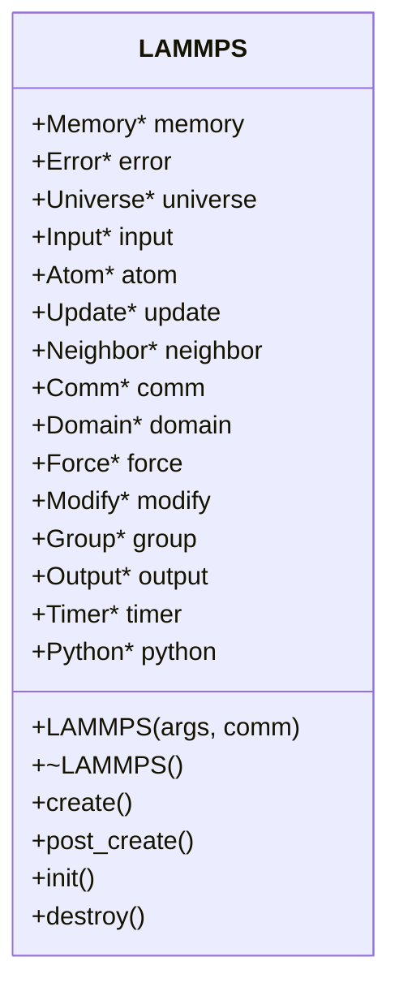

Each of these components handles a specific aspect of the simulation:

| Component | Purpose |
|-----------|---------|
| Memory | Memory allocation and deallocation |
| Error | Error detection and handling |
| Universe | Defines the MPI communicator and processor set |
| Input | Processes input commands and scripts |
| Atom | Manages atom data and properties |
| Update | Time integration and minimizer management |
| Neighbor | Neighbor list construction and management |
| Comm | MPI communication for atom exchanges and ghost atoms |
| Domain | Definition of simulation box and boundary conditions |
| Force | Force field components: pair, bond, angle, dihedral, improper, KSpace |
| Modify | Manages Fix and Compute objects that modify or compute properties |
| Group | Atom grouping system |
| Output | Thermodynamics, dump files, restart writing |
| Timer | Performance timing for profiling |
| Python | Embedded Python interface |

Sources: [src/lammps.h:21-47](src/lammps.h:21-47), [src/lammps.cpp:84-89](src/lammps.cpp:84-89)

## Component Hierarchy

The LAMMPS class manages a hierarchical structure composed of interrelated components that represent the simulation state and behavior:

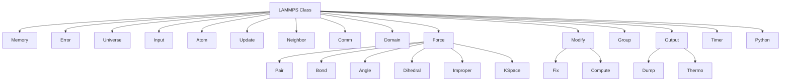

This structure emphasizes the modular organization of the simulation, with `Force` and `Modify` managing specialized sub-objects such as various force classes and fixes, respectively.

Sources: [src/lammps.cpp:843-889](src/lammps.cpp:843-889), [src/force.cpp:77-111](src/force.cpp:77-111), [src/modify.cpp:60-105](src/modify.cpp:60-105)

## Construction and Initialization

### Constructor and Command-Line Processing

The LAMMPS constructor initializes the core components in a specific order critical to establishing dependencies, processes command-line arguments, and sets up MPI communication.

Key constructor steps:

- Register built-in style factories for commands, fixes, computes, and force styles.
- Create instances of `Memory`, `Error`, and `Universe` classes.
- Process special MPI arguments such as `-mpicolor` to re-partition communicator sets.
- Parse command-line flags to set up input, output, acceleration modes, packages, and suffix styles.
- Instantiate core components such as Input, Atom, Neighbor, Comm, Domain, Force, Modify, Group, Output, Update, Timer, and optional Python interface objects.
- Initialize logging and screen output files.

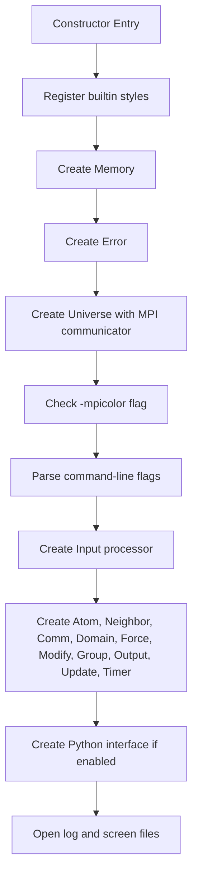

Sources: [src/lammps.cpp:119-195](src/lammps.cpp:119-195)

### Component Creation Process

Component creation is encapsulated in the `create()` method, which the constructor calls. Creation order ensures dependencies are met and components are usable immediately after creation:

1. Create `Comm` to establish parallel communication.
2. Create `Neighbor` to handle neighbor list construction.
3. Create `Domain` for simulation box and boundaries.
4. Create `Atom` to hold atomic data.
5. Create `Group` to manage atom groups.
6. Create `Force` for force calculations.
7. Create `Modify` for fixes and computes.
8. Create `Output` for dumps and thermodynamics.
9. Create `Update` for integration and minimization.
10. Create `Timer` for performance monitoring.
11. Optionally create the `Python` interface.

After component creation, `post_create()` performs additional setup such as enforcing suffix consistency and package command issuing.

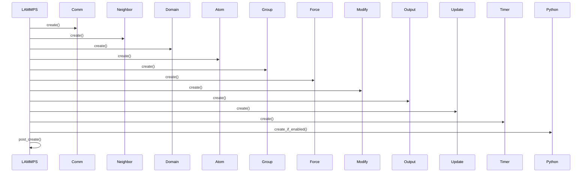

Sources: [src/lammps.cpp:843-889](src/lammps.cpp:843-889), [src/lammps.cpp:901-963](src/lammps.cpp:901-963)

### Initialization Order and Dependencies

The `init()` method initializes each component in a carefully chosen sequence respecting inter-component dependencies:

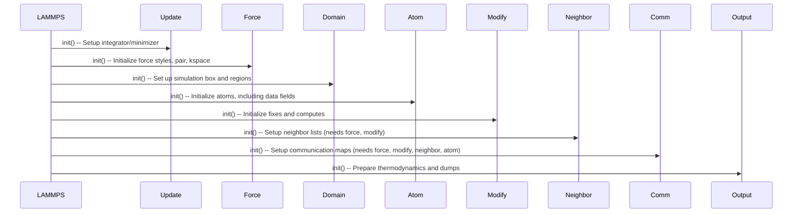

The order ensures components that depend on other's data (e.g., communication needing neighbor and force info) are initialized afterward.

Sources: [src/lammps.cpp:971-984](src/lammps.cpp:971-984)

## The Pointers Base Class Pattern

Components such as `Input`, `Modify`, `Force`, `Update`, `Domain`, `Output`, and others inherit from a base class called `Pointers`. This base class:

- Holds a pointer to the parent `LAMMPS` instance.
- Provides convenient, centralized access to all major components from within each class.
- Enables components to interact with each other without explicit external pointers.

This design pattern keeps the code concise and tightly integrated, allowing components like `Modify` to easily access `Atom`, `Force`, `Update`, etc.

Sources: [src/pointers.h (implied from #include "pointers.h")], [src/input.cpp:110-162](src/input.cpp:110-162), [src/modify.cpp:60-105](src/modify.cpp:60-105)

## Input Command Processor

The `Input` class is responsible for parsing and processing LAMMPS commands from input scripts or command line flags. Integrated tightly with the `LAMMPS` class, it:

- Supports variable substitution via the `Variable` subsystem.
- Dispatches commands to the appropriate component or executes them directly.
- Manages recursion of input files and reads command lines.
- Holds factory registries for all command styles, allowing extensibility through plugins.

Command execution flow:

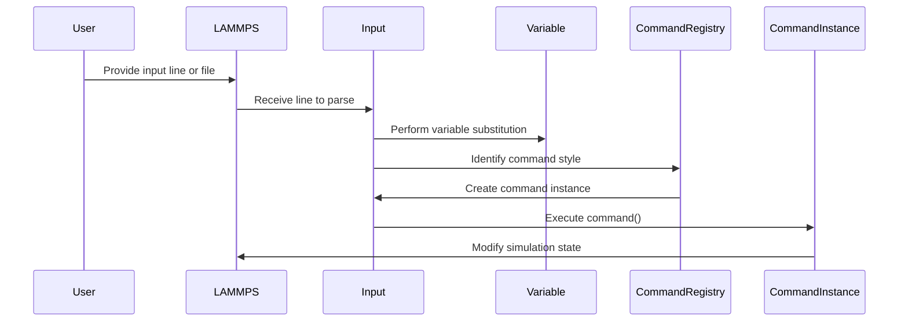

Sources: [src/input.cpp:79-180](src/input.cpp:79-180), [src/input.cpp:764-875](src/input.cpp:764-875)

## Modify Manager: Fixes and Computes

The `Modify` class manages **Fix** and **Compute** objects, which are the plugins or extensions that modify simulation data or compute properties.

- It maintains registry factories for all built-in and plugin-based fix and compute styles.
- Responsible for fix and compute lifecycle: creation, initialization, invocation, and deletion.
- Organizes fix calls into lists tied to simulation stages (e.g., initial_integrate, pre_force).
- Implements the `init()` method that calls all fixes' and computes' `init()` in the correct order.
- Handles restart and checkpoint data related to fixes.

The use of factory registries allows LAMMPS to create fix and compute styles dynamically based on style names—a flexible plugin architecture.

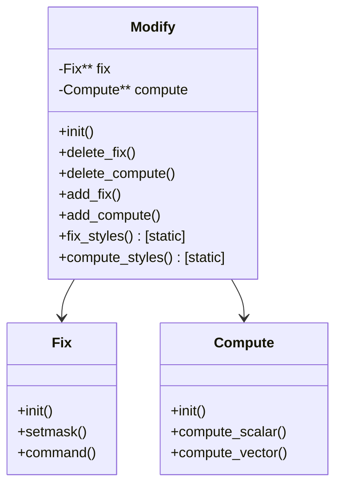

Sources: [src/modify.cpp:39-155](src/modify.cpp:39-155), [src/fix.h:21-163](src/fix.h:21-163)

## Force and Update Subsystems

### Force Subsystem

The `Force` class manages all aspects of force calculation:

- Holds pointers to the various interaction styles: `pair`, `bond`, `angle`, `dihedral`, `improper`, and `kspace`.
- Includes static registries (factories) for each force style category, enabling easy addition of new force styles.
- Initializes force fields and checks consistency of bonded topologies vs selected force styles.
- Supports specialized force styles with suffixes (e.g., GPU, KOKKOS versions).
- Provides `init()` and `setup()` methods to prepare force calculation for simulations.

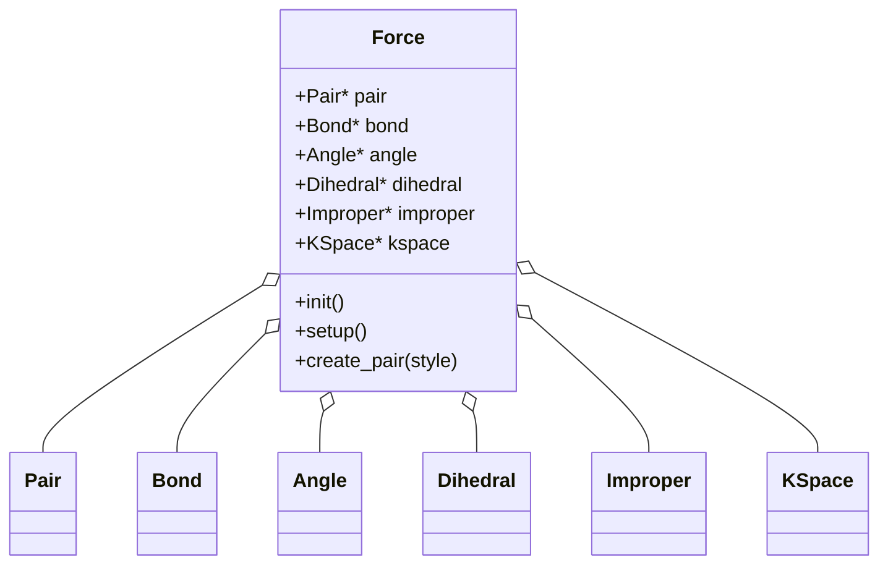

Sources: [src/force.cpp:37-182](src/force.cpp:37-182)

### Update Subsystem

The `Update` class governs the time integration and minimization:

- Manages the current integration and minimization styles.
- Supports multiple built-in integrators (e.g., Verlet) and minimizers (e.g., CG).
- Maintains timestep and simulation clock.
- Provides methods to set units and initialize solvers.
- Registers integrator and minimizer styles via static registries.
- Controls the running of simulation steps.

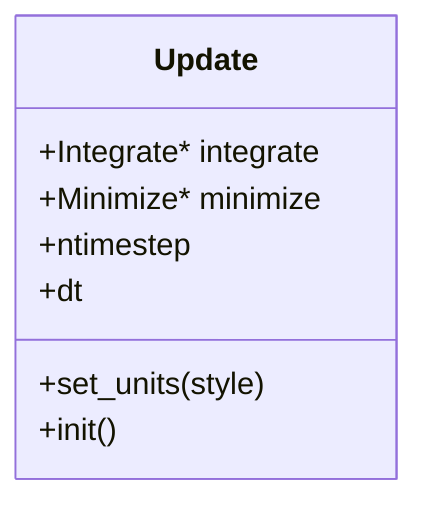

Sources: [src/update.cpp:31-123](src/update.cpp:31-123)

## Summary Diagram: Major LAMMPS Class Interface

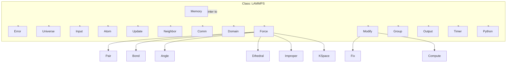

This diagram represents the core internal structure of LAMMPS: the main class holding all key components, with `Force` and `Modify` managing respective subsystems related to interactions and fixes/computes.

## Destruction Process

The `destroy()` method ensures all components are deleted in a specific order to prevent memory corruption and dangling references:

- `Update` is destroyed first as it may call fixes during cleanup.
- Next `Neighbor`, `Force`, and `Group`.
- `Output` is deleted after because it unregisters atomfile variables.
- `Modify` must be deleted after `Output`, `Force`, and `Update` due to interdependencies.
- `Comm` follows, since it interacts with `Modify` during destruction.
- `Domain` after `Modify` because fixes might depend on domain data during shutdown.
- `Atom` after `Modify` and `Neighbor` due to fix callbacks.
- `Timer` is deleted last.
- All files and MPI resources are closed and freed.

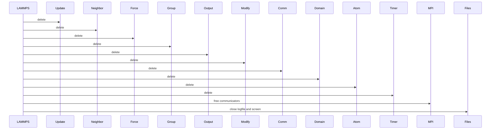

Sources: [src/lammps.cpp:771-835](src/lammps.cpp:771-835), [src/lammps.cpp:992-1040](src/lammps.cpp:992-1040)

## Style and Package System Management

LAMMPS supports style suffixes that influence how components are created and which packages are enabled:

- Common suffixes: `/gpu`, `/omp`, `/kk` (Kokkos), etc.
- The LAMMPS class holds flags and strings to manage suffixes and their priorities.
- The `post_create()` method ensures that style suffixes are consistent and that corresponding package commands are issued.
- This mechanism enables fallback strategies, for example falling back from GPU-accelerated versions to CPU versions if unavailable.

Example flow in `post_create()`:

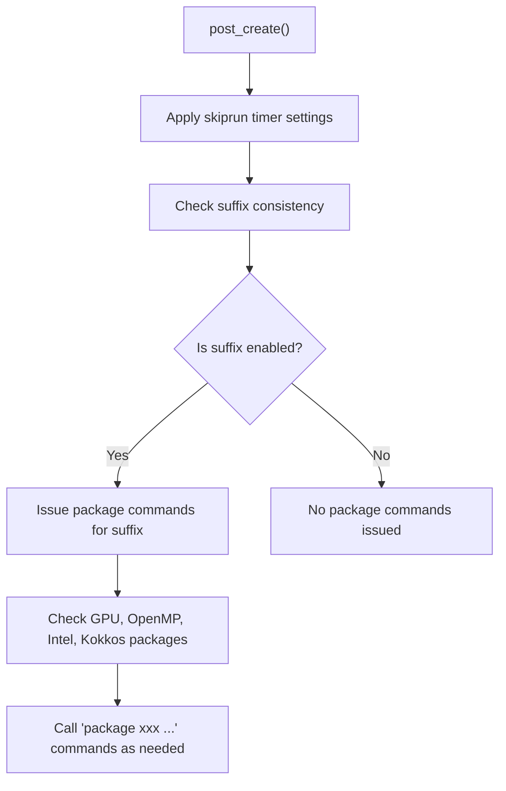

Sources: [src/lammps.cpp:901-963](src/lammps.cpp:901-963)

## Plugin System

The LAMMPS binary can load plugins at runtime to extend its core functionality:

- Plugins can add new fix, compute, pair, and command styles.
- Managed by the `Plugin` subsystem, which loads dynamic shared objects.
- The main `LAMMPS` instance interacts with this system during creation and style registration.

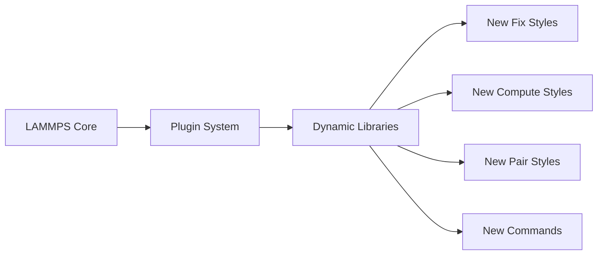

Sources: [src/lammps.cpp:884-889](src/lammps.cpp:884-889)

## Command Processing and Input Handling

Commands entered by user (via script or interactive input) flow through the `Input` class:

- Commands are parsed and matched to known styles from the command factory.
- Variables are substituted and pre-processing performed.
- Command instances are created and executed dynamically.
- Input class calls into various components to effect changes or query simulation state.

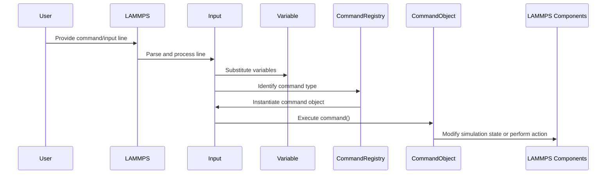

Sources: [src/input.cpp:79-180](src/input.cpp:79-180), [src/input.cpp:764-875](src/input.cpp:764-875)

## Resource Tracking and Interface Management

The LAMMPS class monitors resource usage and manages global interfaces:

- Maintains wall clock start time to measure total run duration.
- Uses the `Memory` class for all allocations.
- Coordinates MPI communicators and their cleanup.
- Manages open files: screen output, logfile, input file pointers.
- Provides interfaces for external use (e.g., via library or Python bindings).

Sources: [src/lammps.cpp:158-161](src/lammps.cpp:158-161), [src/lammps.cpp:789-794](src/lammps.cpp:789-794)

## Error Handling

Error handling in LAMMPS is centralized through the `Error` class:

- The LAMMPS main class interacts with `Error` to throw fatal errors or warnings.
- MPI-aware error messaging ensures proper output from the root process only.
- Errors during construction or initialization propagate exceptions caught at higher levels.

Sources: [src/lammps.cpp:130](src/lammps.cpp:130), [src/error.cpp (implicitly)]

## Summary

The `LAMMPS` class acts as the nucleus of the LAMMPS molecular dynamics simulation framework. It coordinates creation, initialization, input processing, simulation execution, and cleanup by managing many interdependent components. Familiarity with this class and the architecture of subcomponents like `Modify`, `Force`, `Input`, and `Update` is critical for understanding the overall LAMMPS simulation workflow and for contributing to core development or extensions.

---

**References:**  
- LAMMPS main class and constructor: [src/lammps.cpp:86-195](src/lammps.cpp:86-195)  
- Component creation and initialization: [src/lammps.cpp:843-984](src/lammps.cpp:843-984)  
- Fix and Compute management: [src/modify.cpp:39-155](src/modify.cpp:39-155)  
- Force class and style registries: [src/force.cpp:37-182](src/force.cpp:37-182)  
- Input command processing: [src/input.cpp:79-180](src/input.cpp:79-180)  
- Update integrator and minimizer management: [src/update.cpp:31-123](src/update.cpp:31-123)  
- Error and memory management: [src/lammps.cpp:130](src/lammps.cpp:130), [src/lammps.cpp:789-794](src/lammps.cpp:789-794)

---