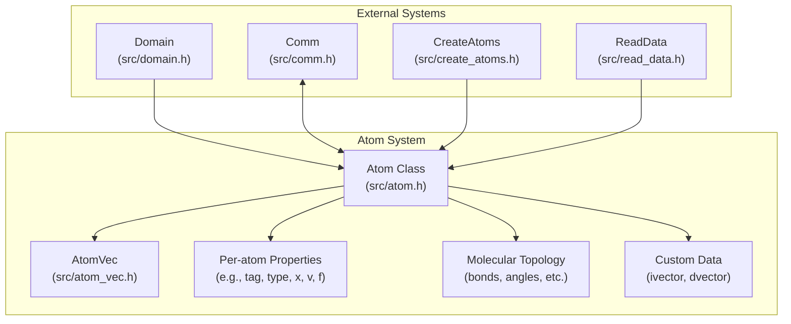
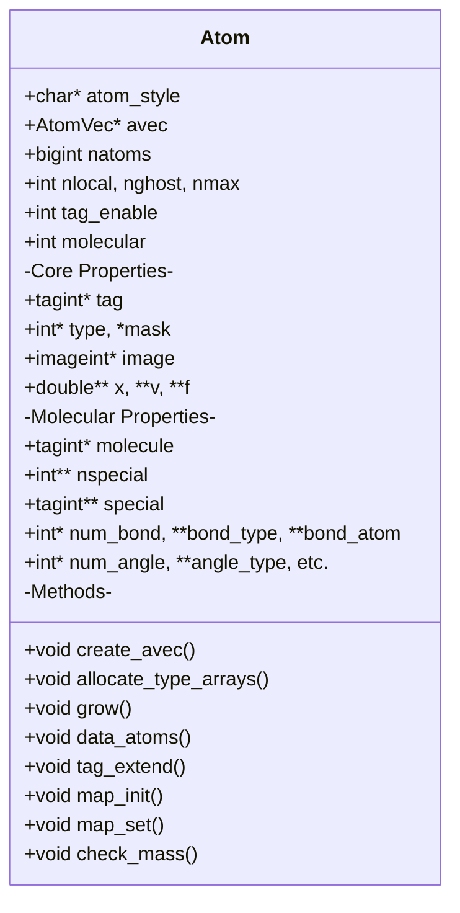
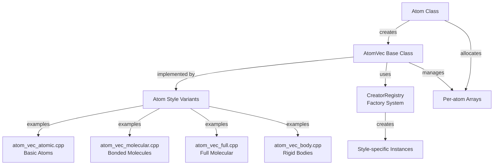
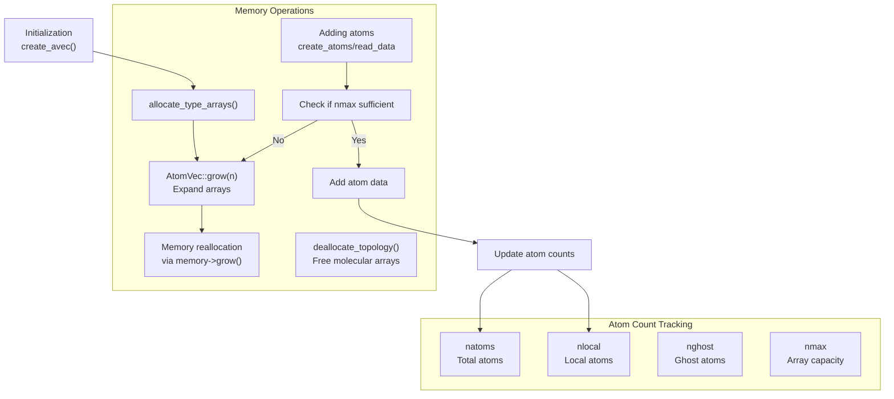
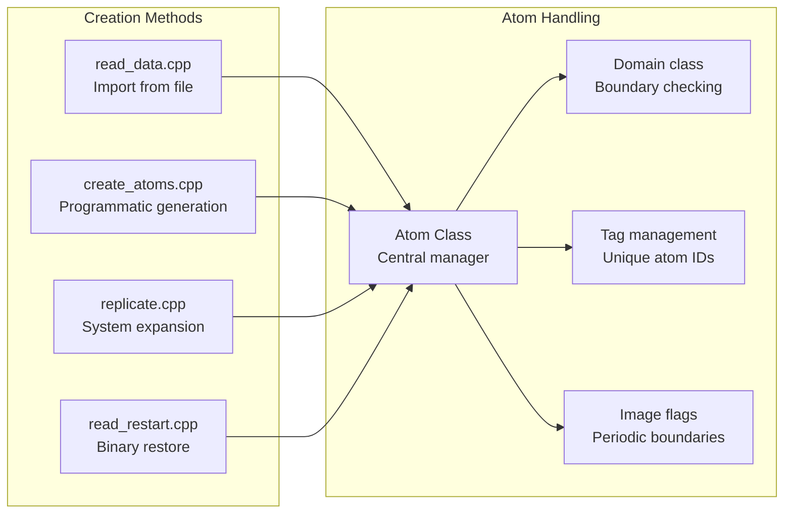
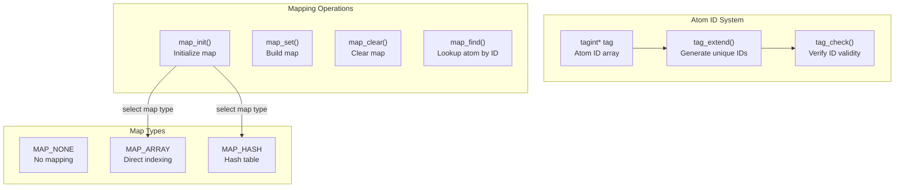
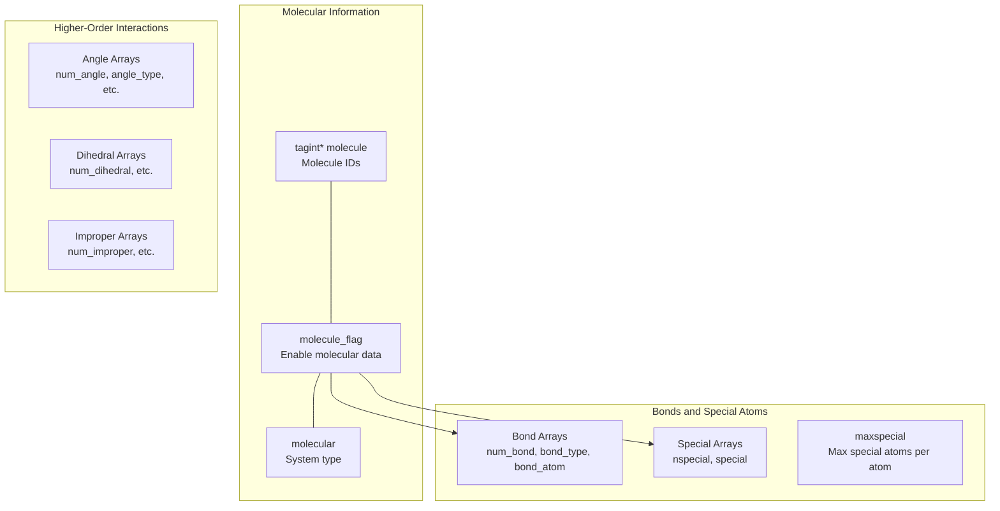
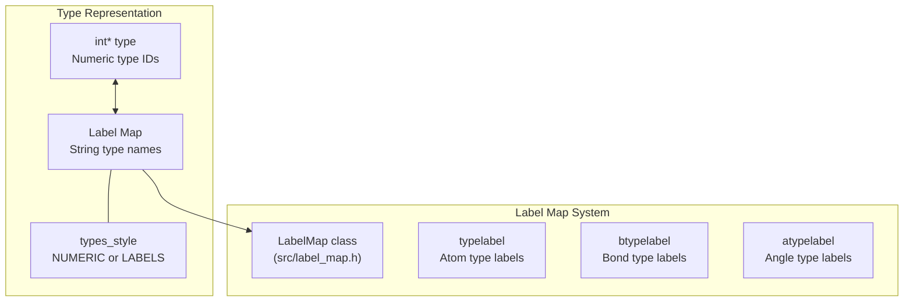

# Atom System

Relevant source files

The following files were used as context for generating this wiki page:

- [doc/src/Howto_2d.rst](doc/src/Howto_2d.rst)
- [doc/src/Howto_ldd.rst](doc/src/Howto_ldd.rst)
- [doc/src/Howto_triclinic.rst](doc/src/Howto_triclinic.rst)
- [doc/src/Howto_type_labels.rst](doc/src/Howto_type_labels.rst)
- [doc/src/angle_coeff.rst](doc/src/angle_coeff.rst)
- [doc/src/atom_style.rst](doc/src/atom_style.rst)
- [doc/src/bond_coeff.rst](doc/src/bond_coeff.rst)
- [doc/src/boundary.rst](doc/src/boundary.rst)
- [doc/src/compute_property_atom.rst](doc/src/compute_property_atom.rst)
- [doc/src/create_atoms.rst](doc/src/create_atoms.rst)
- [doc/src/create_box.rst](doc/src/create_box.rst)
- [doc/src/dihedral_coeff.rst](doc/src/dihedral_coeff.rst)
- [doc/src/fix_property_atom.rst](doc/src/fix_property_atom.rst)
- [doc/src/fix_set.rst](doc/src/fix_set.rst)
- [doc/src/fix_store_state.rst](doc/src/fix_store_state.rst)
- [doc/src/improper_coeff.rst](doc/src/improper_coeff.rst)
- [doc/src/labelmap.rst](doc/src/labelmap.rst)
- [doc/src/lattice.rst](doc/src/lattice.rst)
- [doc/src/pair_coeff.rst](doc/src/pair_coeff.rst)
- [doc/src/pair_ldd.rst](doc/src/pair_ldd.rst)
- [doc/src/read_data.rst](doc/src/read_data.rst)
- [doc/src/run.rst](doc/src/run.rst)
- [doc/src/set.rst](doc/src/set.rst)
- [doc/src/write_data.rst](doc/src/write_data.rst)
- [src/CG-DNA/atom_vec_oxdna.cpp](src/CG-DNA/atom_vec_oxdna.cpp)
- [src/CG-DNA/atom_vec_oxdna.h](src/CG-DNA/atom_vec_oxdna.h)
- [src/DIPOLE/atom_vec_dipole.cpp](src/DIPOLE/atom_vec_dipole.cpp)
- [src/GRANULAR/fix_pour.cpp](src/GRANULAR/fix_pour.cpp)
- [src/GRANULAR/fix_pour.h](src/GRANULAR/fix_pour.h)
- [src/MOLECULE/atom_vec_angle.cpp](src/MOLECULE/atom_vec_angle.cpp)
- [src/MOLECULE/atom_vec_bond.cpp](src/MOLECULE/atom_vec_bond.cpp)
- [src/MOLECULE/atom_vec_full.cpp](src/MOLECULE/atom_vec_full.cpp)
- [src/MOLECULE/atom_vec_molecular.cpp](src/MOLECULE/atom_vec_molecular.cpp)
- [src/PERI/atom_vec_peri.cpp](src/PERI/atom_vec_peri.cpp)
- [src/atom.cpp](src/atom.cpp)
- [src/atom.h](src/atom.h)
- [src/atom_vec.cpp](src/atom_vec.cpp)
- [src/atom_vec.h](src/atom_vec.h)
- [src/atom_vec_atomic.cpp](src/atom_vec_atomic.cpp)
- [src/atom_vec_body.cpp](src/atom_vec_body.cpp)
- [src/atom_vec_body.h](src/atom_vec_body.h)
- [src/atom_vec_charge.cpp](src/atom_vec_charge.cpp)
- [src/atom_vec_ellipsoid.cpp](src/atom_vec_ellipsoid.cpp)
- [src/atom_vec_ellipsoid.h](src/atom_vec_ellipsoid.h)
- [src/atom_vec_hybrid.cpp](src/atom_vec_hybrid.cpp)
- [src/atom_vec_hybrid.h](src/atom_vec_hybrid.h)
- [src/atom_vec_line.cpp](src/atom_vec_line.cpp)
- [src/atom_vec_line.h](src/atom_vec_line.h)
- [src/atom_vec_sphere.cpp](src/atom_vec_sphere.cpp)
- [src/atom_vec_tri.cpp](src/atom_vec_tri.cpp)
- [src/atom_vec_tri.h](src/atom_vec_tri.h)
- [src/compute_property_atom.cpp](src/compute_property_atom.cpp)
- [src/compute_property_atom.h](src/compute_property_atom.h)
- [src/create_atoms.cpp](src/create_atoms.cpp)
- [src/create_atoms.h](src/create_atoms.h)
- [src/fix_deposit.cpp](src/fix_deposit.cpp)
- [src/fix_deposit.h](src/fix_deposit.h)
- [src/fix_evaporate.cpp](src/fix_evaporate.cpp)
- [src/fix_evaporate.h](src/fix_evaporate.h)
- [src/fix_set.cpp](src/fix_set.cpp)
- [src/fix_set.h](src/fix_set.h)
- [src/fix_store_state.cpp](src/fix_store_state.cpp)
- [src/fix_store_state.h](src/fix_store_state.h)
- [src/fix_thermal_conductivity.cpp](src/fix_thermal_conductivity.cpp)
- [src/fix_thermal_conductivity.h](src/fix_thermal_conductivity.h)
- [src/label_map.cpp](src/label_map.cpp)
- [src/label_map.h](src/label_map.h)
- [src/lmprestart.h](src/lmprestart.h)
- [src/math_extra.cpp](src/math_extra.cpp)
- [src/math_extra.h](src/math_extra.h)
- [src/read_data.cpp](src/read_data.cpp)
- [src/read_data.h](src/read_data.h)
- [src/read_restart.cpp](src/read_restart.cpp)
- [src/read_restart.h](src/read_restart.h)
- [src/replicate.cpp](src/replicate.cpp)
- [src/set.cpp](src/set.cpp)
- [src/set.h](src/set.h)
- [src/write_data.cpp](src/write_data.cpp)
- [src/write_data.h](src/write_data.h)
- [src/write_restart.cpp](src/write_restart.cpp)
- [src/write_restart.h](src/write_restart.h)
- [unittest/commands/test_labelmap.cpp](unittest/commands/test_labelmap.cpp)
- [unittest/commands/test_set_property.cpp](unittest/commands/test_set_property.cpp)

The Atom System in LAMMPS provides the core representation and management of atoms and their properties in simulations. This page documents the `Atom` class structure, how atoms and their properties are stored and managed, atom creation mechanisms, and how atom data structures integrate with other systems in LAMMPS.

## Overview

The `Atom` class serves as the central data structure for all atom-related information in LAMMPS. It maintains arrays of per-atom properties, handles memory allocation for atom data, and provides interfaces for other parts of the code to access atom information. The `Atom` class works closely with the atom style system (implemented through `AtomVec` classes) to determine which properties are available for atoms in a given simulation.

Sources: [src/atom.h:32-324](), [src/atom.cpp:98-106](), [src/atom.cpp:118-234]()

## Atom Class Structure

The `Atom` class contains numerous data structures for storing various atom properties and methods for managing them. The figure below highlights the key components:

Sources: [src/atom.h:32-89](), [src/atom.h:118-236](), [src/atom.cpp:98-135]()

Key attributes in the `Atom` class include:

- **atom_style**: The style of atoms in the simulation (e.g., atomic, molecular) [src/atom.h:34]().
- **avec**: Pointer to the `AtomVec` instance that implements the atom style [src/atom.h:35]().
- **natoms**: Total number of atoms in the system [src/atom.h:45]().
- **nlocal**: Number of atoms owned by this processor [src/atom.h:47]().
- **nghost**: Number of ghost atoms on this processor [src/atom.h:47]().
- **nmax**: Maximum number of atoms (local + ghost) for which arrays are currently allocated [src/atom.h:48]().
- **molecular**: Flag for molecular system type (0 = atomic, 1 = molecular, 2 = template) [src/atom.h:50-51]().

## Per-atom Property Storage

LAMMPS uses a flexible approach to storing per-atom properties through arrays of different types. These properties are organized based on their data type (integer, double, etc.) and dimensionality (scalar, vector, array).

```mermaid
graph TD
    subgraph "Core Properties"
        Tag["tagint* tag\nAtom IDs"]
        Type["int* type\nAtom Types"]
        Mask["int* mask\nGroup Masks"]
        Image["imageint* image\nPeriodic Image Flags"]
        Position["double** x\nPositions"]
        Velocity["double** v\nVelocities"]
        Force["double** f\nForces"]
    end

    subgraph "Extended Properties"
        Charge["double* q\nCharges"]
        Mass["double* rmass\nPer-atom Mass"]
        Radius["double* radius\nParticle Radii"]
        Molecule["tagint* molecule\nMolecule ID"]
        Dipole["double** mu\nDipole Moments"]
        Special["tagint** special\nSpecial Bond Partners"]
    end

    subgraph "Molecular Topology"
        Bonds["int* num_bond\nint** bond_type\ntagint** bond_atom"]
        Angles["int* num_angle\nint** angle_type\ntagint** angle_atom1/2/3"]
        Dihedrals["int* num_dihedral\nint** dihedral_type\ntagint** dihedral_atom1/2/3/4"]
        Impropers["int* num_improper\nint** improper_type\ntagint** improper_atom1/2/3/4"]
    end

    Atom --> Tag
    Atom --> Type
    Atom --> Mask
    Atom --> Image
    Atom --> Position
    Atom --> Velocity
    Atom --> Force
    Atom --> Charge
    Atom --> Mass
    Atom --> Radius
    Atom --> Molecule
    Atom --> Dipole
    Atom --> Special
    Atom --> Bonds
    Atom --> Angles
    Atom --> Dihedrals
    Atom --> Impropers
```

Sources: [src/atom.h:73-134](), [src/atom.cpp:118-185](), [src/atom.cpp:413-503]()

The `Atom` class also supports **Custom Atom Arrays**, which allow fixes and computes to register their own per-atom data that migrates with atoms. These are managed via `ivector`, `dvector`, `iarray`, and `darray` pointers [src/atom.h:249-256]().

## Atom Style System

The atom style system determines which properties are stored for atoms in a simulation. LAMMPS implements different atom styles through the `AtomVec` class hierarchy.

Sources: [src/atom.cpp:63-67](), [src/atom.cpp:299-306](), [src/atom.cpp:680-715](), [src/atom.cpp:719-762]()

Key aspects of the atom style system:

1.  **Style Selection**: The `create_avec()` method in `Atom` creates an appropriate `AtomVec` instance based on the selected atom style [src/atom.cpp:680-715]().
2.  **Factory Pattern**: LAMMPS uses a `CreatorRegistry` to store factory functions for all available atom styles [src/atom.cpp:63-67]().
3.  **Style-specific Implementation**: Each `AtomVec` subclass (e.g., `AtomVecEllipsoid`, `AtomVecBody`) manages different sets of per-atom properties relevant to its style [src/atom.cpp:17-20]().
4.  **Property Flags**: The atom style sets various flags in the `Atom` class (e.g., `q_flag`, `mu_flag`, `molecule_flag`) to indicate which properties are active [src/atom.h:198-207]().

## Memory Management

The `Atom` class implements sophisticated memory management to efficiently handle atom data. Per-atom arrays are typically grown in chunks defined by a `DELTA` constant to minimize reallocations.

Sources: [src/atom_vec.cpp:161-173](), [src/atom_vec.cpp:204-215](), [src/read_data.cpp:523-538](), [src/create_atoms.cpp:560-561]()

Key memory management operations:

1.  **Allocation**: Initial allocation of type-based arrays (e.g., `mass`) occurs in `allocate_type_arrays()` [src/atom.cpp:1040-1072]().
2.  **Growth**: Per-atom arrays are grown using the `AtomVec::grow()` method, which calls `memory->grow()` for each registered array [src/atom_vec.cpp:204-245]().
3.  **Deallocation**: Molecular topology arrays are freed via `deallocate_topology()` [src/atom.cpp:1086-1123]().

## Atom Creation and Manipulation

Atoms can be created and manipulated through several mechanisms:

Sources: [src/read_data.cpp:721-731](), [src/create_atoms.cpp:544-551](), [src/replicate.cpp:201-295](), [src/read_restart.cpp:234-237]()

Primary atom creation pathways:

1.  **read_data**: Parses a text data file. It handles sections like `Atoms`, `Velocities`, and `Bonds` [src/read_data.cpp:61-71]().
2.  **create_atoms**: Generates atoms on a lattice or randomly. Supports `box`, `region`, `single`, and `random` styles [src/create_atoms.cpp:125-169]().
3.  **replicate**: Multiplies the current system by $N_x \times N_y \times N_z$ [src/replicate.cpp:65-77]().
4.  **read_restart**: Restores a simulation from a binary restart file, recreating the `AtomVec` and all per-atom data [src/read_restart.cpp:173-238]().

## Atom ID and Mapping System

LAMMPS maintains a mapping system to quickly find atoms by their global ID (tag). This is managed by `map_init()`, `map_set()`, and `map_find()`.

Sources: [src/atom.cpp:901-992](), [src/atom.cpp:567-578](), [src/atom.cpp:3018-3107]()

Three mapping types are available [src/atom.h:41]():
1.  **MAP_NONE**: No mapping (used when IDs are not required).
2.  **MAP_ARRAY**: A direct lookup array where `map[ID]` gives the local index. Efficient for contiguous IDs.
3.  **MAP_HASH**: A hash table for looking up local indices. Efficient for sparse or very large ID ranges.

## Molecular Topology

For molecular simulations, the `Atom` class stores connectivity information:

Sources: [src/atom.h:93-115](), [src/atom.cpp:142-161](), [src/read_data.cpp:744-761]()

Key aspects of molecular topology:
- **Bonds**: Stores the number of bonds per atom and the IDs of bonded atoms [src/atom.h:100-102]().
- **Special Bonds**: The `special` array tracks 1-2, 1-3, and 1-4 neighbors to exclude or scale their non-bonded interactions [src/atom.h:96-98]().
- **Templates**: The `molecular = 2` setting indicates a molecule template system where topology is stored in `Molecule` objects rather than per-atom [src/atom.h:38]().

## Type Label System

LAMMPS supports the **LabelMap** framework, allowing users to refer to atom, bond, and other types by string labels instead of just integers.

Sources: [src/atom.h:194-195](), [src/atom.cpp:243-245](), [src/label_map.cpp:50-114]()

The `LabelMap` class manages the bidirectional mapping between string labels and integer types [src/label_map.cpp:120-187](). This system is used by `read_data` to parse labels in sections like `Atom Type Labels` [src/read_data.cpp:69-71]().

## Per-Atom Data Registration

Fixes and Computes can register per-atom arrays that migrate with atoms during processor exchange.

1.  **Registration**: A fix calls `atom->add_custom()` to create a new per-atom vector or array [src/atom.cpp:2648-2700]().
2.  **Migration**: During `AtomVec::exchange()`, custom arrays are packed into the communication buffer along with standard properties [src/atom_vec.cpp:537-564]().
3.  **Persistence**: Custom data is saved to restart files if the `restart` flag is set during registration [src/atom.cpp:2655]().

Sources: [src/atom.cpp:2648-2700](), [src/atom_vec.cpp:537-564](), [src/atom.h:246-256]()

## Performance Considerations

The `Atom` class is designed for high performance in large-scale simulations:
- **Memory Layout**: Per-atom data is stored in contiguous arrays to maximize cache hits during force loops.
- **Growth Strategy**: Arrays are resized with extra space (defined by `DELTA`) to reduce reallocation frequency [src/atom_vec.cpp:161-173]().
- **Sorting**: Atoms can be sorted periodically by spatial location (`sortfreq`) to improve neighbor list build performance [src/atom.h:305-317]().
- **Vectorization**: Many `AtomVec` operations are designed to be vector-friendly.

Sources: [src/atom.h:305-317](), [src/atom_vec.cpp:161-173](), [src/atom.cpp:799-801]()

---