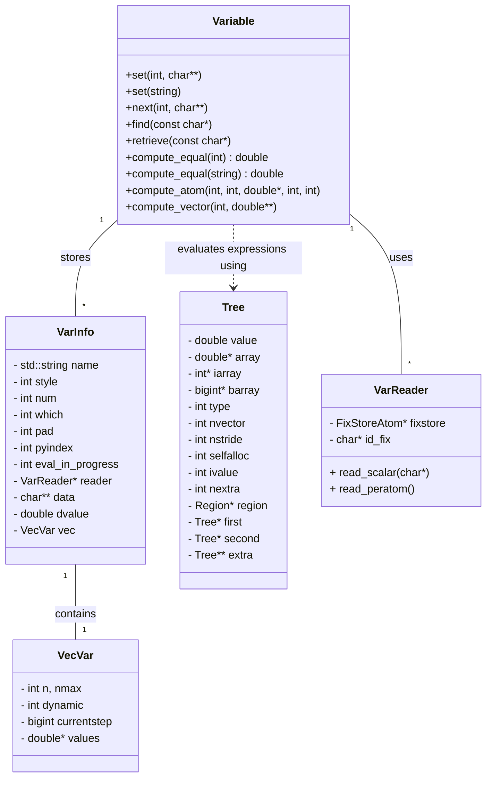
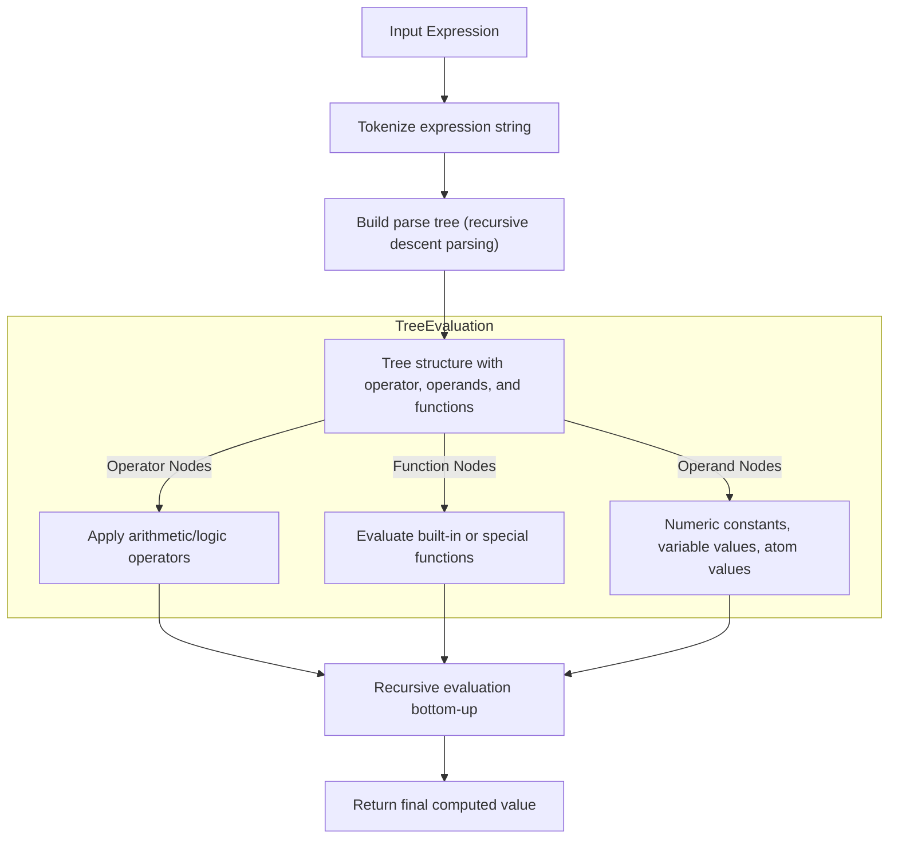
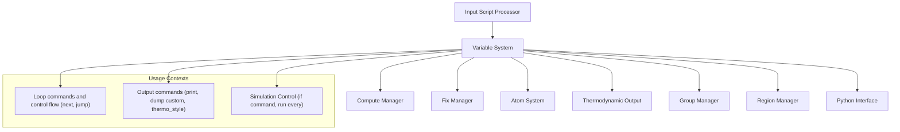

# Variable System

<details>
<summary>Relevant source files</summary>

The following files were used as context for generating this wiki page:

- [doc/src/fix_print.rst](doc/src/fix_print.rst)
- [doc/src/geturl.rst](doc/src/geturl.rst)
- [doc/src/print.rst](doc/src/print.rst)
- [doc/src/variable.rst](doc/src/variable.rst)
- [src/EXTRA-COMMAND/geturl.cpp](src/EXTRA-COMMAND/geturl.cpp)
- [src/EXTRA-COMMAND/geturl.h](src/EXTRA-COMMAND/geturl.h)
- [src/variable.cpp](src/variable.cpp)
- [src/variable.h](src/variable.h)
- [unittest/commands/CMakeLists.txt](unittest/commands/CMakeLists.txt)
- [unittest/commands/test_compute_global.cpp](unittest/commands/test_compute_global.cpp)
- [unittest/commands/test_delete_atoms.cpp](unittest/commands/test_delete_atoms.cpp)
- [unittest/commands/test_groups.cpp](unittest/commands/test_groups.cpp)
- [unittest/commands/test_info.cpp](unittest/commands/test_info.cpp)
- [unittest/commands/test_kim_commands.cpp](unittest/commands/test_kim_commands.cpp)
- [unittest/commands/test_lattice_region.cpp](unittest/commands/test_lattice_region.cpp)
- [unittest/commands/test_regions.cpp](unittest/commands/test_regions.cpp)
- [unittest/commands/test_simple_commands.cpp](unittest/commands/test_simple_commands.cpp)
- [unittest/commands/test_thermo.cpp](unittest/commands/test_thermo.cpp)
- [unittest/commands/test_variables.cpp](unittest/commands/test_variables.cpp)
- [unittest/cplusplus/test_advanced_utils.cpp](unittest/cplusplus/test_advanced_utils.cpp)
- [unittest/cplusplus/test_error_class.cpp](unittest/cplusplus/test_error_class.cpp)
- [unittest/formats/test_atom_styles.cpp](unittest/formats/test_atom_styles.cpp)
- [unittest/formats/test_eim_potential_file_reader.cpp](unittest/formats/test_eim_potential_file_reader.cpp)
- [unittest/formats/test_file_operations.cpp](unittest/formats/test_file_operations.cpp)
- [unittest/formats/test_molecule_file.cpp](unittest/formats/test_molecule_file.cpp)
- [unittest/formats/test_potential_file_reader.cpp](unittest/formats/test_potential_file_reader.cpp)
- [unittest/formats/test_text_file_reader.cpp](unittest/formats/test_text_file_reader.cpp)
- [unittest/utils/test_fmtlib.cpp](unittest/utils/test_fmtlib.cpp)

</details>


The Variable System in LAMMPS provides a powerful mechanism for defining, storing, and manipulating dynamic values during simulations. It allows users to create variables of various styles—from simple strings and lists to complex mathematical formulas and per-atom computations—that can be referenced and evaluated dynamically throughout simulation input scripts. This page details the architecture, implementation, data flow, key classes and functions, expression parsing, and integration of the Variable system within the broader LAMMPS framework.

---

## Overview

LAMMPS variables are user-defined entities identified by names and styles, created using the `variable` command. They can be referenced later with the syntax `$varname` or `${varname}`. Supported variable styles include iteration and list variables (e.g., `index`, `loop`, `uloop`), global arrays (`world`, `universe`), string and environment variables (`string`, `getenv`), file-based variables (`file`, `atomfile`), formula-based variables (`equal`, `vector`, `atom`), special-purpose variables (`internal`, `timer`), formatting variables (`format`), and Python-interfaced variables (`python`).

Variables enable flexible scripting by supporting:

- Dynamic evaluation of mathematical expressions
- Per-atom data calculations
- Access to simulation data via computes and fixes
- Integration with Python for user-defined functions
- Iterator support for loops and staged processing

---

## Variable System Architecture

The core class managing variables is `Variable` (defined in `src/variable.h` and implemented in `src/variable.cpp`). It maintains data structures for all variables and the logic for parsing, storing, and evaluating variable values.

### Key Classes and Structures

- **Variable::VarInfo**  
  Stores all metadata and data for an individual variable, including its name, style, numeric value(s), string data, and pointers to file readers or Python hooks.

- **Variable::VecVar**  
  Used specifically for `vector`-style variables to store arrays of floating-point values over time steps.

- **Variable::Tree**  
  Represents nodes in the parse tree of mathematical expressions for formula-based variables (like `equal`, `atom`, and `vector`). Attributes include value, array pointers, operator type, child nodes, and linkages to special evaluation contexts.

- **VarReader**  
  Helper class to read data from files for `file` or `atomfile` variable styles.

The `Variable` class encapsulates:

- Storage arrays of `VarInfo` instances for all variables
- Parsing of variable definitions and expressions
- Evaluation of expressions (including atom-based and vector data)
- Management of loop and index variables and their states
- Integration hooks for Python and file interfaces



Sources: [src/variable.h:20-120](), [src/variable.cpp:20-250](), [src/variable.cpp:120-250]()

---

## Variable Styles and Their Processing Flow

LAMMPS supports multiple variable styles, each representing a different kind of data or evaluation mechanism:

| Style      | Description                                                      |
|------------|------------------------------------------------------------------|
| **index**  | A list of string tokens, often used as iterator sequences        |
| **loop**   | An integer loop variable, generating a range of strings          |
| **uloop**  | Unsigned integer loop variable with optional zero-padding        |
| **world**  | Values associated with MPI partitions, for parallel runs         |
| **universe**| Global values for use across MPI tasks                          |
| **string** | Simple string storage                                            |
| **getenv** | Environment variable retrieval                                   |
| **file**   | Sequential string loading from a file                            |
| **atomfile** | Per-atom numeric data loaded from file                         |
| **equal**  | Single numeric value evaluated from an expression/formula       |
| **atom**   | Per-atom value from formula evaluated for each atom             |
| **vector** | Instance of formula generating a vector of numeric values       |
| **format** | Formatting output of another variable                            |
| **python** | Calls a Python function returning a value                        |
| **internal** | Numeric value stored and accessed directly                    |
| **timer**  | Stores a simulation timer value                                  |

### Variable Command Processing Flow

```mermaid
flowchart TD
    A["variable command input"] --> B["Parser: parse style and args"]
    B --> C{"Variable Style?"}
    C -->|index/loop/uloop| D[Generate or store string sequences]
    C -->|world/universe| E[Store MPI partition/global arrays]
    C -->|string/getenv| F[Store simple strings or environment vars]
    C -->|file/atomfile| G[Read data from file (scalar or per-atom)]
    C -->|equal/vector/atom| H[Parse and store expression formula]
    C -->|format| I[Format another variable's output]
    C -->|python| J[Store Python function hook]
    C -->|internal/timer| K[Store numeric values directly]

    D --> L["Store in variable data structures"]
    E --> L
    F --> L
    G --> L
    H --> L
    I --> L
    J --> L
    K --> L

    L --> M["Variable data stored in Variable::variables array"]
```

When later referenced (e.g., via `$name`), variables are processed based on their style:

- Loop/Index/World/Universe variables retrieve current string values from stored data.
- Expression variables (`equal`, `atom`, `vector`) parse and evaluate their formulas dynamically.
- File-based variables load values as needed.
- Python variables call registered Python functions to get values.
- Internal/timer variables return stored values directly.

Sources: [src/variable.cpp:100-670](), [doc/src/variable.rst:3-110]()

---

## Expression Evaluation System

A major feature of the Variable system is its built-in expression parser and evaluator for formulas in `equal`, `atom`, and `vector` variables.

### Expression Parsing and Evaluation

Expressions may include:

- Numeric constants (e.g., 2.0, 3.14159)
- Constants `PI`, `version` etc.
- Arithmetic operators: `+`, `-`, `*`, `/`, `^`, `%`
- Comparison operators: `==`, `!=`, `<`, `<=`, `>`, `>=`
- Logical operators: `&&`, `||`, `!`, `xor`
- Built-in math functions: `sqrt`, `exp`, `log`, `sin`, `cos`, `tan`, etc.
- Random functions: `random`, `normal`
- Special functions: `count(group)`, `mass(group)`, `xcm(group,dim)`, `sum()`, `min()`, `max()`, etc.
- References to variables (`v_name`), computes (`c_ID`), fixes(`f_ID`)
- Atom properties for per-atom variables

### Evaluation Process



### Supported Expression Node Types
- **Math operations:** add, subtract, multiply, divide, modulo, power, unary minus
- **Relational and logical operators:** equality, inequality, less/greater than, logical AND/OR/XOR/NOT
- **Mathematical functions:** sqrt, exp, ln, log, abs, sign, trigonometric and inverse trig functions
- **Random functions:** random (uniform), normal (Gaussian)
- **Ternary functions:** ternary, ramp, stagger, logfreq variants, stride variants
- **Atom-value arrays:** positional (x, y, z), velocity (vx, vy, vz), force (fx, fy, fz), mass, type, molecule ID, charge, radius, and custom per-atom properties
- **Compute and fix references:** allow access to data computed during the simulation steps
- **Python function wrappers:** enable evaluation of Python-defined functions in expressions

Outputs may be scalar values (for `equal`), single per-atom values (for `atom`), or vectors (for `vector`).

Sources: [src/variable.cpp:2320-3370](), [src/variable.cpp:3400-4550](), [doc/src/variable.rst:450-534]()

---

## Variable Storage and Management

### Internal Data Structures

The `Variable` class keeps all variables in a vector of `VarInfo` structs which contain:

| Member / Storage       | Description                                                    |
|-----------------------|----------------------------------------------------------------|
| `name`                | Variable name as `std::string`                                 |
| `style`               | Style enum code (e.g., `EQUAL`, `ATOM`, `INDEX`)              |
| `num`                 | Number of values or size (for arrays/lists)                    |
| `which`               | Current selected index/position for list-style variables       |
| `pad`                 | Padding width for `loop` variables                              |
| `pyindex`             | Index for Python variable wrappers                              |
| `eval_in_progress`    | Flag for recursion detection during evaluation                  |
| `reader`              | Pointer to `VarReader` for file-based variables                 |
| `data`                | Array(s) of character strings for `index` and other list vars  |
| `dvalue`              | Direct stored double value for `internal` or `timer` variables |
| `vec`                 | `VecVar` struct for vector-style variables                      |

### Variable Lifecycle

- Variables can be **added** via `Variable::set()`, defining their name, style, and values or formulas.
- Variables can be **deleted** with style `delete`.
- The **find** method returns the index of a variable by name.
- The **next** command advances the position for list-style variables.
- For `equal` and expression styles, parsing builds a cached parse tree for repeated efficient evaluation.
- File variables have `VarReader` instances that read data lazily or on demand from input files.
- Recursion and circular references among variables are detected via the `eval_in_progress` flag to prevent infinite loops during evaluation.

Sources: [src/variable.h:40-95](), [src/variable.cpp:80-180](), [src/variable.cpp:880-930]()

---

## Integration with Other LAMMPS Components

The Variable system tightly integrates with other components, enabling comprehensive simulation control:



**Key points:**

- Variables provide the dynamic interface for the input processor to substitute values.
- Expression variables can access computes and fixes to retrieve simulation data.
- Atom-style variables access per-atom arrays, often populated or extended by fixes.
- Variables can access thermodynamic keywords for single-value measurements.
- Variables return values dynamically, allowing conditional control flow in the input script.
- The Python package can register custom variable functions that the Variable class can invoke.

Sources: [src/variable.cpp:130-150](), [src/variable.cpp:1210-1480](), [doc/src/variable.rst:110-140]()

---

## Variable Command Syntax and Usage

The `variable` command syntax is as follows (from `doc/src/variable.rst`):

```LAMMPS
variable name style args ...
```

Here, `name` is the variable identifier and `style` specifies the variable type.

Common styles and argument examples:

| Style      | Arguments                                  | Example                                   | Description                        |
|------------|--------------------------------------------|-------------------------------------------|----------------------------------|
| `index`    | list of strings                            | `variable x index run1 run2 run3`          | A list of string elements         |
| `loop`     | N [pad] or N1 N2 [pad]                    | `variable i loop 10 pad`                    | Loop from 1 to N or from N1 to N2 |
| `uloop`    | N [pad]                                   | `variable j uloop 5 pad`                    | Unsigned integer loop             |
| `world`    | one value per MPI partition                | `variable temp world 300 310 320`           | Cluster partition values          |
| `universe` | list of numbers or strings                 | `variable x universe 1 2 3 4`                | Values across universe            |
| `string`   | single string                             | `variable fname string directory/data`      | Text string                      |
| `getenv`   | single string (env var name)              | `variable home getenv HOME`                  | Retrieve environment variable     |
| `file`     | filename                                 | `variable file file values.txt`               | Read values line-wise             |
| `atomfile` | filename                                 | `variable af atomfile atom_values.txt`       | Read per-atom values              |
| `equal`    | expression                              | `variable rho equal c_myTemp/(0.5*vol^(1/3))` | Numeric scalar formula            |
| `atom`     | expression                              | `variable fx atom fx + 0.1*sin(x)`             | Per-atom numeric formula         |
| `vector`   | expression (list)                       | `variable vec vector [1, 4, 10, 20]`           | Vector of values                 |
| `format`   | varname format_string                     | `variable f format v_rho "%10.4f"`               | Format another variable's value |
| `python`   | Python function name                     | `variable py python myfunc`                    | Call Python function              |
| `internal` | numeric value                            | `variable ci internal 3.1`                       | Internal numeric storage         |
| `timer`    | (no args)                               | `variable t timer`                               | Timer variable                   |

Additionally, immediate evaluation can be done with the `$(expression)` syntax directly in input commands.

Sources: [doc/src/variable.rst:7-110](), [src/variable.cpp:180-650]()

---

## Performance Considerations

- **Lazy evaluation**: Variable formulas (especially `equal`, `atom`, `vector`) are parsed and evaluated only when their values are needed.
- **Caching**: Variables cache some computed results between evaluations.
- **Circular dependency detection**: `eval_in_progress` flag prevents infinite recursion during nested variable evaluation.
- **Memory management**: String lists and arrays are dynamically allocated and freed carefully in `VarInfo`.
- **File reading**: File-based variables read on demand; atomfile variables read per-atom data, which can be I/O intensive.
- **Python calls**: Interfacing with Python is flexible but may have overhead.

Users should be mindful of:

- Complex and frequently evaluated expressions can impact performance
- ATOM-style variables are more costly due to per-atom computations
- I/O overhead for file-based variables may be significant in certain runs

Sources: [src/variable.cpp:1000-1100](), [src/variable.cpp:3400-3500](), [doc/src/variable.rst:165-180]()

---

## Examples

### Index variable for multiple run parameters

```LAMMPS
variable x index run1 run2 run3 run4
label loop
  ... commands ...
next x
jump SELF loop
```

### Mathematical expression as `equal` variable

```LAMMPS
variable rho equal "c_myTemp / (0.5 * vol^(1/3))"
print "Scaled temperature = ${rho}"
```

### Per-atom computation with `atom`

```LAMMPS
variable fx atom "fx + 0.1*sin(x*0.1) * sin(y*0.1)"
dump 1 all custom 100 dump.dat id type x y z v_fx
```

### Python function integration

```LAMMPS
python mypython return v_result format f file funcs.py
variable result python mypython
```

### Timer usage

```LAMMPS
variable start timer
run 10000
variable end timer
variable elapsed equal v_end-v_start
print "Simulation took ${elapsed} seconds"
```

### Conditional execution

```LAMMPS
variable temp equal c_thermo_temp
if "${temp} < 300.0" then "fix hot all heat 1.0"
```

Sources: [doc/src/variable.rst:245-270]()

---

# Summary

The Variable system in LAMMPS is a flexible, extensible infrastructure that supports a wide range of variable types enabling dynamic, programmable control of simulations. It integrates deeply with other components such as computes, fixes, groups, atoms, and the Python interface, facilitating complex, responsive simulation workflows.

---

# References

- Variable class and implementation: [src/variable.h:20-192](), [src/variable.cpp:12-1200]()
- Variable command input and syntax: [doc/src/variable.rst:1-142]()
- Variable expression evaluation: [src/variable.cpp:2300-5100]()
- Variable state management and file reading: [src/variable.cpp:800-1000]()

---