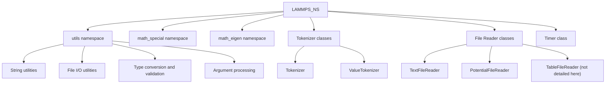
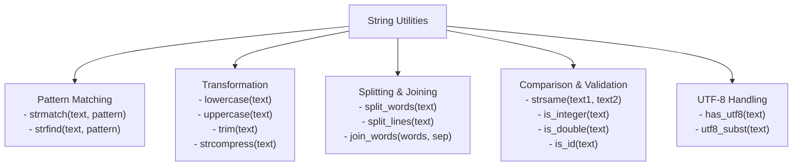
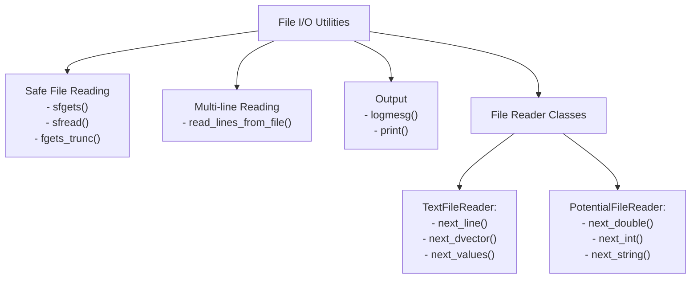
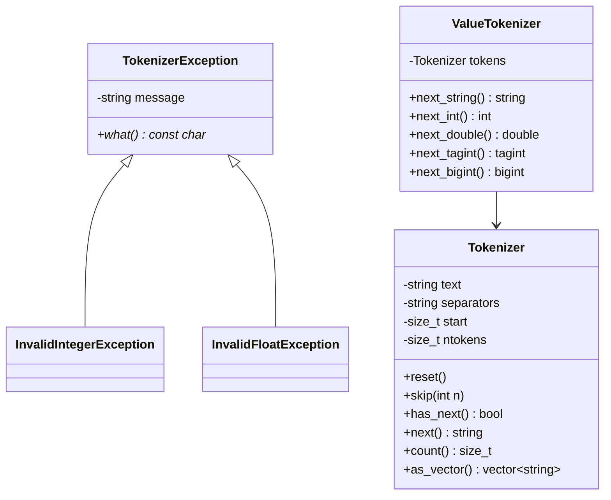
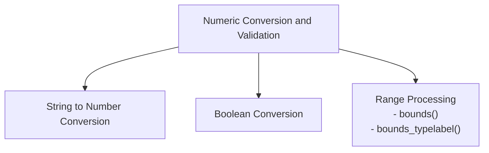
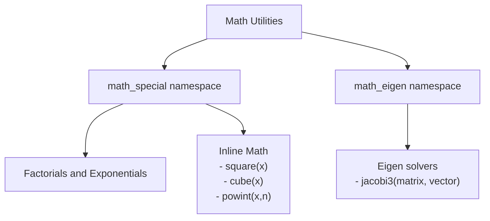
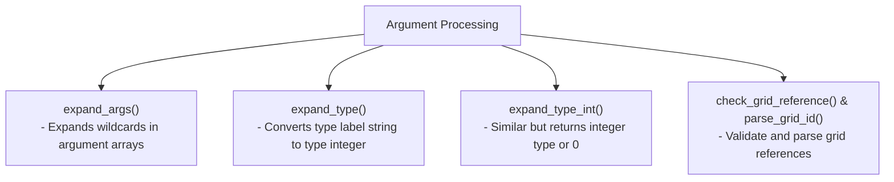
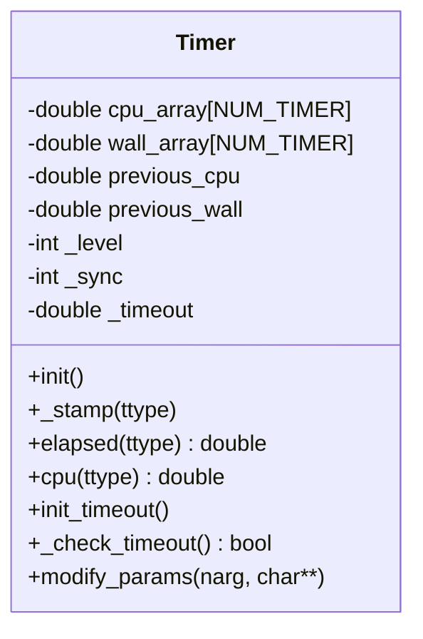
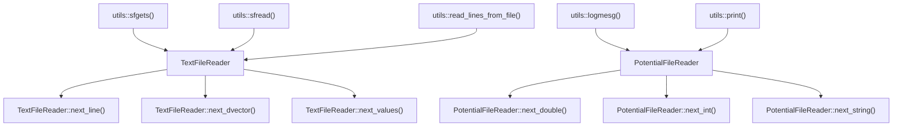

# Utility Functions

Relevant source files

The following files were used as context for generating this wiki page:

- [doc/doxygen/Doxyfile.in](doc/doxygen/Doxyfile.in)
- [doc/src/Developer_utils.rst](doc/src/Developer_utils.rst)
- [examples/gransurf/surf.tri.stl](examples/gransurf/surf.tri.stl)
- [examples/gransurf/surf.tribox.stl](examples/gransurf/surf.tribox.stl)
- [src/CG-SPICA/lj_spica_common.h](src/CG-SPICA/lj_spica_common.h)
- [src/COMPRESS/gz_file_writer.cpp](src/COMPRESS/gz_file_writer.cpp)
- [src/COMPRESS/gz_file_writer.h](src/COMPRESS/gz_file_writer.h)
- [src/COMPRESS/zstd_file_writer.cpp](src/COMPRESS/zstd_file_writer.cpp)
- [src/COMPRESS/zstd_file_writer.h](src/COMPRESS/zstd_file_writer.h)
- [src/EXTRA-DUMP/dump_dcd.cpp](src/EXTRA-DUMP/dump_dcd.cpp)
- [src/KOKKOS/math_special_kokkos.cpp](src/KOKKOS/math_special_kokkos.cpp)
- [src/KOKKOS/math_special_kokkos.h](src/KOKKOS/math_special_kokkos.h)
- [src/MACHDYN/fix_smd_wall_surface.cpp](src/MACHDYN/fix_smd_wall_surface.cpp)
- [src/MACHDYN/fix_smd_wall_surface.h](src/MACHDYN/fix_smd_wall_surface.h)
- [src/error.cpp](src/error.cpp)
- [src/error.h](src/error.h)
- [src/exceptions.h](src/exceptions.h)
- [src/file_writer.h](src/file_writer.h)
- [src/fmt/args.h](src/fmt/args.h)
- [src/fmt/chrono.h](src/fmt/chrono.h)
- [src/fmt/color.h](src/fmt/color.h)
- [src/fmt/compile.h](src/fmt/compile.h)
- [src/fmt/core.h](src/fmt/core.h)
- [src/fmt/format-inl.h](src/fmt/format-inl.h)
- [src/fmt/format.h](src/fmt/format.h)
- [src/fmt/os.h](src/fmt/os.h)
- [src/fmt/ostream.h](src/fmt/ostream.h)
- [src/fmt/printf.h](src/fmt/printf.h)
- [src/fmt/ranges.h](src/fmt/ranges.h)
- [src/fmt/std.h](src/fmt/std.h)
- [src/fmt/xchar.h](src/fmt/xchar.h)
- [src/fmtlib_format.cpp](src/fmtlib_format.cpp)
- [src/fmtlib_os.cpp](src/fmtlib_os.cpp)
- [src/math_eigen.cpp](src/math_eigen.cpp)
- [src/math_eigen.h](src/math_eigen.h)
- [src/math_eigen_impl.h](src/math_eigen_impl.h)
- [src/math_special.cpp](src/math_special.cpp)
- [src/math_special.h](src/math_special.h)
- [src/potential_file_reader.cpp](src/potential_file_reader.cpp)
- [src/potential_file_reader.h](src/potential_file_reader.h)
- [src/stl_reader.cpp](src/stl_reader.cpp)
- [src/stl_reader.h](src/stl_reader.h)
- [src/table_file_reader.cpp](src/table_file_reader.cpp)
- [src/table_file_reader.h](src/table_file_reader.h)
- [src/text_file_reader.cpp](src/text_file_reader.cpp)
- [src/text_file_reader.h](src/text_file_reader.h)
- [src/timer.cpp](src/timer.cpp)
- [src/timer.h](src/timer.h)
- [src/tokenizer.cpp](src/tokenizer.cpp)
- [src/tokenizer.h](src/tokenizer.h)
- [src/utils.cpp](src/utils.cpp)
- [src/utils.h](src/utils.h)
- [unittest/utils/test_stl_reader.cpp](unittest/utils/test_stl_reader.cpp)
- [unittest/utils/test_tokenizer.cpp](unittest/utils/test_tokenizer.cpp)
- [unittest/utils/test_utils.cpp](unittest/utils/test_utils.cpp)

The LAMMPS codebase includes a comprehensive set of utility functions and classes that provide common functionality used throughout the simulation code. Located primarily in the `utils` namespace within `LAMMPS_NS`, these utilities are designed to reduce code duplication, enhance error checking, and provide consistent behavior across the codebase. This page documents the various utility functions that serve as the foundation for many operations in LAMMPS.

## Overview of Utility Components

The LAMMPS utility system consists of several key components organized primarily under the `utils` namespace and related classes for math, tokenization, and file reading:

- **`utils` namespace**: Core string processing, file I/O, numeric conversion, error reporting, and argument utilities.
- **`math_special` namespace**: Optimized math functions, including factorial, special exponentials, and inline operations.
- **`math_eigen` namespace**: Specialized eigenvalue solvers for small matrices.
- **Tokenizer classes**: Classes to split text into tokens and parse values robustly.
- **File Reader classes**: Robust classes for reading formatted text files and potential files with error checking.
- **Timer class**: Utilities for timing and profiling parts of the code with MPI-aware barriers and timeout management.

Sources: [src/utils.h:14-264](), [src/utils.cpp:14-133](), [src/tokenizer.h:18-34](), [src/text_file_reader.h:18-30](), [src/potential_file_reader.h:18-27](), [src/math_special.h:14-22](), [src/math_eigen.h:14-18](), [src/timer.h:18-23]()

---

## String Processing Utilities

The `utils` namespace provides rich string manipulation functions for matching, transformation, splitting, and validation. These offer safe and consistent alternatives to common C string or STL operations.

### Pattern Matching with Simplified Regex

- `bool strmatch(const std::string &text, const std::string &pattern)`: Matches the entire `text` against a simplified regex pattern supporting:
  - Anchors: `^` (start), `$` (end)
  - Wildcards: `.`, `*`, `+`, `?`
  - Character classes: `[abc]`, `[a-zA-Z]`
  - Shorthand classes: `\s`, `\S`, `\w`, `\W`, `\d`, `\D`, `\i`, `\I`, `\f`, `\F`
  
- `std::string strfind(const std::string &text, const std::string &pattern)`: Returns the substring of `text` that matches the pattern, or empty if no match.

This simplified regex is a mini-module adapted from [tiny-regex-c](https://github.com/kokke/tiny-regex-c).

### String Transformation

- `std::string strcompress(const std::string &text)`: Compresses all whitespace to single spaces and trims leading/trailing whitespace.
- `bool strsame(const std::string &text1, const std::string &text2)`: Compares two strings ignoring all whitespace characters.
- Conversion utilities: `lowercase(text)` and `uppercase(text)` convert case.
- `trim(text)`: Removes leading and trailing whitespace.
- `trim_comment(text)`: Removes everything after a `#` character (to handle inline comments).

### String Splitting and Joining

- `split_words(text, sep_chars)`: Splits text based on separators into vector<string>.
- `split_lines(text)`: Splits on newlines into vector<string>.
- `join_words(words, sep)`: Join vector of words using separator.
- `count_words(text)`: Counts words separated by whitespace or custom separators.

These utilities simplify parsing input commands and text data.

Sources: [src/utils.h:38-84](), [src/utils.cpp:43-190]()

---

## File I/O Utilities

LAMMPS utilities provide safe wrappers for file reading with error checking, and higher-level file reader classes for line-oriented input of simulation data or potential files.

### Safe Reading Wrappers

- `sfgets()` wraps `fgets()` to check for errors or unexpected EOF.
- `sfread()` wraps `fread()` similarly.
- `fgets_trunc()` reads a full line but truncates it to buffer size gracefully.

### Multi-line String Reading

- `read_lines_from_file()` reads multiple lines, ensuring proper termination and error checking, also broadcasting lines in parallel MPI environments.

### Output Utilities

- `logmesg()` sends formatted messages to both screen and logfile if available on rank 0.
- `print()` writes formatted messages to files or stdout.
- `point_to_error()` generates string that highlights the position of an error in the last input command.

### TextFileReader Class

- Reads text files robustly with buffers and comment handling.
- Can read lines until a minimum number of parameters (words) is reached, replicating Fortran-like formatted input behavior.
- Supports reading arrays of doubles and creating tokenizers from next input.

### PotentialFileReader Class

- Specialized wrapper around `TextFileReader` for reading LAMMPS potential files.
- Supports unit conversion between different unit sets automatically.
- Provides methods to read the next double, int, tagint, or tokenized values.
- Handles error reporting for file and parsing issues related to potentials.

Sources: [src/utils.h:214-264](), [src/utils.cpp:308-432](), [src/text_file_reader.cpp:18-229](), [src/potential_file_reader.cpp:18-225]()

---

## Tokenizer Classes

Tokenizer classes in LAMMPS simplify breaking lines into tokens and extracting typed values, and provide useful exceptions for malformed inputs.

### Tokenizer

- Splits input string into tokens based on separators (default whitespace).
- Supports UTF-8 substitution on initialization to map special UTF-8 characters to ASCII.
- Provides
  - `next()` to retrieve next token,
  - `skip(n)` to skip tokens,
  - `has_next()` to check availability,
  - `count()` to find total tokens,
  - `as_vector()` to get all tokens as a vector.

### ValueTokenizer

- Wraps `Tokenizer` and provides typed getters with validation.
- Supports extracting strings, integers, doubles, tagints (64-bit IDs), and bigints from tokens.
- Throws specialized exceptions for invalid conversions.

Sources: [src/tokenizer.h:31-131](), [src/tokenizer.cpp:36-389]()

---

## Numeric Conversion and Validation

Robust functions convert strings to numeric types or boolean with error checking, ensuring that the entire string represents a valid number and preventing silent truncation or misinterpretation.

### String to Number Conversion

- `double numeric(const char *file, int line, const std::string &str, bool do_abort, LAMMPS *lmp)`
- `int inumeric(const char *file, int line, const std::string &str, bool do_abort, LAMMPS *lmp)`
- `bigint bnumeric(...)`, `tagint tnumeric(...)` similar
- `int logical(...)` converts boolean literals (`yes`, `no`, `true`, `false`, `on`, `off`, `1`, `0`), case insensitive.

Each performs complete parsing and throws an error with file and line info if invalid.

### Range Processing

- `bounds()` parses strings representing ranges with wildcards, e.g., `"1*5"` for range 1 to 5.
- `bounds_typelabel()` extends range parsing to type labels.

Sources: [src/utils.h:289-394](), [src/utils.cpp:458-773]()

---

## Math Utilities: math_special and math_eigen

LAMMPS provides optimized math routines to improve performance and numerical stability.

### math_special Namespace

- `factorial(int)` returns precomputed factorial values (0! to 20!).
- `exp2_x86(double)` fast 2^x exponential for little-endian Intel/AMD CPUs.
- `fm_exp(double)`, `my_erfcx(double)`, `expmsq(double)` fast exponentials with improved accuracy/stability.
- Inline functions `square(x)`, `cube(x)` provide fast, readable alternatives to `pow`.
- `powint(double x, int n)` optimizes integer power calculation.

### math_eigen Namespace

- Implements eigenvalue and eigenvector calculations specialized for 3x3 symmetric matrices.
- `jacobi3()` performs Jacobi iterations to diagonalize small matrices efficiently.

Sources: [src/math_special.h:22-190](), [src/math_special.cpp:10-161](), [src/math_eigen.h:17-33](), [src/math_eigen.cpp:28-63]()

---

## Argument Processing Utilities

These functions handle command argument expansions and type label conversions to support flexible user input and group specifications.

Sources: [src/utils.h:478-542](), [src/utils.cpp:866-1112]()

---

## Error Handling

Centralized error handling is implemented in the `Error` class. It provides:

- MPI-aware error reporting targeting either all ranks or single rank.
- Message formatting with `fmt` library support.
- Warning message counting and limits.
- Facilities to abort the entire universe or world MPI communicator cleanly.
- Error message augmentation to point to exact faulty argument with command-line indication.
- Throws exceptions `LAMMPSException` and `LAMMPSAbortException` to leverage C++ error handling.

Sources: [src/error.h:22-108](), [src/error.cpp:14-193]()

---

## Bundled Libraries: fmtlib and nlohmann/json

LAMMPS bundles the following third-party libraries integrated into the utils framework:

- **fmtlib**: Modern formatting library used extensively in `utils::print()`, `utils::logmesg()`, and error formatting. The interface closely resembles C++20 `std::format`.
- **nlohmann/json**: Header-only JSON library (not shown in deep detail here) for parsing and generating JSON structures in LAMMPS.

Their inclusion improves type-safe string formatting throughout the codebase without exposing external dependencies.

Sources: [src/fmt/format.h:1-300+] (partial excerpt only)

---

## Timer Utilities

The `Timer` class tracks wall and CPU time for different sections of the simulation to facilitate profiling and timeout management.

- Supports multiple timing levels: off, loop, normal, full.
- Synchronizes times across MPI ranks with barriers.
- Provides timeout functionality with periodic checks.
- Can print remaining wall time to output.

Sources: [src/timer.h:22-97](), [src/timer.cpp:28-283]()

---

## Summary

The utility functions in LAMMPS provide a robust foundation for the rest of the codebase, offering consistent error handling, efficient string processing, safe file I/O, and optimized mathematical operations. These utilities increase code readability, reduce duplication, and enable a more maintainable codebase.

Most utility functions are designed to be used as standalone functions, making them easy to incorporate into different parts of the code. The tokenizer and file reader classes provide higher-level abstractions for common text processing tasks, while the math utilities offer optimized implementations of frequently used mathematical operations.

---

# Appendix: Bridging Natural Language to Code Entities

### Diagram: String Utilities and Core String Functions in `utils`

```mermaid
graph LR
    strmatch_s["utils::strmatch(text, pattern)"]
    strfind_s["utils::strfind(text, pattern)"]
    strcompress_s["utils::strcompress(text)"]
    strsame_s["utils::strsame(text1, text2)"]
    lowercase_s["utils::lowercase(text)"]
    uppercase_s["utils::uppercase(text)"]
    trim_s["utils::trim(text)"]
    trim_comment_s["utils::trim_comment(text)"]
    count_words_s["utils::count_words(text)"]
    split_words_s["utils::split_words(text)"]
    join_words_s["utils::join_words(words, sep)"]

    subgraph "String Processing Functions (utils.cpp, utils.h)"
        strmatch_s
        strfind_s
        strcompress_s
        strsame_s
        lowercase_s
        uppercase_s
        trim_s
        trim_comment_s
        count_words_s
        split_words_s
        join_words_s
    end
```

### Diagram: File I/O and Parsing Utilities to Code Classes and Functions

---

Sources:  
[src/utils.h:14-264](), [src/utils.cpp:14-133](), [src/text_file_reader.cpp:18-229](), [src/potential_file_reader.cpp:18-225](),  
[src/tokenizer.h:31-131](), [src/tokenizer.cpp:36-389](), [src/error.cpp:14-193](), [src/error.h:22-108](), [src/math_special.h:22-190](),  
[src/math_eigen.h:17-33](), [src/timer.cpp:15-283](), [src/timer.h:18-97](), [src/fmt/format.h:1-300]()

---