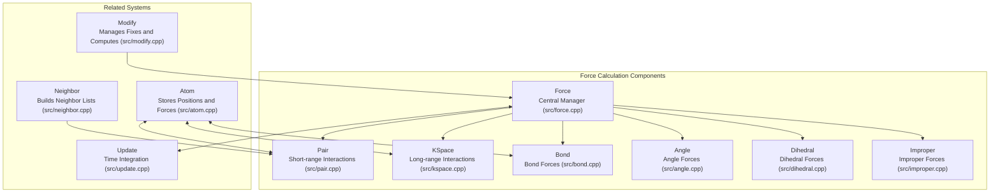
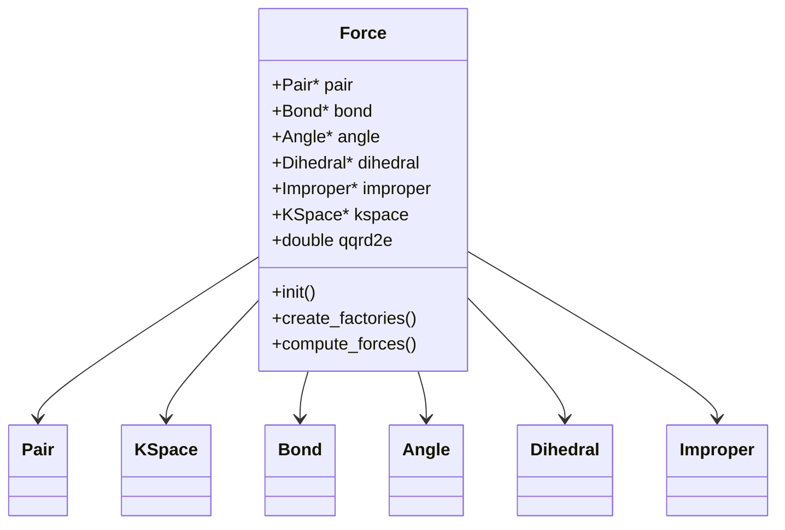
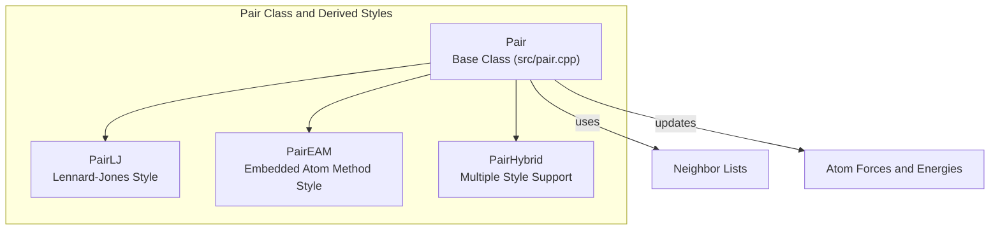
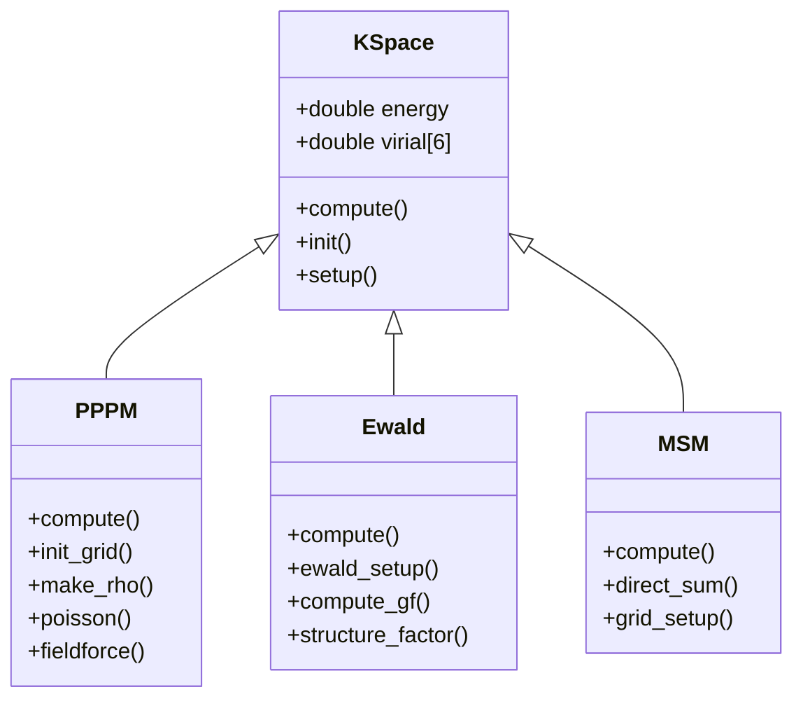
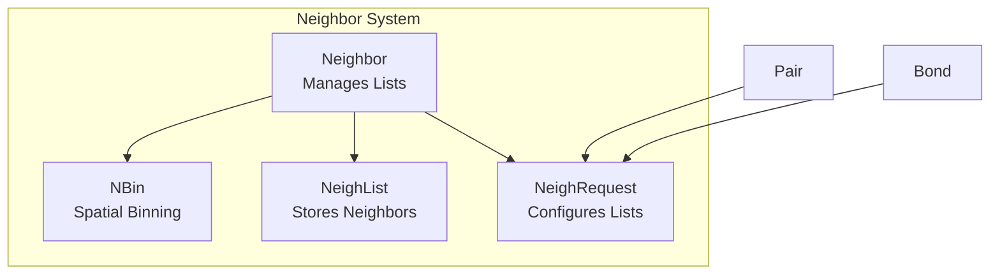
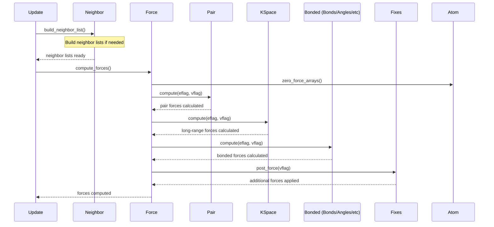

# Force Calculation System

Relevant source files

The following files were used as context for generating this wiki page:

- [src/GPU/pppm_gpu.cpp](src/GPU/pppm_gpu.cpp)
- [src/GPU/pppm_gpu.h](src/GPU/pppm_gpu.h)
- [src/KOKKOS/neigh_list_kokkos.cpp](src/KOKKOS/neigh_list_kokkos.cpp)
- [src/KOKKOS/neigh_list_kokkos.h](src/KOKKOS/neigh_list_kokkos.h)
- [src/KSPACE/ewald.cpp](src/KSPACE/ewald.cpp)
- [src/KSPACE/ewald.h](src/KSPACE/ewald.h)
- [src/KSPACE/ewald_dipole.cpp](src/KSPACE/ewald_dipole.cpp)
- [src/KSPACE/ewald_dipole.h](src/KSPACE/ewald_dipole.h)
- [src/KSPACE/ewald_dipole_spin.cpp](src/KSPACE/ewald_dipole_spin.cpp)
- [src/KSPACE/ewald_dipole_spin.h](src/KSPACE/ewald_dipole_spin.h)
- [src/KSPACE/ewald_disp.cpp](src/KSPACE/ewald_disp.cpp)
- [src/KSPACE/ewald_disp.h](src/KSPACE/ewald_disp.h)
- [src/KSPACE/msm.cpp](src/KSPACE/msm.cpp)
- [src/KSPACE/msm.h](src/KSPACE/msm.h)
- [src/KSPACE/msm_cg.cpp](src/KSPACE/msm_cg.cpp)
- [src/KSPACE/pppm.cpp](src/KSPACE/pppm.cpp)
- [src/KSPACE/pppm.h](src/KSPACE/pppm.h)
- [src/KSPACE/pppm_cg.cpp](src/KSPACE/pppm_cg.cpp)
- [src/KSPACE/pppm_cg.h](src/KSPACE/pppm_cg.h)
- [src/KSPACE/pppm_dipole.cpp](src/KSPACE/pppm_dipole.cpp)
- [src/KSPACE/pppm_dipole.h](src/KSPACE/pppm_dipole.h)
- [src/KSPACE/pppm_dipole_spin.cpp](src/KSPACE/pppm_dipole_spin.cpp)
- [src/KSPACE/pppm_dipole_spin.h](src/KSPACE/pppm_dipole_spin.h)
- [src/KSPACE/pppm_disp.cpp](src/KSPACE/pppm_disp.cpp)
- [src/KSPACE/pppm_disp.h](src/KSPACE/pppm_disp.h)
- [src/KSPACE/pppm_disp_tip4p.cpp](src/KSPACE/pppm_disp_tip4p.cpp)
- [src/KSPACE/pppm_disp_tip4p.h](src/KSPACE/pppm_disp_tip4p.h)
- [src/KSPACE/pppm_stagger.cpp](src/KSPACE/pppm_stagger.cpp)
- [src/KSPACE/pppm_stagger.h](src/KSPACE/pppm_stagger.h)
- [src/KSPACE/pppm_tip4p.cpp](src/KSPACE/pppm_tip4p.cpp)
- [src/KSPACE/pppm_tip4p.h](src/KSPACE/pppm_tip4p.h)
- [src/MACHDYN/smd_material_models.cpp](src/MACHDYN/smd_material_models.cpp)
- [src/angle.cpp](src/angle.cpp)
- [src/angle.h](src/angle.h)
- [src/bond.cpp](src/bond.cpp)
- [src/bond.h](src/bond.h)
- [src/comm.cpp](src/comm.cpp)
- [src/comm.h](src/comm.h)
- [src/comm_brick.cpp](src/comm_brick.cpp)
- [src/comm_brick.h](src/comm_brick.h)
- [src/comm_tiled.cpp](src/comm_tiled.cpp)
- [src/comm_tiled.h](src/comm_tiled.h)
- [src/dihedral.cpp](src/dihedral.cpp)
- [src/dihedral.h](src/dihedral.h)
- [src/improper.cpp](src/improper.cpp)
- [src/improper.h](src/improper.h)
- [src/irregular.cpp](src/irregular.cpp)
- [src/irregular.h](src/irregular.h)
- [src/kspace.cpp](src/kspace.cpp)
- [src/kspace.h](src/kspace.h)
- [src/neigh_list.cpp](src/neigh_list.cpp)
- [src/neigh_list.h](src/neigh_list.h)
- [src/neigh_request.cpp](src/neigh_request.cpp)
- [src/neigh_request.h](src/neigh_request.h)
- [src/neighbor.cpp](src/neighbor.cpp)
- [src/neighbor.h](src/neighbor.h)
- [src/nstencil.cpp](src/nstencil.cpp)
- [src/nstencil.h](src/nstencil.h)
- [src/pair.cpp](src/pair.cpp)
- [src/pair.h](src/pair.h)
- [src/procmap.cpp](src/procmap.cpp)
- [src/procmap.h](src/procmap.h)
- [src/rcb.cpp](src/rcb.cpp)
- [src/rcb.h](src/rcb.h)
- [src/special.cpp](src/special.cpp)
- [src/special.h](src/special.h)

The Force Calculation System in LAMMPS is responsible for computing all interatomic forces that drive molecular dynamics simulations. This system evaluates multiple types of interactions, including short-range pair potentials, bonded forces (bonds, angles, dihedrals, impropers), long-range electrostatic forces computed via KSpace methods, and others. The calculated forces are applied to atoms and contribute to energies, virials/stresses, and accelerations during integration.

This page provides a high-level overview of how forces are computed in LAMMPS, outlining its key subsystems and their roles. Details about implementations, APIs, and algorithms are covered in dedicated child pages.

## Overview

LAMMPS divides the force calculation into several distinct subsystems that operate on atomic data and neighbor lists. The main components include the Pair style (for short-range pairwise interactions), Bonded interactions (bonds, angles, dihedrals, impropers), KSpace methods (long-range Coulombic and related interactions), and Neighbor lists (to efficiently identify interacting atom pairs).

At runtime, the `Force` class manages these components, invoking them to compute forces and energies for each timestep in a modular way.

Sources: [src/force.cpp:1-170](), [src/pair.cpp:50-136](), [src/kspace.cpp:30-130](), [src/neighbor.cpp:100-230](), [src/bond.cpp:10-80]().

---

## Core Components

### Force Class

The `Force` class (defined in `src/force.cpp` and `src/force.h`) acts as the central orchestrator of the force calculation system. It holds and manages pointers to the various potential styles and subsystems including pair, bond, angle, dihedral, improper, and kspace styles.

Key responsibilities:
- Initialize each force component
- Coordinate computation of all force contributions at each timestep
- Store global physical constants and unit conversions
- Facilitate energy and virial accumulation across components

Sources: [src/force.cpp:47-136](), [src/force.h:10-60]().

---

### Pair Class

The `Pair` class (`src/pair.cpp` and `src/pair.h`) is the base class for implementing short-range pairwise potentials. It supports computing energies, forces, virials, and supports mixing rules for heterogeneous systems.

Characteristics:
- Provides interface for derived pair styles (LJ, EAM, Tersoff, ReaxFF, etc.)
- Supports neighbor lists for efficient force evaluation
- Handles pairwise cutoff distances and switching functions
- Interfaces with the `Neighbor` subsystem to get atom pairs this style needs to compute

Sources: [src/pair.cpp:20-140](), [src/pair.h:20-130]().

---

### KSpace Class

The `KSpace` subsystem (`src/kspace.cpp` and related files under `src/KSPACE`) implements long-range electrostatics and other non-local potentials using methods like Ewald summation, PPPM (Particle-Particle Particle-Mesh), and MSM (Multilevel Summation Method).

Features:
- Computes long-range Coulombic interactions efficiently using FFT or multigrid methods
- Supports multiple PPPM variants (dispersion, dipole, TIP4P water, charge-group methods)
- Manages grid setup, reciprocal space transforms, and force interpolation
- Interfaces with pair styles to ensure compatibility

Sources: [src/kspace.cpp:30-130](), [src/KSPACE/pppm.cpp:60-200](), [src/KSPACE/msm.cpp:40-70]().

---

### Neighbor Lists System

Neighbor lists are fundamental to efficient force computations by listing atom pairs that lie within interaction cutoffs. The `Neighbor` class (`src/neighbor.cpp` and `src/neighbor.h`) is responsible for building and managing these lists.

Capabilities:
- Supports multiple building styles (binning, multi neighbor lists)
- Maintains separate lists for bonds, angles, dihedrals, and impropers (topology lists)
- Handles exclusions (e.g., 1-2, 1-3, 1-4 special bonds)
- Supports multi-cutoff/special collection grouping for diverse interactions
- Works closely with `Pair` and bonded subsystems to supply needed neighbors

Sources: [src/neighbor.cpp:100-230](), [src/neighbor.h:20-130]().

---

### Bonded Interactions

Bonded forces include bonds, angles, dihedrals, and impropers that model connectivity and angular rigidity in molecules. These are implemented in their respective classes (`src/bond.cpp`, `src/angle.cpp`, `src/dihedral.cpp`, `src/improper.cpp`).

Key Notes:
- Each bonded interaction type has its base class handling force and energy calculation
- Bonded potentials support various common force fields (CHARMM, OPLS, CLASS2, MOLECULE package styles)
- Can be combined in hybrid bonded styles where multiple bonded potential types are used simultaneously
- Relies on topology neighbor lists provided by the `Neighbor` subsystem

Sources: [src/bond.cpp:10-80](), [src/angle.cpp:10-80](), [src/dihedral.cpp:10-80](), [src/improper.cpp:10-80]().

---

## Force Calculation Flow

The force calculation proceeds each timestep by updating neighbor lists (if needed), then computing forces from each force category in a defined sequence:

Sources: [src/update.cpp (not listed but implied)](), [src/neighbor.cpp:131-190](), [src/pair.cpp:159-200]().

---

## Key Subsystems and Where to Learn More

This Force Calculation System serves as a parent to detailed components documented in child pages:

- **[Pair Potentials](#3.1)**  
  Implementation of short-range pair potentials including style hierarchies, mixing rules, hybrid pair styles, tabulated potentials, and popular potentials such as Lennard-Jones (LJ), Embedded Atom Method (EAM), Tersoff, AIREBO, ReaxFF, AMOEBA, and many-body potentials.

- **[KSpace Methods](#3.2)**  
  Long-range electrostatics treated by PPPM (Particle-Particle Particle-Mesh), Ewald options, MSM (Multilevel Summation Method), various PPPM variants (dispersion, dipole, TIP4P water), GPU acceleration, FFT infrastructure, and Kokkos implementations.

- **[Neighbor Lists](#3.3)**  
  System responsible for efficient neighbor list construction and maintenance. Includes `Neighbor`, `NeighRequest`, `NeighList` classes and spatial binning (`NBin`), stencil-based neighbor identification (`NStencil`), special bonds handling, multi-cutoff support, and Kokkos-enabled neighbor list implementations.

- **[Bonded Interactions](#3.4)**  
  Documentation on bonded interaction styles: bonds, angles, dihedrals, impropers. Covers base classes, hybrid and tabulated styles, CHARMM, OPLS, and CLASS2 force fields, MOLECULE package styles, and BPM bond styles.

---

## Summary

LAMMPS's Force Calculation System is a modular and extensible framework that cleanly separates short-range pair interactions, bonded forces, and long-range electrostatics. It relies heavily on neighbor lists to efficiently identify interacting atom pairs and bonds. The system integrates tightly with parallel communication, atom storage, and time integration to deliver high-performance simulations on a variety of architectures.

For further details and usage, please consult the specialized child pages:

| Subsystem          | Description                                 | Link       |
|--------------------|---------------------------------------------|------------|
| Pair Potentials    | Short-range pairwise potential implementations and styles | [Pair Potentials](#3.1) |
| KSpace Methods     | Long-range electrostatics calculation methods including PPPM and Ewald | [KSpace Methods](#3.2) |
| Neighbor Lists     | Efficient neighbor list construction and maintenance | [Neighbor Lists](#3.3) |
| Bonded Interactions | Bond, angle, dihedral, improper calculation styles | [Bonded Interactions](#3.4) |

---

Sources:  
[src/force.cpp:1-170]()  
[src/pair.cpp:53-135]()  
[src/pair.h:20-130]()  
[src/kspace.cpp:30-150]()  
[src/KSPACE/pppm.cpp:50-200]()  
[src/KSPACE/msm.cpp:40-70]()  
[src/neighbor.cpp:100-230]()  
[src/neighbor.h:20-130]()  
[src/bond.cpp:10-80]()  
[src/angle.cpp:10-80]()  
[src/dihedral.cpp:10-80]()  
[src/improper.cpp:10-80]()

---